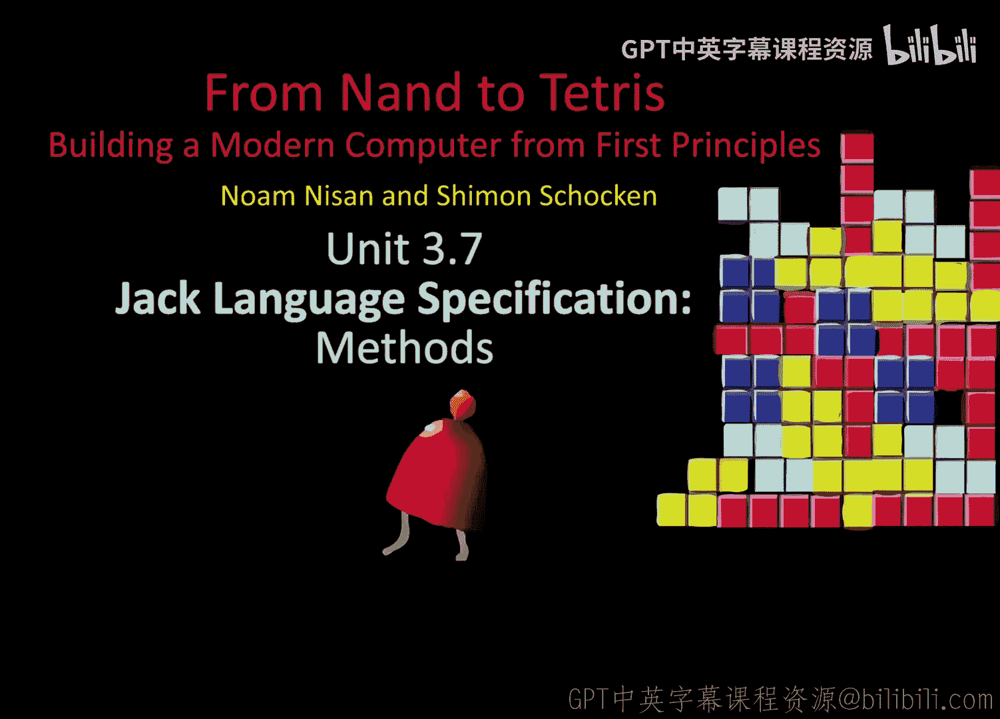

# 耶路撒冷希伯来大学《从零开始构建现代计算机2｜Build a Modern Computer from First Principles》中英字幕 p40 40_05_08_单元3-7_Jack语言规范：方法.zh_en -BV1DA4m1w7FU_p40-

So welcome to our last language specification unit in which we are going to discuss everything that goes into methods and as you know a lot goes into methods right。

 variables， subroutine calls， arrays， strings， we have to describe this hodgepodge and we'll try to do it as painlessly as possible。

So in the last unit we talked about classes and we mentioned that they end with subroutine declarations and these subroutines are either constructors。

 methods or functions， they all have exactly the same declaration syntax。

 subroutines inject is conceptual name that we use to describe the three kinds of methods。

 if you will the language supports which are constructors methods and functions。

 they have different purposes but at the same time they have exactly the same declaration syntax。

 constructors are designed to create new objects， methods are designed to operate on the current object and functions are similar to C functions in the sense that they don't understand what an object is。

 and they simply deliver some computational services。

All these different subroutines must be typed and they must return a value so you know you may wonder what happens with a void subroutine is a void subrout supposed to return a value well the answer is yes and no。

 no because you must say return at the end and there seems to be no value and yes。

 because essentially a return null and so you can think about return as a shorthand for return null command so once again all subroutines must return some value the same is true for other languages as well。

 although in other languages it is aesthetically covered or implicit implicitly done under the surface so a void method in Java for example has no return command。

 but in fact it does have a return which is planted by the compiler as we'll see。

When we write the compiler。All right， constructors are somewhat privileged methods that have their own strange rules and a constructor once again is designed to create new objects。

 there may be0，1 or more constructors in a class， for example， if the class contains only functions。

 there will be no constructor in that class， the common name that programmers jack programmers use for a constructor is new。

 but if you have more than one constructor， you may need you know several new one， new  two。

 new3 or maybe。Better and more descriptive names for these constructors。

The type of the constructor must be the name of the class to which it belongs and the constructor must return a value like any other subroutine。

 but in the constructor's case it must be this value must be an object of the class type。

 so these are the rules of the game when it comes to constructors。Moving along。

 programs are rife with variables of which Jack offers four kinds。

 so we have static variables which are sort of class level variables that are seen by all the suboutines in the class。

 we have field variables that are also seen by all the methods and constructors in the class but not by the functions。

 because a function doesn't understand what is a field。

We have local variables which are used locally by subluoutines and we have parameter variables which are essentially the same as local variables。

 except that they can be initialized from the outside and therefore they may be used to pass parameters from the outside the class into the class。

And all these variables must be typed and they must be declared before they are used。

 and as we pointed before， the language is weak typed so we can almost always assign a variable to any other variable irrespective of the types because once again Jack is somewhat wild in that respect。

I have here， I should say that in general in this unit I lifted freely some text from the book and I'm not going to read all this stuff you can stop the video and look at it or consult the book so a few more some more information about variables and then let's move on to talk about statements of which Jack offers five we have a let statement for assignment purposes。

 we have if while do and return once again this was lifted from the book you can stop and read it or look at the book。

Which brings us to expressions。Now， what is an expression， Well，17 is an expression。

17 plus 3 is also an expression and so is x plus 17 and so is x plus 17 in parenthses times y and so on and so forth。

 so an expression is what you expect it to be and because it has to capture so many different kinds of expressions。

 the definition of an expression is a little bit involved and the best way to do it is to use some recursive definition or some recursive language So a jack expression is either a constant or a variable that this keyword is also considered an expression。

We may have an array indexed to some entry which is also an expression。 So for example。

 temperature 15 is you know subindex 15 is an expression that presumably gives you the the temperature in the 15th day in some array or something like that and a subroutine call is also an expression。

 So for example， a square root of 17 obviously is an expression。And so is minus square root of 17。

 which brings me to the next definition。That says that an expression。

 which is prefixed by minus or by negation， is also an expression。And obviously。

 an expression plus an expression is an expression。And so on and so forth。

 using some other operators。 and finally， an expression within parentheses is also an expression。

So you may stop this and look at it or once again take a look at the book and this is as much as I want to say about expressions suboutine calls are a little bit confusing because different languages have different rules although you get used to it very quickly and instead of giving you all the rules what I gave instead is a set of examples that I think are sufficiently rich to refer to any well not any but many different kinds of suboutine calls in Jack and you're welcome to look at it and maybe we'll do a quiz about it there's some general syntax that you should follow the most important thing to remember is that the number and type of arguments that you supply in your call must match those of the method signature or the suboutine signature as is typical。

availablevailable through some API。All right， well end this longer unit with a discussion of strings and arrays。

 and this will complete everything you want to say about the Jack language。

Stings are objects and they are actually instances of a string class which is part of the operating system。

 so as usual we'll describe a strings using an example so what we see here in the first line is the declaration of a string variable S that presumably at some point will be will contain some sensible string or some non-sens string and then we have a variable called C which is primitive it has the data type of character。

And I want to show you how we use both types of variables。

 S we want to set S to the string hello world。Well， we can do it in several different ways。

 One of them， which is the hard way， is to construct the string using a new。

And to limit the string to at most 12 characters。And then we can use some loop or some hardwired statements that populate the string with the characterss H ELO using something called a pen car。

 which is a method which is part of the string API。

 so that's you know one way of initializing his string or some value。

 obviously it it's a very tedious way to initialize strings。

 and given that strings are widely used and we want to you know we don't want to write loops whenever we want to create a list the compiler is nice enough to allow us to also say let S equals hello world。

Which is very nice because it saves us a lot of trouble。

 and yet you should understand that when this code is being translated into a lower level code。

 the compiler will have to work hard and turn it into the code that you saw previously or something like that。

 So what we usually do without even thinking about is actually quite a dramatic when it comes to the implementation and this way in which compilers sometimes hide。

Complexity from the user is called a syntactic sugar， which is just a buzzword。嗯。

The last thing that I want to show you is that we can extract an individual character from a string using this CAette method。

 so essentially we showed how you can construct the string from characters and we also showed how you can create a character from a string using the CA at method and if you want to learn more about string operations。

 you're welcome to explore the string API of the operating system and finally we come to a and once again we'll start with an example。

 so in this example we declare an array called ARR and a string variable called the hello world which immediately goes on to contain the value hello world。

And then we create the array， we actually construct it。

 and we tell Jack that we want to construct array of length 4。And then we do AR 0 equals 12。

 which sounds completely sensible and harmless。But then we do something a little bit strange。

 we do error R1 equals false。And if you thought that this is strange。

 the next thing that we do is even crazier because next we do error2 equals a fraction 314 time 100。

 which is some abbreviation of approximation of pi。And if this was not enough。

 Air 3 is going to contain the string helllo world。So what do we show here Well， we show in a。

 I think， a dramatic way that arrays in J are not typed。

 and therefore different entries of the same array can contain different data types all these arrays of which we see one here are instances of an operating system class called array。

 they are always unidimensional， so if you want to implement a multidimensional array。

 you should define and use an array of arrays， similarly to the way it is done in Java。

 although the syntax in jack is somewhat more cumbersome。Alright。

 so that's what we wanted to say about arrays。 And toward the end of this。Unit。

 I'd like to summarize some。But not all of the peculiar features of the jack language of which you should be aware when you set out to write your program in Jack as well do in the final project of this of this module So first of all we have this strange let prefix that we must use whenever we do assignment so this is something which you can easily get used to after youll get a few compilation errors when you forget to do it。

 same with do when we call a method for for its effect。

 we use the term do unless the method returns a value and then we just we can assign the value to a variable called the let。

Prefix and once again， we use these prefixes because it makes the writing of the compiler easier。

 as we'll see in the next module。The next requirement is that the body of a statement must be within curly brackets。

 even if it's just a single statement， so for example， if you look at this piece of code here。

 returnturn A is a single statement， but you must put it in curly brackets and so is return minus a in this particular example。

And and this is actually a good practice anyway。 so it's not such a big price to pay to get used to this style of coding。

Also routines must end with a return， which is a little bit of pain because you'll forget to do it and you'll get some compilation errors。

And once again， I want to remind you that the same is true for any other language。

 but some languages are nice enough to do it implicitly so the programmer doesn't have to write the return command in Jack。

 you have to write it explicitly。Perhaps the strangest feature。

Object to many programmers is that there is no operator priority。And so if you write naively。

 2 plus three times 4 and expect to get 14， well you may well get in this example 20。

Because if we evaluate this from left to right，2 plus3 is5 times 4 is 20。And in general。

 the results of such expressions are unpredictable。

Because the language does not bother to specify an operate priority and it's left up to the compiler writer to decide if he or she wants to support operator priority。

 which is not required。So how do you deal with this？ Well， very simply。

 if you want to enforce priority of operations， you have to use parentheses。

 So if you want to get 14 in this example and in general。

 if you want multiplication to go before addition。Don't forget to use parentheses。

If you forget this little twist here， you're going to get all sorts of interesting bugs in your programs。

 And therefore， if you get some exotic bugs in your programs， remember。

 just to go back to this slide and check it， maybe will。

See some information that will help you debug your program。And finally。

 I want to remind you that Jack is a weekly type language and much more weekly typed than industrial strength languages。

 which makes it very powerful from one end because the programmer can have complete control of the host hardware using not complete。

 but it can get considerable control of the host hardware using pointers that can go wild。

 as we do with great pleasure。In in the next modules in this course。

 and obviously this is very unsafe because you can bring the host machine to its knees。

Meaphorically speaking， and yet in a course like Notetriris。

 this is a very desirable feature of the language because we want to treat the language and the surrounding hardware as an open lab in which you are allowed to do whatever you please。

So that's the end of our Jack language specification and in the next unit we are going to discuss the art and practice of writing Jack programs and J applications on the heCC platform。

