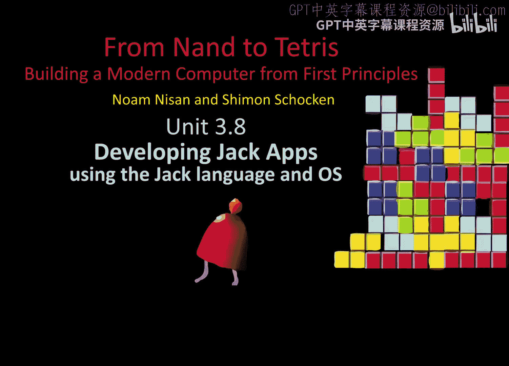

# 耶路撒冷希伯来大学《从零开始构建现代计算机2｜Build a Modern Computer from First Principles》中英字幕 p41 41_05_09_单元3-8_使用Jack语言和操作系统开发应用.zh_en -BV1DA4m1w7FU_p41-

In all the units of this module up until now， we talked about the specifications of the jack language。

 the various commands that the language features and so on and so forths in this unit and in the next two units we are going to talk about how we can use this language to develop all sorts of cool applications。

 So let me start by showing you some screenshots of existing applications beginning with this rather trivial program that interacts with the user gets some names and grades in some course and then it produces the average of all the grades and the name of the students who got the highest grade。

 so a very simple program that presumably uses some loop to interact with the user。

Here is a classical Tetriris game。Implemented in a certain way， here is a bouncing ball。

 It's not exactly a game， but rather a wonderful demonstration of what can be done in terms of dynamic graphics with Jack。

 Here is a classical space invaders game。😊，And finally， in this set of examples， a Soku band game。

 a very cool game that came from Japan， I believe， and all these games and numerous others were developed mostly by students who took this course and by now youre going to join this camp and developed some cool applications of your own。

So how you should go about it？Well， we recommend going through the following sequence， first of all。

Create a new directory and give it a name。 The name should be the name of the application that you develop。

 for example， Teris， so call this directory Teris。Then write and later on edit your J class files using a standard text editor and put all these files in the directory that you created there previously。

If you have access to a more sophisticated text editor that can be customized to help you write J programs using the J synyntax。

 you know you should feel free to use it， but let's not make a big deal out of it。

 you simply have to write your program using some standard editor。

Once the program is ready for compilation， you can apply the supplied J compiler to the program to either to the individual J files that make your program or you can apply the directory。

 I'm sorry。Or you can apply the jack compiler to the entire directory。

 and the jack compiler is clever enough to go through every one of the jack files within the directory and compile them one at a time。

 So for each one of these jack files， the compiler will produce the VM， the corresponding VM file。

 which is the compiled version of the jack file。Then you can execute your program in several different ways and the most natural approach is to simply load the entire directory into the VM emulator and by doing this the emulator will ignore the jack files。

 it will load the VM files， the VM code into the emulator's environment and then you can go on and run your program。

So that's how you do it。 here's an example of a screenshot of the VM emulator running a certain program。

 and once again this is the environment that we recommend using for executing the programs that you write as well。

All right， now how should you handle input and output， Well， it depends on what you want to do。

If you're developing a textual application that deals with simple characters and strings。

 then you should view the screen， the screen that you saw before you know the screen of the VM emulator or the hex screen in general。

 you should view it as a grid consisting of 23 rows。😊，Each of 64 characters， black and white。

And if you're using the supplied jack operating system for writing your outputs。

 then the operating system features a fixed font that you are welcome to use and here's the API of this class。

 the class is called output and it features a bunch of selfexplanatory functions for handling textual output。

 so youre welcome to use this class in order to generate your textual outputs。

Now what about if you decide to develop a graphical application like pong or space invaders or snake or something like that well in that case you should view the same physical screen that we saw earlier the same hex screen as a grid consisting of 256 rows of 512 pixels each once again black and white and if you want to generate graphics we recommend that you use the supplied OS screen class or you can do graphics using your own libraries something that we will discuss in a separate unit later on in this module。

So here's the API of the screen class which is the name of our graphics package。

 so to speak and as you see it features once again a bunch of self-explanatory functions for drawing pixels on the screen the set color function is used to set a global color which is either black and white for all the subsequent drawing operations until the next invocation of set color so if you want to draw in black we invoke set color true and then you know all the subsequent draw pixel draw line and so on if you have those method invocations or method calls in your code will draw in black if you all of a sudden want to era stuff or draw in white。

 then you set color to。And once again， all the subsequent graphics operation will use the background color。

😊，And we are switching occasionally from black and white when we want to create an effect and we'll talk about this and demonstrate it later on in the next module。

 actually， not in the next module in the next unit in this module。What about inputs？Well。

 the standard input device of the hec computer is a standard keyboard。

 like the one that you are presently using on your own computer。

And in order to control input that comes from the keyboard， we supply a class called keyboard。

 it is part of the operating system and this class once again provides a set of four selfexplanatory methods or functions for handling the keyboards and。

And we recommend that you use it in order to control what the user wants to do。Well。

 here is the character set， which is recognized by the heCC computer of which the arrow keys。

 up arrow， left arrow， up arrows， down arrow， left and right are very useful in all sorts of interactive games。

 but you are welcome to use other keys as well。😊，And given this context of a character set。

 I want to say a few words about the key press method。

The keypress method is such that it always returns the scan code of the key that the user is currently pressing。

 So as long as my finger is down on a certain key， let's say on a left arrow。

 key press is going to return the number 130。 once I lift my finger and don't touch the keyboard anymore。

 Keypress will return0。 So one basic way to interact with the user is to continuously sample the keyboard using key press and check what this method returns。

We'll do this later on when we'll demonstrate an interactive J application that does just that。

Moving along the OS。Supplies， all sorts of other classes as well。 Here is our math library。

And it features all sorts of useful。Well， I shouldn't say useful。

 but functions that you may need in your applications。

 if you need a certain function which is not found here， you should develop it yourself。

Multiply and divide are two functions that you don't actually need when you develop regular applications in J because the jack language features and multiply operator。

 asterisk and a divide operator slash， but you will need these functions some other purposes when writing the compiler and so on so don't worry about it。

 but once again you won't need it for jack programming。

And so this class is quite similar to the math class of Java with a small difference that Java's math class features about。

 I don't know， several dozens of mathematical functions and our features only six or seven such functions。

 clearly we can add more to future versions of the J language and operating system。

Then we have just like Java， we have another very useful class， which is a string。

And the string class provides a string obstruction。

 and so it features a constructor for creating strings。

 a bunch of selfexplanatory methods for manipulating the current string as well as some special characters like backspace double quote and new line。

Moving along we also have an array class in the operating system and this is somewhat unique to the jack language。

 If you want to create an array in a jack program you have to make a call to array dot new and this will create the array and later on you can access this array just like you do in other languages using an index which is surrounded by square brackets。

 know this syntax is supported by the jack compiler when you no longer need the array。

 we recommend to dispose it。We also have a memory class that allows J programs to access the host RamM directly。

And you do it using peak and poke methods， which are highly dangerous， obviously。

 because you can get into all sorts of addresses that you shouldn't play with addresses you know that are perhaps in the stack or of some pointers so it's up to you to use these functions with great caution and we'll make a lot of use of them when we develop this operating system later on。

We also provide the alloc and the all functions which are used to create memory blocks and dispose them when they are no longer needed。

Once again， the best way to learn how to use these classes is to see examples and that's what we'll do in the next unit the Ss class provides a set of three utilities。

 halt error and weight， you can read the API later on and see what each one of them does。

 the weight function is quite useful， for example， if you create an animation that runs within some loop and you think that the animation is too fast you can slow it down or add some delay factor by putting the weight command into this loop。

The output class we saw and discussed before， likewise a screen was discussed and so was a keyboard。

 and this pretty much wraps up the description of our operating system。

So just like Java has a standard library that accompanies the language， this is our library。

 the Jack library with once again the small difference that the standard library that accompanies Java contains。

As of 2016， I think about 4，000 classes and the library that accompanies the Jack language contains as of 20168 classes。

Allright， moving along。I guess that the best way to。

Appreciate Jack programming is to look at existing jack programs so during this module we showed you many such programs like fractions and linked lists and so on and in addition we are going to show you another program called square which consists of three classes and gives a demonstration of a simple interactive game we also provide the complete code of Pg。

 which is a more elaborate interactive multiclass object oriented application。

And then theres a set of programs， average complex arrays and convert bin that are supplied actually as part of Project 11 we are now in this module we are going to do project 9。

 but if you want you can go to the project 11 directory and take a look at the code of these programs also。

These programs are used in the context of developing the compiler。

 we use them as test programs that will test your evolving J compiler。

 but you can certainly look at them also in the context of Project9 if you feel that you want to see more examples of J programming。

Now here are a few guidelines as to what we think is the best way to develop your application first of all。

 watch some existing jack appss you can do it by you know going our to the course website。

 play with some of the supplied applications like square and Pg。

Understand the user experience limitations and the style of J input output。Obviously。

 you should invest time in planning your application carefully， you know， you have to decide exactly。

What the user is allowed and prompted to do and then you have to plan how you're going to implement it。

 you will have to decide on you know how many classes and which classes you will need in your application and so on and obviously it's always recommended to think about your testing strategy early on in the application development once you do this just implement the program test it and have fun you should enjoy the fruits of your work and I'm sure that some of you will come up with with great examples of J programming。

Here are a few technical tips we talked about them before you should write your programs using a text editor。

 make sure that you understand and you know or you get familiar with the operating system。

 you can optimize your graphics if you want your graphics to sail on the screen more smoothly using some tricks that will discuss in a later unit。

You should document your code just like you document Java， Python programs and so on。

 so it's up to you to decide how much documentation you should use following conventional practices。

In order to compile your code， use the supply jet compiler， and then to execute it。

 use the VM emulator。As you use the VM emulator， we recommend that you remember that you have a slider that controls the speed of the execution and there are also some animation controls that you should use in order to enable various modes of operation within within the emulator's environment if you're not sure look at the VM emulator tutorial which is available in the course website。

So that's it， that's what I wanted to say about some general ideas and notions of developing J applications and using the operating system。

 and what we'll do next is we are going to go through the code of an entire J application consisting of several classes。

