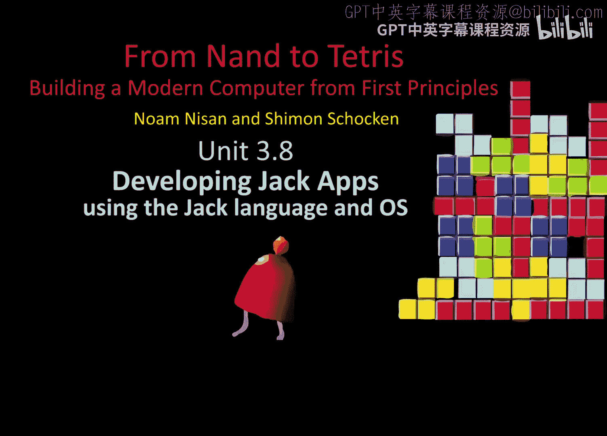

# 从零开始构建现代计算机2：单元3-8：使用Jack语言和操作系统开发应用 🚀



在本节课中，我们将学习如何使用Jack语言及其配套的操作系统来开发各种应用程序。我们将从开发流程、输入输出处理、操作系统提供的核心类库等方面进行介绍，并给出一些实用的开发建议。

---

## 开发流程 📝

上一节我们介绍了Jack语言的基本规范。本节中，我们来看看如何将Jack语言用于实际应用开发。

开发一个Jack应用程序，我们建议遵循以下步骤：

1.  **创建项目目录**：新建一个目录，并以你的应用名称命名，例如 `Tetris`。
2.  **编写Jack代码**：使用标准文本编辑器编写 `.jack` 类文件，并将它们放入之前创建的目录中。如果编辑器支持Jack语法高亮，使用它会更加方便。
3.  **编译程序**：使用提供的Jack编译器编译你的程序。你可以编译单个 `.jack` 文件，也可以直接编译整个目录。编译器会为每个 `.jack` 文件生成对应的 `.vm` 虚拟机文件。
4.  **执行程序**：将包含 `.vm` 文件的整个目录加载到虚拟机模拟器中，然后运行你的程序。

以下是虚拟机模拟器运行某个程序的截图示例，这也是我们推荐用于执行你编写的程序的环境。


---

## 处理输入与输出 ⌨️🖥️

应用程序如何与用户交互？这取决于你想开发什么类型的应用。

### 文本应用

如果你开发的是处理简单字符和字符串的文本应用，那么你应该将屏幕（虚拟机模拟器的屏幕或Hack计算机的通用屏幕）视为一个由 **23行**、每行 **64个字符** 组成的黑白网格。

使用Jack操作系统提供的 `Output` 类可以方便地处理文本输出。这个类提供了一系列功能明确的函数。

以下是 `Output` 类的API示例：
```java
class Output {
    function void printChar(char c) { ... }
    function void printString(String s) { ... }
    function void printInt(int i) { ... }
    function void println() { ... }
    // ... 其他方法
}
```

### 图形应用

如果你想开发像《乒乓球》、《太空入侵者》或《贪吃蛇》这样的图形应用，那么你应该将同一个物理屏幕视为一个由 **256行**、每行 **512个像素** 组成的黑白网格。

对于图形生成，我们推荐使用操作系统提供的 `Screen` 类，当然你也可以创建自己的图形库（这将在本模块后续单元讨论）。

以下是 `Screen` 类的API示例：
```java
class Screen {
    function void clearScreen() { ... }
    function void setColor(boolean b) { ... } // true=黑色, false=白色
    function void drawPixel(int x, int y) { ... }
    function void drawLine(int x1, int y1, int x2, int y2) { ... }
    function void drawRectangle(int x1, int y1, int x2, int y2) { ... }
    function void drawCircle(int x, int y, int r) { ... }
}
```
`setColor` 函数用于设置一个全局颜色（黑色或白色），所有后续的绘图操作都将使用这个颜色，直到下一次调用 `setColor`。通过交替使用黑色和白色，可以创造出擦除或动画效果。

### 处理用户输入

Hack计算机的标准输入设备是一个标准键盘。为了处理来自键盘的输入，操作系统提供了一个 `Keyboard` 类。

以下是 `Keyboard` 类的API示例：
```java
class Keyboard {
    function char keyPressed() { ... }
    function char readChar() { ... }
    function String readLine(String message) { ... }
    function int readInt(String message) { ... }
}
```
`keyPressed` 方法会持续返回用户当前按下的键的扫描码。只要手指按住某个键（例如左箭头键），`keyPressed` 就会返回对应的数字（如130）。一旦松开手指，它将返回0。一种基本的用户交互方式就是持续采样 `keyPressed` 的返回值。

Hack计算机识别的字符集包括方向键（上、下、左、右），这些键在各类交互式游戏中非常有用。

---

## Jack操作系统类库概览 📚

就像Java拥有标准库一样，Jack语言也配套了一个操作系统类库。不过，Java标准库有数千个类，而Jack的类库目前只有8个核心类。

以下是这些类的简要介绍：

1.  **Math**：数学库。提供一些你可能需要的数学函数，例如 `Math.multiply` 和 `Math.divide`。注意，在常规Jack编程中，你可以直接使用 `*` 和 `/` 运算符，这两个函数主要用于编译器开发等场景。
2.  **String**：字符串类。提供了字符串抽象，包括构造函数、一系列操作字符串的方法，以及一些特殊字符常量（如退格键、双引号、换行符）。
3.  **Array**：数组类。在Jack程序中创建数组，需要调用 `Array.new(size)`。之后可以通过 `array[index]` 的语法访问数组元素。不再需要数组时，建议调用 `Array.dispose()` 释放。
4.  **Memory**：内存类。允许Jack程序直接访问宿主机的RAM，通过 `peek`（读）和 `poke`（写）方法实现。**使用这些函数需要格外小心**，因为它们可能访问到不应触碰的内存地址（如栈或指针区域）。此外，还提供了 `alloc` 和 `deAlloc` 函数来创建和释放内存块。
5.  **Sys**：系统工具类。提供三个实用函数：`halt`（停止程序）、`error`（输出错误信息）和 `wait`（等待指定毫秒数）。`wait` 函数在制作动画时非常有用，可以通过它在循环中添加延迟来控制动画速度。
6.  **Output**：文本输出类，前文已介绍。
7.  **Screen**：图形输出类，前文已介绍。
8.  **Keyboard**：键盘输入类，前文已介绍。

---

## 学习与开发建议 💡

了解Jack编程的最佳方式是研究现有的Jack程序。本模块中我们已经展示了许多示例，如分数计算器和链表。此外，我们还提供了一个名为 `Square` 的简单交互式游戏程序（包含三个类），以及一个更复杂的、面向对象的多类应用程序 `Pong` 的完整代码。

以下是一些开发你自己应用程序的指南：

*   **观摩现有程序**：访问课程网站，运行并研究提供的应用程序（如 `Square` 和 `Pong`），理解其用户体验、局限性和Jack的输入输出风格。
*   **精心规划**：仔细规划你的应用。明确用户能做什么、程序提示什么，并设计实现方案，包括需要哪些类。
*   **尽早考虑测试**：在开发早期就思考你的测试策略。
*   **实现、测试、享受**：完成实现，进行测试，并享受你的劳动成果。

以下是一些技术提示：

*   使用文本编辑器编写程序。
*   熟悉操作系统提供的类库。
*   如需图形更流畅，可以使用后续单元讨论的一些优化技巧。
*   像注释Java、Python程序一样为你的代码添加文档。
*   使用提供的Jack编译器编译代码，并使用虚拟机模拟器执行。
*   在虚拟机模拟器中，记得使用滑块控制执行速度，并利用各种动画控制选项。如果不确定，请查看课程网站上的虚拟机模拟器教程。

---

## 总结 ✨

本节课中，我们一起学习了使用Jack语言和操作系统开发应用程序的全过程。我们了解了从创建目录、编写代码、编译到执行的完整开发流程。重点介绍了如何处理文本与图形输出，以及如何通过 `Keyboard` 类接收用户输入。我们还概览了Jack操作系统提供的8个核心类库（`Math`, `String`, `Array`, `Memory`, `Sys`, `Output`, `Screen`, `Keyboard`）及其基本用途。最后，我们获得了一些关于学习现有代码、规划应用以及进行开发实践的实用建议。接下来，我们将通过分析一个由多个类组成的完整Jack应用程序代码来加深理解。


