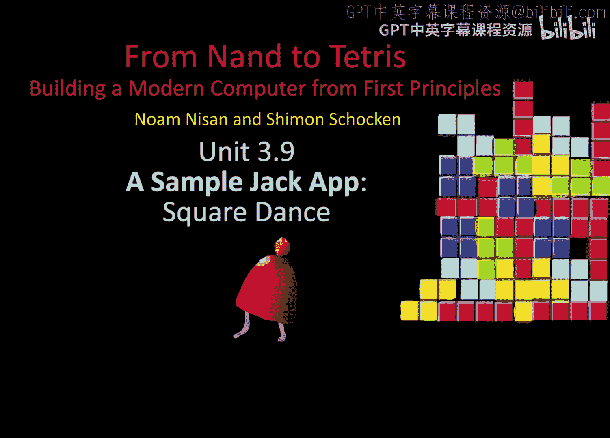
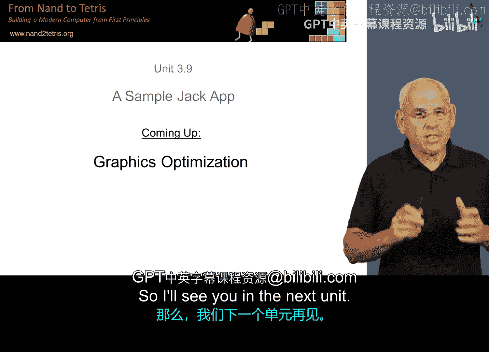

# 耶路撒冷希伯来大学《从零开始构建现代计算机2｜Build a Modern Computer from First Principles》中英字幕 p42 42_05_10_单元3-9_Jack应用示例：方块舞.zh_en -BV1DA4m1w7FU_p42-

In the previous unit we talked about some general guidelines of developing jack applications and in this unit we are going to see an example of a full full blown jack application in action will both see the program run and then we'll delve into its J code now the application that we have chosen to show you is something that we call square dance and in showing you this particular program。

 we want to illustrate some notions of the object oriented design in Jack we want to illustrate one way of developing interaction with the user。

Using various input and output services supplied by the host operating system。

Now I want to say a few words about object oriented design， this is clearly not part of this course。

 you know this course is not about programming， so we assume that you know something about object oriented design and if you don't。

 you can see some examples in our course and elsewhere and get some ideas on how to design your own applications。

Al right， so we'll start with a quick demo of the square dance game。

So welcome once again to the VM emulator environment。

 I have already loaded the square program so we can go ahead and execute it。 As we do so。

 we see that lots of things are happening with a code， but nothing shows on the screen。😊，And indeed。

 let me stop execution and explain what's going on。So basically。

 you have to recall that each time you start executing a program。

The operating system has to initialize。 The program has to initialize。

 So we have to spend several thousand cycles before anything shows on the screen。

 so we can definitely keep on executing the program。 and at some point。

 we'll see some output on the screen。But if you want to skip all this preliminary stuff。

 what we have to do。Is turned from program flow to no animation and no animation means in the context of the emulator。

 no animation of the program's behavior of the internal behavior of the code and now we will rewind the code so to speak。

 basically we set the program count to zero and we'll start executing the program again。

And immediately， we see a black screen。 I'm sorry， a black square appearing。

At the top left of the screen， this is the default square， which is， I believe。

 30 pixels wide and 30 pixels high。 And you have to believe me that I'm now taking my finger one of my fingers and pressing the right arrow key。

 So let's do that。And indeed， you see that the square has moved until it hit the wall。 Now。

 I'm going to press the down arrow， left arrow。Up arrow。

 And you see that the the square responds to my keyboard events。You know。

 I can play with several arrows， one just after the other， and the square will move accordingly。

I can also click the X key and each time I click x the square increases by two pixels on the base and the height。

 and I can now move this square around， it looks like it moves us slower， but it's only because。

It it's bigger， so it's kind of an optical bias， and I can make it smaller。

So if I click the z key each time I click it becomes a smaller。

 the visual effect is not very delicate because I didn't use any graphics optimization and at some point the square will become so small that maybe it will even completely shrink and disappear but actually I see that there is still a small square surviving here apparently that's how the program is written and so I can once again increase it and bring it relatively back to normal and song and so forth。

 so this has been a demo of our little square program。😊，Now to recap the demo that we just saw。

 when you launch the square dance game。The first thing that you see is a black square located in the top left corner of the screen and the square is not going anywhere。

 it sits there until the user does something in particular if the user clicks the arrow keys the square begin begins to move around the screen and so the user can control the movement using these four keys。

 the user can also you know make the square larger and smaller and finally the user can quit the game。

 So nothing new here you know everything that I discussed that I just discussed was shown in the demo。

But we have to keep these things in mind when we delve into the code because the code is designed to implement all of this action here。

All right， so what is the architecture of our program， Well， we've decided to。

Structure it around three independent and standalone jack class files。 First of all。

 we have a square class that provides。The square obstruction。 So using this class， you can create。

A graphical square and manipulate it and move it around on the screen。

Then we have a square game class that controls the user's actions and responds to the user's actions by moving the square around。

 and this is done within an ongoing loop and finally we have a main class which is rather simple that serves to initialize things。

 set the stage， and get the square game rolling。So these are the three classes that we use and。

By and large， you know， this this design here follows what is sometimes known as MVC。

 which is a well known design pattern that。Recommend that you develop graphical applications using。

 you know， some class that handles the data of the objects that you want to manipulate another class。

Or more than one class to handle the control of the game and other features to to control the viewing of the objects。

 And indeed， this is roughly what we do。 The square class is our correspond to what is known as model。

 The square game is the game controller。 and we use a set of standalone methods。

 and obviously the operating system to actually do the drawing and and put and supply the viewing functionalities of this game。

😊，Alright， so moving along， I would like to begin to explore each one of these three classes step by step。

 so let's start with square。Here's the API of square。 First of all。

 we feature a constructor that creates a new square。

And locates it in the given coordinates and the square will be created in the given size。

The size is the length of the square size in the squared edge in pixels and then we have a dispose method that gets rid of the current square。

 we provide a draw routine that draws the square and it draws it in its current coordinates and size。

😊，A rayse basically draws the square also， but using the background color。

 so effectively it erases the square。We have an increase size and decrease size routines that serve to do what their names imply and then we have a move up。

 move down， move left and move right routines that each once again does what they advertise so everything is very self explanatory so as you see this is the square obstruction and other classes in the world are welcome to use it。

 including of course the classes of our application。

So let's open up the code and going back to this square class here are the fields that characterize the current object。

 first of all it has an x and y coordinates and I wish to remind you that the top left of the screen is considered as00 and then it has a size in pixels。

Then comes the constructor and here is the code of the constructor。

 so we set x and y to the given values， we set size to the given value and then we call draw once we call draw you will see the square located in the current coordinates and presumably whoever calls this constructor will call it with a00 coordinates to begin with and this means that you will see the square kind of anchored to the top left corner of the screen。

So after drawing it， we return this， which is something which is standard in every J constructor。

 we always have to return the base address of the newly created object to the calling code。

 as we've seen before in other examples。Moving along， the dispose method is a standard。

 there's nothing special about it。 we've seen such methods before。

And then we have the draw method which actually takes this logical square and finally you know shows it to the user How do we do it Well we set color to true。

 meaning that we select black and then we use the draw rectangle operating system function to draw a rectangle that has a length and a height which are the same so effectively we are drawing a square using the standard draw rectangle routine what about as as does exactly the same thing using the background color using false which is interpreted as white。

Then we have an ink size method and the ink size method simply erases the the current。

Image of the square increases the size of the square and then redraws it okay so effectively you will see a square which is slightly larger than what we had before and notice the condition this method just wants to make sure that the increased operation does not cause the square to sort of overflow and mess up the screen。

Then we have a decreased routine which is symmetric and there's no need to discuss it。

So that's how we increase and decrease the size of the square。So moving along。

 how do we move the square up？Well， think about it。 The square is located somewhere on the screen。

And what we have to do is move it up to pixels。So the simplest way to do it。

 which is not necessarily the most efficient one。Is to draw。

The current square in its current position using the background color。

 which will effectively eliminate it from the user's eye。

Then we can change the y coordinate of our square and switch back to the foreground color black and redraw it in its new location。

And that's exactly what we do in the implementation of the move up method。And if you want。

 you can stop the tape and take a look at this code。And you know， once we do it。

 the rest of the move methods， move down， move left， move right are very similar。

 follow the same tricks， and therefore theres no need to discuss them。All right。Okay。

 so this has been the square class in all its glory。

 and now we move on to talk about the square game class that actually controls the game。😊。

So to begin with every square game class。Needs to have a square。

 So one property of the square game class is a square， which is an object of type square。

 and then the square also has a direction and the direction is something which is controlled by the user。

And because this direction is something that we use in many places in the code。

 we decided to use some constants to code four the five possible directions， starting with0。

 which means the square is stationary。And so these are the two properties of every square game。

Then we have a constructor which creates a new game。And here's the code of the constructor。

 We start by constructing a new square， we construct it in the top left corner of the screen。

 and we decided by default the square will begin its life in the size of 30 pixels。

Then we set the direction to0， meaning that at the beginning we want the square to sort of sit tight in the corner and do nothing until the user decides to start clicking something on the keyboard and then as we normally do we return this as we normally do in constructors。

Dissp is standard， but before we dispose you know our object。

 we make sure to also dispose the square that we created and we act as responsible citizens。

And let's see， move square， move square is a routine which is designed to move the square。And。

You know， it's not obvious to me that it belongs to this class。

 We could have put it also in the square class。 So it's a matter of judgment。 You know。

 this routine could be either here or there。 So we decided to put it here。So how do we do it？ Well。

 if the direction is one。We want to move the square up if direction is2。

 we want to move it down and so on and so forth and after we move the square we do cis weight5 because we want to delay the animation somewhat and then we return so this is the move square routine。

And then we come to the most important routine of the square game class， which is called run。

 And this is the routine that actually runs the show。 Now， let's see how it actually does it。Well。

 we have chosen to do it in the following way。 First of all， we declare a variable called key。

 which contains the scan code of the key。That the user has last pressed。 Okay。

 And if the user releases this key， it will be 0。 No So that's。That's the contract of， of key。

Then we use a Boolean exit name the variable to decide when we want to exit the game and we initialize it to false because the game has just started。

Then we enter a Y loop， and we say that as long as。Not exit Later on。

 you will see as long as the user didn't hit queue for a quit。 what do we want to do？Well。

 think about it， we started the game and the square is lodged at the top left corner of the screen。

And presumably it will take some while， you know， a few nanoseconds or seconds or hours before the user decides to do something。

So how do we know that the user has actually began to use the keyboard， Well。

 we have to sample the keyboard， we have to use key to find out what the user is doing。

So what you will do， what you will see next in this from now until the end of this unit is the typical way that we deal with keyboard effects or with keyboard events。

As long as key is0， it means that the user has not touched yet the keyboard， what do we do。

 we sample the keyboard and we put the scan code which the user has entered or0 into key。

And then we move square。 Okay， we move square because these are the rules of the game。

 The rules of the game is that the square is always moving until it hits the wall。 Okay。

 and at the beginning direction is0。 So we move the square in direction 0。

 which means that the square is not really moving。 but at some point you see after many such a key presses。

 because we are running within a loop here， as long as we are within as long as we are within this loop。

 we know that the user has not touched the keyboard。 but once the user。😊。

Touches the keyboard will be yanked out of this while loop because key will no longer be0。

 So finally， we have a direction or a direction which is not0。So if the key happens to be 81。

 which is a scan code of Q。We set X Z to true。 If the key is z， we decrease the square。

 If it key is 88， we increase the square。 and then if the key。

Contains one of the scan codes of the arrow keys， then we set the direction property of the square to the corresponding agreed upon constant and then we go on to enter into another loop。

Which controls the time that the user。Is actually holding his or her finger down。 Okay。

 so think about it。 We arrived to this code because the user has clicked the key， right。

 So the user holds the finger down and and therefore key is not0， but at some point。

 the user will lift his or her finger。 So as long as the keys down as long as the key is down as long as key is not0。

 We want to continuously monitor the keyboard or sort of sample the keyboard using key press。

 And at some point， the user will lift。Her finger and the key will become zero。

So at this point we are getting out of the loop and as long as we are within the loop。

 we move the square because once again we want the square to continuously move because these are the rules of the game that we have chosen to implement。

So at some point。Will be out of the while that controls the user's actions and we' be back into the outer while that that asks the question。

 are we still playing the game you know， as long as exit is false。

 We want to continue playing the game At some point。

 the user will click queue exit will become true and at that point we are going to get out of this outer loop as well。

 and then the run method will return and this will be the end of the game。

So that's the square game class。Moving along the last class that we have to explore is fairly simple。

 it's the main class， the main class basically initializes things and sets the game in motion。

 so it does it as is customer inject using a main function， so we create a new game object，We。

Call the run method of this game object。 And then the method that I just described starts executing。

 Once this run method terminates， we dispose the game object and return。And that's it。

 So this has been a complete description of the square dancer application。

 and I do hope that it served to highlight some of the art and science of developing interactive apps in Jack。

So to recap， we showed you this example because we wanted you to appreciate and understand the user interface style that heEC Jack applications feature。

 we wanted to show you that you have to use the operating system extensively。

 just like you use the operating system extensively when you write programs in Java and Python。

In other high level languages。😊，And we also wanted to illustrate some basic object oriented design。

 and we didn't show you our testing strategy， but we wish to emphasize that this is something that you have to worry about as well。

 you have to be able to unit test everything that you do just like we do in any other project in this course。

So with that， that's the end of this unit and in the next unit。

 we will discuss how to handle some graphical requirements which are more challenging than the moving squares around the screen。

So I'll see you in the next unit。

