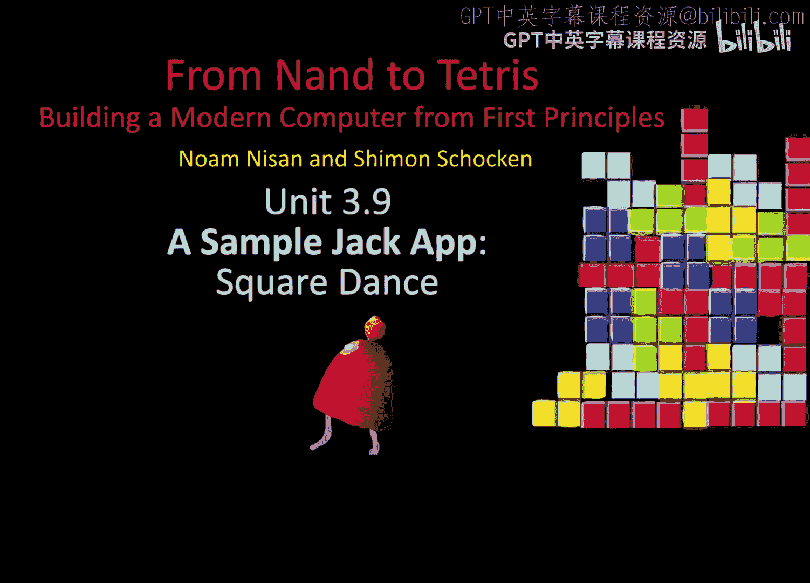
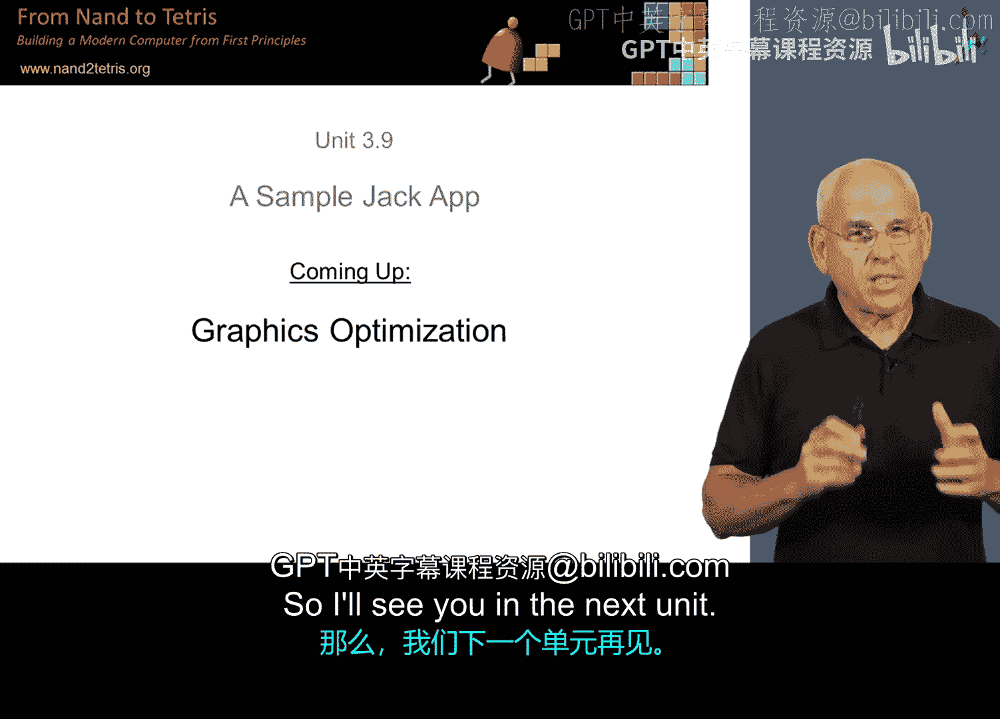

# 从零开始构建现代计算机2：单元3-9：Jack应用示例：方块舞 🎮

## 概述
在本单元中，我们将通过一个名为“方块舞”的完整Jack应用程序示例，学习如何将面向对象设计原则与操作系统提供的输入/输出服务相结合，来开发交互式应用。我们将先观察程序的运行效果，然后深入分析其Jack代码。

---

## 程序演示与功能说明

上一单元我们讨论了开发Jack应用程序的一些通用准则，本节中我们来看看一个完整Jack应用程序的实际示例。

我们选择展示的应用程序称为“方块舞”。通过这个特定程序，我们旨在阐释Jack中的面向对象设计概念，并展示一种利用主机操作系统提供的各种输入/输出服务来开发用户交互的方法。

关于面向对象设计需要说明的是，这并非本课程的核心内容。本课程的重点不是编程，因此我们假设您已具备一些面向对象设计的基础知识。如果不熟悉，可以参考课程内外的示例来获得设计自己应用程序的思路。

首先，我们快速演示一下方块舞游戏。

再次欢迎来到虚拟机模拟器环境。我已经加载了方块程序，现在可以执行它。执行时，代码内部发生了很多操作，但屏幕上没有显示任何内容。让我停止执行并解释一下原因。

基本上，每次启动程序时，操作系统和程序本身都需要进行初始化。这需要数千个时钟周期才能在屏幕上显示内容。我们可以继续执行程序，最终会在屏幕上看到输出。但如果你想跳过所有这些初始化步骤，我们需要将程序流程切换到“无动画”模式。在模拟器上下文中，“无动画”意味着不展示代码内部行为的动画。现在，我们“倒回”代码，将程序计数器设置为零，然后重新开始执行。

立即，我们看到屏幕左上角出现了一个黑色方块。这是默认方块，宽高均为30像素。请注意，我现在正用一根手指按下右箭头键。确实，你看到方块开始移动，直到碰到墙壁。接着，我按下下箭头、左箭头、上箭头，方块对我的键盘事件做出了响应。我可以连续按几个箭头键，方块会相应移动。

我还可以点击X键。每次点击X，方块的底边和高度都会增加2个像素。现在移动这个方块，看起来它移动得更慢了，但这只是因为方块变大了，这是一种视觉偏差。我也可以让它变小。如果点击Z键，每次点击方块都会变小。由于没有使用任何图形优化，视觉效果并不精细。在某个时刻，方块会变得非常小，甚至可能完全收缩消失，但实际上我看到这里仍然有一个小方块幸存下来，显然程序就是这样写的。我可以再次增大它，使其大致恢复正常大小，如此反复。以上就是我们这个小方块程序的演示。

回顾一下刚刚看到的演示：当你启动方块舞游戏时，首先看到的是一个位于屏幕左上角的黑色方块。方块不会移动，它会停留在原地，直到用户进行操作。特别是，如果用户点击箭头键，方块就会开始在屏幕上移动。因此，用户可以使用这四个键来控制移动。用户还可以使方块变大或变小。最后，用户可以退出游戏。这里没有什么新内容，我刚才讨论的一切都在演示中展示了。但在深入分析代码时，我们必须牢记这些点，因为代码的设计就是为了实现所有这些动作。

---

## 程序架构与设计模式

那么，我们程序的架构是怎样的？我们决定围绕三个独立且自包含的Jack类文件来构建它。

以下是构成我们程序的三个独立类：

1.  **Square类**：提供方块对象。使用这个类，你可以创建一个图形方块，并在屏幕上操纵和移动它。
2.  **SquareGame类**：控制用户操作，并通过在一个持续循环中移动方块来响应用户操作。
3.  **Main类**：相当简单，用于初始化、设置舞台并启动方块游戏。

总的来说，这个设计遵循了有时被称为MVC的著名设计模式。该模式建议使用一些类来处理你想要操纵的对象数据，使用另一个或多个类来控制游戏和视图功能。确实，我们大致就是这样做的。Square类对应所谓的“模型”，SquareGame是游戏控制器。我们使用一组独立的方法，以及操作系统来实际进行绘制并提供游戏的视图功能。

---

## Square类详解

接下来，我想逐步探索这三个类中的每一个，让我们从Square类开始。

以下是Square类的API：

*   **构造函数**：`constructor Square new(int x, int y, int size)`。创建一个新方块，将其定位在给定的坐标，并以给定的尺寸创建。尺寸是方块边长的像素值。
*   **析构方法**：`method void dispose()`。处理掉当前方块。
*   **绘制方法**：`method void draw()`。在当前位置和尺寸绘制方块。
*   **擦除方法**：`method void erase()`。同样绘制方块，但使用背景色，因此实际上是擦除方块。
*   **改变大小方法**：`method void incSize()` 和 `method void decSize()`。执行其名称所暗示的操作。
*   **移动方法**：`method void moveUp()`, `method void moveDown()`, `method void moveLeft()`, `method void moveRight()`。每个方法都执行其广告的功能。

一切都非常直观。正如你所见，这就是方块对象，世界上的其他类都可以使用它，当然也包括我们应用程序中的类。

让我们打开代码，回到这个Square类。以下是表征当前对象的字段：首先，它有x和y坐标（提醒一下，屏幕左上角被认为是(0,0)），然后它有一个以像素为单位的尺寸。

接下来是构造函数，以下是构造函数的代码：我们将x和y设置为给定值，将size设置为给定值，然后调用draw。一旦调用draw，你将看到方块定位在当前坐标。假设调用此构造函数的人会以(0,0)坐标开始调用，这意味着你将看到方块锚定在屏幕的左上角。绘制后，我们返回`this`，这是每个Jack构造函数中的标准做法，我们必须将新创建对象的基地址返回给调用代码，正如我们在其他示例中看到的那样。

继续看，dispose方法是标准的，没有什么特别之处，我们以前见过这样的方法。

然后我们有draw方法，它实际上获取这个逻辑方块并最终向用户显示它。我们如何做到呢？我们将颜色设置为true（意味着选择黑色），然后使用操作系统的`drawRectangle`函数来绘制一个长度和高度相同的矩形，因此我们实际上是使用标准的`drawRectangle`例程来绘制一个正方形。erase方法做完全相同的事情，但使用背景色（false被解释为白色）。

接着是incSize方法。incSize方法简单地擦除当前方块的图像，增加方块的尺寸，然后重新绘制它。这样，你将看到一个比之前稍大的方块。注意其中的条件判断，该方法只是确保增加操作不会导致方块溢出并弄乱屏幕。

然后我们有一个对称的decSize例程，无需讨论。

以上就是我们如何增大和减小方块尺寸。

那么，我们如何向上移动方块呢？想一想，方块位于屏幕上的某个位置，我们需要将其向上移动两个像素。最简单的方法（不一定是最有效的方法）是：使用背景色在当前位置绘制当前方块，这将有效地从用户视野中消除它。然后，我们可以改变方块的y坐标，切换回前景色黑色，并在新位置重新绘制它。这正是我们在moveUp方法实现中所做的。如果你愿意，可以暂停并查看这段代码。一旦我们这样做了，其余的移动方法（moveDown、moveLeft、moveRight）都非常相似，遵循相同的技巧，因此无需讨论它们。

好的，以上就是Square类的全部内容。

---

## SquareGame类详解

现在，我们继续讨论实际控制游戏的SquareGame类。

首先，每个SquareGame类都需要一个方块。因此，SquareGame类的一个属性是一个Square类型的对象。然后，方块还有一个方向，这个方向由用户控制。由于这个方向在代码的许多地方都会用到，我们决定使用一些常量来编码五种可能的方向，从0开始，表示方块静止。这就是每个SquareGame的两个属性。

然后我们有一个构造函数，它创建一个新游戏。以下是构造函数的代码：我们首先构造一个新方块，将其构造在屏幕的左上角，并默认决定方块的生命起始尺寸为30像素。然后我们将方向设置为0，这意味着在开始时，我们希望方块在角落里保持不动，直到用户决定开始点击键盘上的某些键。然后，像构造函数中通常做的那样，我们返回`this`。

dispose方法是标准的，但在处理我们的对象之前，我们确保也处理掉我们创建的方块，我们作为负责任的公民行事。

让我们看看moveSquare例程。moveSquare是一个设计用来移动方块的例程。我不太确定它是否属于这个类，我们也可以把它放在Square类中。所以这是一个判断问题。这个例程可以放在这里或那里，我们决定把它放在这里。那么我们如何做呢？如果方向是1，我们想向上移动方块；如果方向是2，我们想向下移动它，依此类推。移动方块后，我们调用`Sys.wait(5)`，因为我们想稍微延迟一下动画，然后返回。这就是moveSquare例程。

然后我们来到SquareGame类最重要的例程，叫做run。这是实际运行整个表演的例程。现在，让我们看看它实际上是如何做到的。

我们选择以下方式来实现：首先，我们声明一个名为key的变量，它包含用户最后按下的键的扫描码。如果用户释放了这个键，它将是0。这就是key的约定。

然后我们使用一个名为exit的布尔变量来决定何时退出游戏，并将其初始化为false，因为游戏刚刚开始。

接着我们进入一个while循环，条件是`not exit`。稍后你会看到，只要用户没有按Q退出，我们想做什么呢？想一想，我们启动了游戏，方块位于屏幕的左上角。假设需要一些时间（几纳秒、几秒或几小时），用户才会决定做些什么。那么我们如何知道用户实际上已经开始使用键盘呢？我们必须采样键盘，必须使用key来找出用户在做什么。

因此，从现在开始直到本单元结束，你将看到我们处理键盘事件或键盘效果的典型方式。

只要key是0，就意味着用户还没有触碰键盘。我们做什么？我们采样键盘，并将用户输入的扫描码（或0）放入key。然后我们移动方块。我们移动方块是因为游戏的规则是：方块总是在移动，直到碰到墙壁。在开始时，方向是0，所以我们以方向0移动方块，这意味着方块并没有真正移动。但在许多次这样的按键之后（因为我们在这里的循环中运行），只要我们还在这个循环内，我们就知道用户还没有触碰键盘。但是一旦用户触碰了键盘，我们将被拉出这个while循环，因为key将不再是0。最终，我们有了一个非零的方向。

因此，如果key恰好是81（这是Q的扫描码），我们将exit设置为true。如果key是Z，我们减小方块。如果key是88（X），我们增大方块。然后，如果key包含箭头键之一的扫描码，我们将方块的方向属性设置为相应的约定常量。然后我们进入另一个循环。

这个循环控制用户实际按住他或她的手指的时间。想一想，我们到达这段代码是因为用户点击了键，对吧？所以用户按住手指，因此key不为0。但在某个时刻，用户会抬起他或她的手指。因此，只要键被按住（只要key不为0），我们希望持续监控或采样键盘（使用`Keyboard.keyPressed()`）。在某个时刻，用户会抬起他或她的手指，key将变为零。此时，我们将退出这个循环。只要我们还在这个循环内，我们就移动方块，因为再次强调，我们希望方块持续移动，因为这是我们选择实现的游戏规则。

在某个时刻，我们将退出控制用户操作的内层while循环，回到外层while循环，该循环询问：我们还在玩游戏吗？只要exit为false，我们就想继续玩游戏。在某个时刻，用户会点击Q，exit将变为true，那时我们也将退出这个外层循环。然后run方法将返回，这将是游戏的结束。

以上就是SquareGame类。

---

## Main类详解

继续，我们需要探索的最后一个类相当简单，就是Main类。Main类基本上初始化事物并启动游戏。它按照Jack的惯例，使用一个main函数来完成：我们创建一个新的game对象，调用这个game对象的run方法。然后，我刚才描述的方法开始执行。一旦这个run方法终止，我们处理game对象并返回。就是这样。

---

## 总结

以上就是对方块舞应用程序的完整描述，我希望它能帮助您理解在Jack中开发交互式应用程序的一些技巧和科学原理。

回顾一下，我们向您展示这个示例，是因为我们希望您能欣赏和理解Jack应用程序所具备的用户界面风格。我们希望向您展示，您必须广泛使用操作系统，就像您在Java、Python和其他高级语言中编写程序时广泛使用操作系统一样。

我们还希望阐释一些基本的面向对象设计。我们没有展示我们的测试策略，但我们希望强调这也是您必须关注的事情。您必须能够对所做的所有事情进行单元测试，就像我们在本课程的任何其他项目中所做的那样。

至此，本单元结束。在下一单元中，我们将讨论如何处理一些比在屏幕上移动方块更具挑战性的图形需求。

我们下个单元再见。