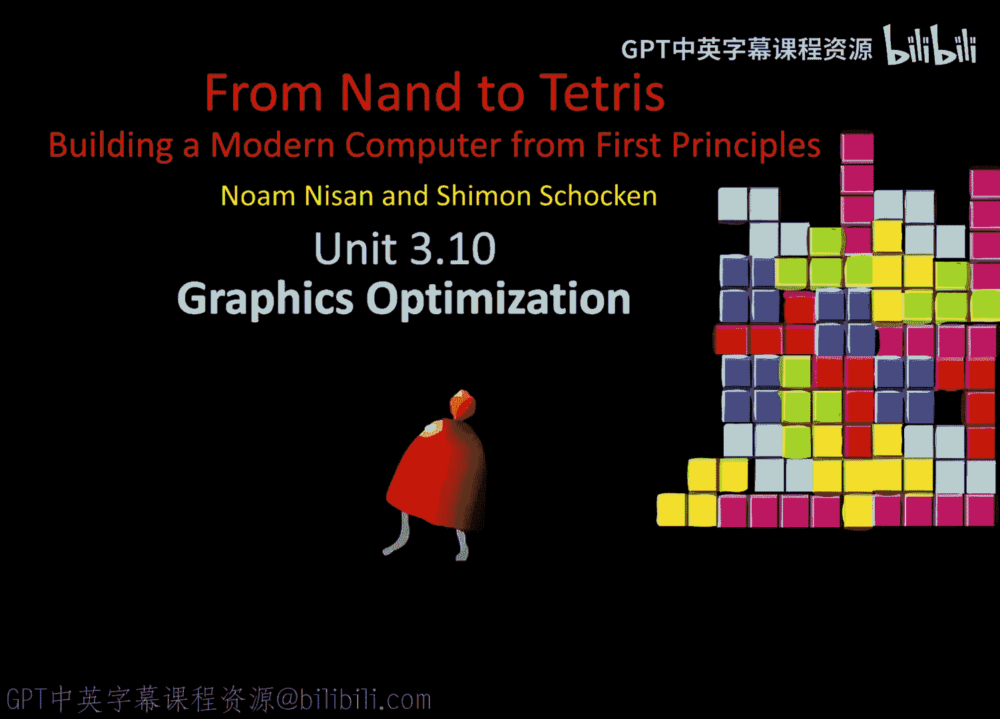
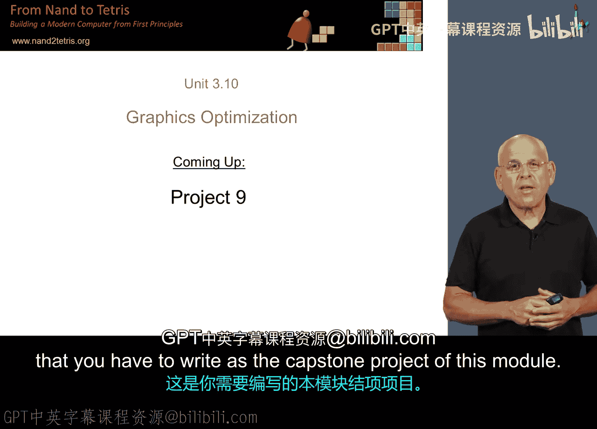
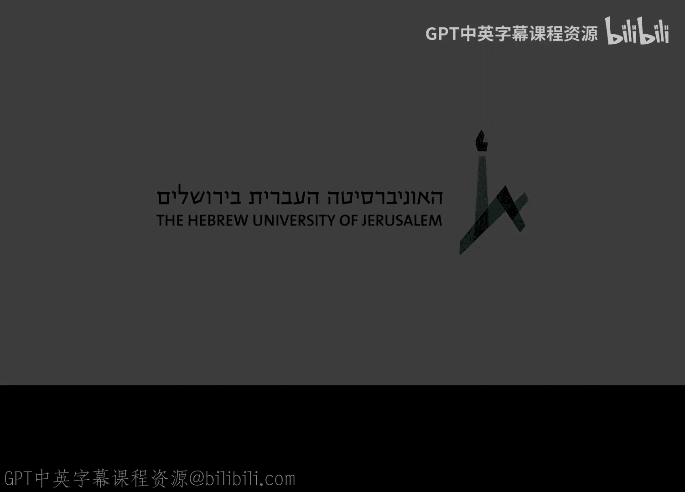

# 耶路撒冷希伯来大学《从零开始构建现代计算机2｜Build a Modern Computer from First Principles》中英字幕 p43 43_05_11_单元3-10_图形优化.zh_en -BV1DA4m1w7FU_p43-

In the previous unit， we showed you the square dance application and。

The square dance involved a very simple graphics image。

A square and in fact we use the operating system in order to draw this square in many applications we have to use some more fancy graphics。

 some less regular polygons than squares and and rectangles so what do you do when when you have to create high performance graphics。

 Well you can do some tricks that we are going to unfold in this unit。

So we saw Square dance and you may had the chance to look at Space invaders app。

 you can look it up in the course website and if you look closer at the images from which space invaders is made you will see these various creatures here。

 so we see the alien and the shooter and the shots。If you look at another application， So band。

 once again， if you focus on the graphical building blocks of this application。

 you will see that this maze is made up from repeating patterns of some basic images。

 as you see here at the bottom。And by and large， all these images are typically referred to as sprites。

 so a sprite is a two dimensional bitmap that typically serves as a singular image or repeating image in a larger scene。

And as application developers。😊，We have to worry about two things。 first of all。

 how to draw sprites quickly， which is not obvious when the sprite is an irregular shape that does not lend itself to standard drawing routines。

And in a similar fashion， we have to worry about moving these sprs around in a smooth and acceptable way to the human eye to the eye of the user。

Now there are two basic ways to do it， one is the standard approach。

 which uses the host operating system。And yet， at some point。

The capabilities of the OS can kind of run out of steam and then you have to use some customized code that you may want to develop yourself。

 and that's what this unit is all about， how to bypass the operating system and do your graphics using your own skills。

All right， so。The graphics that you're going to create in Jack at the end of the game is going to execute on the he computer。

And the head computer， if you recall， features a 32k Ram。And。As you may recall from Project0。

 the computer is organized in such a way that there is an 8k address space which is dedicated to the screen memory map and there is a single word memory map which is dedicated to the keyboard and to these two memory maps we can connect a screen and a keyboard。

And the computer also features an ongoing refresh cycle that refreshes。😊。

The physical screen from the contents of the screen memory map。

So if you want to draw something on the screen， you have to write into the heck Ram。Now。

 let us take a closer look at the screen， because， you know， that's the the focus of this unit。

 graphics on the heck screen。 So the screen is a grid that consists of 256 rows of。512 pixels each。

And if I want to draw three pixels somewhere on the screen， well， in that case。

 I have to write the number 7 or 1，11 somewhere in the screen memory map。

And I've chosen some arbitrary address，919003 that presumably corresponds。

To what we see here on the screen。If we want to see some more pixels， let's say 16 pixels。

 then we have to go to the same address and write the number minus1， which in binary is 16 ones。To。

 to complement。And so， as you see， whenever you want to render something on the screen。

 the only way to do it。Is to write something into the Ram。

 into the screen memory map under program control。 If you're writing in a machine language。

 you can do it directly。 if you write in Jack。Then you have to do it using jack commands。

So how can we do it using J commands？Well， first of all。We are lucky to have a class called Meory。😊。

Is part of our operating system。And in the memory class there are two functions called Pe and Pol which enable me to do what I just described。

 I can use Pe and Pol in order to select certain addresses in the memory and either you know fetch the number which the value。

 which is lodged into this address or we can change this value by using the poke。

So here are some examples， if I will write the code， let X equals a peak of this address， 19003。

X will be set to 7， which is the decimal value of the binary 1，11。If alternatively。

 I will say poke in the same address， minus-1 then。This word will will not be one anymore。 I'm sorry。

 it will not be 7 anymore。 It will become-1， which is 16 ones in in binary。

So I can control the Ram using these two operations。 So that's one way of doing it。

 Let me show you another way。I can also draw pixels using the operating system。 So， for example。

 if I want to draw this rectangle that you see here。

 which consists of let's say two rows of three pixels each。Then there are several ways of doing it。

 and I can do it using the screen class OS features。So let's see we have draw pixel， draw line。

 draw rectangle。 so we can， first of all， we have to decide or to make an assumption about the location。

Of the desired， the rectangle。 So let us decide that these are the coordinates of the top left corner of this image。

 So one thing that we can do is simply draw all the pixels that make up this image。

 So we have six pixels and we draw them one at a time。

Another thing that we can do is we can use the draw line routine in order to draw two lines of three pixels each。

 and I can also draw this image using the draw rectangle routine。That。

Given the parameters that I supplied， will draw the same image。

 So any one of these techniquess here will do the same thing。Now。

 drawing regular figures like this is kind of easy， isn't it， What about images that look like that。

Well， this is an irregular image， and we have no always routine， which is specifically designed。

To to draw anything like that。 And if we had such a routine， I could come up as a devil's advocate。

 I could come up with another example that you cannot draw and so on and so forth。 So at some point。

We have to deal with irregular figures and one way to deal with these figures is to simply draw all the pixels right so I can you know figure out all the coordinates of all these pixels and for each one of these pixels draw it one at a time and it turns out that in this particular example。

 I will end up using 75。Different pixel drawing operations。Now， when you think about efficiency。

You should never think about high level， where you can begin to think about high level。

 But at some point， you should always think。About the low level， you know。

 how long will it actually take to to draw this image on the ultimate。Host platform。

Well it turns out that every one of these pixels at the low level will require all the operations that you see here。

None of which is trivial。Okay， so I've written it in cellelda code that the operating system will have to。

 you know， implement all this。 And at some point， we'll have to translate it into。

Machine language and so on。And so when you look at this batch of commands here。

And if you're worried about efficiency。Then the only two words that come to my mind are O they。

Because。You know， what we have here。I think is something around at least 4040 machine operations or machine cycles。

And so the efficiency of this operation is 40 times 75， which is around 3000 machine operations。

 A lot of work to draw this little sprite on the screen。

And think about animation where you have to draw this image， you know。

 thousands of times within a loop。Al right， so there must be a better way and indeed there is a better way。

 which we call a custom drawing。So。As you may have imagined。

 one thing that we can do is look at this image here。And realize that we are actually。

Looking at a bunch of numbers， right， binary numbers that represent these pixels。

So we can render this image on the screen by simply writing a bunch of numbers and these are the numbers in decimal into selected carefully selected addresses in the Ram。

 and then we'll get exactly the same effect。And so in order to write these numbers。

 it turns out they need 16。Pooke operations。And so the efficiency would be 16 poke corporations。

 now Pol。Is a highly optimized operation， because it's a 16 B。Operation。

 which is very natural to the host platform。And so it can be implemented with， I believe，4。

Machine operations。So we have four times 16， which is 64 operations。

Compared to the 3000 that we had before。You know， significant improvement in terms of efficiency。

All right。We can continue to talk about custom drawing。 And， and now I'd like you to。To note that。

 you know， we never draw these sprites in， in isolation。 They are always located。

In a certain location on the on the host screen， so let us not forget that we have to decide about the exact addresses of these values。

 and that's what I want to do in the next few minutes to discuss the addressing scheme。So。

 first of all。Recall that what we see here on the screen is a rendition， an ongoing rendition。

 which is refreshed all the time of the 8 K screen memory map on the whole strand。

 So let us focus only on the memory map and let us ren the addresses of the memory map from 0。😊。

To 8 k。And。Let us remember also the coordinates of the top left corner of the sprite。And I have。

Filled in some bits into the memory map that illustrate what we actually see in the memory when we see this sprite on the screen。

So let's see the first row of the screen， which is 512 bits or pixels。

 is represented by the first 32 words of the M， and they are all zeros because nothing is drawn there。

And here we see the 32 bits I'm sorry the 32 words that represent the next row or the next 512 pixels if you will from which the screen is made and then at some point we'll get to the address where the sprite actually begins and we see that we have a bunch of zeros and then a bunch of ones and a few more zeros well you see these are the bits that represent the pixels。

That show the top hairline。Of the avatar。 Okay， so these ones are the the hairs that stand on his or hair top of the head。

And then the next 32 words represent the next row of pixels。In this image， and as you see。

 we have a bunch of zeros。 Then we have two ones。More zeros， two ones， more zeros。 Well， these。

 these ones are the the edges。Of the head of the avatar。

 the hair that the avatar has here and the lack of the hair that he has in the middle is the zeros。

And it goes on and on。And at some point。You know， we get to the bottom row of the of the avatar or this bitm。

 And here we see the the bottom。Outline of the shoes of this figure with a single zero pixel in the middle to separate the two shoes from each other。

So what you see here is the netping between the。Two dimensional screen on the right hand side and the vector of 16 bit words from which the memory of the host platform is made。

Allright， now。Therefore， with that in mind， if we want to draw this bitmap， we have to enter。

 as I said before， a bunch of 16 Pol operations with carefully selected addresses。

Everything begins with a certain constant ADDR。And ADDR is the first word that we want to draw。

In the re。Now， if I want to turn this into absolute addressing。Then， I have to。Adds to ADDR。

 First of all， the base address of。The screen memory map in the whole Ram， which is 160384。

 And then I also have to add to it， the location。On the screen you know where I want to or sort of the computed location that corresponds to the point where I want to start to draw this avatar on the screen。

 once I will add up these two constants， I will have the 16 operation that will end up drawing the avatar on this exact location on the screen。

Now， you may agree with me that all this accounting is quite disturbing and tedious。

 and therefore you will be very happy， I think to realize that we provide a tool that does all this automatically for you。

 we have a Binet editor。😊，Provided to you courtesy of Golan Perrahi。

 who is one of the students who took this course。And it's a very nice little JavaScript application。

 which is made available to you。And all you have to do is invoke this application。

 it will start running in your browser， you will get to see a 16 by 16 grid。

 you can then use your mouse to turn on and off individual pixels and then you hit a button in the middle of the screen and the application will automatically generate all the poke commands which are necessary to render this the image of your choice on the he screen。

So from this point onward， all you have to do is。Copy this code from the browser and paste it into your jack code andvoila。

 You know， you have customized code that controls your graphics。

Directly and bypassing the operating system。All right， now if you。Felt。

 somewhat lost about the of the details of the host platform。

Then you're welcome to look again at Project Ze in which we discussed the he computer as well as input and output operations。

 but perhaps you don't have to spend too much time on this because this little tool here really does most of the work for you。

 but of course if you want to get more background， youre welcome to do it。😊。

So I'd like to end with some best practice advice on using high performance graphics。

 And my best advice is that in many cases， you don't use it at all。

 If all you want to do is use some simple graphics。You should use the standard O services。

 If you want to do something more fancy， you can also begin with the standard O services。

 and only if。Something is not working to your satisfaction。

 only then you can opt to do the fancy tricks that we did in this unit。So in particular。

 if you want to do high performance graphical animation。You can do what we showed here。

 And if you're willing to。To settle for 16 by 16 pixels as sprites。

 you're welcome to use the Bimap editor and with all these。

 you know you are free to now develop fancy applications and hopefully the games that you come up with or whatever you want to do will be cool and exciting。

Allright， so。This has been。The unit in which we talked about。

High performance graphics and in the next unit we will finally discuss Project 9。

 which is the Jack program that you have to write as the capstone project of this module。

