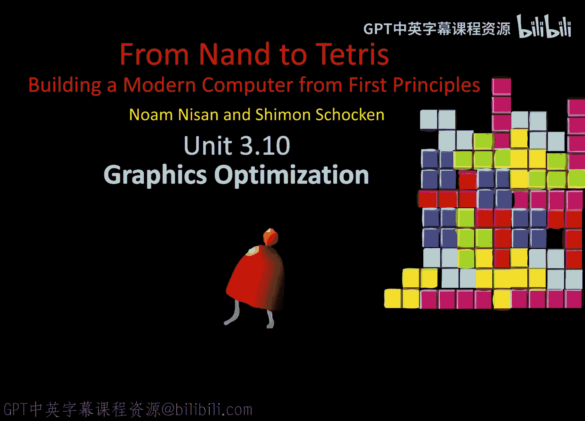
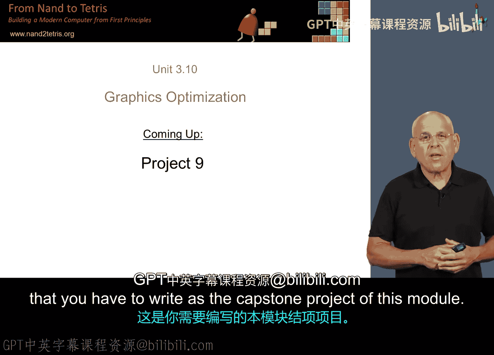
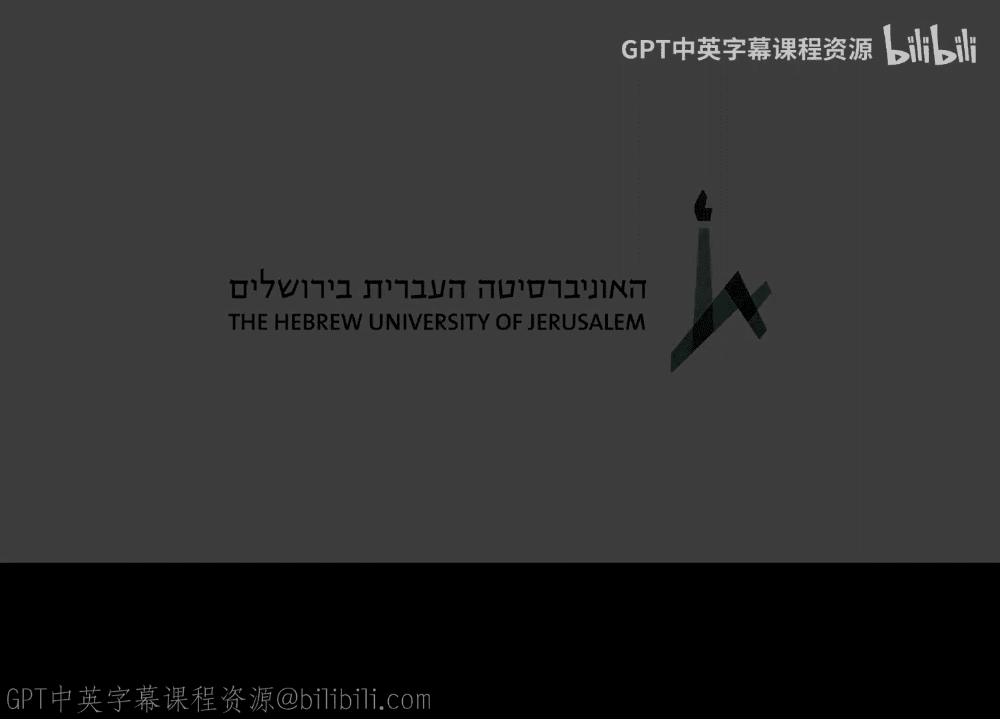

# 从零开始构建现代计算机2：单元3-10：图形优化 🎨

在本单元中，我们将学习如何通过绕过操作系统，使用自定义代码来实现高性能图形渲染。我们将探讨精灵（Sprite）的概念，并学习如何高效地在屏幕上绘制不规则图形。

## 概述

上一单元我们介绍了方块舞应用程序，它涉及非常简单的图形图像——一个正方形。在许多应用程序中，我们需要使用更复杂的图形，例如不规则的多边形。当需要创建高性能图形时，我们可以使用一些技巧，这些技巧将在本单元中展开说明。

## 精灵与挑战

我们看到了方块舞，你可能也有机会查看太空侵略者应用程序。如果你仔细观察构成太空侵略者的图像，你会看到这里各种生物，比如外星人、射击者和子弹。再看另一个应用程序，比如“Band”，如果你关注这个应用程序的图形构建块，你会发现这个迷宫是由一些基本图像的重复图案组成的。总的来说，所有这些图像通常被称为**精灵**。

精灵是一个二维位图，通常作为较大场景中的单一图像或重复图像。作为应用程序开发者，我们需要关注两件事：首先，如何快速绘制精灵，这在精灵是不规则形状、不适合标准绘图例程时并不明显；其次，如何以平滑且用户可接受的方式移动这些精灵。

## 实现图形的两种方法

有两种基本方法可以实现图形：一种是使用主机操作系统的标准方法；另一种是，当操作系统的能力达到极限时，你可能需要开发自己的自定义代码。本单元的主要内容就是关于如何绕过操作系统，利用自己的技能进行图形处理。

## Hack计算机的图形基础

你最终在Jack中创建的图形将在Hack计算机上执行。Hack计算机配备了一个32K的RAM。从项目0中你可能还记得，计算机的组织方式使得有一个8K的地址空间专门用于屏幕内存映射，还有一个单字内存映射专门用于键盘。我们可以将屏幕和键盘连接到这两个内存映射上。

计算机还具有一个持续的刷新周期，该周期根据屏幕内存映射的内容刷新物理屏幕。因此，如果你想在屏幕上绘制某些内容，你必须写入Hack RAM。

## 深入了解屏幕

让我们更仔细地看看屏幕，因为这是本单元的重点——Hack屏幕上的图形。屏幕是一个由256行、每行512像素组成的网格。如果我想在屏幕上的某个位置绘制三个像素，那么我必须在屏幕内存映射中的某个地址写入数字7（即二进制的111）。我选择了一个任意的地址`919003`，它可能对应于我们在屏幕上看到的内容。

如果我们想看到更多像素，比如16个像素，那么我们必须去同一个地址并写入数字`-1`，在二进制中就是16个1。因此，每当你想在屏幕上渲染某些内容时，唯一的方法就是在程序控制下向RAM、向屏幕内存映射中写入内容。如果你用机器语言编写，可以直接操作；如果用Jack编写，则必须使用Jack命令。

## 使用Jack命令操作图形

那么，我们如何使用Jack命令来实现呢？首先，我们很幸运有一个名为`Memory`的类，它是我们操作系统的一部分。在`Memory`类中有两个函数叫做`Peek`和`Poke`，它们使我能够做到我刚才描述的事情。我可以使用`Peek`和`Poke`来选择内存中的特定地址，要么获取存储在该地址的数字值，要么通过使用`Poke`来更改这个值。

以下是一些例子：如果我写代码`let x = peek(19003)`，`x`将被设置为7，这是二进制`111`的十进制值。如果我说`poke(19003, -1)`，那么这个字将不再是7，它会变成`-1`，即二进制中的16个1。因此，我可以使用这两个操作来控制RAM。这是一种方法。

## 使用操作系统绘制图形

我也可以使用操作系统来绘制像素。例如，如果我想绘制你在这里看到的这个矩形，它由两行、每行三个像素组成。那么有几种方法可以做到，我可以使用`Screen`类的操作系统功能。我们有`drawPixel`、`drawLine`、`drawRectangle`。首先，我们必须决定或假设所需矩形的位置。让我们决定这些是这个图像左上角的坐标。

我们可以做的事情就是简单地绘制构成这个图像的所有像素。我们有六个像素，一次绘制一个。我们还可以使用`drawLine`例程来绘制两条各三个像素的线。我也可以使用`drawRectangle`例程来绘制这个图像。只要提供我指定的参数，就会绘制出相同的图像。因此，这里的任何一种技术都会做同样的事情。

## 处理不规则图形

绘制像这样的规则图形很容易，不是吗？那么看起来像这样的图像呢？这是一个不规则的图像，我们没有专门设计用来绘制类似内容的例程。即使我们有这样的例程，我也可以提出另一个你无法绘制的例子，等等。因此，在某些时候，我们必须处理不规则图形。

处理这些图形的一种方法是简单地绘制所有像素。我可以找出所有这些像素的坐标，并为每个像素逐一绘制。在这个特定的例子中，我最终将使用75次不同的像素绘制操作。当你考虑效率时，你不应该只从高级别开始思考，但在某些时候，你应该始终考虑低级别，即在实际的主机平台上绘制这个图像到底需要多长时间。

事实证明，在低级别上，这些像素中的每一个都需要执行你在这里看到的所有操作，没有一个操作是简单的。我已经用伪代码写出来了，操作系统将必须实现所有这些。在某些时候，我们还得把它翻译成机器语言等等。当你看着这一批命令时，如果你担心效率，那么我脑海中浮现的唯一两个词就是“哦，天哪”。

因为我们这里至少有大约40个机器操作或机器周期。因此，这个操作的效率是40乘以75，大约是3000次机器操作。为了在屏幕上绘制这个小精灵，这工作量很大。想想动画，你必须在循环中绘制这个图像成千上万次。

## 自定义绘制：更高效的方法

所以，一定有更好的方法，确实有更好的方法，我们称之为**自定义绘制**。正如你可能已经想到的，我们可以做的一件事是看看这里的图像，并意识到我们实际上是在看一堆数字，对吧？代表这些像素的二进制数字。

我们可以通过简单地写入一堆数字（这些是十进制数字）到RAM中精心选择的地址来在屏幕上渲染这个图像，然后我们会得到完全相同的效果。为了写入这些数字，事实证明需要16次`Poke`操作。因此，效率将是16次`Poke`操作。现在，`Poke`是一个高度优化的操作，因为它是一个16位操作，这对主机平台来说非常自然。因此，我相信它可以用4个机器操作来实现。所以我们有4乘以16，即64次操作，与我们之前的3000次相比，效率有了显著提高。

## 精灵的寻址方案

我们可以继续讨论自定义绘制。现在，我希望你注意，我们从不孤立地绘制这些精灵。它们总是位于主机屏幕的某个特定位置，所以我们不要忘记我们必须决定这些值的精确地址，这就是我想在接下来几分钟里讨论的寻址方案。

首先，回想一下，我们在屏幕上看到的是Hack计算机上8K屏幕内存映射的持续渲染，它一直在刷新。因此，让我们只关注内存映射，并将内存映射的地址从0重命名为8K。同时，让我们记住精灵左上角的坐标。我已经在内存映射中填充了一些位，以说明当我们在屏幕上看到这个精灵时，内存中实际看到的内容。

屏幕的第一行，即512位或像素，由内存映射的前32个字表示，它们都是零，因为那里没有绘制任何内容。这里我们看到代表下一行或下一个512像素的32个字，然后，在某个时刻，我们会到达精灵实际开始的地址，我们看到我们有一堆零，然后是一堆一，还有几个零。这些是代表头像顶部发际线的像素位。这些“一”是站在他或她头顶的头发。

接下来的32个字代表图像中的下一行像素。正如你所看到的，我们有一堆零，然后有两个一，更多零，两个一，更多零。这些“一”是头像头部的边缘，头像在这里有头发，而中间没有头发的地方就是零。如此继续下去。在某个时刻，我们到达了头像或这个位图的底行。在这里，我们看到这个人物鞋子的底部轮廓，中间有一个零像素将两只鞋子分开。

因此，你在这里看到的是右侧二维屏幕与构成主机平台内存的16位字向量之间的映射关系。

## 使用位图编辑器简化流程

因此，考虑到这一点，如果我们想绘制这个位图，我们必须执行我之前说的，进行16次精心选择地址的`Poke`操作。一切都始于某个常量`ADDR`。`ADDR`是我们想要在内存中绘制的第一个字。如果我想将其转换为绝对寻址，那么我必须将屏幕内存映射在整个RAM中的基地址（即`16384`）加到`ADDR`上。然后我还必须加上屏幕上的位置，即我想开始绘制这个头像的位置对应的计算位置。一旦我将这两个常量相加，我将得到最终会在屏幕上这个确切位置绘制头像的16次操作。

你可能会同意，所有这些计算相当烦人和繁琐。因此，当你意识到我们提供了一个为你自动完成所有这些工作的工具时，你会非常高兴。我们有一个**位图编辑器**，由Golan Perrahi（参加本课程的学生之一）提供。这是一个非常不错的小型JavaScript应用程序，可供你使用。

你需要做的就是调用这个应用程序，它将在你的浏览器中开始运行，你会看到一个16x16的网格。然后你可以使用鼠标来打开和关闭单个像素，接着点击屏幕中间的按钮，应用程序将自动生成所有必要的`Poke`命令，以在Hack屏幕上渲染你选择的图像。

因此，从这时起，你需要做的就是从浏览器复制这段代码，并将其粘贴到你的Jack代码中，瞧！你就有了自定义代码，可以直接控制你的图形，并绕过操作系统。

## 最佳实践建议

现在，如果你对主机平台的细节感到有些困惑，欢迎你再次查看项目0，我们在其中讨论了Hack计算机以及输入输出操作。但也许你不必在这上面花太多时间，因为这个小工具真的为你完成了大部分工作。当然，如果你想获得更多背景知识，欢迎你去做。

我想以一些关于使用高性能图形的最佳实践建议来结束。我的最佳建议是，在许多情况下，你根本不需要使用它。如果你只想使用一些简单的图形，你应该使用标准的操作系统服务。如果你想做一些更高级的事情，你也可以从标准的操作系统服务开始，只有当某些东西不能令你满意时，你才可以选择使用我们在本单元中所做的那些高级技巧。

特别是，如果你想进行高性能的图形动画，你可以做我们在这里展示的事情。如果你愿意接受16x16像素的精灵，欢迎你使用位图编辑器。有了所有这些，你现在可以自由地开发高级应用程序了，希望你想出的游戏或任何你想做的事情都会很酷、很令人兴奋。

## 总结

在本单元中，我们讨论了高性能图形。在下一个单元中，我们将最终讨论项目9，这是你必须编写的Jack程序，作为本模块的顶点项目。