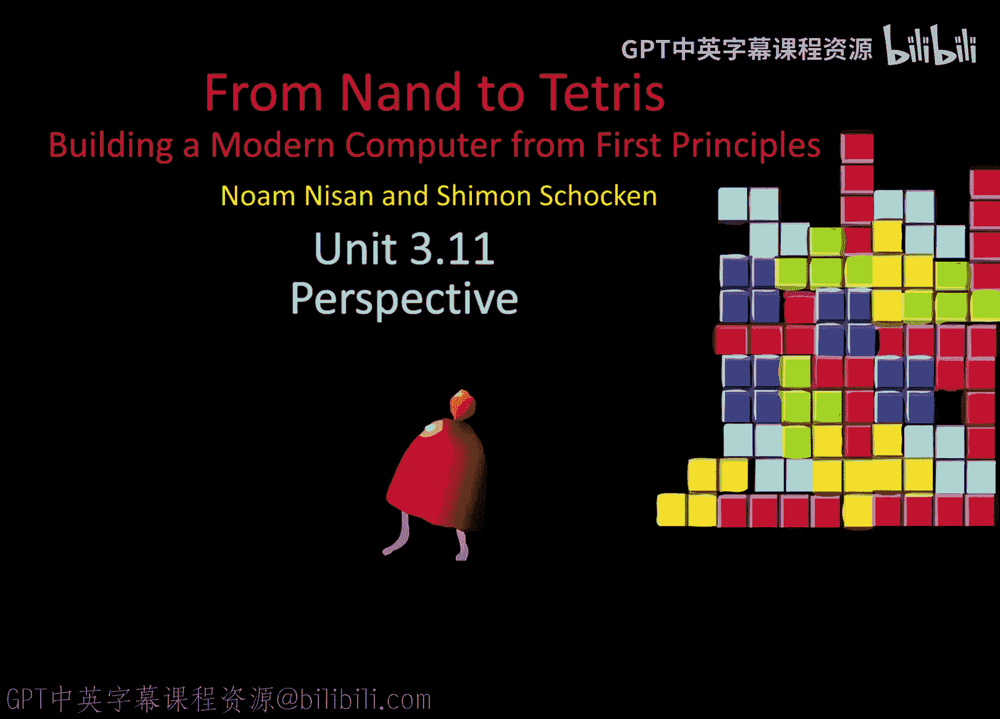
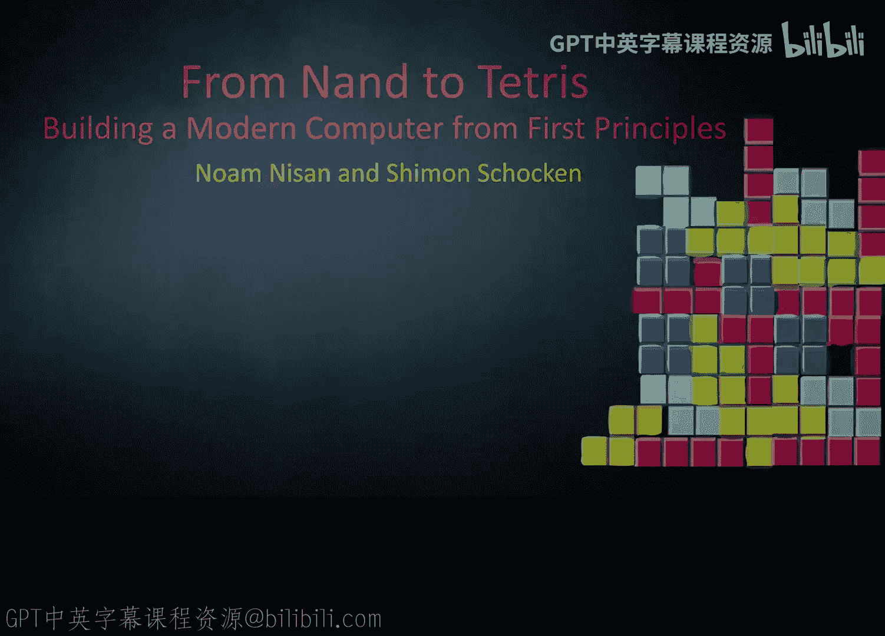

# 耶路撒冷希伯来大学《从零开始构建现代计算机2｜Build a Modern Computer from First Principles》中英字幕 p44 44_05_12_单元3-11_视角.zh_en -BV1DA4m1w7FU_p44-

Welcome to the perspective unit about high level languages， as usual in these perspective units。

 we answer frequently asked questions and so let's see which questions we have today。And。

Can you sum up the differences between Jack and the typical object oriented languages？Well。

 I assume that you refer to questions like two sorry， languages like Java， C sharpp。

 C+ Pla and so on。So Jack is actually a nice little language。

 it features most of the essential features that you would expect to see in procedural programming。

 you know， things like variables， looping， arrays， suboutines。😊，And on top of it。

 it allows constructing and manipulating objects。At the same time。

 Jack has quite a few glaring limitations。To begin with its a primitive type system consisting of three types only is well quite primitive。

And it has only two control structures， if and while。And as an object based language。

 it features no inheritance， which is one of the most celebrated features of object oriented programming。

😊，So to sum up， Jack is a nice little language that cleaves much to be desired。So， you know。

 you may be justified to wonder why didn't we add all these desired features to the Jack language？

The answer is that like many other systems and languages that we designed for teaching none to Tetriris。

 our goal was not to create powerful tools， but rather to expose just enough functionality so that you guys will capture the essence of what the tool。

 in this case， high level language is all about。So if you adopt this minimal and highly focused view or agenda。

 if you will， you realize that any additional feature which is not absolutely necessary is not really a benefit。

 it may well be a liability。In Antetriris， we strongly agree with the French author C Zupri。

 who said， among many other things， that perfection is achieved。

 not when there is nothing more to add， but rather when there is nothing left to take away。

So with that， let's turn to the next question in our frequently asked questions。

What is a weekly typed programming language？Well， strongly typed languages are quite fussy about how you declare and use variables and data types。

First of all， you cannot use the variable before you formally declare it。

 which actually makes a lot of sense。And once declared。

 there are all sorts of restrictions on how to assign to this variable values that don't agree with its declared data type。

Now， this action is sometimes called casting。And in a strongly typed language。

 casting is carefully regulated by the language and obviously by the compilers that implement this language。

And these casting restrictions are important because they prevent all sorts of possible damages。

For example， when you assign， let's say， 3。14。To a variable of type int， you're going to lose the 0。

14 fraction。And this data loss may or may not be intentional。Therefore。

 a strong typing policy makes a lot of sense and programmers should be thankful to the language that it is quite picky about it。

 Now， none of this exists in Jack in Jack， you can assign a value of any data type to a variable of any other type and the language never complains。

So as the language designers， why did we allow such a casting anarchy？Well， the answer is that。

 you know， first of all， as I said in the previous question。

 we wanted the language specification to be minimal。And regulating casting requires， you know。

 a lot of headache。In addition， permissive casting can be exploited cleverly in order to allow all sorts of the high level programming tricks that enable us to take control of the underlying hardware platform。

And this will become very handy when we will set out to develop the operating system toward the end of the course。

This OS will be implemented in J， just like UniX is implemented in C。And as you will later discover。

The weak typing of Jack will allow us to contrive， you know。

 all sorts of ingenious hacks without which we could not have written the O S using high level language。

 or at least using Jack。By the way， this is one reason why operating systems are typically developed in C++。

It's not that C++ is weak typed， in fact， C++ is a strongly typed language， however。

 it provides all sorts of mechanisms for deliberately weakening the type system whenever such weakening is intentionally desired by the programmer。

This liberal casting is very useful when you write operating systems and embedded systems and in general。

 software that runs close to the hardware level。So with that， let us move to the next question。And。

Let's see。Jack has some syntax conventions， like let and do。

That are not customary in other programming languages。Well， they are customary in some old languages。

 but not in modern ones。Why did you introduce these syntax conventions to the language。Indeed。

 in Jack， if you want to assign a value to a variable。

 you have to say let x equals 10 and not just x equals 10。And if you wish to call a sub routineout。

 you have to say do foo and not just foo as you would in a Java or Python。

These prefix tokens were introduced into the language with one purpose。

 allowing the development of elegant， simple， and minimal jack compilers。

 as you will do in the next two modules。One of the most fundamental operations of a compiler is called Parsing。

And passing is the act of analyzing the syntactical structure of the program that we seek to compile。

Now it turns out that when you attempt to pass some source code in any language。

 it always helps if the first token in the given code gives away or indicates which statement we are dealing with。

 is it a while and if a let do a return， a function declaration or whatnot？Therefore。

 although let and do are a bit of a nuisance when you write Jack code and jack applications。

 you will be quite grateful for these prefix tokens when you will have to write the parer of the jack compiler later in the course。

 in fact it will happen in the next module of NantterisPA2。😊，All right， so。

Let's see that we have more questions。 No， we had only three questions。And。

I wish to end this unit with。A comment about the jack operating system。As you know。

 the basic jack language is augmented significantly by the complete functionality of the jack operating system。

This OS is packaged as。The standard class library of the Jack language and being a class library。

 it can be extended at will。This modular and open ended architecture is very typical of modern languages like Java。

 Python and C++， for example， take Java。Now I remember that 20 years ago。

 I helped build a new computer science school at IDC Her Zah， where I'm now a faculty member。

And one decision that we made back then 20 years ago was to adopt Java as the first programming language that our students will learn in In to computer science。

Now this was quite a bold gamble because back in 1996。

 Java was completely new and it came with a very small class library。And since then， Java became。

 of course， a formidable language。 and today the Java class library contains more than 4000 classes。

And yet， during these two decades of fantastic growth in terms of capabilities and functionalities。

 the basic Java language remained more or less the same。😊。

So I hope that I managed to convey to you the beauty and utility of this software architecture。

As a language designer， you specify a simple， elegant， and compact language。

And then using the abstractstructions of classes and subouts。

 you allow people to use this language to extend itself in infinite different ways。In my view。

 this combination of simplicity， on the one hand， and infinite extensibility on the other is perhaps the most remarkable feature of modern programming languages。

So with that this is what I wanted to say in this perspective unit， of course。

 you know we could have said much more about highlevel languages。

 but time is limited so we'll end the module here and in the next module。

 we are going to begin writing our compiler， starting with passing。

