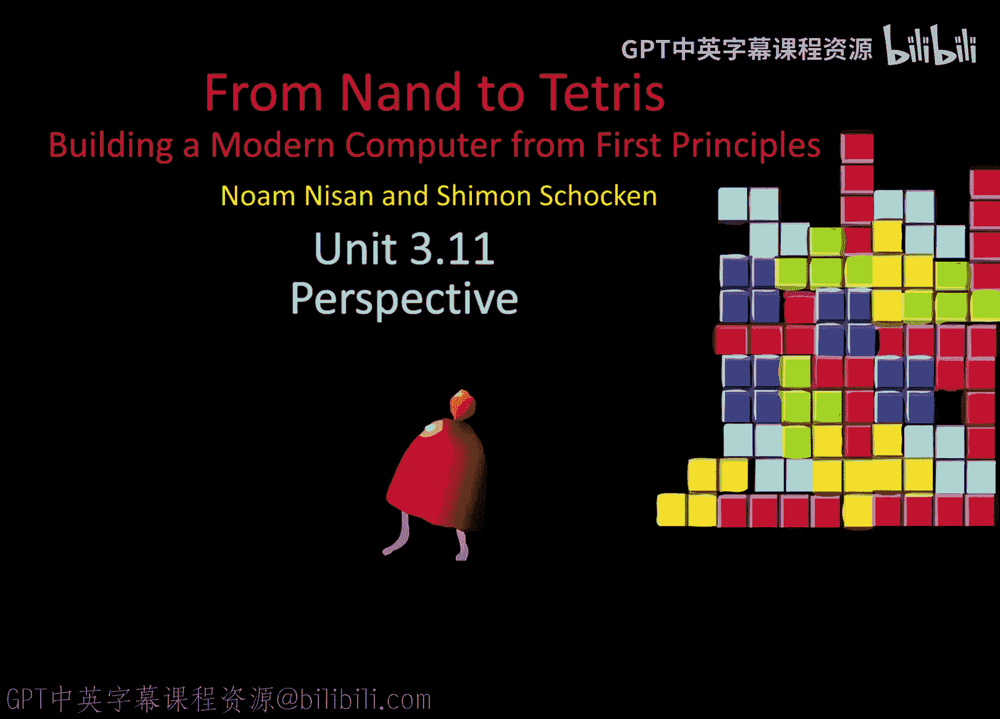
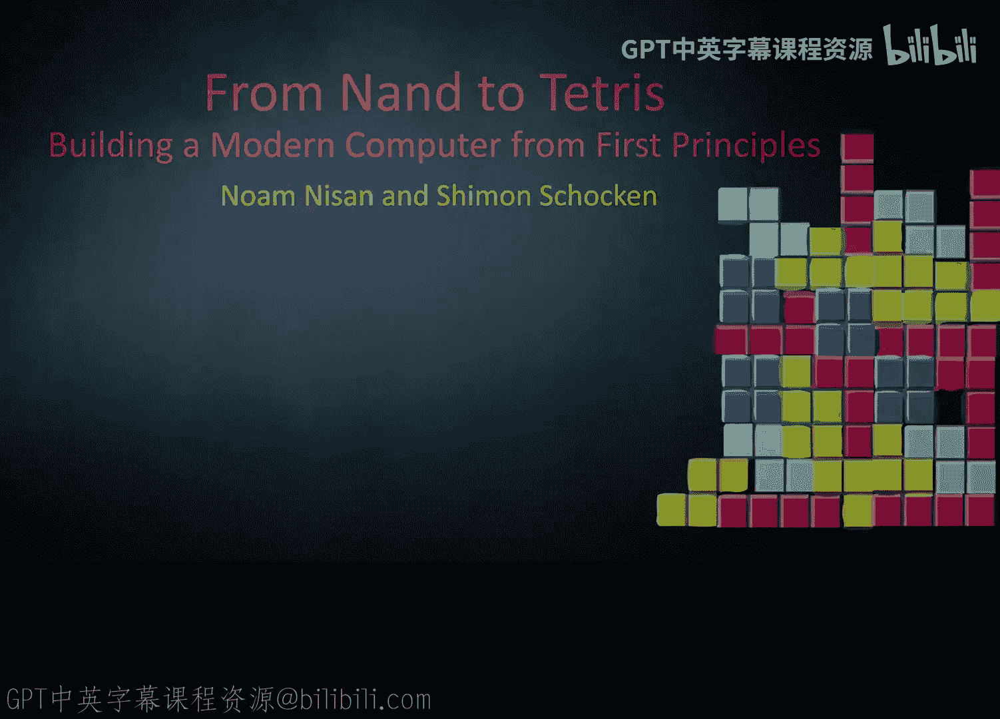

# 从零开始构建现代计算机2：单元3-11：高级语言视角 🧐

在本节课中，我们将探讨高级语言，特别是Jack语言的设计理念、特点及其与主流语言的差异。我们将通过回答几个常见问题，来理解为何Jack语言被设计成现在的样子，以及这种设计背后的教学目的。

---

## Jack语言与典型面向对象语言的差异

上一节我们介绍了高级语言的基本概念，本节中我们来看看Jack语言与Java、C#、C++等典型面向对象语言有何不同。

Jack是一个小巧的语言，它包含了过程式编程所必需的核心特性，例如变量、循环、数组和子程序。此外，它也允许构造和操作对象。

然而，Jack也存在一些明显的局限性：
*   它的类型系统非常原始，仅包含三种基本类型。
*   它只有两种控制结构：`if` 和 `while`。
*   作为一种基于对象的语言，它**不支持继承**，而继承是面向对象编程最受推崇的特性之一。

总而言之，Jack是一个不错的小语言，但仍有诸多不足。你可能会问，为什么我们不把这些缺失的特性加入到Jack语言中呢？

答案是，与我们在课程中设计的许多其他系统和语言一样，我们的目标并非创造功能强大的工具，而是**只暴露足够的功能**，以便大家能够抓住工具（在本例中是高级语言）的本质。从这个极简且高度聚焦的视角来看，任何非绝对必要的额外功能都并非益处，反而可能是一种负担。我们非常赞同法国作家安东尼·德·圣-埃克苏佩里的观点：**完美不在于无以复加，而在于无可删减**。

---

## 什么是弱类型编程语言？

了解了Jack语言的整体定位后，我们来看看它在类型系统上的一个关键设计选择。

强类型语言对于如何声明和使用变量及数据类型非常严格。首先，你必须在正式声明变量后才能使用它，这很有道理。一旦声明，对于如何向该变量赋值与其声明数据类型不符的值，存在诸多限制。这种操作有时被称为**类型转换**。在强类型语言中，类型转换受到语言及其编译器的严格监管。这些限制很重要，因为它们能防止各种可能的损害。例如，如果你将 `3.14` 赋值给一个 `int` 类型的变量，你会丢失 `0.14` 的小数部分，这种数据丢失可能并非本意。因此，强类型策略很有意义，程序员应该感谢语言在这方面的严格把关。

然而，**这一切在Jack中都不存在**。在Jack中，你可以将任何数据类型的值赋给任何其他类型的变量，而语言从不抱怨。

那么，作为语言设计者，我们为何允许这种“转换无政府状态”呢？原因如下：
1.  正如上一个问题所述，我们希望语言规范保持**极简**。而规范类型转换会带来很多麻烦。
2.  宽松的类型转换可以被巧妙地利用，以实现各种高级编程技巧，从而让我们能够控制底层硬件平台。这在课程后期我们着手开发操作系统时将变得非常方便。这个操作系统将用Jack编写，就像Unix用C编写一样。你将发现，Jack的弱类型特性将允许我们构思各种巧妙的“黑客”技巧，没有这些技巧，我们将无法使用高级语言（或至少是Jack）来编写操作系统。

顺便一提，这也是操作系统通常用C语言开发的原因之一。并非C语言是弱类型的（事实上C是强类型语言），而是它提供了各种机制，允许程序员在**有意**时故意弱化类型系统。这种自由的类型转换在编写操作系统、嵌入式系统以及通常靠近硬件层运行的软件时非常有用。

---

## Jack的语法约定：`let` 与 `do`

接下来，我们探讨Jack语言中两个独特的语法约定。

Jack有一些语法约定，例如 `let` 和 `do`，这在其他现代编程语言中并不常见（尽管在一些古老的语言中存在）。为什么要在语言中引入这些语法约定呢？

确实，在Jack中，如果你想给变量赋值，你必须写 `let x = 10;`，而不是简单的 `x = 10;`。如果你想调用一个子程序，你必须写 `do foo();`，而不是像在Java或Python中那样直接写 `foo();`。

引入这些前缀标记只有一个目的：**允许开发优雅、简单且极简的Jack编译器**，正如你们将在下两个模块中所做的那样。编译器最基础的操作之一称为**语法分析**。语法分析是分析我们试图编译的程序的语法结构的行为。事实证明，当你尝试对任何语言的源代码进行语法分析时，如果给定代码的第一个标记能**揭示或表明**我们正在处理的是哪种语句（是 `while`、`if`、`let`、`do`、`return`、函数声明还是其他），这将非常有帮助。

因此，尽管 `let` 和 `do` 在编写Jack代码和应用程序时有点麻烦，但当你在课程后期（实际上是下一个模块）必须编写Jack编译器的语法分析器时，你会对这些前缀标记**感激不尽**。

---

## 关于Jack操作系统的说明

最后，我们来谈谈Jack操作系统。正如你所知，基本的Jack语言通过Jack操作系统的完整功能得到了显著增强。这个操作系统被打包为Jack语言的**标准类库**。作为一个类库，它可以被随意扩展。这种模块化和开放式的架构在现代语言（如Java、Python和C++）中非常典型。

以Java为例。我记得大约20年前，我帮助在IDC Herzliya（我现在任教的地方）建立了一个新的计算机科学学院。我们当时做出的一个决定是采用Java作为学生学习计算机科学的第一门编程语言。这在当时是一个相当大胆的赌注，因为1996年时Java还非常新，并且只带有一个非常小的类库。自那时起，Java当然已经成为一门强大的语言，如今Java类库包含了超过4000个类。然而，在这二十年功能和特性惊人增长的过程中，**基本的Java语言却几乎保持不变**。

我希望我已经向你们传达了这种软件架构的美妙和实用性。作为语言设计者，你指定了一种简单、优雅、紧凑的语言。然后，利用类和子程序的抽象，你允许人们使用这种语言以无限种方式扩展它本身。在我看来，这种**简单性**与**无限可扩展性**的结合，或许是现代编程语言最显著的特征。

---

## 总结

本节课中我们一起学习了：
1.  **Jack语言的定位**：它是一个为教学目的设计的极简语言，包含了核心编程概念，但省略了继承等高级特性以聚焦本质。
2.  **弱类型系统**：Jack采用弱类型，允许灵活的类型转换，这简化了语言设计，并为底层系统编程（如操作系统开发）提供了便利。
3.  **独特的语法**：`let` 和 `do` 等前缀标记旨在简化编译器的语法分析器实现。
4.  **可扩展的架构**：通过标准类库（操作系统）的形式，Jack语言具备了强大的可扩展能力，这体现了现代语言“核心简洁，外围丰富”的设计哲学。

关于高级语言，当然还有更多可以探讨的内容，但时间有限，本模块到此结束。在下一个模块中，我们将从**语法分析**开始，着手编写我们自己的编译器。