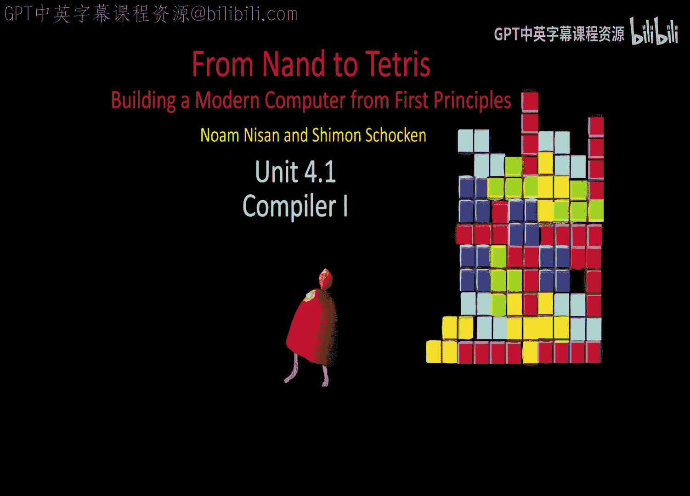
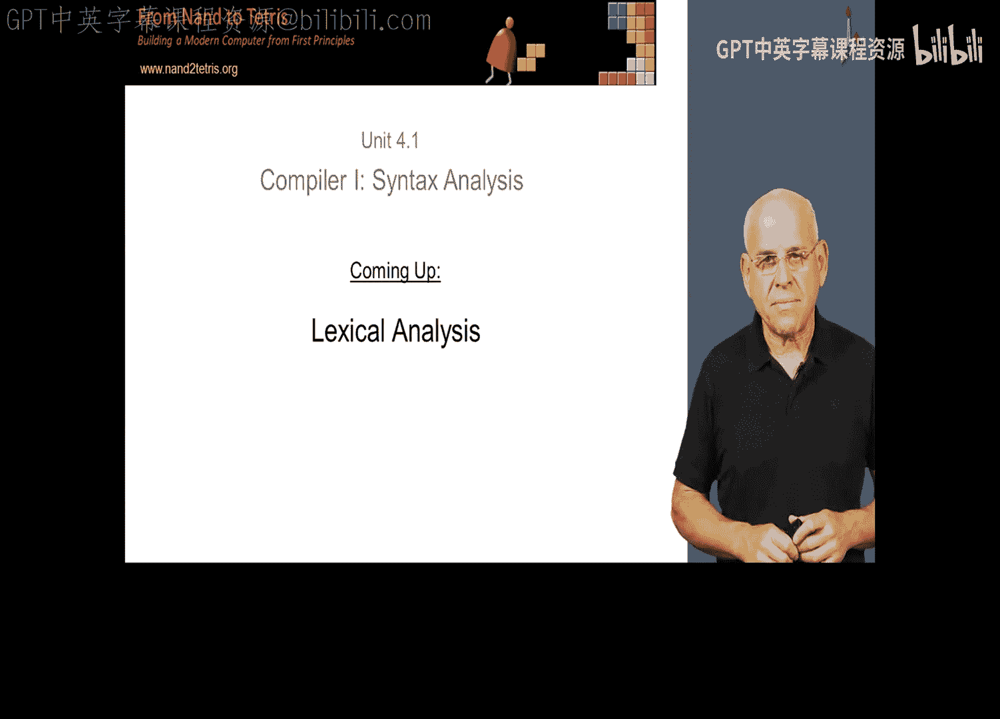

# 耶路撒冷希伯来大学《从零开始构建现代计算机2｜Build a Modern Computer from First Principles》中英字幕 p45 45_06_02_单元4-1_语法分析.zh_en -BV1DA4m1w7FU_p45-

Welcome to Module 4， in which we'll begin to learn how to write compilers。

Now the big picture is such that we want to translate high level programs into a machine code in order to be able to execute them and to enjoy the fruits of their work。

 so to speak。And here's an example of a program that I believe we've seen in the past in which we generate some points in a two- dimensional space and manipulate them to some desired end and like many modern object oriented languages。

 the program typically consists of more than one class that's perfectly okay and what we want to do is to take this code。

Compile it into machine language and then execute the executable code in order to get some meaningful results。

 And if everything works properly， the results that I will see on the screen is what the program was designed to actually produce。

Now， as we mentioned several times in the course before。

In modern or in some modern programming languages like Java C sharpp， as well as J。

 we have what is known as a two tier compilation process。

 So the program is first compiled into some intermediate code。

 which in Java is called a byte code in C sharpp， I believe it's called IL intermediate language and in Jack we simply call it a VM code。

 and then there's another process that takes the VM code and translates it into the ultimate target object machine machine language。

And。The VM translator is a solved problem。 It is something that we've already implemented in the previous two modules。

 so what remains to be done is writing the compiler。

 writing the program that translates from high level into the VM code。

 So that's what we're going to do in this and in the next module in modules 4 and5。

So here's the overall roadm。 We want to build a compiler。And Nor and I decided to。

Split this overall development， which is significant into two separate modules。In module 4。

 the existing module， we are going to develop a syntax analyzer and in the next module in module 5。

 we are going to add to it a co generator module。Now once you have two different modules there's an interesting question which is how do we test the first module in isolation from the second one so for this purpose we decided that the syntax analyzer will output an output file written in XML。

 something that well describe later on and by looking at this file you will be able to convince yourself and to certify that the sentence analyzer indeed understands the input code so to speak and。

Is doing what is necessary in order to create the code or generate the code in the next project。

 so the act of generating this output file， the XML file will be done in project 10 which will be described in the last unit of this module so for now what we have to do in this module is develop the tokenizer and the parer which together make up the syntax analyzer。

Now there are many important take home lessons from this module， tokenizing grammars， passing， past。

 and you can read on to the end of the list。And I suppose that some of you are asking yourself。

Why do I have to learn all this stuff？ I mean， I'm not going to write compilers for a living。

 I'm going to be an application programmer。 I'm going to do something and something else。

 And it's unlikely that I will ever have to write a compiler。And indeed， I agree with you。

 only a few of you will have to write compilers as part of your career， however。

 by understanding how compilers are built and by being able to write one yourself you will become a far more sophisticated and competent highlevel programmer and in addition。

 you have to understand that in today's economy， so to speak。

 we have to process numerous files that have predetermined structured format and these files come from such applications as bioinformatics。

 genetic code， you know all the way to financial information which is structured in a certain way。

 agreed upon protocols and so on， communications networks produce files that have predetermined structures and application programmers today have to routinely process these。

FC them up， convert them from one format to another。

 merge them together and do numerous things that deal with big data and with analyzing data files。

 data mining and so on in every one of these tasks， which are prevalent today。😊。

You can do it in two different ways。 One of them is the ugly one and sort of， you know， start to。

Write a program without any knowledge of doing it correctly。

 and then your program may well deliver what you have to do， but it will be very badly written。

 It will be impossible to maintain and and extend， or you can learn all these classical techniques in computer science which allow you to do your work in a way which is not only elegant。

 beautiful and satisfying， but also in a way that，Creates code。

 which is a pleasure to work with for you and for others。

 So this is the motivation for learning how to write compilers。😊。

So here once again is the overall roadmap of this module and the first thing that we are going to do is focus on writing a tokenizer。

This will be done in a larger context of compilation theory and practice known as lexical analysis。

