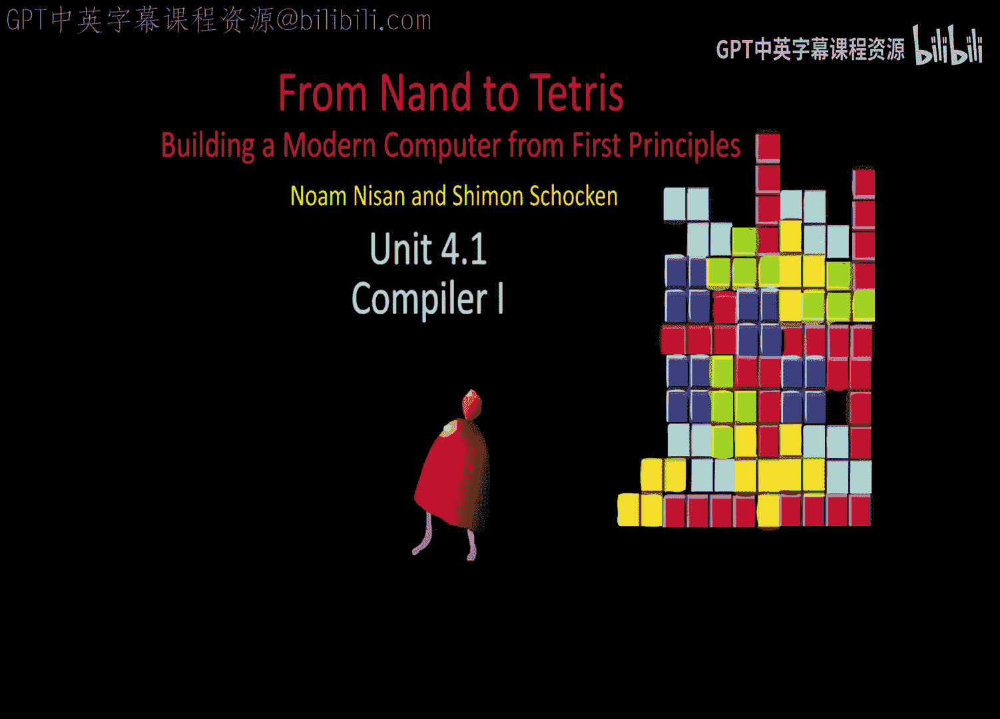
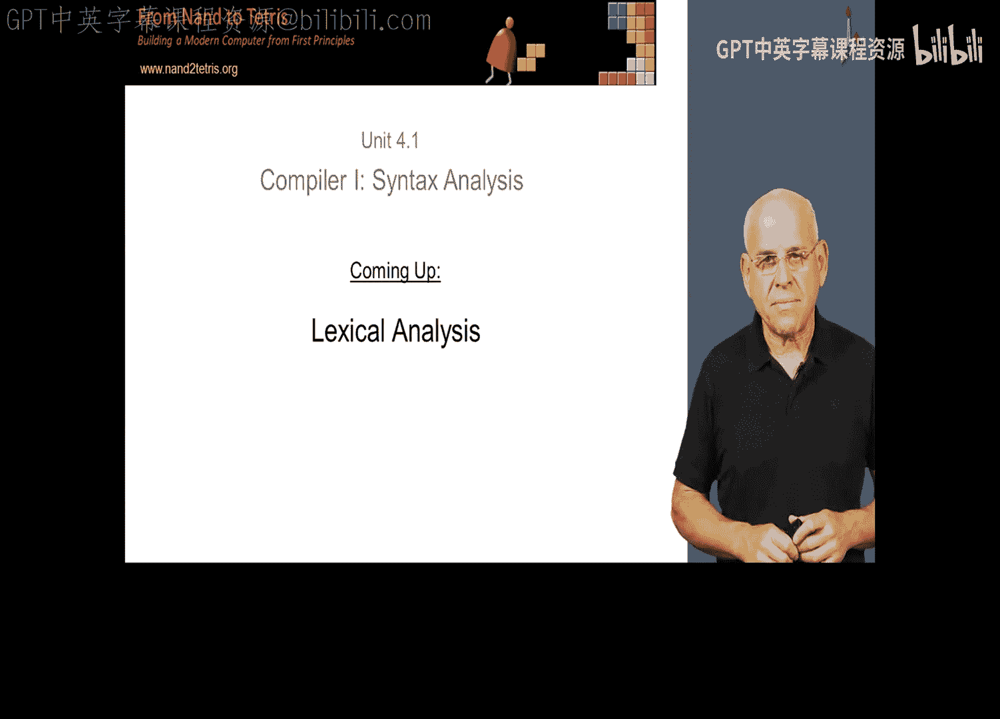

# 从零开始构建现代计算机2：4-1：语法分析

在本节课中，我们将要学习编译器的构建，特别是语法分析器的开发。我们将从宏观视角了解编译过程，并深入探讨语法分析的第一步：词法分析。

## 概述

我们想要将高级语言程序翻译成机器码，以便执行它们并获得计算结果。程序通常由多个类组成，这没有问题。我们的目标是将这些代码编译成机器语言，然后执行可执行代码以获得预期结果。

如果一切正常，屏幕上显示的结果将是程序设计所要产生的。

## 编译过程

正如课程之前多次提到的，在Java、C#以及Jack等现代编程语言中，存在一个**两级编译过程**。

1.  程序首先被编译成某种中间代码。在Java中称为**字节码**，在C#中称为**IL（中间语言）**，而在Jack中我们简单地称之为**VM代码**。
2.  然后，另一个过程会获取VM代码，并将其翻译成最终的目标机器语言。

VM翻译器是一个已解决的问题，我们在前两个模块中已经实现了它。因此，剩下的工作就是编写编译器，即编写将高级语言翻译成VM代码的程序。这将是我们在本模块（模块4）和下一个模块（模块5）中要做的事情。

## 开发路线图

我们想要构建一个编译器。Nor和我决定将这个重要的整体开发工作分成两个独立的模块。

*   在当前的模块4中，我们将开发一个**语法分析器**。
*   在下一个模块5中，我们将为其添加一个**代码生成器**模块。

现在有了两个不同的模块，一个有趣的问题出现了：我们如何独立于第二个模块来测试第一个模块？为此，我们决定让语法分析器输出一个用XML编写的文件（稍后会描述）。通过查看这个文件，你将能够确信并验证语法分析器确实“理解”了输入代码，并为下一个项目生成代码做好了必要的准备。

生成这个XML输出文件的工作将在项目10中完成，该项目将在本模块的最后一个单元中描述。因此，目前我们在本模块中要做的是开发**分词器**和**解析器**，它们共同构成了语法分析器。

本模块有许多重要的知识点，包括分词、语法、解析等。你可以在列表末尾继续阅读。

## 学习动机

我猜你们中有些人会问自己：为什么我必须学习所有这些知识？我又不打算以编写编译器为生，我将成为一名应用程序员，做其他事情。我可能永远都不需要写一个编译器。

我同意你的看法，你们中只有少数人会在职业生涯中需要编写编译器。然而，通过理解编译器是如何构建的，并能够自己编写一个，你将成为一个更加成熟和有能力的高级程序员。

此外，你必须理解，在当今的经济环境中，我们必须处理大量具有预定结构化格式的文件。这些文件来自生物信息学、遗传代码，一直到以特定方式构建的金融信息等应用领域。通信网络产生的文件也具有预定的结构。如今的应用程序员必须常规地处理这些文件，将它们拆分、从一种格式转换为另一种格式、合并它们，并执行许多涉及大数据和分析数据文件、数据挖掘等任务。

在每一项如今普遍存在的任务中，你可以用两种不同的方式来完成。

1.  一种是糟糕的方式，即在不了解正确做法的情况下开始编写程序。你的程序可能完成你需要做的事情，但代码会写得非常糟糕，难以维护和扩展。
2.  或者，你可以学习计算机科学中所有这些经典技术，它们让你不仅能以优雅、美观和令人满意的方式完成工作，还能创造出对你和他人来说都易于使用的代码。

这就是学习如何编写编译器的动机。

## 模块路线图

以下是本模块的整体路线图，我们要做的第一件事是专注于编写一个分词器。

这将在编译理论与实践的一个更大背景下完成，即**词法分析**。

## 总结

本节课我们一起学习了编译器构建的宏观过程，特别是两级编译的概念。我们明确了本模块（模块4）的目标是开发语法分析器，并了解了将其分为分词器和解析器两部分的原因。我们还探讨了学习编译器构建对于提升编程能力和处理结构化数据文件的重要性。接下来，我们将深入词法分析，开始构建分词器。