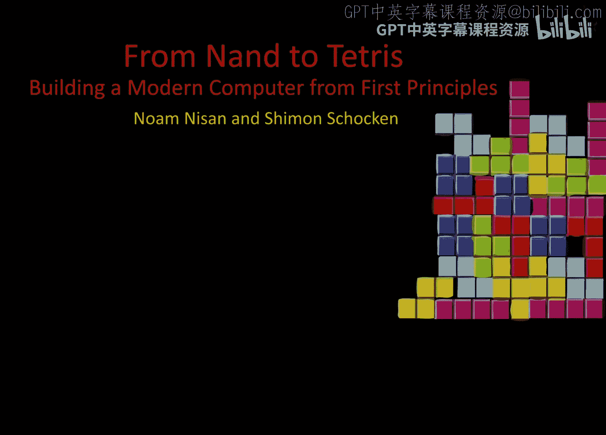
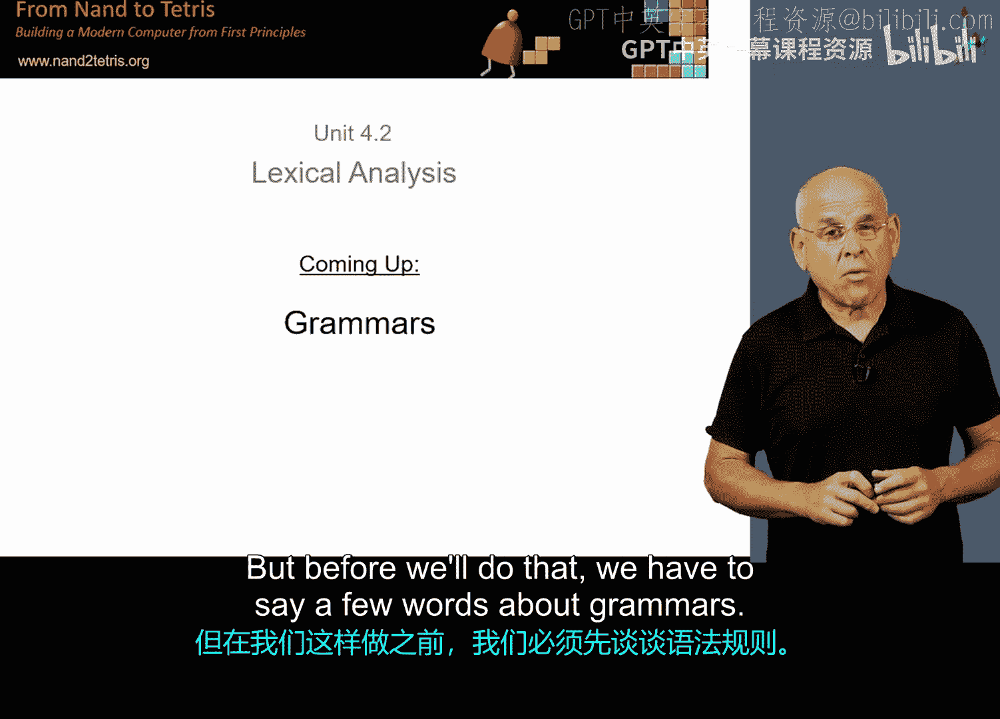
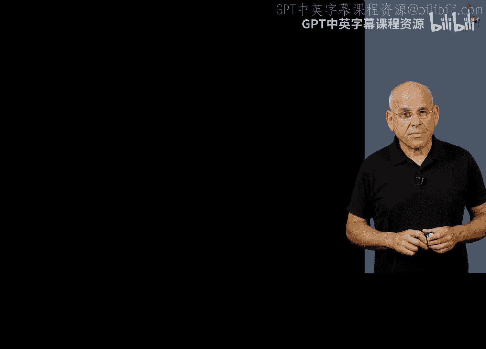

# 耶路撒冷希伯来大学《从零开始构建现代计算机2｜Build a Modern Computer from First Principles》中英字幕 p46 46_06_03_单元4-2_词法分析.zh_en -BV1DA4m1w7FU_p46-

Welcome to Unit 2 in which we're going to talk about lexical analysis。In the previous unit。

 we observed that the syntax analyzer that we are going to develop will consist of two main modules。

 a tokenizer and a parer。And the subject of this unit is the tokenizer。

And this tokenizer is an application of a more general area of theory and practice known as lexical analysis。

So here's an example of tokenizing in action。Suppose that we have this input file。

 which presumably contains a J program。Now， the first thing that I would like you to observe is that as far as lexical analysis is concerned。

 this input file is nothing more than a stream of characters。And。When we say tokenizing。

 we refer to the act of transforming this bareborn。

 primitive stream of characters into a stream of meaningful tokens。

Meaningful within the language that we are analyzing。Now。

 once we come up with this stream of tokens we can hand it over to the compiler and from this point onward we can completely forget about the original input file。

 which is very nice indeed because the original input file contains all sorts of noise like whitespace and comments which are completely irrelevant for the compiler。

 and therefore the tokenizing performs a very simple yet important preliminary processing of the file that makes compilation something that can start on the right foot。

 so to speak。All right， now what does it mean to be a token。

 well a token is a string or a sequence of characters that makes sense within the language that we are seeking to understand？

And different programming languages have different definitions of tokens。 For example。

 consider the statement， say， x plus plus。In the C language， this statement makes a lot of sense。

 Why， Because we can pass it into two meaningful tokens， X and plus plus。However。

 the very same input if we give it to a jack tokenizer will not make sense。

 well it will make sense as far as tokens go because we'll get the three tokens x plus and another plus and then later on in the compilation process someone is going to raise a red flag and say you cannot have a plus immediately after another plus because in the jack language there is no plus plus operator。

So if you have the task of writing a tokenizer， you should demand to get a very well specified documentation that says。

 you know， what does it take to be a token in the language that I'm trying to analyze？

And so in the jack language， specifically we have five categories of tokens。 And here they are。

 First of all， we have keywords of which we have about， you know，20 keyword constants。

Then we have symbols。Like， you know， times， divide and so on。Then we have integer constants。

 which are numbers that vary from 0 to 3 to 767。Then we have string constants。

 which is anything that exists within two double quotes。And finally， we have identifiers。

 which we use know to call variables， methods， classes， and so on。

 and every one of these categories is very well defined without any ambiguity or uncertainty。

And therefore， if we have to write a tokenizer， we can write a program that starts with such an input file。

And based on this lexical definition that we have here。

 we can write code that will carry out the tokenizing for us。And typically。

 the tokenizer ends up being some class or some service， some module， call it， you know。

 anything you want， depending on the language that you use to implement it。

And it will provide all sorts of useful services。 First of all， it will allow us to。

View the input as a stream of tokens。It will allow us to ask questions like are there more tokens to process。

 and if so， can you give me the next token。And can you tell me what is the value of this token。

 what is the type of this token and so on？So the tokenizer provides all these nice services。

And here's an example of a program that uses these services。So tokenize a test is a program that。

You know， constructs the tokenizer object， and then it goes on to process the input file。

 And here is here is what what it does。 It goes with the input and for every token。

 it lists the token to the output file。And it surrounds the token by two tags that describe the type of this token。

 given the Jack grammar in the Jack language。And so it does it you know all the way until the end of the file。

 and what we get is a very useful documentation of not only the tokens that we have in the program。

 but also the token types。Now this test here is not just an arbitrary example of what can be done with a tokenizer。

 this is actually exactly the way in which our parer will later on use the tokenizer。

 the information that we have here obviously is very relevant for the compiler so it's nice that we can easily generate it using the tokenizer services。

😊，And notice that once we do it， we no longer need the source code file because from now on。

 the tokenizer is going to represent the input for the compiler。

In particular we can tell this object to advance and once we do this the first token in this file will become the current token and then we can enter a loop that says as long as we have more tokens to process here's what we want to do well take a look at the desired output and notice that we have to in each line we have to output the classification of the token and we have to do it twice so I'm going to get the current token classification from the tokenizer and put it in some local variable that I call token classification and once I do this I can actually print this line to the output I print the opening tag then I print the value of the current。

The token itself then I print the end tag with the token classification。

 then I print a new line and once I do this I advance to get the next token from the tokenizer。

 go back to the loop and this will go on until we consume all the tokens from the input file。

So this is an example of writing a program that uses the services of the jack tokenizer now obviously we are going to supply to you a very specific and complete API of this tokenizer so if you're not completely sure how to invoke you know all these methods and services。

 don't worry about it， we'll have much more to say about it later on in this module。So to recap。

 the tokenizer is you know the first。A moduleule in our syntax analyzer。

 and now that we know how to group characters into tokens， we can proceed to talk about passing。

But before we do that， we have to say a few words about grammars。

 so this will be the subject of the next unit。

