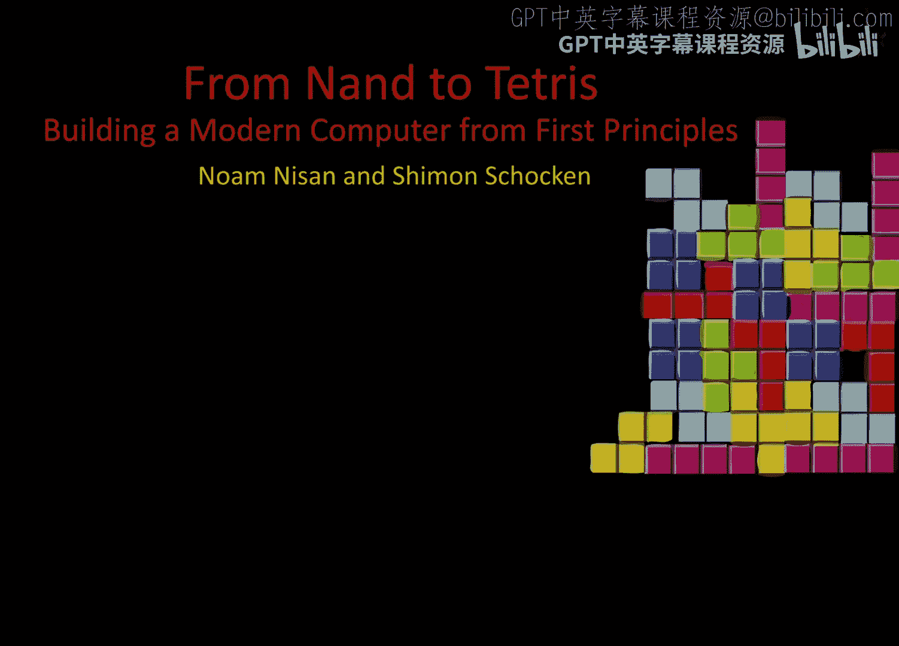
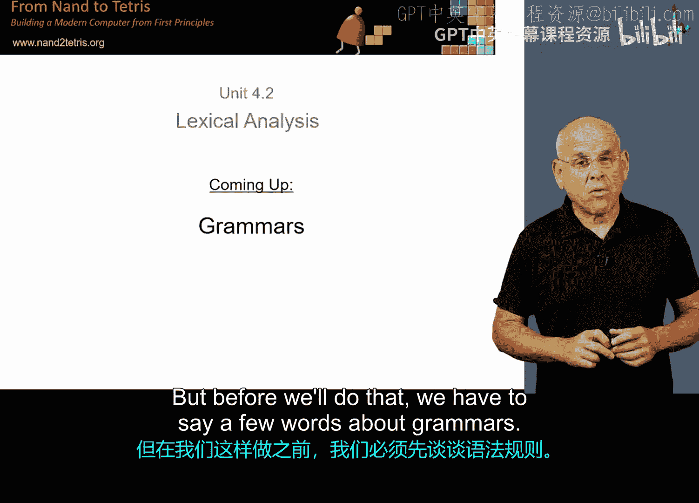

# 从零开始构建现代计算机2：4-2：词法分析



在本节课中，我们将要学习词法分析。词法分析是编译器前端的关键步骤，它负责将原始的字符流转换为有意义的“词法单元”或“标记”流，为后续的语法分析做好准备。

上一节我们介绍了语法分析器的整体结构，它由词法分析器和语法分析器两个主要模块组成。本节中，我们来看看其中的第一个模块——词法分析器。

## 什么是词法分析？

词法分析，通常由一个称为“词法分析器”或“标记器”的程序模块完成。它的核心任务是将输入的、仅由字符组成的原始数据流，转换成一个由有意义的“标记”组成的流。这里的“有意义”是针对我们正在分析的语言（例如Jack语言）而言的。

一旦我们得到了这个标记流，就可以将其交给编译器的后续阶段（如语法分析器）。从这一刻起，我们可以完全忘记原始的输入文件。这非常有用，因为原始文件包含了许多对编译器无关的“噪音”，例如空格、制表符、换行符和注释。因此，词法分析是对文件进行的一种简单而重要的预处理，为编译过程奠定了良好的基础。

## 什么是标记？

一个标记，是在目标语言中有意义的一个字符串或字符序列。不同的编程语言对标记有不同的定义。

例如，考虑语句 `x++`。在C语言中，这个语句很有意义，因为它可以被分解为两个有意义的标记：`x` 和 `++`。然而，如果将完全相同的输入交给一个Jack语言的标记器，它虽然也能将其分解为标记（得到三个标记：`x`、`+` 和 `+`），但在后续的编译过程中，语法分析器会报错，因为在Jack语言中并没有 `++` 这个运算符。

因此，如果你要编写一个标记器，必须获得一份明确的语言规范文档，其中清晰定义了该语言中哪些字符序列构成合法的标记。

## Jack语言的标记类别

在Jack语言中，标记被明确地分为以下五类：

以下是Jack语言中定义的标记类别：

1.  **关键字**：例如 `class`、`method`、`if`、`while` 等，约有20个。
2.  **符号**：例如 `+`、`-`、`*`、`/`、`=`、`{`、`}`、`;` 等。
3.  **整型常量**：范围在 `0` 到 `32767` 之间的数字。
4.  **字符串常量**：由一对双引号 `"` 包围的任何字符序列。
5.  **标识符**：用于命名变量、方法、类等，由字母、数字和下划线组成，且不以数字开头。

每一类标记都有清晰、无歧义的定义。基于这份词法定义，我们就可以编写程序来实现标记器。

## 标记器的功能与使用

标记器通常被实现为一个类或模块。它会提供一系列有用的服务，允许我们将输入视为一个标记流来操作。

以下是标记器提供的主要服务：

*   **判断**：是否还有更多标记需要处理？
*   **获取**：获取下一个标记。
*   **查询**：当前标记的类型是什么？其值是什么？

下面是一个使用这些服务的程序示例。程序 `TokenizeTest` 会构造一个标记器对象，然后处理输入文件。

```java
// 伪代码示例
tokenizer = new JackTokenizer(inputFile);
while (tokenizer.hasMoreTokens()) {
    tokenizer.advance(); // 前进到下一个标记
    tokenType = tokenizer.tokenType(); // 获取当前标记类型
    tokenValue = tokenizer.getValue(); // 获取当前标记值
    // 输出：<tokenType> tokenValue </tokenType>
    outputFile.writeLine("<" + tokenType + "> " + tokenValue + " </" + tokenType + ">");
}
```

对于输入文件中的每一个标记，程序会将其输出，并用标签包围以说明其类型。这样生成的结果不仅列出了程序中的所有标记，也清晰地标明了它们的类型。这个测试并非随意举例，它实际上正是后续我们的语法分析器使用标记器的方式。这里生成的信息对编译器至关重要，而标记器让我们能够轻松地获取它。

请注意，完成此过程后，我们就不再需要源代码文件了。因为从现在开始，标记器对象将成为编译器的输入源。

## 总结

本节课中我们一起学习了词法分析。我们了解到，标记器是语法分析器中的第一个模块，它负责根据语言规范将字符流分组为有意义的标记（如关键字、符号、常量等）。现在我们已经知道了如何将字符分组为标记，接下来就可以继续讨论语法分析了。




但在深入语法分析之前，我们需要先了解一些关于“文法”的知识，这将是下一单元的主题。