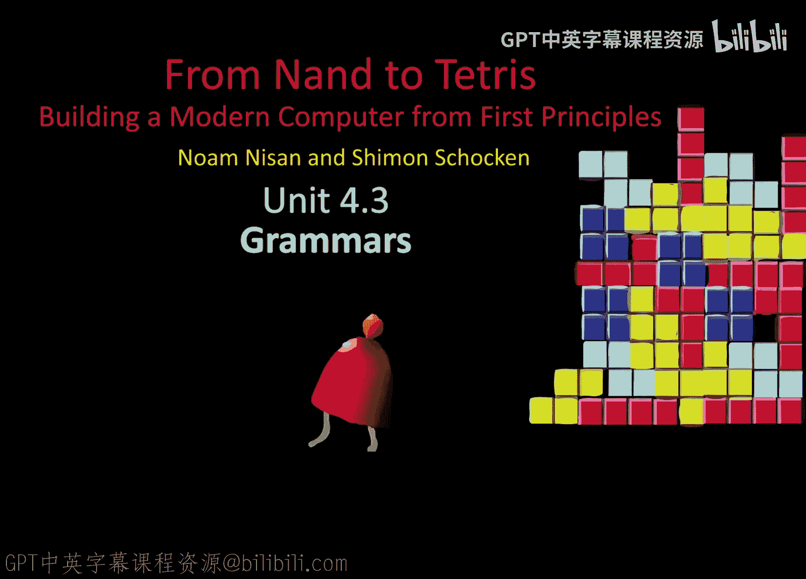
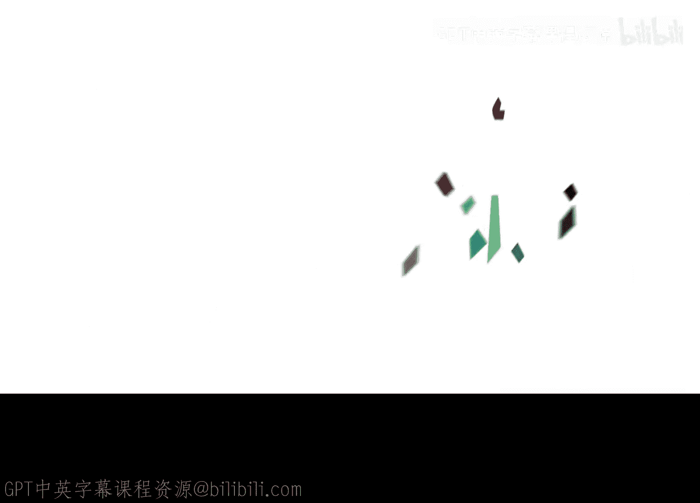

# 耶路撒冷希伯来大学《从零开始构建现代计算机2｜Build a Modern Computer from First Principles》中英字幕 p47 47_06_04_单元4-3_文法.zh_en -BV1DA4m1w7FU_p47-

Welcome to the unit about grammars。In the previous unit。

 we talked about tokenizing and we developed the conceptual ability。

To think about the program as a set of tokens。Now。I think that you will agree with me that the fact that we have a set of valid tokens does not necessarily imply that we also have a valid。

Text or evaluate the program。For example， if we deal with the English language。

 consider the following set of tokens。Red drives a he。Maybe you want me to repeat that。

 red drives a he。It means nothing， right。 Well， it means nothing。

 even though each one of the tokens is perfectly legitimate red。Drives a。And he。

 for legitimate English words。However， they don't come in the right order。

Had I said something like he drives a red car， Everything will become crystal clear。

 So it's not only。The tokens that are important， the order of the tokens is critically important as well。

And the artifact that defines in what order we can put tokens together legibly is called a grammar。

So the grammar technically speaking is a set of rules。

 each rule defines a certain pattern that indicates how tokens can be strung together in order to make meaningful sentences or statements in the underlying language。

So for example， what we see here is a subset of the English language in English， we have sentences。

And each sentence is a noun phrase， followed by a verb phrase。What is a noun phrase。

 What a noun phrase is a possible determiner， which is optional， followed by a mandatory noun。

 So notice that I use question mark to refer to something that may or may not appear in this pattern in the pattern known as noun phrase。

 What about verb phrase。 Well， a verb phrase is a verb followed by a noun phrase。

 So we see that this grammar is is quite a recursive。And then we have a set of allowable nouns。

 which are constants like you know lexical constants like dog， school dinnerina and so on。

 we have a set of allowable verbs， and we have a set of allowable determiners。

And we can add more rules and more constants to this grammar and make it as fancy as we please。

 So once again， this is just a subset of the English language， but。😊。

This subset is sufficiently rich。To support or accept such inputs as， for example。

 Dina went to school。She said。The dog ate my homework。 You。

 every one of these sentences will be accepted by this grammar。For example。

 consider the dog ate my homework。 Well， let's take a look at it there。Is a determiner。

And dog is a noun。 So we have a determiner followed by a noun。

 which taken together are a noun phrase。 So we have something that begins with a noun phrase。

 So it looks like we may have a sentence here， because a sentence is something that begins with a noun phrase。

 Then we have 8 my homework。 Well，8 is a verb。And my homework is a noun phrase。

 so we have a verb phrase followed， I'm sorry a verb followed by a noun phrase which together constitute a verb phrase。

 so taken together we have a noun phrase followed by a verb phrase and therefore we have a legitimate sentence according to this grammar。

This sentence may not be legitimate in a French grammar。

 but it is certainly acceptable by the English grammar。

 and we can do the same exercise and convince ourselves that the previous two sentences are acceptable as well。

Now， looking at this grammar， I can view or observe that it is made of， as I said， a set of rules。😊。

And these rule， these rules fall into two broad categories。 Firsts of all。

 I have terminal rules and terminal rules are rules。Whose right hand side consists of constants only。

And then I have non terminal rules。 And these are the rules whose right hand side consists of names of other rules。

 as well as。Possibly constants。So taken together， a grammar is a set of terminal and non terminal rules。

 This is an observation that will be useful later on in our work。Alright， now。

 let us shift our attention to the jack grammar， because after all， we're not。

This course is not about computational linguistics in general， it is about compilation。

 or at least this module is about compilation。So。Aject program is a set of statements。

And I want to focus on a subset of the jack language in which we have three possible statements， if。

 while and let。 So I use this bar， the vertical bar to denote choice， so。

Either an if or a while or a let is an acceptable statement in this subset of the language。And then。

 statements in plural。Are0 or more occurrences of statement in singular。

And I use asterisk to indicate0 or more。 So once again， what is statements， It is 0 or more。

Ocurnces of the statement pattern。And the statement pattern is either an if statement， while or a。

Okay， then I have an if statement， an if statement is something that begins。With a constant if。

 the token if， if you will。It must be followed by a left paran symbol， then comes an expression。

 then comes a right parran， a left curly bracket， statements， and a right curly bracket。

If you have an input which corresponds to this definition， you have a legitimate if statement。

Likewise， we define a while statement and a let statement。

 And then we go on to define the things which are still missing here。 For example。

 what is an expression。 Well， an expression is a term。

Followed by the optional pair up followed by term， why optional。

 because I use question mark to denote0 or 1 so。An expression is either a term standing alone or it's a term followed by up and another term。

What is a term， a term is either a variable name or a constant。

A variable name is a string not beginning with a digit in this subset of the language。

 a constant is any decimal number and the op is one of these symbols here。Okay， so taken together。

 what we have here is a complete grammar of a subset of the jack language。

And now we can begin to consider possible inputs and ask ourselves。Do they cut mustard， so to speak。

 they Are they accepted by this grammar， for example。Let x equals 100。Well， let's see。

It looks like it should correspond to this pattern， and indeed it starts with the token let。

And then we have x。 Now， what is x， Well I look at the grammar and I realize that the x。

Qualifies as a var name because a var name is a string not beginning with a digit and an x is a string not beginning with a digit。

 So we have a var name。Now， a var name is also a term。And I'm sorry。 All we need is the van name。

 right， because after left， we need the van name， we have it。Then according to the rule。

 we have to have an equal symbol and we do have an equal symbol。Moving along， we have the token 100。

 what is 100， well， according to the grammar。100 must be a constant because it's a decimal number。

And a constant is also a term。So what we have here is a term， I'm sorry。

And a term is also an expression。So we have an expression， and that's what the rule requires。

 right the rule expected to see an expression， and then the rule says I also expect to see a semi column and indeed we have a semi column。

So taken as a whole， this input is acceptable by the grammar。What about this input？Once again。

 we have a let pattern and let X equal。X， you know。

 is is acceptable according to the analysis that we did before。 And then we have plus one。 Now。

 what about this X plus 1， What does it mean， Well， X is a term。

And plus1 is an op followed by another term。 And if you look at the rule that defines expression。

 you will see that x plus 1 qualifies as an expression in this grammar。 So once again。

 we have something that will be accepted by this grammar。What about this input here， Well。

 let's see it looks like we have a while statement。Indeed， we have a while at the beginning。

 then we have a left brainn， very nice indeed， then we have n less than limb。

And if you will analyze it， you will see that n less than limb is a legitimate expression so so far we are okay。

 then we have a right parenthsesis， very nice indeed。

 and then we have to have a left curly bracket which we don't have in the input。

And that's where your compiler is going to throw an error message and tell you that you have a syntax error。

In your source code。All right， so here's an example of an input which is not acceptable where this grammar。

What about this input， Well here we have an if statement and we see that the if statement allows to have statements。

Within the curly brackets and statements is zero or more occurrences of statement and indeed we have here two such occurrences。

 so once again we have a legitimate input。Finally， what about this input example。

 where you're welcome to stop the tape and convince yourself that this input will also be accepted by the grammar。

 but it's a good exercise to follow at least informally what we did before and realize that this is actually the case。

So passing is the art and science of determining if a given input conforms to a certain grammar。

And notice that in the process of doing this confirmation。

 I also uncover the entire grammatical structure of the given input， because I。

I analyze how the input corresponds to the various components of the rule， and by doing so。

 I once again construct the underlying grammar grammatical structure of the input。And by the way。

 that's exactly what our brain does in some mysterious way which is increasingly becomes more and more understandable。

 but basically when we hear a sentence， we try to match it on certain patterns which are sort of wired into our brain have been wired you know from our learning of language throughout our life。

 and our brain has this remarkable capacity of understanding sentences。

 even if they don't match the grammar perfectly， if we didn't have this ability。

 all the poets in the world will be out of business but computer programs and compilers don't have this remarkable ability。

 when you deal with a compiler， the input must。matchch the grammar perfectly。

 And if there's any discrepancy， the compiler will raise its hands and say we have a syntax error。

 You have to fix your program。 So that's basically what I wanted to say about pars。

 and with that the next unit will discuss the notion of past trees。

 which is a data structure that we use in order to describe the grammatical structure of our input。

