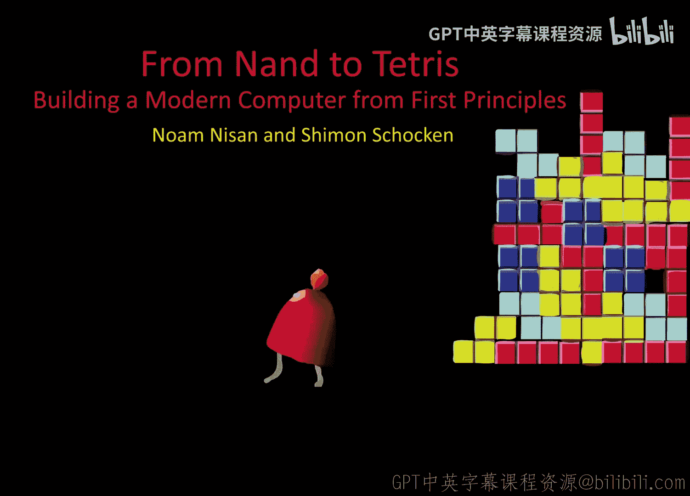
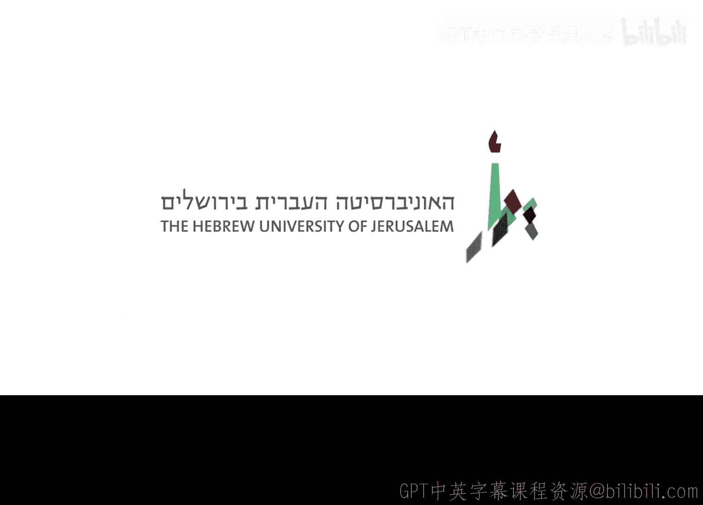

# 耶路撒冷希伯来大学《从零开始构建现代计算机2｜Build a Modern Computer from First Principles》中英字幕 p48 48_06_05_单元4-4_语法分析树.zh_en -BV1DA4m1w7FU_p48-

Poss。In the previous unit， we looked at examples of grammars。 for example。

 we looked at this simple subset of the English grammar。

And then we considered various examples of inputs， and we went in a very informal way through the art of deciding whether or not some sequence of words in the English language actually conforms to this particular grammar。

And if so， it's a legitimate sentence in the English language。

And I told you that as a side effect of this passing process。

 we also get the complete morphology or the complete grammatical structure of the given input。

And in this unit， I'm going to be very specific about what I mean by grammatical structure。 In fact。

 here it is。This is the grammatical structure of this given input。 and as you see。

 it is recorded using something which in computational linguistics is referred to as a parse tree。

And you know， a tree is a very classical data structure in computer science that begins with a root and then branches into subrees and so on and so forths。

 it's a recursive structure。And indeed， the grammatical structure of the inputs that we have。😊。

Are also recursive。In particular。If we look at this morphology here， if we look at it top down。

 it documents the fact that we have a sentence which is described using a pastory。

And this sentence consists of two subpa trees that have names like nounphse and verb phrasese。

 and any one of these subtes consists of lower level pastries and so on and so forth。

 we can continue expanding this tree。Until we get to the boundary of the tree。

Sometimes called the leaves of the tree or the terminal nodes， which in this case。

 in the case of lexical analysis， the terminal nodes are the actual tokens from which the input is constructed。

And so the grammatical structure is some sort of a superstructure that sits on top of the input and describes its lingual morphology。

 if you will。Now that's the story with a language like English and of course， a very simple。

 simple minded example。And let's move to Jack。 Well， in Jack， we have a different grammar。

And different kinds of inputs that correspond to certain subsets of statements in some programming language。

 well in the Jack language。And here's the example of the pastry in this particular case that corresponds to this particular input。

So we see that once again， we get a tree。 You know I used sort of curved lines rather than straight lines。

 but。In fact， it's exactly the same concept that we had before。Now， I'd like you to observe that。

The notion of a pasty is an obstruct artifact that sits somewhere above you know all these nice diagrams。

 and this diagram that I drew here is just one way to describe this pastory。

And in order to motivate what I just said， let us focus on some subset of this pastory that we see here and of sort of zoom in into this small pastory and notice that this pastory describes or corresponds to the input count one。

And what I'd like to show you is an alternative way of describing the very same pastory。

 and here it is。So what we have here is something called XML。

And the XML format is some you know agreed upon way to describe structured data。And basically。

 we describe the structure of the data or the structure of the items that make up the data using markup tags。

So in this example， we use some agreed upon convention that I haven't defined yet。

 but you know we can kind of guess what it is。 We document the fact that we have an expression here and the expression consists of a term。

Followed by a symbol， followed by another term。And the terms in themselves are also made up of lower level structures。

 The first term consists of an identifier。 The second term consists of an integer constant and so on。

So if I want， I can choose to create my pasty using this format that we have here。

 some agreed upon XML text。Now。I would like in closing to make two important observations。

First of all， what we see here is the XML file that corresponds to the input count plus1。

So you can imagine that if we have to create the pastory for a full blown jack program。

 we are going to end up with a gigantic XML file， and that's perfectly okay。

The second observation is that I said nothing about the process of actually constructing this file。

 You know， how do we do it， You know， whats what's the logic that I can use in order to start with this input and end up with this nice looking structured output。

 Well， this logic is exactly the subject of the next unit which is now coming up。Passing logic。

