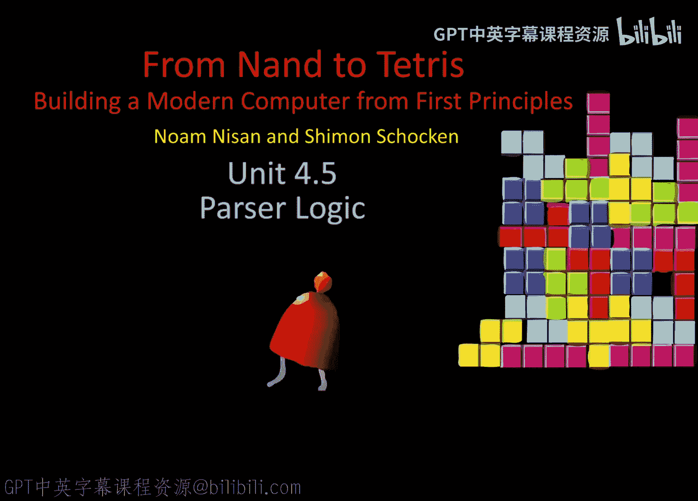
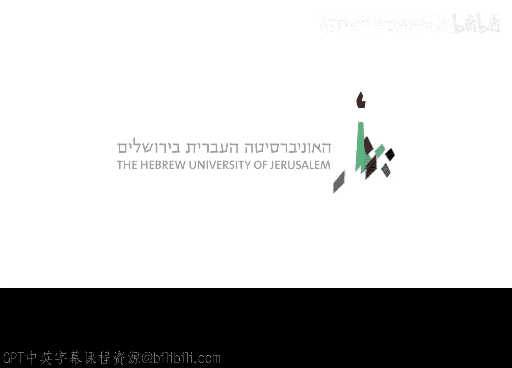

# 耶路撒冷希伯来大学《从零开始构建现代计算机2｜Build a Modern Computer from First Principles》中英字幕 p49 49_06_06_单元4-5_解析器逻辑.zh_en -BV1DA4m1w7FU_p49-

Welcome to Unit 5 in which we're going to talk about the passing logic。In the previous unit。

 we talked about pastries and we saw。Some example of English passing and Jack passing and。

I pointed out that I can draw the pastry using either a diagram like this。

 or I can also use an X Ml format。 Some agreed upon。Way to describe the structure of a given input。

 the syntactic or the grammatic structure of the input。And the question of course， as I pointed out。

 is how do we do it， you know how do we actually start with some obscure input and end up with such a nice and well structured description of what is going on in this input。

From， of course， from a linguistic standpoint。Well， I'd like to kind of fast forward and show you。

The actual code that we are going to use in order to carry out the passing， we are going to develop。

At a later point in this module， a program called Passer。

 actually the name of this module is going to be compilation engine。And this compilation engine。

Is going to consist of a set of methods。One method for almost for every non terminal rule in the corresponding grammar。

So for example， if you look at the grammar， you will see that we have a rule called statements plural。

And indeed we also have a method called compile statements， then we have a rule called if statement。

 and indeed we have a method called compile if statement and so on and so forth for most of the nonterminal rules in the grammar。

 we have corresponding methods that are responsible for passing the part of the input that corresponds to this particular rule。

There' are some rules for which we don't have specific methods。

 but we also take care of them implicitly and other rules we'll discuss this little detail later on in the module。

So to illustrate， let's focus on one of these methods compile while statement。

 which corresponds to the while statement rule。And。

Let us see how this subroutine actually works in practice。Now， in general， the method。

 or I called it Sabutin， is going to be written according to a certain logic。

 and the logic is taken directly from the rule。 So here's how we do it。

 We follow the right hand side of the rule。 And we do exactly what the pattern。

That is documented in the right hand side， dictates。So， for example。

 if we look at the while statement， it says you should expect to see the word while or the token while。

And if we find it in the input， we record the fact that indeed we found the token while。

And then the rule will say the next thing that you should expect to see is the token left parentheses。

 so we look at the input and we check， do we really have a left parenthsesises and if we do。

 we can record it in the output file。And so on and so forth。 at some point。

 we will get something like expression。 So if the right hand side specifies a non terminal rule。

 rather than a token， then we call the corresponding method。

 which is designed specifically to deal with this particular non terminal rule。So as you see。

 this whole thing is highly recursive。So we continue to recurse until we exhaust。The。

 the input and run out of tokens。 And then we know that we have completed the passing of the given input。

So how do we get started， well， we have to you know advance the tokenizer and remember。

 I should have told you that before I wish to remind you that the input is tokenized。

So I have a tokenizer to my disposal that I can exploit。 I can tell the tokenizer advance。

 I can ask questions about what is the current token and so on and so forth。

 So I advance the tokenizer。 And since the first token is while。

I know that I can call the compile while statement and let the passing begin。

 So what we will do from now on is I will give you I will walk you through an elaborate simulation of how we pass this particular input。

So let's see。 we call the compile while statement and。Subroutine， so this subroutine starts running。

And it records the fact that it starts running by writing the tag while statement。

 And then we look at the rule where the rule says that the next thing we should expect is the token while。

Well， let's see what is the current token。 It is while。 So happily。

 we record the fact that we have a while。 We look at the rule again。

 The next thing we should expect to see。 And I'm sorry after we record the token。

 we advance the input。 I should have said this before。😊。

So then we look at the next part of the rule and the rule says you should expect to see a left parentheses。

 well， we look at the current token， it is a left parenthesesis。

 so we record it and advance the input。Back to the rule。

 the rule says now you should expect to see an expression， where with that in mind。

 we call the compile expression sub routineout which starts running。

And let's look at the right hand side of expression。

The right hand I says you should now expect to see a term where a term is a non terminalmin rule。

 So we call compile term， which starts running。And the right hand side of term says you should expect to see either a var name or a constant。

And we look at the current token， indeed we have a var name。

 so we record the fact that we have a varna name or an identifier called count and we are done with and we advance。

 we advance the input and then we are done dealing with this term。

And then we go back to the rule and we see that we are done with the terms。

 so we are back to the expression。And the expression says。The right hand side。

 you should now expect to see optionally an op followed by a term。Well。

 we look at the input or at the current token and we see that indeed we have an operator or an operation there。

 right， so。Let's let's record it。 We record the fact that we have an an operator or a symbol。

 and we advance the input。Going back to the expression definition。

 we see that we should now expect to see a term。And let's see， so we call the compile term suboutin。

 which starts running。And the logic of the term says you should now expect to see either a var name or a constant。

 Well we look at the current token， and indeed， we have a constant。 So we record this constant。

 We advance the input。 We are done with the term。 We go back to the expression。

 We are done with the expression。 and we go back to the while。😊。

So now we look at the right hand side of the while。

 and it says you should expect to see a right parenthses。 We look at the current token， and indeed。

 we have a right parentheses。 So we record it， advanceance the input。😊，Go back to the rule。

 and the rule says you should now expect to see a left curly bracket。 We look at the current token。

 Indeed， it is a left curly bracket。 So we record it back to the rule。

 and the rule says you should now expect to see state min， which is， you know。

 zero or more occurrences of a statement。So， we call the。Comped statements method。And。

The compile method， compile statements method starts running。And the right hand side says。

 you should look for。A statement。And we look at the current token， the current token is a let。Right。

 so we know right away that we have a let statement。 So we call compile let statement。

And the right hand side of the rule says。You should expect to see a let token。 Indeed。

 we have a let token， so we record it。 then you should expect to see a var name。

I'm sorry we record it in advance。 You should expect to see a var name。 We look at the current token。

 Indeed， we have a var name here。 so we record the fact that we have the identifier count then we should expect to see and we advance。

 then we see we should expect to see an equal sign。 Indeed we have an equal sign。

 So we record it in advance and so on and so forth。

 Now we have an expression that we process in a similar way and at some point will be done with the let statement and let's see we be back to the statement。

 there will be no more statements to process so we be we will go back to the while。

And we see that once we finish passing the statements。

 the next thing that we should expect to see is a right cur bracket。 Indeed。

 we have a right curly bracket。 This is the right this is the current tokens。 So we record it。

 We advance the input， and we are done with the tokens。

 There are no more tokens to process and therefore。We finished passing the input。

 and we got this lovely XML file here， which describes the passing of this input。

So that's the end of the story or that's the end of the simulation and I want to kind of recap and take another look at the structure of this compilation engine module which you implements our passing logic once again it consists of a set of subroutines。

 one for each almost for every non-terminal rule in the grammar and once again I said that the handling of some rules which are the shallow or less interesting rules are handled in the context of other rules as we will see later on now let's take a closer look at the compile while statement and I would like to actually show you the code of this particular passing subroutine。

 so here it is。I'm going to use a private method that I will describe later on。Called eat， so。

I look at the grammar。 Well let me retract a little bit。

What I'm doing now is I'm putting myself in the shoes of the softwareer developer who has to develop this syntax analyzer。

And。This software developer is going to use the grammar of the language as the。

Kind of dominating recipe。For writing the code of the answerer。

So the parer or the par code is going to be informed by the grammar。And in particular。

 if I look at the grammar， I see that the grammar says you should expect to see a while。

So I'm going to call a method called eat while， which means， you know。

 you should expect now to eat the while a while token。

 and then I'm going to write some code to handle the while in particular， you know。

 if it's an XML code， I will simply write the while out with the proper tags。

And then according to the logic of the rule， I should expect to eat left parentheses。

 and I will handle it。And then I'm going to compile expression， right。

 because that's what the rule specifies or mandates to do。And then I should eat write parentheses。

 Then I should eat the and then I should。I should eat the left carry bracket and so on and so forths。

 Okay， so that's how I'm going to write the compile while statement subruin。 Now。

 what about this eat method， Well， this is a private method。

And which I'm not going to expose to users of this syntax analyzer。 And in particular。

 the method says you should expect to see。The given string， if you don't see it。

 you should throw an error and otherwise simply advance the input。So by you using this logic here。

 I encapsulate the advancing of the input and I don't have to worry about it。

 You know this the eat method is going to do it for me。So as you see。

 the code of each compile Xxx method follows the right hand side of the corresponding XxX rule。

 and each of these methods is responsible for advancing and handling all the the tokens which correspond to this particular rule。

And by having all these methods call each other recursively。

 I'm going to accomplish the passing of the given input。Now。

 I'd like to end this unit with some theoretical remarks about。

The the character of these grammars that we are using all the time。And first of all。

 I'd like to introduce the notion of an LL grammar。Now， quite frankly。

 I'm not sure what LL stands for， but I'm quite sure that one of these Ls stands for leftmost。

And an NL grammar is a grammar that can be passed by a recursive descent algorithm。

Passing algorithm without backtracking。Now what I mean by this is that this grammar is quite friendly。

 it's friendly in the sense that once you start to pass something， you never have to go back。

 you know when you make a decision that what you have is a wild statement of an if statement。

 you don't have to kind of retract your progress and and find out that you made a mistake and you had to pass it in a different way。

 so this is a very nice property of passers that make the implementation of the passer rather simple。

The next terminology that I would like to present is LLK。 Now， an LLK passer is an L L passer。

In which you have to look ahead at most K tokens before you know which rule you are dealing with。

And luckily， the parer， I'm sorry， the grammar that we saw so far was L1。

 and it's L1 in the sense that once I have a particular token in my hand， like while or let or do。

 I immediately know which rule I have to invoke。And I don't have to backtrack later on。

 So if a grammar is L1， then once again， it lends itself to parsers which are relatively easy to write。

Now， when you deal with a language like English， the situation is much more challenging。

Because English is not L L1。You know， for example， suppose I tell you something like。Lift。Well。

 we have a token， right， lift。And yet。We still have no idea what to do with this token。

Because the next word may well be something like me。Well， once we have lift me， well。

 and then I know I have a verb followed by a noun。And therefore。

 I have a statement which means lift me， know verb noun， everything is， is now clear。However。

 instead of lift me。I could also say something like lift operator。And if I say lift operator。

 then it's not。It's not a sentence。 It's just the beginning of a sentence because what I have is an adjective。

 You know， Lyft is now serving as an adjective and now operator is a noun。 and it's not a sentence。

 You know， I need to do something with this information further on。 So once again。

 you see that in this particular example， I had to look ahead to tokens before I knew which rule in the English English language I have to invoke。

 And in general， I may have to look more tokens downstream。

Before I know which rule I have and you know maybe I have to backtrack and reconsider some of the rules that I thought that I had to use in so on and so forth。

 our brain is trained to do this passing in blinding speed and it would have been extremely difficult to write a computer program to do the same because English is probably something like LL5 or6 or7。

 you know you have to look ahead several tokens before you know which rule of the English language you have to use whereas programming languages are mostly LL1。

 which makes the passing of these languages a far easier task than passing in natural language like English。

Allright， so with that， we discussed the logic of the passing process and the next thing that we are going to look at is the jack grammar。

