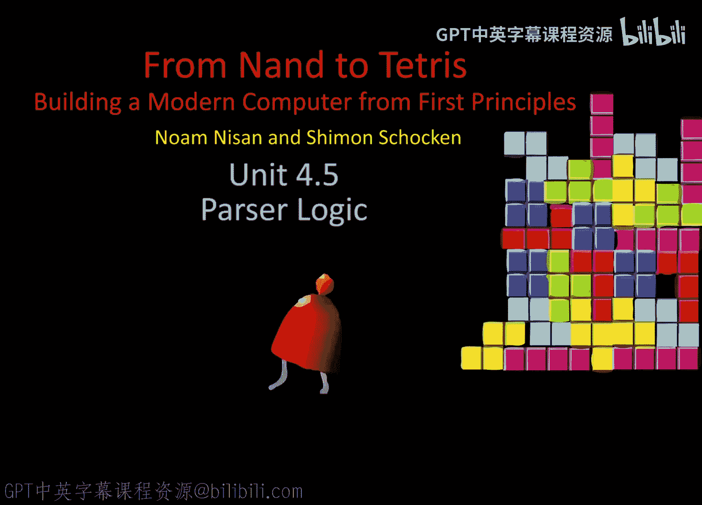

# 从零开始构建现代计算机2：单元4-5：解析器逻辑 🧩



在本单元中，我们将探讨解析器（Parser）的逻辑。我们将了解如何根据给定的语法规则，将输入的源代码（如Jack语言代码）转换成一个结构化的、描述其语法成分的树状表示（例如XML格式）。

在上一单元，我们讨论了语法分析树（Parse Tree），并看到了英语句子和Jack代码的解析示例。我们指出，既可以用图示来表示语法树，也可以用一种约定的格式（如XML）来描述输入的结构。那么，核心问题自然是：我们如何从一个原始的输入开始，最终得到这样一个结构清晰、描述输入语法结构的输出呢？

## 解析器的实现逻辑

为了解答这个问题，我们直接来看实现解析器将要用到的代码逻辑。在本模块后续部分，我们将开发一个名为“解析器”的程序，实际上这个模块的名称将是“编译引擎”（Compilation Engine）。

这个编译引擎将由一系列方法构成。**几乎对应语法中的每一个非终结符规则，我们都会有一个方法**。例如，语法中有一个名为 `statements` 的规则，相应地我们就有一个 `compileStatements` 方法；有一个 `ifStatement` 规则，就有一个 `compileIfStatement` 方法，依此类推。

这些方法负责解析输入中对应特定规则的部分。虽然有些规则没有专门的方法，但它们会在其他规则的上下文中被隐式处理，这个细节我们稍后会讨论。

### 方法的工作原理

为了说明，让我们聚焦于其中一个方法：`compileWhileStatement`，它对应 `whileStatement` 规则。我们来看看这个子程序在实践中如何工作。

总的来说，这些方法的编写逻辑直接来源于语法规则。具体做法如下：

1.  **遵循规则的右侧**：我们严格按照规则右侧描述的“模式”来编写代码。
2.  **处理终结符**：如果规则右侧指定了一个终结符（Token，如 `while`、`(`），我们就检查输入中的当前Token是否匹配。如果匹配，就将其记录到输出文件中，然后让输入前进到下一个Token。
3.  **处理非终结符**：如果规则右侧指定了一个非终结符规则（如 `expression`），我们就调用专门处理这个非终结符的对应方法（如 `compileExpression`）。

可以看到，整个过程是高度递归的。我们不断递归调用，直到耗尽输入中的所有Token，这样就完成了对给定输入的解析。

### 解析过程模拟

让我们通过一个具体的 `while` 循环示例，来模拟解析器的完整工作流程。假设输入是 `while (count < 10) { let count = count + 1; }`。

以下是解析步骤的详细模拟：

1.  **启动**：我们启动词法分析器（Tokenizer），它负责将输入分解为Token序列。第一个Token是 `while`。
2.  **调用 `compileWhileStatement`**：由于第一个Token是 `while`，我们调用 `compileWhileStatement` 方法。该方法开始运行，并在输出中写入开始标签 `<whileStatement>`。
3.  **处理 `while`**：规则说第一个应该是 `while` Token。检查当前Token，确实是 `while`。将其记录到输出（如 `<keyword> while </keyword>`），然后让输入前进。
4.  **处理 `(`**：规则说下一个应该是 `(`。检查当前Token，确实是 `(`。记录并前进。
5.  **处理 `expression`**：规则说下一个应该是 `expression`。我们调用 `compileExpression` 方法。
    *   `compileExpression` 查看其规则，发现应以一个 `term` 开始。于是调用 `compileTerm`。
    *   `compileTerm` 查看其规则，发现当前Token `count` 是一个 `varName`。记录 `count` 并前进。
    *   控制权回到 `compileExpression`。它检查规则，发现后面可能有一个可选的 `op` 和另一个 `term`。当前Token是 `<`，是一个操作符。记录 `<` 并前进。
    *   再次调用 `compileTerm` 来处理下一个 `term`。当前Token `10` 是一个 `constant`。记录 `10` 并前进。
    *   `compileTerm` 结束，`compileExpression` 也结束。
6.  **处理 `)`**：控制权回到 `compileWhileStatement`。规则说下一个应该是 `)`。检查当前Token，确实是 `)`。记录并前进。
7.  **处理 `{`**：规则说下一个应该是 `{`。检查当前Token，确实是 `{`。记录并前进。
8.  **处理 `statements`**：规则说下一个应该是 `statements`。我们调用 `compileStatements` 方法。
    *   `compileStatements` 查看其规则，寻找一个 `statement`。当前Token是 `let`，表明是一个 `letStatement`。于是调用 `compileLetStatement`。
    *   `compileLetStatement` 按照其规则依次处理 `let`、`varName` (`count`)、`=`、`expression` (`count + 1`)、`;`。每处理一个Token就记录并前进。
    *   `compileLetStatement` 结束，`compileStatements` 发现没有更多 `statement`，也结束。
9.  **处理 `}`**：控制权回到 `compileWhileStatement`。规则说下一个应该是 `}`。检查当前Token，确实是 `}`。记录并前进。
10. **结束**：没有更多Token需要处理。`compileWhileStatement` 方法结束，并在输出中写入结束标签 `</whileStatement>`。至此，解析完成，我们得到了描述输入结构的XML文件。

## 代码结构示例

现在，让我们更具体地看看 `compileWhileStatement` 方法的代码结构。开发者会以语法规则为指导来编写解析器代码。

以下是 `compileWhileStatement` 方法的一个伪代码示例：

```java
// 伪代码示例
public void compileWhileStatement() {
    // 写入开始标签
    output.write("<whileStatement>");

    // 1. 处理 'while' 关键字
    eat("while"); // 期望并消耗掉 "while" 这个Token
    // 2. 处理 '('
    eat("(");
    // 3. 处理表达式
    compileExpression();
    // 4. 处理 ')'
    eat(")");
    // 5. 处理 '{'
    eat("{");
    // 6. 处理语句序列
    compileStatements();
    // 7. 处理 '}'
    eat("}");

    // 写入结束标签
    output.write("</whileStatement>");
}

// 一个私有的辅助方法
private void eat(String expectedToken) {
    if (currentToken.equals(expectedToken)) {
        // 将当前Token写入输出（带适当标签）
        output.writeToken(currentToken);
        // 前进到下一个Token
        advance();
    } else {
        // 如果不匹配，抛出语法错误
        throw new SyntaxError("Expected: " + expectedToken + ", but found: " + currentToken);
    }
}
```

如你所见，每个 `compileXxx` 方法的代码都严格遵循对应 `xxx` 规则的右侧描述。每个方法都负责推进并处理属于该规则的所有Token。通过这些方法的递归调用，我们就能完成对整个输入的解析。

## 关于语法的理论说明

最后，我们以一些关于所用语法类型的理论说明来结束本单元。

首先，引入 **LL 文法** 的概念。LL文法是一种可以被**递归下降解析算法**（即我们正在使用的这种算法）**无回溯地**解析的文法。这意味着这种文法非常“友好”：一旦你开始解析某部分，就永远不需要回头。当你判定当前是一个 `while` 语句还是一个 `if` 语句时，你不必撤销进度、重新分析。这个特性使得解析器的实现相对简单。

其次，是 **LL(k)** 的概念。一个LL(k)解析器在确定使用哪条规则之前，最多需要向前查看 **k** 个Token。幸运的是，我们目前看到的Jack语法是 **LL(1)** 的。这意味着，只要我手中有一个特定的Token（如 `while`、`let`、`do`），我就能立即知道应该调用哪条规则，无需回溯。

这与自然语言（如英语）形成鲜明对比。英语不是LL(1)。例如，听到单词“Lift”时，你无法确定其语法角色。它可能是一个动词（如“Lift me”），也可能是一个形容词（如“Lift operator”）。你可能需要向前查看多个单词，甚至可能需要回溯，才能确定正确的语法结构。人类大脑能以惊人的速度完成这种解析，但用计算机程序实现则极其困难，因为英语可能是类似LL(5)或LL(6)的文法。而大多数编程语言被设计成LL(1)，这使得解析它们比解析自然语言要容易得多。

## 总结


在本单元中，我们一起学习了解析器的核心逻辑。我们了解到，解析器通过一系列与语法规则对应的方法，以递归下降的方式工作。每个方法负责处理输入中符合特定规则的部分，通过检查、记录Token和递归调用其他方法，最终将线性的Token序列转换为结构化的语法树表示。我们还了解到，像Jack这样的编程语言通常采用LL(1)文法，这使得其解析过程可以高效、无回溯地进行，大大简化了解析器的实现。在接下来的部分，我们将具体审视Jack语言的完整语法规则。