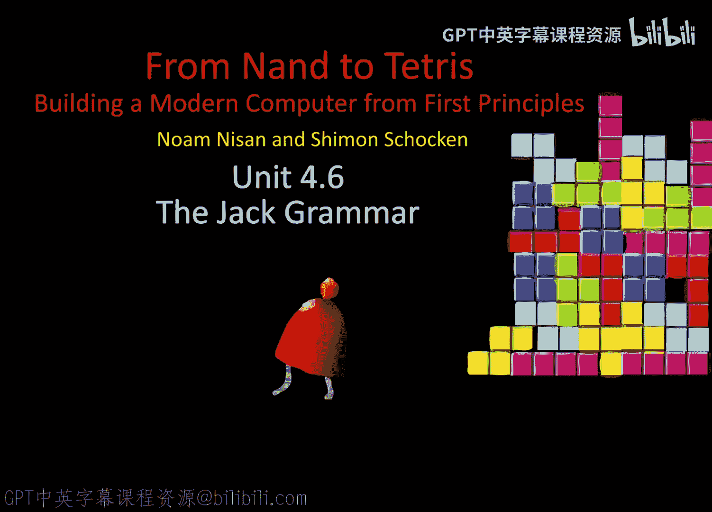

# 耶路撒冷希伯来大学《从零开始构建现代计算机2｜Build a Modern Computer from First Principles》中英字幕 p50 50_06_07_单元4-6_Jack文法.zh_en -BV1DA4m1w7FU_p50-

So up until now in this module， in the previous units。

 we discussed the notions of passing and grammars and tokenizing in a。

Rather general context and from this unit onward， we are going to talk specifically about the Jack grammar and about developing the parer and the syntax analyzer for Jack programs。

All right now。As you noticed， we use a certain notation when we describe grammars and what you see here is the subset of the jack grammar that we used all along。

And I'd like to say a few words about the notation that we used all the time without you know paying much attention to it。

 So basically here is a formal definition of the notation。

If I write something in black font and I put it within two quotes， well。

 this is a description of a token that must appear verbatim as is in the input。

And everything else is sort of meta language that describes the grammar， you know。

 all the green stuff is thescriptors that I invented or more precisely a Norman I invented in order to describe the Jack grammar。

And we're using a certain formalism here that we thought is appropriate for our purposes。

 And so we use。Prenentheses to describe groupings of tokens。

 We use a vertical bar to decide a choice between you know， different options and so on and so forth。

 We also use， as I explained before， question mark to describe something that should appear。

zero or one time and we describe and we use asterisk to describe something that should appear zero or more times。

 so these are the rules of the game， very simple， very straightforward and that's all we need in order to describe the structure of programming languages。

All right， so with that in mind， I'd like to now unveil the entire jack grammar in all its glory。

 and before I do so， I want to warn you that it may look a little bit forbidding。

 But the good news is that the only reason it looks forbidding is because I condensed it to a size that will fit on one slide。

 So here we see it。😊，And。Actually， I think Nor and I are quite proud that the whole language fits on one slide。

And if you were to zoom out from this image here， which is lifted out of the book。

 you will see that it consists of four sections and we already discussed most of what we see here。

 so what I'd like to do next is go through every one of these four sections and spend a few minutes talking about it。

Alright， so， first of all， the language has a lexicon or lexxiical elements。 And in particular。

 as we said in unit。I think the second unit in this module when we talked about tokenizing。

 we have keywords。😊，We have symbols， integer constants， string constants and identifiers。

 And these four。Terminal rules describe all the lexical elements that can go into Jack programs。

 These are the atoms or the tokens from which， from which Jack programs consist。All right。

 moving along， what about the structure of a jack program。

 Well a jack program is a collection of one or more classes。Each of these classes is stored， handled。

 and compiled separately， just like we do with Java and other object oriented languages。

And the structure of each of these classes is as follows。

And what you see here is a non-terminal rule that describes what it takes to be a class。

 so a class begins with a keyword class， then we have a class name which。

 as you will see later on is an identifier， then we have you know cur left parent which begins the definition of the class。

 then we may have you know zero or more declarations of either fields or static variables。

 so altogether we call this class deck class our deck and then we may have zero or more subroutine declarations followed by a right curly bracket。

 so that's what it takes to be a class in jack。Now drilling you know into this definition is class what is a class vardeck。

 well it's either the keyword static or the keyword field followed by a type followed by a variable name which as you will see later on is an identifier also and then I might have zero or more comma separated additional variable names。

 so I can have something like static int x comma y comma Z you know this definition here will conform to this grammatical rule。

Then we have a type you know what is a type well in Jack there are only three primitive types in K and Boolean。

 you know in Java there are eight types， so it's just a matter of you know simple a few more keywords and because Jack is an object oriented language。

Another possibility for a type is the name of a class。 So a class type。Is also permissible。

Sroutine declaration always begins with either construct function or method。

 the subroutine can be either void or a typed subroutin in other words it returns either a void or a typed value and so on and so forth okay it might have a parameter list and as you see in the rule a parameter list is a name of yet another nonterminal rule it's the next rule and indeed we see that the entire parameter list is optional we have a question mark at the end so we either have some parameter or we just have the parentheses only。

So you see a few more rules here and a few more terminals that describe what it takes to be a class name。

 subroutee name and variable name， and that's it， you know that's the definition of the program structure in J。

Okay， what else do we have Well in Jack we have statements right and this is something that we actually dealt with before in our examples。

 but basically you know we have statements which are zero or more occurrences of statement in singular。

And statement is either a let an if， a while， a do or a return。

 and for every one of these statements， we have a rule that describes it once again。

 you know all this stuff is lifted straight out of the book and I simply laid out in front of you in separate slides。

 but by now after we went through all the previous examples。

 I think that this stuff should be relatively straightforward。All right， finally。

 we have expressions。 That's the last thing that the grammar describes。And。

The expressions are similar to what we discussed in our previous examples， and expression is a term。

Followed by an optional opt term clause。And the thing that makes these expressions somewhat complex in Jack is the term rule。

 And as you see， the term rule is a little bit involved。

 much more than the simple grammar that we saw previously。 And， in fact。

 the handling of expressions is。Somewhat tricky and therefore I would like to defer it to the end of the unit。

 so please bear with me， we'll put expressions on the side and I'd like to sort of summarize what we did so far and then I'll go back to the handling of expressions。

So。To recap， we gave the entire Jack grammar。And we need this grammar because this is the recipe according to which we're going to write our parer。

And the passer is going to be a set of compile routines。

 one for almost every nonterminal rule that you see in the grammar。

 we're going to skip some of these rules because they are very shallow and I'll have more to say about it in the subsequent units but essentially we're going to have a rule for every nonterminal I'm sorry we're going to have a passing routine for every nonterminal rule。

 the passing routine would be written according to the righthand side of the corresponding rule。

 it will write the required XmL and。May call in the process yet another routine to do the same and so on and so forth。

 So here you see the sort of tight relationship， the close relationship between a grammar and a parer that operates according to this grammar。

All right， now I promise that I will handle expression separately and that's what I'd like to do next before we wrap up this unit。

So let's zoom into the handling of expressions and we see here the grammatical definition of expressions in Jack。

And the thing that makes the handling of expressions somewhat challenging is the handling of the term rule。

 you know， the rule that handles the term non terminal rule。 Now， think about it if。The expression。

 or I'm sorry， if the current token。Is an integer constant simple。If it's a string constant。

 also simple。 Likewise， if it's a keyword constant。We can easily handle it， however。

 if the current expression， I'm sorry， if the current token is a variable name。

 then it turns out that according to the rule here。

 we have several options and each one of them should be handled separately。

And here are some examples of what may sort of transpire when you have a token。

 which is a variable name。 It may be just the variable name fo， right， which is， you know。

 easy to handle， but it may also be the name of an array， right， F followed by left。

Square bracket followed an expression that evaluates to some index of this array。

It may also be full dot。And then comes a call to either a method or a function。And。We have to decide。

 you know what we have here。 So， you know， the bottom line is that we have to resolve whether we have any one of these options here。

And in order to make this resolution， we have to look ahead to the next token down the token stream。

So as a rule， you know， when you have an identifier。You cannot know immediately what you have。

 you have to look ahead at the next one and then if the next one is a left square bracket。

 you do one thing， if it's a dot， you do another and so on and so forth。

This is the only case in the Jack language where the language becomes LL2。

And you have to work a little bit more delicately to write code that takes care of these various possibilities。

 In all other cases， the language is completely L1。

 and the writing of the passer is relatively straightforward。So with that in mind。

 this is the end of unit 46 and in the next unit， we're going to talk about finally how to write the jack analyzer itself。

