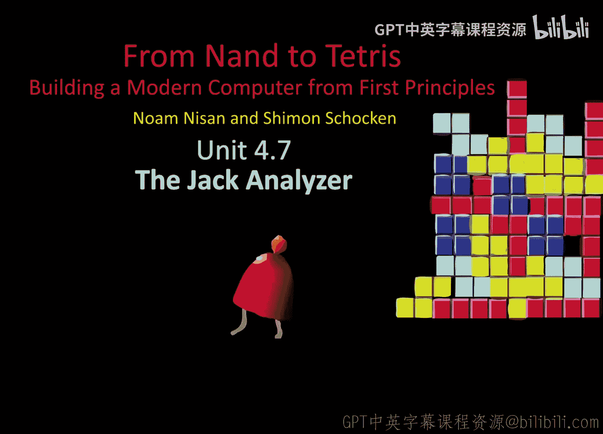

# 耶路撒冷希伯来大学《从零开始构建现代计算机2｜Build a Modern Computer from First Principles》中英字幕 p51 51_06_08_单元4-7_Jack分析器.zh_en -BV1DA4m1w7FU_p51-

In previous units， we talked in general terms about pass trees and the passers logic。

And in this unit， I would like to specify exactly what our jack analyzer is expected to output。

So once again， let's look at the general roadmap and remember that we are developing a compiler。

But in this module， we are focusing only on the syntax analyzer。

 So there's an interesting question here， which is。

 how can we unit test the syntax analyzer in isolation。

 How can we convince ourselves that the syntax analyzer understand the source code before we actually develop the capability to generate code from from the source。

 Well， the answer is we can defer the development of the code generator to a later stage as indeed。

 we do， and for now we can ask the analyzer to output。

The structured code of the source in some predetermined way。And in particular， here's what we do。

We shortcut the code analyzer， I'm sorry， we shortcut the code generator。

And instead of generating VM code， will generate。XML code and XML code is something that we discussed in the past。

 and now I will show you exactly what kind of output we expect the analyzer to emit。So。

Here's an example of some source code that we saw before。

 and here is the Xml output that our analyzer will output when it processes this particular source code and by the way。

 I use the terms Passer and syntax analyzer interchangeably and in the context of this unit and the subsequent units。

 when I say passer， I mean the passer。Which already has the tokenizer embedded in it。

So we see that the parer generates marked up output。And it is marked up according to the XML format。

And the markup actually creates a textual pastory。And。

This pastry is generated according to the Jack grammar。So why do we do this。

 We do this once again because we want to create some evidence that the parer understands the source code so that whenever the parer sees some construct in the source code。

 it will be able to say that what we have here is either an expression or a verbal name or a let statement or whatnot。

 and the parer should possess this syntactic understanding in a complete recursive way and the XML code which is also not exactly recursive but hierarchical is designed to demonstrate that the parer is well behaving。

So what I'd like to do next is go through the jack grammar and I'm not going to do it in detail。

 I will actually do it in broad terms and show you how the parer should handle inputs that are structured according to this grammar。

So， first of all。How should we handle inputs that correspond to the grammars terminal rules， Well。

 if we。Have to process an input which is either a keyword， a symbol， an integer constant。

 a string constant or an identifier， which is according to our grammar considered a terminal element of the input then we generate output that looks like this in particular let's look at an example because it is much more instructive than the general definition here。

 so if we have something like the word method or the token method。 well it's a keyword。

 So we just mark it up as keyword begin keyword end and that's it likewise if we have a symbol or an integer constant and so on we simply wrap them up in the right XmL tags and emit them to the output。

 So this is very simple。 that's what we do with inputs that correspond to terminal rules。

But what about non terminal rules， Well， we have two subsets of non terminal rules。

 and I would like to discuss these two subsets in isolation。 So， first of all。

 we have this subset of terminal rules， which constitutes。

The vast majority of the rules in the grammar， when we have inputs that correspond to any one of these rules。

 here's what we do。 Once again， we write the name of the non terminal。

And at the beginning and at the end， we write slash the same name again。 And in between。

 we are going to recursively output everything which relates to the body of this non terminalmin rule。

 And once again an example is worth 100 words。 So。Suppose that the input is the simple statement。

 returnturn X， that's it。How do I handle it Well， the par should say what we have here is a return statement。

 It should write it out， return statement。And according to the rule。

 a return statement should begin with a keyword return。 and indeed we have a keyword return。

And then we should have an expression。 Once again， the analyzer is following the grammar。

 We should have an expression， and the expression consists of a term。

 and indeed we have here an identifier X which constitutes a term in so on and so forths so。😊。

The analyzer must once again emit all the output that constitutes the body of the rule。

 and this output may well be nested because the rule is made up of other rules and so on and so forth。

 and that is why the parer must be a recursive program。Now， we have another subset of non terminals。

 which I sometimes refer to as shallow rules or rules that are not。

Terribly interesting from a syntactic standpoint。 Well。

 inputs that correspond to such shallow rules are handled。

 but the analyzer does not generate any Xml associated with them。 Let me give an example。

 Let us focus on this subset of the jack grammar that describes a let statement and a var name。

Now suppose that and I decide to focus on the var name because the var name is one of these non terminal rules that I decided not to include in my XML。

 So， for example， if I have to handle let x equal 17，I look at the let statement。

 I record the fact that I have a let statement。 I record the fact that I have a let token。

 and then according to the rule， I should have a var name， right？ However， look at the output。

 I don't say begin var name。 I skip the var name rule because I was told that I'm supposed to skip it。

 and I delve right into the identifier， which is the right hand side of the var name rule。

 So once again， just notice that。Vanim， the van name rule generates no markup。

And we decided to do it， because。Some of these rules， the rules that are mentioned here are very。S。

 for instance， one name is just the name of a rule whose body is the name of yet another rule。

So we allow ourselves to skip the passing of these simple rules because we want to try to eliminate some of the clutter that will result if we didn't take these shortcuts here。

So that's what I wanted to say about the outputs that the jack analyzer is expected to emit and notice that in this unit I didn't say anything about how the analyzer is supposed to emit these outputs and I didn't say for two reasons first of all。

 in unit 454。5， we discussed in broad terms how the analyzer is supposed to generate the outputs you know that we said that it's going to have a set of methods one for each rule that handles the corresponding rule。

And also in the next unit， we are going to give you the proposed implementation of the jack Anar and taken together these two units。

 4，5 and 48 will give you all the information that you need in order to write such a jack analyzer yourself。

