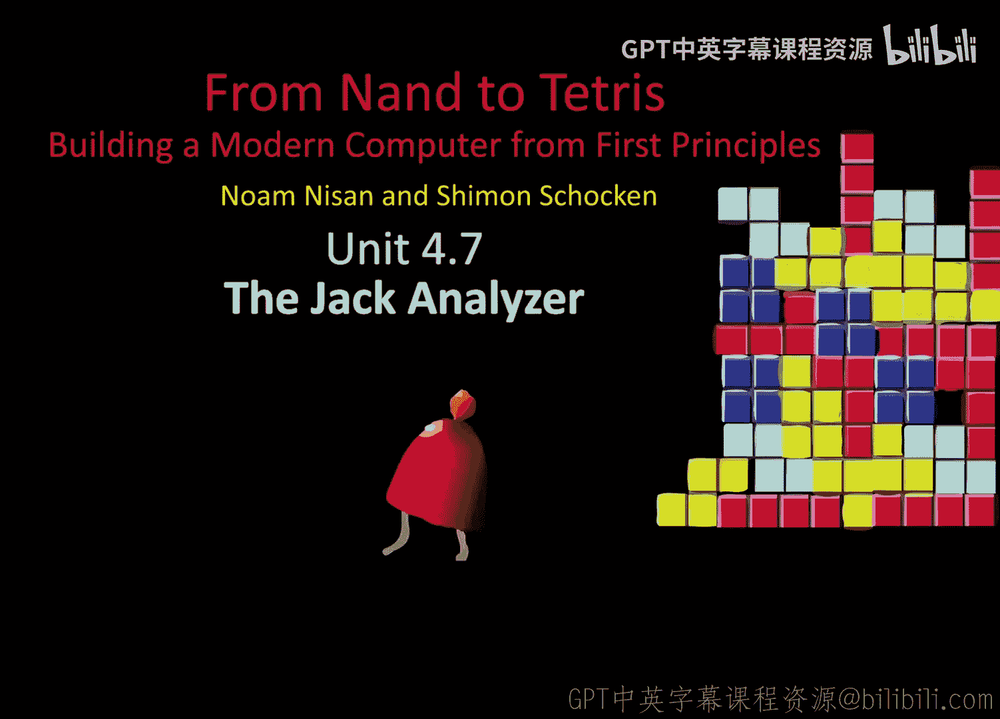

# 从零开始构建现代计算机2：单元4-7：Jack分析器输出规范

在本单元中，我们将详细说明Jack语法分析器（或称解析器）应输出的具体内容。我们将了解如何通过生成结构化的XML输出来验证分析器对源代码的语法理解，而无需等待代码生成器的开发。

## 概述

在之前的单元中，我们泛泛地讨论了语法树和解析器逻辑。本单元将具体说明Jack分析器应输出的内容。我们正在开发一个编译器，但当前模块仅关注语法分析器。一个有趣的问题是：如何独立地对语法分析器进行单元测试？如何在不生成代码的情况下，确认分析器正确理解了源代码？答案是：我们可以将代码生成器的开发推迟到后续阶段。目前，我们可以要求分析器以预定的方式输出源代码的结构化表示，具体来说，就是生成XML代码。

## 终端规则的输出处理

首先，我们来看如何处理符合语法中**终端规则**的输入。根据Jack语法，终端元素包括关键字、符号、整数常量、字符串常量或标识符。

以下是处理此类输入的方法：
*   对于关键字（如 `method`），输出格式为：`<keyword> method </keyword>`。
*   对于符号、整数常量等，只需用相应的XML标签将其包裹并输出即可。

处理终端规则的输出非常简单直接。

## 非终端规则的输出处理（主要部分）

接下来，我们讨论**非终端规则**。非终端规则可分为两个子集。首先，我们看构成语法中绝大部分规则的那个子集。

当输入符合此类规则时，处理方法如下：
*   在输出开始处写入该非终端规则的名称作为开始标签。
*   然后，递归地输出构成该规则主体的所有内容。
*   最后，写入结束标签。

例如，对于输入 `return x;`：
1.  分析器识别出这是一个 `returnStatement`，输出 `<returnStatement>`。
2.  根据语法规则，`returnStatement` 应以关键字 `return` 开始。分析器输出 `<keyword> return </keyword>`。
3.  接着应有一个 `expression`。分析器递归处理，发现表达式由 `term` 构成，而 `term` 在这里是标识符 `x`。因此输出 `<identifier> x </identifier>`。
4.  最后输出 `</returnStatement>`。

分析器必须递归地发出构成规则主体的所有输出，这些输出本身可能是嵌套的，因此解析器必须是一个递归程序。

## 非终端规则的输出处理（浅层规则）

现在，我们来看第二个非终端规则子集，我有时称之为**浅层规则**或从语法角度看“不那么有趣”的规则。

处理符合此类规则的输入时，分析器**不会生成任何相关的XML标记**。让我举例说明。

让我们关注描述 `let` 语句和 `varName` 的这部分Jack语法。`varName` 就是一条我们决定不在XML输出中包含的非终端规则。

例如，处理输入 `let x = 17;`：
1.  分析器记录这是一个 `letStatement`，输出 `<letStatement>`。
2.  记录 `let` 关键字，输出 `<keyword> let </keyword>`。
3.  根据规则，接下来应有一个 `varName`。**但是，查看输出示例，我们不会输出 `<varName>` 标签。** 我们跳过了 `varName` 规则，直接深入处理其右侧的标识符 `x`，输出 `<identifier> x </identifier>`。

再次注意，`varName` 规则不生成任何标记。我们决定这样做，是因为此处列出的一些规则（如 `varName`）在结构上非常简单（例如，一个规则的名称只是另一个规则主体的名称）。我们允许自己跳过解析这些简单规则，以避免如果不采取这些快捷方式可能产生的一些冗余输出。

## 总结

本节课我们一起学习了Jack语法分析器应输出的具体规范。我们了解到，分析器通过生成反映Jack语法结构的XML输出来证明其对源代码的理解。对于终端规则，直接输出带标签的内容；对于主要的非终端规则，递归输出其完整结构；而对于一些浅层规则，则选择跳过其标记以简化输出。在单元4.5中，我们已从宏观上讨论了分析器生成输出的方法（即为每个规则配备一个处理方法），下一个单元将提供Jack分析器的参考实现。结合这两个单元，你将获得编写自己的Jack分析器所需的全部信息。