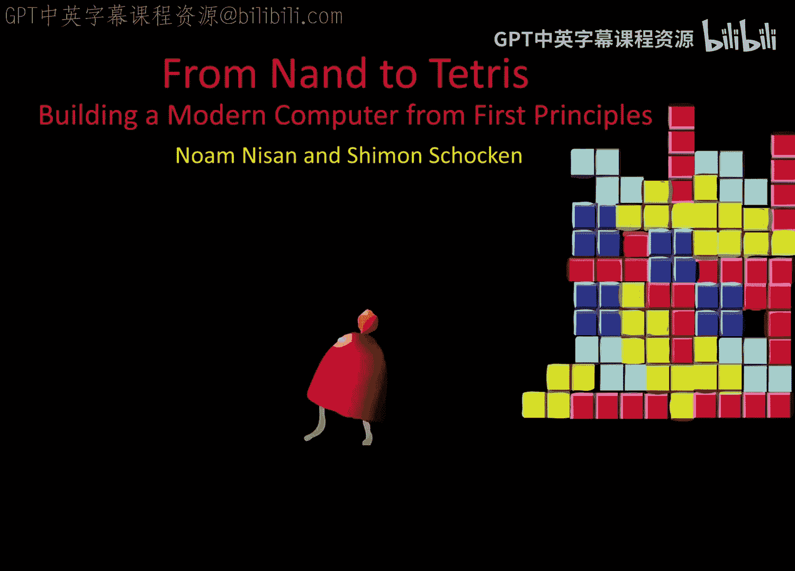
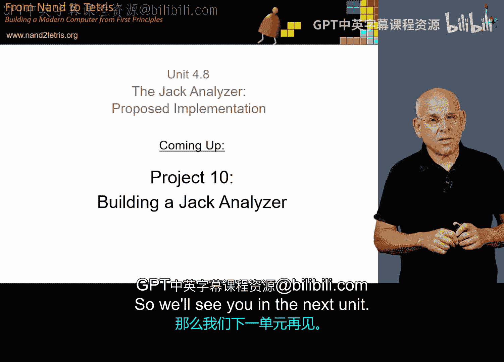

# 耶路撒冷希伯来大学《从零开始构建现代计算机2｜Build a Modern Computer from First Principles》中英字幕 p52 52_06_09_单元4-8_Jack分析器建议实现方案.zh_en -BV1DA4m1w7FU_p52-

Up until now， we talked about syntax analysis in general using Jack as an example。

In this unit and the next one， we are going to actually roll our sleeves and build a jack analyzer。

And to remind you， our overall objective is developing a compiler。

We decided that we will split the development of the compiler into two separate projects in the current project。

 we are developing a syntax analyzer in the next project and in the next module we'll develop a co generator。

And we had faced this challenge of unit testing the syntax analyzer in isolation from the rest of the system。

 and we decided that in order to do it， we are going to have the syntax analyzer generate an XML code。

An XL code file and by looking at this file we'll be able to tell whether or not the syntax analyzer is well behaving and well have a more operational and specific definition of well behaving in the next unit when we talk about Project 10 in detail。

So the syntax analyzer that we are going to develop is going to consist of three modules。

 at least this is the implementation that we propose that you use。

 so we' are going to use a jack tokenizer module， a compilation engine。

 and an overall kind of main program called a jack Anar which is going to drive the show。

And what we'll do in this unit is we'll discuss each one of these modules and give its API so that you'll be able if you want to follow our implementation and develop your analyzer。

All right。 I think it's， it makes sense to start from the end。

And illustrate how we actually use the jack analyzer once we finish developing it。 So if。

 if this language， I'm sorry， if this program would have been written， say in Java。

 then from the shell， I would write the name of the program， which is Jack analyzer。

 and I will supply it。With some input and the input could be one of two things。

 it could either be the name of some file dot jack， you know something like my program dot jack。

 or it could be the name of a directory that contains actually zero or more such jack files。

And the output， in the first case， if it's a single J file。

 the output will be an XML file that has the same prefix， the same file name do Xml。

And if the input were a directory name， the output would be。You know。

 one XML file for every jack file in the input directory。 and we're going to store everything within。

 within the same directory that we were given。So this is the desired behavior of our J analyzer。Now。

 here's an example of what this program will actually do if we give it this particular input。

 it will end up producing this particular output。And。How will it do it， Well。

 the jack analyzer is going to use the services of a jack tokenizer。And everything。

 both the tokenizer， I'm sorry， both the tokenizer and the compilation engine that we haven't discussed yet are going to be developed by you according to the Jack grammar and according to all the guidelines that we gave before in this module。

In particular， you know， this is the main document that guides our work， right。

 This is the Jack grammar。And if you recall， the first section of the ja grammar describes the lexicon of the language or describe the kind of。

Tokens that the language recognizes。 And we said that we have five categories of tokens。

 you know keyword symbol。And so on。 And so the jack tokenizer is going to be responsible for handling such tokens。

And the rest of the grammar will be handled by the compilation engine。

So what we'll do from now until the end of this unit is discuss these two modules we'll first talk about how to develop a tokenizer and then we'll talk about how to develop the compilation engine。

Now， if you go back to this example that we had before。You have to realize that the tokenizer。

Operates in the context of the compilation engine。So the compilation engine uses the services of the tokenizer。

And therefore， you know， we can， for example， we can focus only on the tokens in the XmL output and these tokens。

Will be handled by the tokens。 So what we see here is the part of the output， which is。

Handed by once again by the tokenizer。And let me shorten this example to make some space on the slide。

And once again， the code that is going to create these tokens is going to be informed by this part of the grammar that deals with the lexical elements of the language of which we have five right keyword symbol。

 integer constants and so on。So theject tokenizer， as we mentioned。

 I think in earlier units is some sort of a service that allows us to ignore the white space in the input。

 it allows us to advance the input one token at a time and ask all sorts of questions about the current token。

So if you think about it， the tokenizer encapsulates the input， you know， once we have a tokenizer。

 we no longer have to worry about the actual input file。It is completely hidden from us for us。

 the tokenizer is the input。 You know， we can advance the tokenizer。

 We can ask questions about the current token and so on and so forth。 So at the end of the day。

 if I fast forward this discussion。 The tokenizer will be some sort of a module。

 software module that has a constructor。 And then it has a bunch of methods that will describe。

Whose API will be given in just a minute。And， you know， these methods it names like Hesmo tokens。

 advanced to the next token， token type and so on。So writing this tokenizer is a matter of you know writing a program or a class you know。

 if you write in a language like a Java or a C sharpp or C++， you write a class。

That has these bunch of methods， and the class。Uses the input as the input file as its input。

 and it goes through the character and groups them into tokens and so on and so forth。And you know。

 I think that the most challenging method here is advance。

 because advance is the method that groups characters into tokens and figures out also you know what type of token we have here。

And this is。Not。A terribly complex thing to do。 But you do have to think about some contingencies。

 for example。啊。You know， the fact that you have a bunch of characters with no space in the middle。

Does not necessarily mean that you have only one token。 You can have several tokens there。

For example， take a look at get X。 So we have G， E， T X， left paren， right paran。

 and only then we have a space。In the input stream。

And you know that what we have here is actually three tokens。 get x is one token。

 Left Paran is another token。 right paran is a third token。

The tokenizer has to be smart enough to distinguish between these three tokens。

So one advance will give me get x， another advance will give me left paran。

 and the next advance will give me right paran and so on。So how do I figure it out， Well。

 I use the grammar as my。Overarching guide。And。Let's see。 you know， I start with the character G。

And then I look at the next character。 It's E。I happily append it。 Well。

 let's assume that I start with the character， G， And I know that I'm now starting to build a token。

So then I have an E。 I appended to what I had previously。 Then I have a T。I append it happily。

 I have an X。 I append it， and then I have a left parnne。

Where left Peren is not a legitimate part of。A。An identifier。Right， in fact。

 left parentnne is a symbol。 I can check it， right， I can check that left parentan is a symbol。

 Indeed， it is a symbol。And therefore， I know that I now have a new token。

So I go back to the token that I constructed before， G ETX。And I look it up in my keywords list。

 It's not there， so it must be an identifier。 And I can make this conclusion。So I have a token， G。

 E T X。 and I know that it's an identifier。 And then the next token is kind of easy。

 It's a left paran。 I look it up in the symbols。 and I know right away that I have a symbol and so on and so forth。

 So as you see。It's not terribly complicated， but you know。

 it requires some programming effort to come up with the actual implementation。And obviously。

 you know， you're free to use you know， whatever your language is kind enough to give you in the way of string processing。

 regular expressions， you know， whatever you have。You can use it。All right。

 so here is the API of theject tokenizer。We have a constructor that receives the name of an input file and opens it for processing。

Then we have has more tokens method that has no arguments。

 it returns a boolean answering the question whether or not we have more tokens。

 then we have this advanced method which is sort of the main beef of this module。

 it gets the next token from the input。And it should be called only if indeed we have more tokens to process。

Then we have a token type method which returns a constant and the constant is one of these five constant keyword symbol identifier end constant or string constant。

 and this constant informs the user of the tokenizer， what type of token we now have。

And then we have five more detailed methods， if you will， that return turn the actual。

Value of this token of the current token。And you can read the documentation yourself。

 It's a little bit tedious and realize that。Implementing these methods is rather easy。呃，So。

You have to come up with a module that actually delivers this particular API。

So this takes care of this part of the grammar， and now we are ready to go on and talk about the compilation engine。

那呃。The compilation engine is designed just like the tokenizer using the grammar as。

 is our lead guide。And to make a long story short， I'm going to develop a class or a module called compilation engine。

The compilation engine is going to get its input from a jack tokenizer。

 So I no no longer have to worry about the original input file。 I can happily。

Ask questions about the current tokens and advance within the input and so on。

It will have a constructor and we， will skip the definition for now。

 And then I will have a sequence of。Compile。X， X， X routines，1 for。Almost every X X。

 X rule in the grammar。And each one of these routines is going to be responsible for handling all the tokens that make up。

The right hand side of the corresponding rule。Now we dedicated a whole unit unit 4。

5 for simulating the logic and the operations of the compilation engine。

 and so if you feel that you need some more guidance on how to implement the compilation engine。

 I highly recommend that you take a look at unit 4。5。And so here's the API。

 We're going to have a constructor。 The constructor will create a new compilation engine。And。

 and then the constructor is going to invoke the compile class method。

The compile class method is going to compile a complete class。In a complete class。

 if you take a look at the grammar， you will see that the complete class consists of0 or more。

Class variable declarations， you know， either statics or fields which have to be compiled。

 and then we have zero or more subroutines that have to be compiled。

 So I guess we're going to have two loops that that handle these compilations。

And then we'll have a compile subluoutin declaration， compile parameter list， compile subluin body。

Each one of these methods simply follows。The logic of the corresponding rule from the grammar。

 And I feel that， you know， we gave enough hints on how to develop them in the previous units of this module。

Then we are going to have five subroutines that deal with the compilation of the five。

Statement types in Jack。 And finally， we are going to have three subroutines that deal with the compilation of expressions and the the components of expressions。

 which are terms and expression lists and so on。That's it。 That's the API of the compilation engine。

Now， I'd like to make one one more end note about this computation engine。

The following rules in the jack grammar are not covered and are not handled by specific compile methods。

And indeed， if you look at the grammar。At the Je grammar。I believe that it consists of 21。

Nontermin rules。 If you look at the API。I believe that it consists of only 15 compile methods。

 so there are six missing rules in this accounting here。

 and these are the rules which don't have corresponding compile methods and the logic of these rules is handled by the logic of the rules that invoke them。

We don't bother to deal with these rules directly because they are kind of secondary or shallow in the role that they play in the overall grammar。

 Let me give you an example。Take a look， for example， at。Statements。

Statements is covered by a method called compile。Statements。And and this method compile statements。

 uses a loop to handle zero or more statement instances。And it determines。

 you know which rule we have or you know which rule to invoke according to the first token in each one of these of these statements。

 So if the left token is if a while， it invokes compileive， compile while， and so on。

So I'm saying all this because I want to point out that there is no compile statement method。

 You know， the first rule is not covered by a method because it's shallow and not terribly interesting。

 So we bypass this rule。And we use， you know， similar rationale to once again bypass some other rules and。

Take care of their logic。In the suboutines that actually use them。

So we are done with the proposed implementation of the jack tokenizer and the compilation engine and now let's talk about the jack analyzer module which is relatively simple because it just you know it drives the show by using the services of the far more challenging tokenizer and compilation engine that we discussed before all right so the jack analyzer is the topmost module in our program it receives either a single jack file name or the name of a directory that contains several jack files。

And for each such file， it goes through the following routine。First of all。

 it creates a jack tokenizer object。Using or I'm sorry， from the file name dot Jack， the input。

And then it creates an output file whose name is the same as the input file do XML and prepares it for writing。

And finally， it creates and uses a compilation engine that compiles the inputject organizer into the output file。

And that's it。 You know， that's what the jack analyzer is designed to do。

So with that we are done with the description of our proposed implementation of the syntax analyzer。

 we called it the J Anar， and in the next unit we are going to actually get our hands dirty and build this analyzer using some programming language like Java or Python。

So we'll see you in the next unit。

