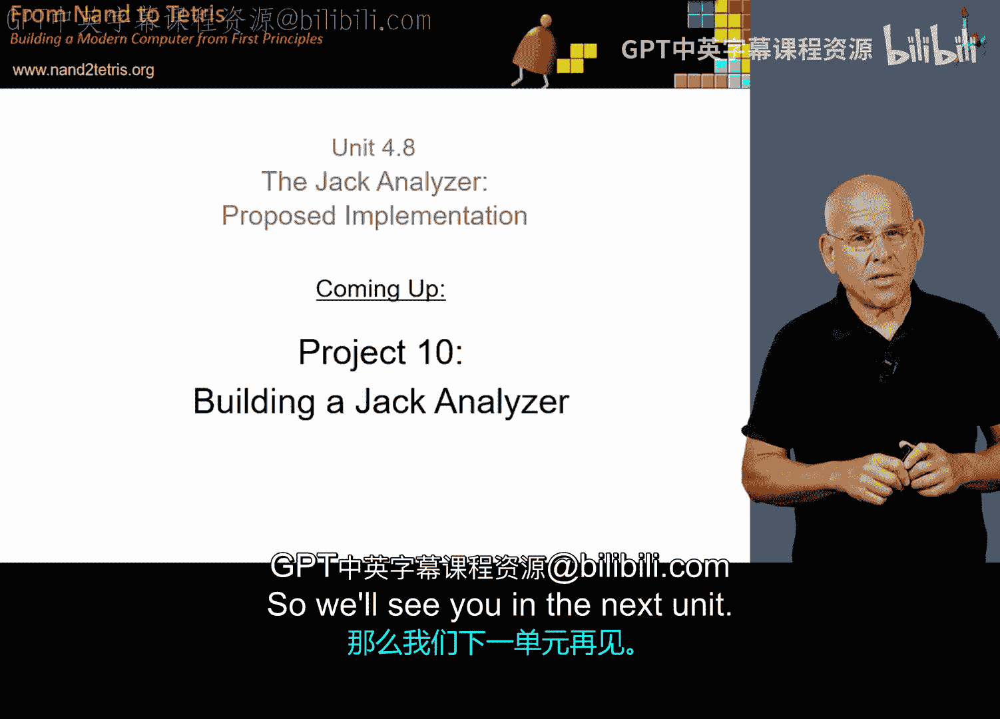

# 从零开始构建现代计算机2：4-8：Jack分析器建议实现方案 🛠️

在本节课中，我们将学习如何构建一个Jack语法分析器。我们将讨论其核心模块：Jack分词器、编译引擎以及驱动它们的主程序Jack分析器。

---

## 概述

到目前为止，我们以Jack语言为例，讨论了语法分析的一般概念。在本单元及下一单元，我们将实际动手构建一个Jack分析器。我们的最终目标是开发一个编译器，并决定将编译器的开发分为两个独立项目。在当前项目中，我们开发语法分析器；在下一个项目（模块）中，我们将开发代码生成器。

为了独立于系统其他部分对语法分析器进行单元测试，我们决定让语法分析器生成一个XML代码文件。通过检查这个文件，我们可以判断语法分析器是否正常工作。关于“正常工作”的具体定义，我们将在下一单元详细讨论项目10时给出。

我们建议的语法分析器实现将包含三个模块：一个Jack分词器模块、一个编译引擎以及一个名为Jack分析器的主程序。本单元我们将讨论每个模块，并给出其API，以便你能够按照我们的建议实现自己的分析器。

---

## Jack分析器的使用方式

首先，让我们从最终如何使用Jack分析器开始说明。假设这个程序是用Java编写的，那么在命令行中，我们会输入程序名 `JackAnalyzer`，并提供一个输入参数。

输入参数可以是以下两种之一：
*   一个 `.jack` 文件（例如 `MyProgram.jack`）。
*   一个包含零个或多个 `.jack` 文件的目录名。

输出结果如下：
*   如果输入是单个 `.jack` 文件，输出将是一个同名的 `.xml` 文件。
*   如果输入是一个目录名，将为该目录中的每个 `.jack` 文件生成一个对应的 `.xml` 文件，并保存在同一目录下。

这就是我们的Jack分析器期望的行为。

---

## 模块架构与工作流程

Jack分析器将使用Jack分词器和编译引擎的服务。分词器和编译引擎都需要你根据Jack语法和本模块之前给出的所有指导原则来开发。

Jack语法的第一部分描述了语言的词法元素（即标记）。语言共有五类标记：**关键字**、**符号**、**整型常量**、**字符串常量**和**标识符**。Jack分词器将负责处理这些标记。

语法的其余部分将由编译引擎处理。

因此，从现在到本单元结束，我们将讨论这两个模块：首先介绍如何开发分词器，然后介绍如何开发编译引擎。

---

## Jack分词器模块 🔤

分词器在编译引擎的上下文中运行。编译引擎使用分词器的服务。分词器封装了输入文件，使我们无需再关心原始文件本身。对我们而言，分词器就是输入源。我们可以让它前进到下一个标记，询问当前标记的类型等信息。

最终，分词器将是一个软件模块，包含一个构造函数和一系列方法。

编写分词器意味着编写一个类（如果用Java、C#或C++等语言），该类包含这些方法。它使用输入文件作为输入，逐个读取字符并将其分组为标记。

其中最具挑战性的方法是 `advance`，因为它负责将字符分组为标记，并判断标记的类型。这并不十分复杂，但需要考虑一些特殊情况。例如，一连串没有空格的字符并不一定代表一个标记，可能包含多个标记（如 `getX()` 包含三个标记：`getX`、`(` 和 `)`）。分词器必须足够智能来区分它们。

实现逻辑是：从第一个字符开始构建标记，当遇到不属于当前标记类型的字符时（例如，标识符后遇到符号 `(`），就结束当前标记的构建，并开始下一个标记。我们可以通过查询语法定义中的合法字符集来判断。

### Jack分词器API

以下是Jack分词器的应用程序接口：

*   **构造函数** `JackTokenizer(inputFile)`
    *   打开输入文件/流并准备进行标记化。
*   `boolean hasMoreTokens()`
    *   判断输入中是否还有更多标记。
*   `void advance()`
    *   从输入中获取下一个标记，并将其设为当前标记。只有在 `hasMoreTokens()` 为真时才能调用此方法。
*   `tokenType tokenType()`
    *   返回当前标记的类型。`tokenType` 是以下常量之一：`KEYWORD`， `SYMBOL`， `IDENTIFIER`， `INT_CONST`， `STRING_CONST`。
*   `keyword keyword()`
    *   返回当前标记的关键字。仅当 `tokenType()` 为 `KEYWORD` 时调用。
*   `char symbol()`
    *   返回当前标记的字符。仅当 `tokenType()` 为 `SYMBOL` 时调用。
*   `string identifier()`
    *   返回当前标记的标识符。仅当 `tokenType()` 为 `IDENTIFIER` 时调用。
*   `int intVal()`
    *   返回当前标记的整数值。仅当 `tokenType()` 为 `INT_CONST` 时调用。
*   `string stringVal()`
    *   返回当前标记的字符串值（不含双引号）。仅当 `tokenType()` 为 `STRING_CONST` 时调用。

实现这些方法相对简单。你可以自由使用编程语言提供的字符串处理工具，如正则表达式。

---

## 编译引擎模块 ⚙️

与分词器类似，编译引擎也以语法为指导进行设计。简而言之，我们将开发一个名为 `CompilationEngine` 的类或模块。

编译引擎从Jack分词器获取输入，因此我们无需再关心原始输入文件。它可以愉快地询问当前标记、在输入中前进等。

它将有一个构造函数和一系列 `compileXxx` 例程，几乎对应语法中的每一个 `xxx` 规则。每个例程负责处理对应规则右侧的所有标记。

我们在第4.5单元专门模拟了编译引擎的逻辑和操作。如果你需要更多关于如何实现编译引擎的指导，强烈建议回顾第4.5单元。

### 编译引擎API

以下是编译引擎的应用程序接口：

*   **构造函数** `CompilationEngine(inputTokenizer, outputFile)`
    *   创建一个新的编译引擎，并指定其输入（分词器）和输出文件/流。
*   `void compileClass()`
    *   编译一个完整的类。
*   `void compileClassVarDec()`
    *   编译一个静态变量声明或字段声明。
*   `void compileSubroutine()`
    *   编译一个完整的方法、函数或构造函数。
*   `void compileParameterList()`
    *   编译一个（可能为空的）参数列表，不包括括号 `()`。
*   `void compileVarDec()`
    *   编译一个 `var` 声明。
*   `void compileStatements()`
    *   编译一系列语句，不包含花括号 `{}`。
*   `void compileDo()`
    *   编译一个 `do` 语句。
*   `void compileLet()`
    *   编译一个 `let` 语句。
*   `void compileWhile()`
    *   编译一个 `while` 语句。
*   `void compileReturn()`
    *   编译一个 `return` 语句。
*   `void compileIf()`
    *   编译一个 `if` 语句，可能包含 `else` 分支。
*   `void compileExpression()`
    *   编译一个表达式。
*   `void compileTerm()`
    *   编译一个项。如果当前标记是标识符，此例程必须区分变量、数组元素还是子程序调用。
*   `void compileExpressionList()`
    *   编译一个（可能为空的）逗号分隔的表达式列表，不包含括号 `()`。

### 关于未覆盖的语法规则

Jack语法中有一些规则没有对应的独立 `compile` 方法。语法大约有21条非终结符规则，而上面的API只有15个编译方法。缺少的6条规则（如 `statement`、`subroutineCall` 等）的逻辑，由调用它们的上层方法处理。

我们之所以不直接为这些规则创建方法，是因为它们在整体语法中的作用相对次要或浅显。例如，`statements` 规则由 `compileStatements()` 方法处理，该方法使用循环处理零个或多个 `statement` 实例，并根据每个语句的第一个标记来决定调用 `compileIf`、`compileWhile` 等具体方法。因此，没有单独的 `compileStatement` 方法。

---

## Jack分析器主程序 🚀

Jack分析器模块相对简单，因为它只是通过使用我们之前讨论过的、更具挑战性的分词器和编译引擎的服务来驱动整个流程。

Jack分析器是我们程序的最顶层模块。它接收一个 `.jack` 文件名或一个包含多个 `.jack` 文件的目录名。

对于每个输入文件，它执行以下流程：
1.  根据输入文件名（`.jack`）创建一个Jack分词器对象。
2.  创建一个输出文件，其名称与输入文件相同，但扩展名为 `.xml`，并准备写入。
3.  创建并使用一个编译引擎，将输入（Jack分词器）编译到输出文件。

这就是Jack分析器的全部设计工作。

---

## 总结

本节课我们一起学习了Jack语法分析器的建议实现方案。我们详细介绍了三个核心组件：
1.  **Jack分词器**：负责读取源代码并将其分解为有意义的标记（如关键字、标识符、符号等）。
2.  **编译引擎**：根据Jack语法规则，接收分词器产生的标记流，并生成结构化的XML输出，反映程序的语法层次。
3.  **Jack分析器**：作为主程序，负责处理文件输入/输出，并协调分词器与编译引擎的工作。

在下一单元，我们将实际动手，使用Java或Python等编程语言来构建这个分析器。