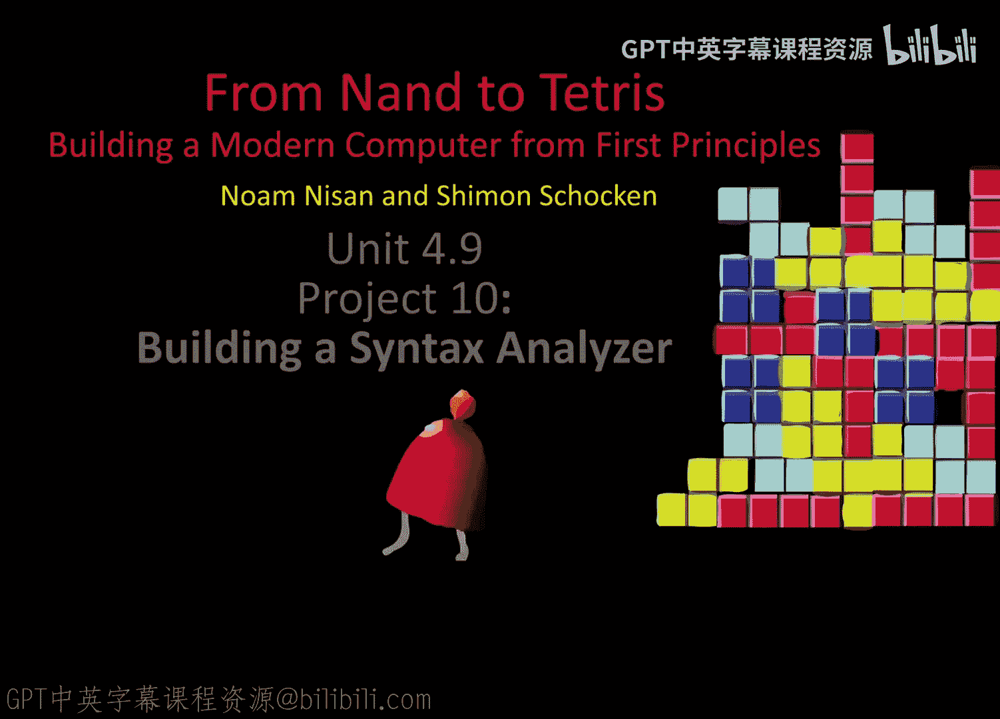
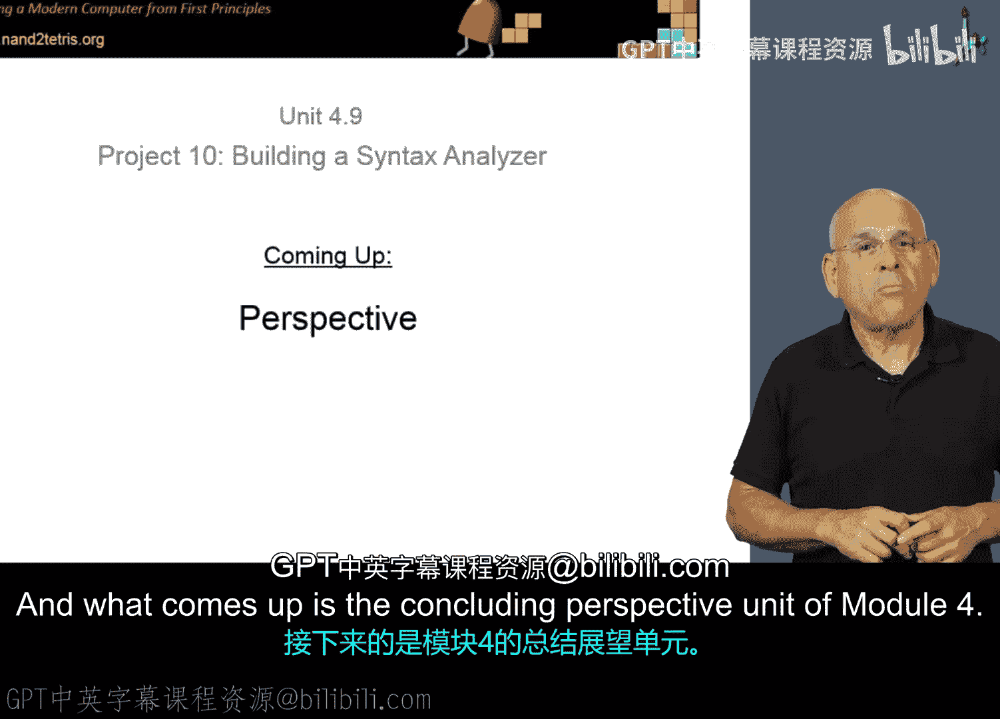

# 耶路撒冷希伯来大学《从零开始构建现代计算机2｜Build a Modern Computer from First Principles》中英字幕 p53 53_06_10_单元4-9_项目10：构建语法分析器.zh_en -BV1DA4m1w7FU_p53-

Welcome to Unit 49 in which we will finally get our hands dirty and set out to develop the syntax analyzer that we described all along。

Now let me remind you the overall picture of what we are doing。

 we are developing a J compiler and in this module we are focusing on the syntax analyzer part of the compiler。

 and we are faced with a challenge of unit testing this module separately from the rest of the system。

We decided that in order to do so in Project 10， we will have the syntax analyzer generate XML code。

And by looking at this XML code， either by eyeball analysis or using some other techniques。

 we'll be able to tell that the syntax analyzer actually delivers that it understands the source code。

 so to speak。And so that's the program that we have to develop， this syntax analyzer。All right， so。

We are doing it obviously in the context of the jack language and the contract is such that we have to develop a syntax analyzer that is capable of translating all the supplied J programs that you will find in the Project 10 directory and for each of such jack file。

 your analyzer should produce a separate XML output file that reflects the grammatical context of the jack file and this XML file should be identical to the compare files that are also provided by us。

Now， how do you compare them？ Well， first of all， the test programs and the compare files are available in the project directory on your computer。

And you compare your outputs with our compare files using a utility that we also supplied。

 which we call a text Compr。Text Compr is a tool that compares two text files up to white space differences。

 so it is quite possible that you know your XML analyzer will use some spaces or some empty lines and so on that will not get into the comparison with the supplied compare files。

 so the text Comp is quite a handy tool。Now another way to look at your XML output and figure out if it makes sense is to load it into either a browser like Chrome or Firefox or into a text editor that knows how to handle programming languages。

 any one of these tools which are freely available on the web will enable you to once again look at the source code I'm sorry。

 look at the generated the XML and see how it's structured and once again decide if if it's well structured。

And it's a little bit difficult to explain in words， you can just。Try it and see for yourself。

You also need a programming language to create your syntax analyzer and in this course so far we accept programs in Java and Python and finally it's recommended to also take a look at the book and we have a whole chapter dedicated to syntax analysis and you can find some useful information there。

 even though most of what I have to say we said already in these units。Alright。

 so here is the implementation plan。First of all， we are going to develop a tokenizer。

 which is a very well defined and relatively simple undertaking。 Then once we develop the tokenizer。

 we're going to move on and develop a compilation engine。😊。

And we use the term compilation engine to describe a syntax analyzer that uses the services of the tokenizer that we developed before。

And we are going to develop this compilation engine in two stages。

 first we build a basic program which is relatively simple and then we are going to extend it into a full blown syntax analyzer as we now go on to explain。

All right。Let's begin with aject organizer， to remind you。We start with some source code。

 and we want to end up with something that looks like this。Now。

 what we see here on the right hand side is slightly different than the XML examples that we saw in the previous units。

And here are the differences。 First of all， we decided that we are going to wrap up。

The whole XML file with a begin and end tag which we call tokens now why do we do this because it turns out that that's what the browsers expect if you're going to load this file into a browser in order to see it nicely structured the browser you know expects to see a well definedfined XML that has a begin and and that's why we added this little detail。

What else you will also notice that string constants。

 like the word negative in the source code appears in the XMl without double quotes。

 That's just fine。 That's how you want how we want you to handle it。 So your。

A synyntax analyzer should not output double quotes。

 it should output the string constant as is without double quotes for technical reasons only。

And finally， you will note that we have certain special characters which are handled in a special way。

 in particular， less than greater than double quote。😊，And Im percent。

 have special meaning in HTML and therefore when you load this file into a browser in order to inspect it。

 the browser will kind of get lost and it will not know how to handle these special characters or it will handle them in a way which is not good for us and therefore instead of using these special characters as is。

 we use an alternative set of characters as you see here which kind of bypa this special meaning in HTML and once you use this convention here。

 you will actually see you know less than greater than equal and so on as they are when you load this file into the into your favorite browser once again you know I set browser several times and you have to understand。

You know， we're not talking about the internet at all。

 we just we use the browser as a viewer program and browsers have this ability to look at an XML file and lay it out nicely on the screen in kind of a telescopic way so that you can tell that everything was done well but by your syntax analyzer。

So how should you build this。This tokenizer， well。We propose that you or we actually request that you follow the API described in unit 48。

And you have to remember that everything in this module。

 both the tokenizer and the Passer is essentially a text processing challenge and therefore you're welcome to use everything that your language facilitate in the way of string processing and handling regular expressions and whatnot。

 it's up to you to look at the libraries and decide what to use。

 you don't have to use these things but you can if you wish。All right。Moving along， you know。

 once we are done with the tokenizer， we have to develop the parer or the overall jack analyzer。

 So here's an example of some test program， some jack code。 and we have to。You know。

 analyze it or translate it and into the XM L that you see on the right hand side。

How should we do it Well we talked about it all along in this module。

 but basically we recommend that you begin by writing a basic compilation engine that handles everything except for expressions why because expressions are a little bit of a headache so we prefer to handle them separately and only then we're going to add the handling of expressions and in order to support this staged development strategy we're going to provide you with test files that would enable you to unitest each one of these steps separately so here's how we do it。

Here's an example of one of the test files that your syntax analyzer should handle。In project 10。

And I'm going to highlight the expressions in this jack file。

 and as you see we have or every program has lots of expressions in it。😊。

And so we are going to supply you with two versions of this file。

 first of all you have this version which is sort of the complete test。

 but we also provide another version of this file which is called expressionless version and in this version we have substituted every expression with a variable name which is in the scope of this method okay so for example。

 instead of saying y plus size less than 254， we simply say X。

Now X makes sense because x happens to be a field in this class and therefore it is you know globally recognizable by all the methods。

 it's in the scope of all the methods likewise instead of saying size equals size plus2。

 which is a complex expression so to speak， we replace it with size equals size。

 so this is our job to create these files， it shouldn't interest you how we did it。

But the result is a file which is simpler than than the original one。

 because it has no complex expressions。 So it suits。The purpose of testing。A VM， I'm sorry。

 a syntax analyzer that tends everything except for expressions。So that's the purpose of these files。

So basically when you look at the expressionless version of these programs。

 you will notice that you know they make no sense， they are kind of weird semantics and yet syntactically speaking。

 they are perfectly valid and therefore they serve the purpose and we use them happily in order to test the basic version of our syntax analyzer once your syntax analyzer can handle these expressionless files。

 you can move on and complete the overall version that handles expressions as well。

So that's the grand plan of building the syntax analyzer。 Now。

 I'd like to end this unit with a few words about handling expressions。

And going back to the jack grammar， the problematic cross of the grammar。

In terms of passing is what is highlighted here， it's the handling of the term rule and the problem is that when the current token is a variable name as I explained in one of the previous units or know some identifier。

 it can be either a variable name like X， or it can be an array entry like X。18， for example。

 or it can be a sub routine call X dot do something， right。

 So the only way to resolve which possibility we're in is to look ahead into the next token。

 You know， we have to save the current token。Because we haven't yet used it for cogeneration。

 we have to look ahead for the next token， and then once we have these two tokens in hand。

 we have all the information that we need in order to resolve how to handle it and which XML to generate from it。

Okay， so that's a detail that you have to worry about when you develop the full scale version of your syntax analyzer。

All right， now， what about subroutine call， It looks like subroutine call is a separate rule in the grammar。

 and indeed， it is。But for various reasons we decided that the suboutine call will not be handled by a separate compilation method。

 like you know other rules in the grammar， but rather we're going to handle the subruine call logic the right hand side of the rule as part of handling the term。

When you develop the syntax analyzer， you will realize that this little advice here will result with a code which is easier to write so once again there will be no compile suboutin call。

The compiler routine call logic will be handled as part of handling the term so you know to recap here is our roadmap we are developing a jack compiler and in this module we developed the syntax analyzer of the compiler and in the next module we are going to develop a co generator that taken together well deliver the full functionality of a compiler for the J language。

So this has been the unit in which we discussed how to handle Project 10 and what comes up is the concluding perspective unit of module 4。

