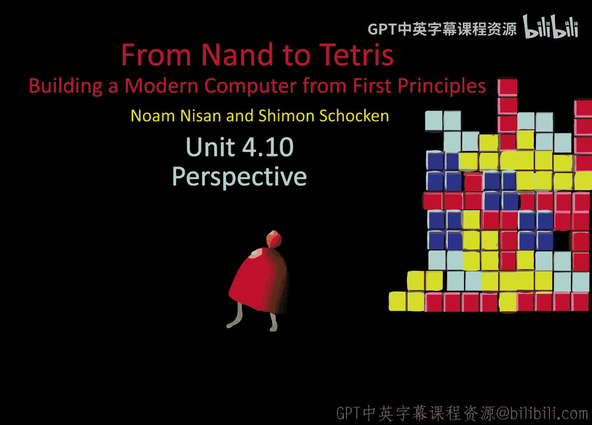
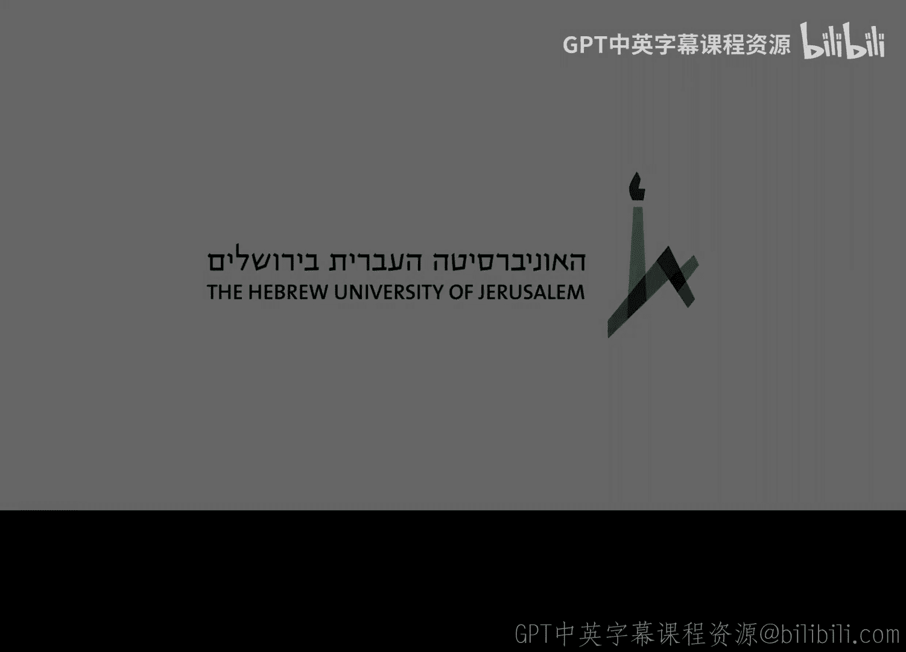

# 耶路撒冷希伯来大学《从零开始构建现代计算机2｜Build a Modern Computer from First Principles》中英字幕 p54 54_06_11_单元4-10_视角.zh_en -BV1DA4m1w7FU_p54-

Welcome to the last unit of the first part of our two part or two mod compiler treatment in which we discussed syntax analysis and parsing。

And as usual， we will answer some frequently asked questions about this module。

So let's see compilers don't only translate programs。 They also find and report errors。

Are we going to handle errors in our J compiler？Well。

Ara diagnostics is something that we decided to completely sidestep in this module。In other words。

 we assumed quite naively， I must say， that the source code that we have to compile is error free。

So what should we do if we were to remove this simplifying assumption。Well， in some cases。

 catching an error is a simple matter。 for example， suppose that you pass a let statement LET。

According to the Jack grammar， the keyword let must be followed by an identifier。As in say。

 let X equals something。 So x is an identifier。So when your parer handles a let token。

 it should expect that the next token should be an identifier and if the next token is anything but an identifier。

 you can generate an error message and terminate the compilation right there。However， you know。

 normally compilers try to be more friendly and they don't stop dead in their tracks whenever they find an error instead a clever compiler attempts to somehow contain the damage that was caused by the current error and proceed to catch and report additional possible errors in your code。

Also， a clever compiler makes the best effort to try to sort of pinpoint。

The exact location in the source code where the error was conceived， so to speak。

 And this location is not necessarily the same place where the error raised its head or or was detected by the compiler。

So， as you see。Error handling is an intricate art that requires sophisticated diagnostics methods。

And intricate code， none of which were discussed in Ntoteis。And as I say this。

 I feel obliged to also qualify something that I said when we discussed， I think， tokenizes。

If you recall， I said that once we construct the tokenizer。

 you know an object that implements the tokenizer in API， once we do it。

 we no longer need the input file， which contains the original source code because because excuse me the tokenizer is going to sort of dispense for us the next token whenever we need it。

 so why do we need the source code。However， if we wish to handle errors。

 then we must preserve the original source code in order to annotate it with all sorts of error message。

 warning messages and so on。You know， all these details are very important when you set out to develop a full service compiler。

 and yet in Anotetriris， we decided to build a minimal compiler。

And we decided to treat error diagnostics as an optional feature that can be certainly added to the basic compiler whenever you want to do it。

All right， so with that， let us move to the next question。Which is。

Can we use the techniques that we learned in this module to develop pass for other programming languages。

Let me start by saying that parers are quite useful not only for passing programs。

 but also for passing any syntax based text， which happens a lot in the careers of many application programmers。

There are numerous applications out there ranging from bioinformatics to email to financial services in which you have to handle。

 analyze and render structured text。And the techniques that we learned in this module are directly applicable to any of these applications。

Specifically throughout the module， we covered and developed the two most important elements of syntax analysis。

 and they are tokenizing and passing。So in that respect。

 you now have a solid hands on understanding of the essence of what it takes to do syntax analysis。

However。Compared to other programming languages that you are familiar with。

 the language that we handled， Jack is deliberately simple。

It has neither operator priority nor inheritance nor many other features that can be found in industrial strength programming languages。

Now， this limited design was obviously done in purpose。

 because our goal was to be able to develop a jet compiler using simple and elegant passing algorithms。

 In particular， the passing algorithm that we discuss in this module builds the pass tree from the top。

😊，down。You know it reads as few tokens as possible。

And it tries to determine which language construct we are passing as soon as it can make this determination。

Passes that employ this top down greedy passing strategy are quite suitable for languages that have a simple syntax。

And yet， when compiler developers have to pass languages that have a more elaborate syntax。

 they typically resort to using something known as bottom up passing。Which is quite different。

This passing strategy starts bottom up by first building the terminal leaves of the pastry。

And they defer the decision of which language construct we are dealing with to a later stage in the passing process。

This way they can entertain simultaneously several processing possibilities。But in order to do this。

 these algorithms have to use backtracking。And the result is passing logic。

 which is harder to develop than the simple top down passing that we use in this module。

 which once again is applicable to numerous applications and to simple languages。

 but not necessarily for languages like Java and C++。As usual， there are numerous topics， you know。

 in this case， in compilation in the formal languages。

 which are simply outside the highly focused scope of Nantuttetriris。Now。

 if you find compilation and computational linguistics interesting。

 then by now I think that we gave you a solid foundation to build on and you're obviously welcome to consider taking either a compilation course or buying some decent book about it。

So with that， let's move to the next question。Why didn't we use Lex and the yak？

So for those of you who are not familiar with these buzzwords。

 Lex and Diak are two software tools that come from the world of UniX。And by now。

 there are numerous versions of these two tools that have different names and flavors。 and you know。

 they are implemented in many different programming languages。Lex stands for a Lexical Anar。

 which actually refers to a tool which is capable of generating tokenizing code automatically。

And YAC stands for the whimsical yet another compiler compiler。

 which actually refers to a tool which is capable of generating parsing code automatically。Typically。

 Alex and diac go together and are quite inseparable。So where do these tools come from？Well。

 many good programmers are lazy。They are lazy in the positive sense of the word。

And they seek to automate whatever can be automated。Now， as you may have noticed。

And I'm sure you did。The passing logic that we outlined throughout this module， which by the way。

 was given as a recipe for developing your passer。 well， this passing logic was highly structured。

In particular， we advise that for each production rule in the J grammar。

 you guys should develop a corresponding passing method in your syntax analyzer and taken together all these passing methods comprise this analyzer。

Now， it turns out that this soft development strategy that we exposed in this module is so structured that indeed it can be generalized to other grammars and automated。

In other words， if you have a well defined grammar of some language or some file format or whatever。

And you can specify this grammar using some agreed upon machine readable format。

 then indeed you can write a program that takes this grammar specification as input and produces from it automatically a syntax analyzer which is written in some language like C or Java or whatnot。

Now， of course， you will have to get into the generated code and make all sorts of changes here and there。

 but most of the logic can be generated automatically by Lex anddiac kind of tools。

And so that's what these tools are all about。 They generate syntax analyzer。

Or syntax analysis code that can be customized and， you know。

Developed into a full scale syntax analysis tool。So let's go back to the question。

 why did we insist on developing the tokenizer and the password from scratch？Where， in fact。

 we could have used these automatic tools and make our life much simpler。Well。

 I suspect that you know the answer。Nantutteris is about doing everything from scratch。

 from the from the ground up。In your bare hands， in order to explore and understand。

Using black box tools like Lex anddiak go against the Nantuttetriris spirit。

 and that's why we decided not to use them。So that's the end of our perspective unit on passing and we now turn to the next module in the course。

 module 5 in which we will continue to develop our compiler and in particular。

 we're going to deal with code generation。

