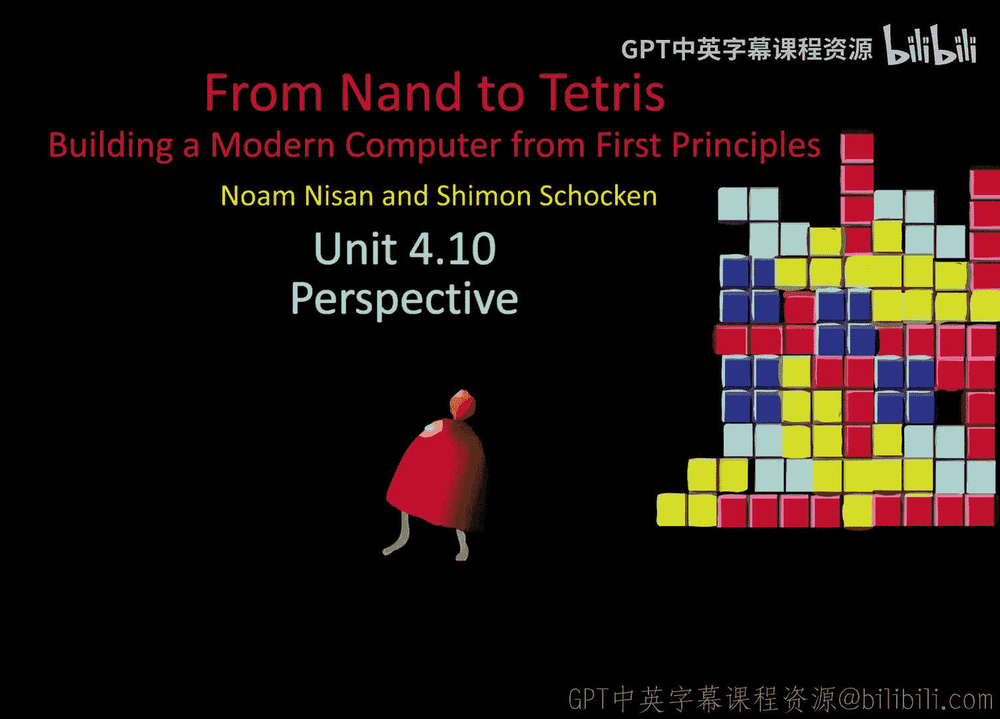

# 编译器构建：单元4-10：视角与展望

在本单元中，我们将回顾第一部分（语法分析与解析）的内容，并回答一些常见问题，为进入下一模块的代码生成部分做好准备。

---

## 概述

在本节课中，我们将探讨编译器构建中关于错误处理、技术通用性以及自动化工具使用的几个关键视角。我们将了解为何在本课程中做出某些设计选择，并展望这些技术在其他领域的应用。

---

## 错误处理与诊断

上一节我们介绍了语法分析的核心流程。本节中，我们来看看一个现实问题：错误处理。

在真实的编译器中，除了翻译程序，发现并报告错误同样重要。然而，在我们的Jack编译器中，我们决定完全回避错误诊断。我们做了一个简化的假设：需要编译的源代码是无错误的。

如果我们要移除这个简化假设，该如何处理？在某些情况下，捕获错误是简单的。例如，根据Jack语法，`let`关键字后必须跟一个标识符（如 `let x = ...`）。当解析器处理到`let`这个token时，它应预期下一个token是标识符。如果下一个token不是标识符，就可以生成错误信息并终止编译。

然而，通常编译器会更友好。它们不会在发现第一个错误时就立即停止，而是会尝试“控制”当前错误造成的损害，并继续捕获和报告代码中可能存在的其他错误。同时，一个优秀的编译器会尽力精确定位错误在源代码中的确切位置（这个位置可能与编译器检测到错误的位置不同）。

因此，错误处理是一门复杂的艺术，需要精密的诊断方法和复杂的代码，这些内容在本课程中均未涉及。此外，如果我们希望处理错误，就必须保留原始源代码，以便用各种错误信息和警告信息来标注它。这些细节在开发一个功能完整的编译器时非常重要。但在本课程中，我们决定构建一个最小化的编译器，并将错误诊断视为一个可以随时添加到基础编译器中的可选功能。

---

## 技术的通用性

接下来，我们探讨一下在本模块中学到的技术是否适用于其他编程语言。

解析器不仅对解析程序有用，对解析任何基于语法的文本也很有用，这在许多应用程序员的职业生涯中很常见。从生物信息学到电子邮件再到金融服务，有大量应用需要处理、分析和呈现结构化文本。我们在本模块中学到的技术可以直接应用于这些场景。

具体来说，在整个模块中，我们涵盖并开发了语法分析的两个最重要元素：**词法分析**和**语法解析**。因此，在这方面，你现在对进行语法分析的核心要点有了扎实的实践理解。

然而，与我们熟悉的Java、C++等工业级编程语言相比，我们处理的Jack语言被刻意设计得非常简单。它既没有运算符优先级，也没有继承等许多复杂特性。这种有限的设计显然是故意的，因为我们的目标是能够使用简单而优雅的解析算法来开发一个Jack编译器。

我们讨论的解析算法是**自顶向下**的。它尽可能少地读取token，并试图尽早确定正在解析的是哪种语言结构。采用这种自顶向下贪婪策略的解析器非常适合语法简单的语言。

当编译器开发者需要解析语法更复杂的语言时，他们通常会使用**自底向上**的解析，这与我们的方法有很大不同。这种策略自底向上开始，首先构建解析树的终端叶子节点，并将判断当前处理的是哪种语言结构的决定推迟到解析过程的后期阶段。这样，它们可以同时考虑多种处理可能性。但为了实现这一点，这些算法必须使用回溯，导致解析逻辑比我们在本模块中使用的简单自顶向下解析更难开发。

本课程高度聚焦，形式语言和编译中的许多主题都超出了其范围。如果你对编译和计算语言学感兴趣，那么现在我们已经为你打下了坚实的基础，你可以考虑选修编译课程或购买相关书籍进行深入学习。

---

## 为何不使用自动化工具？

以下是关于为何在本课程中手动构建词法分析器和解析器，而非使用自动化工具的说明。

`Lex`和`Yacc`是两个来自Unix世界的软件工具，如今已有许多不同名称和风格的版本，并用多种编程语言实现。
*   **`Lex`** 代表“词法分析器生成器”，指能够自动生成词法分析代码的工具。
*   **`Yacc`** 代表“又一个编译器编译器”，指能够自动生成语法解析代码的工具。

它们通常一起使用。这些工具的出现是因为许多优秀的程序员都“懒惰”（褒义），他们寻求自动化一切可以自动化的东西。你可能已经注意到，我们在整个模块中概述的解析逻辑（作为开发解析器的“配方”）是高度结构化的。我们建议为Jack语法中的每个产生式规则，在语法分析器中开发一个对应的解析方法，所有这些方法共同构成了分析器。

事实证明，这种开发策略如此结构化，以至于确实可以推广到其他语法并实现自动化。换句话说，如果你有一个定义良好的语言（或某种文件格式）的语法，并且可以用某种约定的机器可读格式来指定它，那么你确实可以编写一个程序，将该语法规范作为输入，并自动生成用C、Java等语言编写的语法分析器。当然，你可能需要进入生成的代码中进行各种修改，但大部分逻辑都可以由`Lex`和`Yacc`这类工具自动生成。

那么，回到问题本身：为什么我们坚持要从零开始开发词法分析器和解析器？事实上，我们本可以使用这些自动化工具让事情变得更简单。答案在于本课程的精神——“从第一性原理出发构建”。使用像`Lex`和`Yacc`这样的黑盒工具违背了这种精神，因此我们决定不使用它们。

---

## 总结

本节课中我们一起学习了编译器构建第一部分的收尾视角。我们探讨了错误处理的重要性与复杂性，了解了自顶向下解析技术的适用场景与局限，并明白了本课程选择手动实现而非依赖自动化工具（如Lex和Yacc）的教学初衷。这为我们进入下一个模块——**代码生成**——做好了准备。