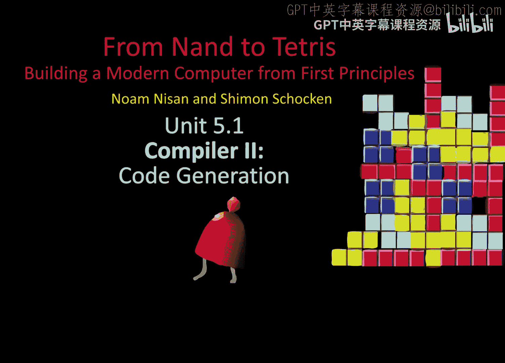

# 耶路撒冷希伯来大学《从零开始构建现代计算机2｜Build a Modern Computer from First Principles》中英字幕 p55 55_07_02_单元5-1_代码生成.zh_en -BV1DA4m1w7FU_p55-

Welcome to Moule 5 in which we are going to talk about the code generation component of our compiler。

Now I think that you will agree with me that most high-level programmers tend to take compilers for granted。

 they write their programs， they apply the programs to the source code。

 and they happily sit back and observe how the code is being translated into machine language。

 they don't see the actual process， they just see the result。

 actually they don't even see see the result， they just execute it and then they go on to debug their source code。

Now this bliss of ignorance is just fine， however， I think that you will also agree with me that translating a program from high level to machine code is nothing short of magic and if you don't want to understand this magic。

 then I think that you are going to deny yourself from two important benefits， first of all。

 you will not appreciate the beauty and the wisdom that goes into the algorithms and the technique that come to play in writing a compiler。

And second of all， you will lose the opportunity to become a much more competent high-level programmer because in the process of writing a compiler。

 you're going to gain lots of very important capabilities that go far beyond the narrow context of writing a compiler for a high levelvel language。

So with that let us go back to the overall roadmap， that's what we want to do。

 we want to write a compiler， the translate program from programs from the Jack language into machine language。

And in this course， we decided to write a two tier compiler。

 just like the compilers of Java and C sharpp。 So instead of going all the way to machine code。

The compiler we translate from Jack into VM code， and then there will be a VM translator that will translate further into machine language。

 Now， the good news is that the VM translator has already been taken care of。

 we wrote it in the previous two modules。 So now all we have to do you know quote unquote all we have to do is write a compiler that translates from the high level to the VM code only。

 Now we decided to split the construction of this compiler into two welldefined modules。

 a syntax analyzer and a code generator。😊，Now the syntax analyzer is something that we already developed in the previous modules。

 and in order to test it， we decided that the syntax analyzer will emit not VM code but rather XML code and the purpose of this exercise was just to verify that the parer understands the source code。

 that it understands the syntactic structure of the commands and is capable of demonstrating this understanding by producing legible XML code。

In this project， the Xml code is no longer relevant， right because in this module。

 we' are going to focus on a code generator， which is going to translate into VM code。

 So what we're going to do is were going to focus on the parer and the code generator modules。

 we will rewrite certain elements from the parer that are responsible for generating code will write some more codegen capabilities。

 and the result will be a compiler that goes all the way from J programs to VM code。

 So the objective once again is to develop a full scale compiler or more accurately to extend the compiler that we've written before into a full scale compiler。

 So instead of generating passive XML code， we will。

More the compilation engine that we had before into something that generates executable VM code。

 So this is the objective。 and that's how we're going to do it。

 Now when we say program compilation in this course we talk about a language which is highle and object oriented the jack language and here's an example of some code segment that you've seen before that is designed to manipulate some points on a two- dimensionmensional space。

 if you compile and execute this code you'll end up seeing some nice results on the screen and as we discussed before in order for this code to work properly。

 it has to interact with yet another class file that delivers the point functionality so to speak the point class file。

Now， when you set out to develop something complicated like a compiler。

 it always helps to try to simplify matters as much as possible。

So I'm going to make some simplification observations。 And the first one is the following。

Each class file is compiled separately。Each jack class file， just like each Java class file。

 is a separate and standalone compilation unit。So the overall task of compiling a multiclass program has been reduced to the more sort of limited task of compiling one class at a time。

So that's my first observation。And the second one is based on you know going into the class itself。

 so here's an example of the class point。And what I've listed here is some you know class level declaration statements。

 and then all the methods or all the suboutines of the point class。And for lack of space。

 I didn't list the code of all the subroutines， I just listed their signatures except for one subroutine distance in which I took the trouble to show the entire code。

So here's my second simplifying assumption。 first of all。

 let us observe that the class consists of two main modules。

 first of all we have some preamble code that defines the class in some class level variables and then we have zero or more subroutine code declarations right and in the case of this class here's the code which is at the class level and here's an example of the code of one particular subroutine。

Now， the simplifying assumption is such that。Compilation can once again be viewed as two separate processes when you go down to the class level。

 First you compile the class level code that we see here on the top and then you compile each subroutine one at a time。

 so to a great extent these two compilation tasks are relatively separate and standone。And therefore。

 once again， the overall and rather formidable task of writing a compiler for a multiclass program has been reduced to compiling one suboutine at a time。

So once again， things are localized and we are going to use a very modular strategy and as usual。

 we are going to do things one step at a time。All right。Now。

 what do you see when you compile sub routine， you see variables， expressions， if while， you know。

 statements like those， you can see objects。 and obviously， you can see arrays。

 So the compilation challenges that we're going to handle are what you see here on the screen。

 And these challenges are also sort of the table of contents of the next units in this module in every unit will deal with one of these challenges one at a time。

Now。The challenge， when I say to deal with them， is to。

Generate VM code that captures the semantics of variables， expressions and so on using VM commands。

 Now， this is not a trivial task because high level languages today。

 including Jack are very sophisticated。 You know， they give you all these fancy control structures and objects and arrays。

 And yet， the target language。 the VM language is very simple and limited。 you know。

 it has only push pop commands and a few more commands。 and that's it。

So we are facing the challenge of bridging the gap between the high level and the VM code。

 and we have to somehow express this very rich semantics that you see here in front of you using the very limited VM language。

 but as you will see， we will do it in a surprisingly elegant in relatively simple fashion。Allright。

 before we wrap up this module， I'd like to list you know some of the lessons that you're going to take from it。

 So first of all， you will learn how programming languages work。

 you will learn how to implement you know a simple procedural language like C。

Because you will know how to handle variables， expressions， flow of control。

 you will also learn how to handle arrays and objects in the low level。And by doing this， once again。

 you will gain a very deep understanding of the tools of the trade。And secondly。

 you will learn some you know general purpose techniques which can be applicable to numerous other problems and applications。

 you will strengthen your understanding of passing。

 something that we've dealt with extensively in the previous module you will understand how recursive compilation works you will learn how to generate code how to create and use symbol tables and you will begin to learn how to manage memory cleverly something that we will take up also when we discuss the operating system in the last module of this course So all these goodies are coming up in the current module So in closing you know these are the challenges that we have to deal with starting with variables so that's what we'll do in the next unit。

