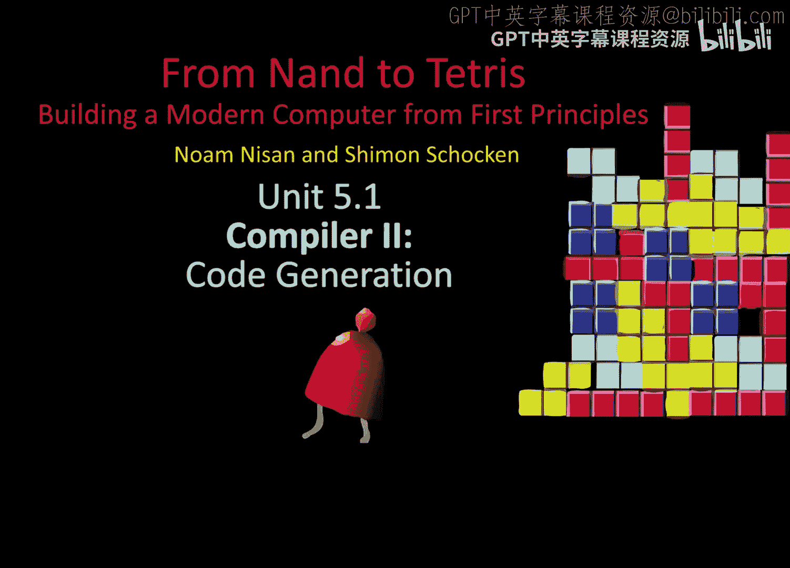

# 从零开始构建现代计算机2：单元5-1：代码生成概述 🧠

在本节课中，我们将要学习编译器的代码生成组件。我们将探讨如何将高级语言程序转换为虚拟机代码，并理解这一过程背后的核心原理。

---

## 课程概述

大多数高级程序员倾向于将编译器视为理所当然的工具。他们编写程序，将编译器应用于源代码，然后观察代码如何被翻译成机器语言。他们看不到实际的过程，只看到结果。实际上，他们甚至看不到结果，他们只是执行它，然后继续调试源代码。

这种无知的幸福状态是可以接受的。然而，将程序从高级语言翻译成机器代码无异于一种魔法。如果你不想理解这种魔法，那么你将错失两个重要的好处。首先，你将无法欣赏编写编译器时所涉及的算法和技术的美丽与智慧。其次，你将失去成为一个更称职的高级程序员的机会，因为在编写编译器的过程中，你将获得许多非常重要的能力，这些能力远远超出了为高级语言编写编译器的狭隘范畴。

---

## 编译器整体路线图

我们的目标是编写一个编译器，将Jack语言的程序翻译成机器语言。在本课程中，我们决定编写一个两层编译器，就像Java和C#的编译器一样。因此，我们不是直接翻译成机器代码，而是先将Jack翻译成VM代码，然后通过一个VM翻译器进一步翻译成机器语言。

好消息是，VM翻译器已经在之前的两个模块中完成了。所以现在，我们“只需要”编写一个将高级语言翻译成VM代码的编译器。

我们决定将这个编译器的构建分为两个定义明确的模块：语法分析器和代码生成器。语法分析器是我们在之前的模块中已经开发的部分。为了测试它，我们决定让语法分析器输出XML代码而不是VM代码。这个练习的目的是验证分析器能够理解源代码，理解命令的语法结构，并能通过生成可读的XML代码来展示这种理解。

在本项目中，XML代码不再相关。因为在本模块中，我们将专注于代码生成器，它将翻译成VM代码。因此，我们将专注于分析器和代码生成器模块。我们将重写分析器中负责生成代码的某些部分，并编写更多的代码生成能力。最终结果将是一个能够从Jack程序一直翻译到VM代码的编译器。

因此，我们的目标是开发一个全功能的编译器，或者更准确地说，是将我们之前编写的编译器扩展为一个全功能的编译器。我们将把之前拥有的编译引擎从生成被动的XML代码，转变为生成可执行的VM代码。这就是我们的目标，也是我们将要采取的方法。

---

## 编译过程的简化观察

当我们谈论程序编译时，我们指的是一个高级的、面向对象的语言——Jack语言。以下是一个你之前见过的代码段示例，它旨在操作二维空间中的一些点。如果你编译并执行这段代码，你最终会在屏幕上看到一些漂亮的结果。正如我们之前讨论的，为了使这段代码正常工作，它必须与另一个提供点功能的类文件（即Point类文件）进行交互。

当你着手开发像编译器这样复杂的东西时，尽可能地简化问题总是有帮助的。因此，我将提出一些简化的观察。

**第一个观察是：每个类文件都是单独编译的。**
每个Jack类文件，就像每个Java类文件一样，都是一个独立且自包含的编译单元。因此，编译多类程序的整体任务被简化为一次编译一个类的更有限的任务。

**第二个观察是：类内部的编译可以进一步分解。**
以下是一个Point类的示例。这里列出了一些类级别的声明语句，然后是Point类的所有方法或子程序。由于空间有限，我没有列出所有子程序的代码，只列出了它们的签名，除了一个名为`distance`的子程序，我展示了其完整代码。

类由两个主要模块组成。首先，我们有一些定义类和一些类级别变量的前导代码。然后，我们有零个或多个子程序代码声明。在这个类中，这里是类级别的代码，这里是一个特定子程序的代码示例。

因此，简化的假设是：编译可以再次被视为两个独立的过程。首先编译我们在顶部看到的类级别代码，然后一次编译一个子程序。在很大程度上，这两个编译任务是相对独立和自包含的。因此，为一个多类程序编写编译器这一整体且艰巨的任务，再次被简化为一次编译一个子程序。

因此，事情再次被局部化，我们将采用一种非常模块化的策略，并且像往常一样，我们将一步一步地进行。

---

## 编译子程序面临的挑战

当你编译子程序时，你会看到变量、表达式、`if`、`while`等语句，你还可以看到对象，显然，你也会看到数组。因此，我们将要处理的编译挑战就是屏幕上看到的这些内容。这些挑战也构成了本模块后续单元的内容目录，每个单元将依次处理其中一个挑战。

处理这些挑战的任务是：使用VM命令生成能够捕捉变量、表达式等语义的VM代码。这不是一项简单的任务，因为当今的高级语言（包括Jack）非常复杂。它们提供了所有这些花哨的控制结构、对象和数组。然而，目标语言——VM语言——却非常简单和有限。它只有`push`、`pop`命令和少数其他命令，仅此而已。

因此，我们面临着弥合高级语言和VM代码之间差距的挑战。我们必须以某种方式，使用非常有限的VM语言来表达你在这里看到的非常丰富的语义。但正如你将看到的，我们将以一种令人惊讶的优雅且相对简单的方式来完成它。

---

## 本模块的学习收获

在结束本模块之前，我想列出你将从中获得的一些经验教训。

**首先，你将学习编程语言的工作原理。**
你将学习如何实现一个简单的过程式语言，如C。因为你将知道如何处理变量、表达式、控制流。你还将学习如何在低级层面处理数组和对象。通过这样做，你将再次对行业工具有非常深入的理解。

**其次，你将学习一些通用的技术，这些技术可以应用于许多其他问题和应用。**
你将加强对解析的理解（这是我们在上一个模块中广泛讨论的内容），你将理解递归编译是如何工作的，你将学习如何生成代码，如何创建和使用符号表，并且你将开始学习如何巧妙地管理内存（这将在我们讨论本课程最后一个模块的操作系统时再次涉及）。

所有这些好处都将在当前模块中出现。

---

## 总结

在本节课中，我们一起学习了编译器代码生成组件的概述。我们探讨了编译器的整体路线图，理解了将高级Jack语言编译为VM代码的两层架构。我们通过将编译任务分解为独立的类编译和子程序编译来简化问题。我们还明确了在编译子程序时将面临的核心挑战：即用简单有限的VM语言去表达复杂的高级语言语义，如变量、表达式、控制流、对象和数组。最后，我们展望了学习本模块将带来的收获，包括深入理解编程语言的工作原理和掌握一系列通用的软件工程技术。

接下来的单元，我们将从处理变量开始，逐一攻克这些挑战。