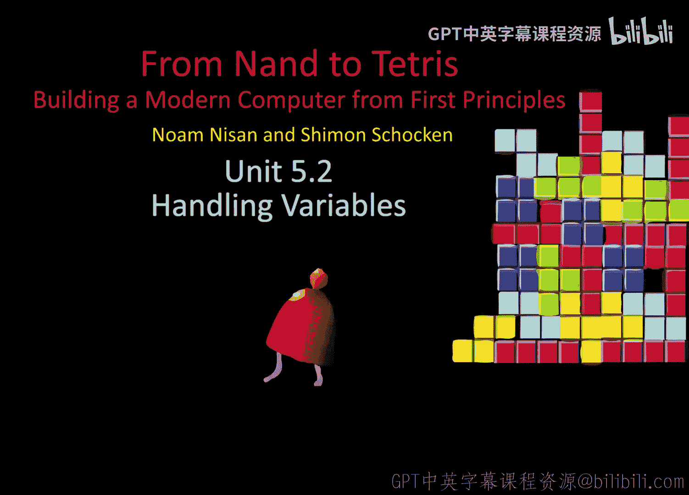
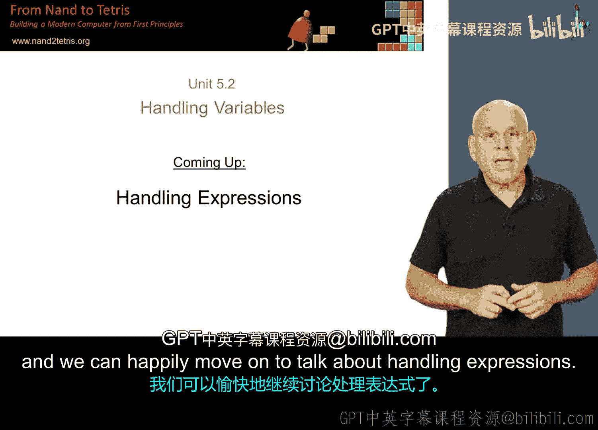

# 耶路撒冷希伯来大学《从零开始构建现代计算机2｜Build a Modern Computer from First Principles》中英字幕 p56 56_07_03_单元5-2_处理变量.zh_en -BV1DA4m1w7FU_p56-

So let us begin our code generation journey and the first thing on our item is handling variables。

So here's an example of a high level expression written in some typical high level language。

 and we see that in this particular expression， we have three variables， sum x and rate。

Now the co generator is going to take this expression and somehow you know by some magic which we haven't yet discussed。

 it is going to translate it into VM code and the result will be the stream of VM instruction that you see here and you can convince yourself。

 you can go through these instructions and you can convince yourself that they will end up。

Computing the value of the desired expression and putting this value at the top of the stack。

 So we're again to get exactly what we wanted。And yet。

 we haven't yet discussed how the co generator is going to accomplish this magical transformation。

 This will be done in the next unit of this module。 But for now， let us focus only on the variables。

 So once again， we have some x and rate。 Now， remember that the Vm language does not have symbolic variables。

 It only has things like local argument， this that and so on。

 So in order to resolve this soda code into final executable VM code。

 I have to map these symbolic variables on what we call the logical， I'm sorry。

 the virtual memory segments。😊，So I need some information in order to generate code。

 I have to know whether some x and rate are field static local or argument variables。

 I need this information for every one of these variables I also have to know。

 is it the first local variable or the second local variable and so on。

 Once I will have this information I can indeed go ahead and complete the translation and the result will look something like this。

 Now obviously here I made some arbitrary assumptions。

 I assume that let's see I assume that x was argument2 In other words， it was the third arguments，0。

12， I assume that let's see rate was the first static variable in this class code。And so on。

 you know， these are just arbitrary assumptions， but once again。

 I just want to illustrate the fact that I cannot complete the code generation task unless I know what are the properties or every of every one of the underlying variables。

So what are these properties Well let's look at a more realistic example。

 a segment of jack code and I'm going to highlight as I did all the variables that appear in this code and earlier in previous units or in the previous unit I told you that we can focus on the class level code and the subroutine level code in two separate points of focus so to speak and indeed here we have class level variables you know which are in the jack language they are the fields and the static variables and we have subroutine level variables which in this case are the argument and local variables。

So these two categories capture all the possible variables in the jack language。

So every one of these variables has some properties， it has a name， it has a type。

 it has a kind or role in the program， and it has a scope which is the region of the code in which this variable is recognized。

Now in the jack language we have more specific documentation or specifications of what each one of these things mean。

 so the name of the variable must be an identifier。

 you know something that happens in every programming language that I can think of high level language。

 the type in jack can be either one of the three primitive types in car or Boolean。

 or it can be any class name in your application， so in theory we can have an infinite number of different types。

 three fixed primitive types and many as many class types as necessary。

Then we have the kind of the variable， which is either a field static， local an argument。

 And finally we have the scope of the variable， which in the jack language is very simple。

 You have only two scopes。 You have a class level scope。

 you know that's where this these variables are recognized throughout the class。

 and we have subrine level scope which is。😊，The scope of the subroutine。

 the specific subroutine that you're compiling only。

We'll have more to say about scoping rules later on in this unit。

 so taken together what we have here is a bundle of variable properties that must be maintained for every variable that occurs in the source code。

How should we do it， how can we manage this information about the variables Well the typical way of handling it is using something called symbol table。

 so we'll illustrate the notion of symbol tables using an example using this particular piece of code and let us begin with a class level variables of which we have three right we have X Y the coordinates of the point and point count which is a variable that counts how many points we have constructed so far。

And in order to represent these variables in a symbol table we' construct a table that looks like this。

 It has， you know several columns。 First column records the name of each variable。

 the next one is the type of the variable which in this example happens to be integer all along。

 then we have the different kinds of the variables and a running number that indicates that in this example we have two fields。

 field0 and field1 and one static you know static0 So this is the symbol table which is associated with a point class。

 you know assuming that these are the only field and static variables in this class。

  moving along what about the suboutine that we see here。 Well。

 if we look at it we see what seems to be three variables right the first variable is other。

 it's an argument variable and then we have two local variables Dx and D1。はい。But in fact。

 if you stop to think about it。Things are slightly more sophisticated。

If this were a function or what is called in Java aesthetic static method。

 then indeed it would have had only three variables。 but this particular subrout is a method。

 and a method is always designed to operate on the current object。

And this object is always represented using the variable， which by convention， is called。This。

And therefore， the symbol table of this method begins with a somewhat surprising entry。

 which is the properties of the current object。 The name of the current object is this。

The type of the current object is always the name of the class to which this sub routineout belongs。

 in this case， its point。And this particular variable， this is always treated as argument 0。

 It is always treated as the argument which is passed to the code here by the call。And it is。

 you know some kind of an implicit argument that well discuss at length later on in this module。

 so for now you just have to remember that whenever you construct a symbol table for a method。

 you have to start it with this particular entry。And the only thing that will change from this code to your code is the name of the class because you know the name of your class may be different。

 Obviously the compiler has to handle many different classes。

 but everything else is going to be fixed， this argument zero。

The rest of the symbol table is straightforward， you know we'll have we have an another variable of type point also happens to have a type point。

 it's an argument， argument number one， and then we have two local variables， very simple。

So these are the two symbol tables that we need in order to manage the variables of this application。

Now。The class level symbol table can be reset each time we begin to to compile a new class。

 I told you in the previous unit that in J as well as in Java and in C sharpp。

Classes are standalone compilation units， so whenever you complete to compile a class。

 you can throw away the symbol table of that class and when you start compiling a new class。

 you can start fresh from a new class level symbol table。

Something similar happens when you compile subouts each time you finish compiling a subroutin。

 you can throw away the symbol table of this subroutin and start afresh with a new one。

 So I think you know these are sort of simplifying observations because it turns out that when you compile anything inject。

 you always have to maintain just two symbol tables。

 the class levelve symbol table and the subroutin the current subroutine symbol table， and that's it。

 Now I'd like to say a few words about the perspective or the viewpoint of the code writer。

 which is the agent which is responsible for creating and managing these symbol tables。

Now the code writer is going to encounter all sorts of variable declaration commands of which in Jack we have three。

 right we have either local variable declarations， field declarations or static variables declarations。

 so whenever the code writer is going to encounter you know an instance of any one of these variable declaration categories。

The code writer will elucidate from this statement all the important properties of the declared variable。

 and then the code writer will add this information to the respective symbol table if we are defining a field or a static variable。

 the code writer will add a new row to the end of the class level symbol table。

 if we are defining a local variable or an argument。

 the code writer will update the symbol table of the subroutine which is currently being compiled。

And by the way， one thing which is missing here is the treatment of arguments。

 right we talked only about locals， fields and statics。

 well arguments are being defined as part of the parameter list of the method signature。

 so when the code writer goes through this parameter list。

 it also adds the respective lines to the suboutine's symbol table。Now， importantly。

 that's the only thing that the code writer does， it generates no code whatsoever beyond updating the symbol tables。

 so it's a relatively simple task to handle。What about using variables within the context of expressions or statements like let the x equals x minus。

Applying the get method to the other object。 know what how should we handle the variables in this example Well here's what we do for each variable that appears in the source code。

 we have to look up this variable in the subroutine level symbol table， if we find it there fine。

 we know which properties we have to use if we don't find it there。

 we revert to looking it up in the class level symbol table。

 and if if we don't find it there either we can conclude that this variable is undefined。

 we can throw an error message。So in this example we have you know the two possibilities because Dx。

 for example， is a local variable， so we'll find it right away in the symbol table of of the distance method。

 but X will not be found in the symbol table of distance so we look up the class level variable and indeed we find that x is right there。

 So that's how the lookup algorithm works。Allright。

 let me give you a more sort of elaborate example to wrap up what we said so far。

 If we have some highlevel statement like this one。

 let y equals y plus dy how do we handle it Well once again the compiler is going to translate this expression into VM code。

 how it does it is something that will discuss in the next unit but in the process of generating this code。

 it will look up the respective tables， it will find out that y stands for the first field of the current object and therefore it will says it will translate y into this one it will find out that dy stands for the second local variable and therefore it will map dy on local one and so on and so forth So that's how。

Usage is being handled。Now， I'd like to end this unit with several。

Very general observations about hand variables in programming languages in general。Now。

 high level programming languages vary。In terms of how they feature you know different variable types。

 different kinds and different scoping rules。Now the techniques that we discussed in this unit。

 most importantly the symbol table generation and usage。

 these techniques can be easily extended to handle any number of possible variable types and kinds。

 you know in Java for example， we have eight primitive variable types or data types and in Jack we have three。

It it's a very small detail， you know we can handle any other primitive type just as well with our symbol table mechanism。

 likewise if you have more kinds of variables we can also easily recall this information in the symbol tables that we describe。

 maybe we'll need more columns or whatever， it's a small detail。

The nested scoping rules are somewhat more involved。 and I'd like to say a few words about them。Now。

 I'd like to say a few words about what is nested scoping to begin with。Well， some languages。

 which Java is a good example， feature unlimited scoping。

And this means that whenever you define a block of code with a pair of curly brackets。

 you can define variables within this code which are recognized only within that block So X in this block does not mean the same as x in that block if you so desire as as a high level programmer so you can create once again as many variable scopes as you desire。

 which in some situations is quite helpful and the question of course is how do we represent this information in our symbol table mechanism。

Well， the answer is， or the classical solution is to use a linked list of symbol tables。

And here's how you do it when you start combining the class。

 you create this linked list and the first symbol table that you add to the list is the class level symbol table。

And then when you start compiling a method， you create the method symbol table just like we did previously。

And then whenever you have another scoping region， you add another symbol table to this linked list。

 and at the end you're going to get a linked list of several such symbol tables。

And now the question is， how do you use this linked list when you encounter some variable X in the code。

 Well， here's what you do。You start in the first table in the list and you look up X in the current scope。

Failing to find X in this symbol table， you move to the next symbol table in the list and you look it up there and you simply go on you know downstream in this linked list until you get to the class level symbol table and if it's not there either you can conclude safely that this variable is undefined and you can throw an error message。

So as you see， this linked list data structure here captures very nicely this notion that the current scope hides all the scopes behind it。

And that's how we handle nested scoping。 This is something that we don't need at all when we write a compiler for the jack language because in Jack we have only two symbol tables。

 class level and suboutine level and yet I thought that it would be very relevant to talk about this extension at the end of this unit。

So we know how to handle variables and we can happily move on to talk about handling expressions。

