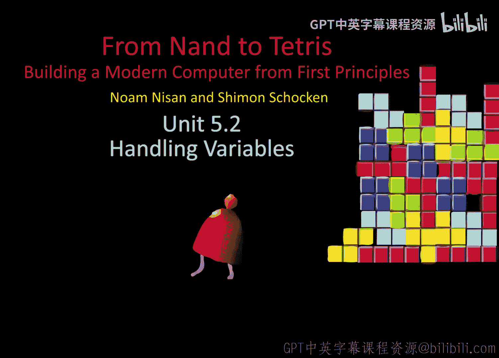
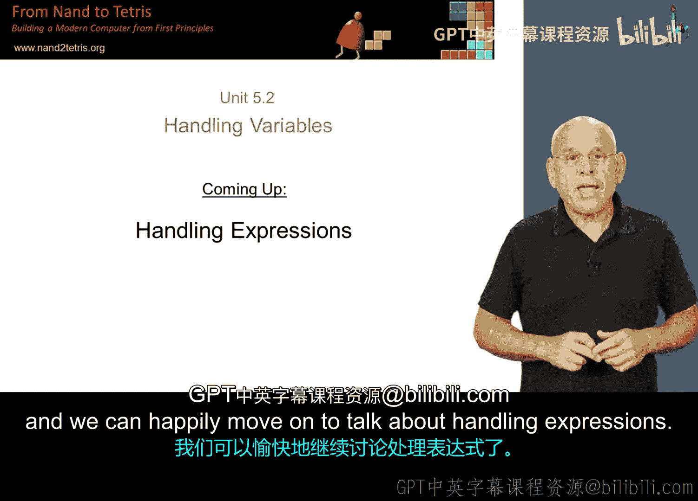

# 从零开始构建现代计算机2：单元5-2：处理变量 🧩



在本节课中，我们将学习编译器如何识别和处理高级语言中的变量。我们将重点介绍符号表的概念及其在代码生成过程中的关键作用。

---

## 概述

编译器在将高级语言代码（如Jack语言）转换为虚拟机（VM）代码时，必须能够识别和处理程序中出现的所有变量。这包括确定每个变量的类型、种类（如字段、静态、局部、参数）和作用域。为了实现这一点，编译器使用一种称为“符号表”的数据结构来存储和管理所有变量的信息。

上一节我们介绍了编译器的整体架构，本节中我们来看看如何处理变量这一核心任务。

---

## 变量与代码生成

让我们从一个高级语言表达式开始。例如，表达式 `sum + x * rate` 包含了三个变量：`sum`、`x` 和 `rate`。

代码生成器的任务是将这个表达式翻译成VM指令流。一个可能的翻译结果如下：
```vm
push sum
push x
push rate
multiply
add
```
这些指令会计算表达式的值，并将结果置于栈顶。然而，VM语言本身没有“sum”、“x”、“rate”这样的符号变量，它只有像 `local`、`argument`、`this`、`that` 这样的虚拟内存段。

因此，为了完成翻译，编译器必须知道每个符号变量对应哪个虚拟内存段及其索引。这需要关于每个变量的详细信息。

---

## 变量的属性

在Jack语言中，每个变量都有四个关键属性：
1.  **名称**：一个标识符。
2.  **类型**：可以是三种基本类型（`int`、`char`、`boolean`）之一，也可以是程序中定义的任何类名。
3.  **种类**：指明变量在程序中的角色，有四种可能：`field`（字段）、`static`（静态）、`local`（局部）、`argument`（参数）。
4.  **作用域**：变量被识别的代码区域。在Jack中只有两种作用域：类级（在整个类中有效）和子程序级（仅在当前子程序中有效）。

为了管理这些信息，编译器使用**符号表**。

---

## 符号表示例

考虑以下Jack代码片段：
```jack
class Point {
    field int x, y;          // 类级变量：字段
    static int pointCount;   // 类级变量：静态

    method int distance(Point other) { // 子程序
        var int dx, dy;      // 子程序级变量：局部
        let dx = x - other.getX();
        ...
    }
}
```

以下是管理这些变量所需的符号表。

**类级符号表（Point类）**：
| 名称 | 类型 | 种类 | 编号 |
| :--- | :--- | :--- | :--- |
| x | int | field | 0 |
| y | int | field | 1 |
| pointCount | int | static | 0 |

**子程序级符号表（distance方法）**：
| 名称 | 类型 | 种类 | 编号 |
| :--- | :--- | :--- | :--- |
| this | Point | argument | 0 |
| other | Point | argument | 1 |
| dx | int | local | 0 |
| dy | int | local | 1 |

请注意，对于方法（`method`），符号表的第一个条目总是隐式的 `this` 参数，它代表当前对象，类型是所属的类名（此处为`Point`），并且总是作为`argument 0`传递。

---

## 符号表的管理与使用

编译器在分析源代码时，会创建和维护这些符号表。

**当遇到变量声明时**（如 `field int x;` 或 `var int dx;`），编译器会：
1.  提取变量的名称、类型和种类。
2.  根据变量的种类，将其信息添加到相应的符号表中（类级或子程序级）。
3.  **不生成任何VM代码**，仅更新符号表。

**当在表达式或语句中使用变量时**（如 `x - other.getX()`），编译器需要生成访问该变量的VM代码（例如 `push this 0`）。为此，它执行**变量查找**：
1.  首先在**当前子程序的符号表**中查找变量名。
2.  如果未找到，则在**类级符号表**中查找。
3.  如果仍未找到，则报错（变量未定义）。

例如，在表达式 `dx = x - other.getX()` 中：
*   `dx` 是局部变量，会在子程序符号表中立即找到。
*   `x` 是字段变量，不会在子程序符号表中找到，但会在类级符号表中找到。

---

## 扩展到更复杂的语言特性

我们讨论的符号表机制可以轻松扩展到处理更复杂的语言特性。

**更多的变量类型和种类**：例如，Java有8种基本数据类型。我们的符号表只需在“类型”列中容纳这些类型即可，机制不变。

**嵌套作用域**：像Java这样的语言允许在代码块（由花括号 `{}` 定义）内创建新的作用域。这可以通过**符号表链表**来处理。
*   链表头部是当前最内层作用域的符号表。
*   查找变量时，从链表头部开始，依次在每个符号表中查找，直到找到或遍历完整个链表（最后是类级符号表）。
*   这种结构自然地实现了“内层作用域遮蔽外层作用域同名变量”的规则。

虽然在Jack语言中只有两级作用域，无需链表，但了解这种通用机制对理解编译器设计很有帮助。

---

## 总结

本节课中我们一起学习了编译器处理变量的核心机制。我们了解到，通过构建和维护**类级**与**子程序级**的**符号表**，编译器可以记录每个变量的名称、类型、种类和编号。在生成代码时，通过**查找**这些符号表，编译器能将高级语言中的符号变量准确映射到虚拟机语言的虚拟内存段指令上。这种基于符号表的方法，是连接高级语言抽象与底层虚拟机执行的关键桥梁。




掌握了变量的处理方法后，我们就可以继续前进，探讨编译器如何分析和翻译更复杂的程序结构，例如表达式和语句。