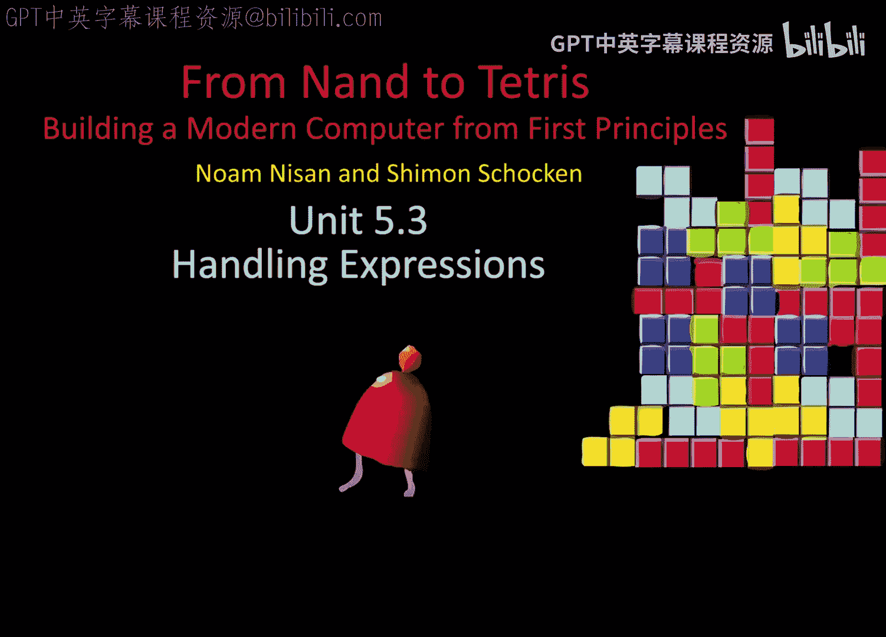
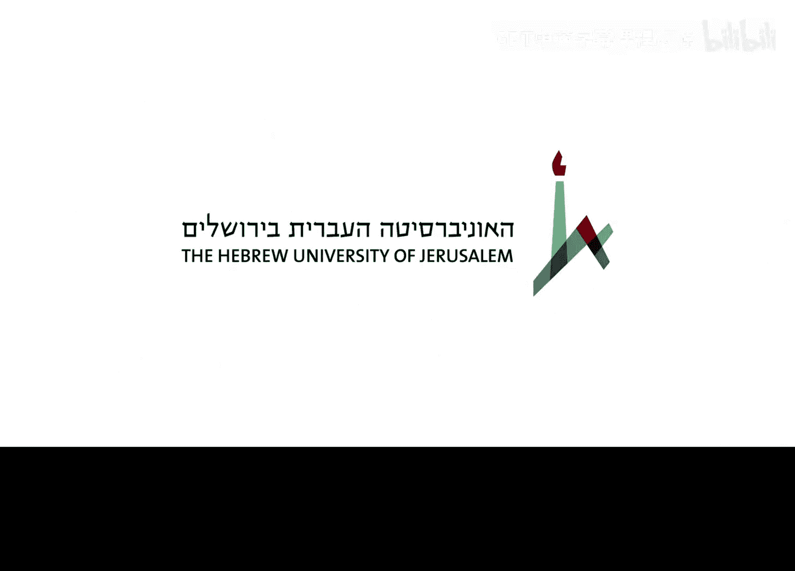

# 耶路撒冷希伯来大学《从零开始构建现代计算机2｜Build a Modern Computer from First Principles》中英字幕 p57 57_07_04_单元5-3_处理表达式.zh_en -BV1DA4m1w7FU_p57-

In the previous unit we discussed the hand of variables Now these variables appeared in the context of expressions and I kind of waved my hands around the translation of these expressions into VM code。

 Well in this unit I'm going to discuss this translation in detail。

 So we're going to talk about how the compiler handles expressions。Now to get started。

 I'd like to go back to basics and present to you a subset of the jack grammar that describes or defines expressions。

And here I simply lifted a snapshot from the book that accompanies this course and simply put it on the slide。

 and what we see here once again is the grammatical definition of what it takes to be an expression。

Now we discussed this in the previous module， I'm not going to repeat it。

 but I just want you to observe that every one of the expressions that we see here。

Will qualify as a legitimate expression according to this grammar， for example， take the number five。

Well I look at the grammar and first of all， I observe that5 is an integer constant。 Now。

 if you look at the second rule， you will see that an integer constant is a term and according to the first rule。

 a term is an expression， and therefore5 is an expression。What about x， Well x is a variable name。

 and according to the same second rule， a variable name is a term and term once again is an expression。

 What about x plus 5， Well x is an expression or x is a term。

And plus is an op and 5 is yet another term。 So once again， it matches the pattern of term。

 followed by an optional op and yet another term。 So using the same rationale。

 every one of the expressions that you see here will qualify or will be accepted by the jack grammar。

Now， as you can imagine， I can invent an unlimited number or an infinite number of such expressions。

 and some of them will be highly complex。And the question that we face as compiler writers is。

 how can we systematically translate any one of these versatile expressions into VM code， you know。

 beginning with a trivial5 or x and ending with。A very elaborate expression， how do we do it？

How do we map it on on VM commands？Well， the first thing that we have to bring into the picture is the past trees that we mentioned and used in the previous module。

And what we see here is an example of a simple expression， A times B plus C。

 and the pastry which can be derived from this expression or the pastry that describes the same semantics that the expression describes。

Now this thing is called infi， this notation is called infi， and as I pointed out here。

 it is human oriented。 What do I mean by this？Well， look at B plus C。

We want to add up two quantities， B and C。Why do we say B plus C？

Why don't we say something like add up？B， commma， C， or why don't we say something like。

 here are two quantities。 B and C， add them up。 Okay， instead， we say B plus C。

 Why do we use this language？ Well， we use this language。

 because that's what was sort of ingrained into our brains in elementary school。

 We were taught that whenever we have to add up two numbers， we say the magic words B plus C。😊。

And because the operator is located in the middle of this expression between the two operarans。

 because of that， this notation is called infi。But you have to realize that there's nothing special or sacred about this notation。

 and this notation will be just as good。😊，In prefix notation。

 we put the operators before the opera runs。And that's why it's also sometimes called functional notation。

 because that's what we do when we define functions， right， we put the function name。

 and then we give a list of opera or parameters or arguments for this function。So here for example。

 we start from the left if we evaluate this prefix expression and we realize that we have a multiply operator where we know that multiplication is a binary operator。

 it expects to see two operas， so we keep on reading and we are looking for the first opera and we find it it's called a。

And now we look for the second operaand where we hit this plus。

 so we know that the second operaand is the result of applying plus to two more arguments。

 and so we go on to evaluate the plus and so on and so forth。

 so you see that the prefix notation is just as natural and ubiquitous as the infi notation。

And if you don't completely see it， you can add some parentheses and then things will become clearer。

Finally， we also have something called post fixed notation。In the Post fixed notation。

 we first list the arguments on which we want to operate。 and then we call up。

The operator that has to be applied to the previously stated opera values。Now， for obvious reasons。

 this is called Post fix。And I would like to point out very importantly that this Post fix notation is intimately related to our stack machine because our stack language is also Postfi。

 right if we want to add up two numbers， What do we do， we push a， we push B。

 and we sayed classical Post fix。So if you take everything that you saw in this slide into consideration。

Except for the prefix which is irrelevant for our discussion， so if you think about the inF。

 the postfi and the pastory， this gives you a very strong clue on how you can translate from inF to postfi。

Now， why is this important， It's important because our source language is infi， know， Java， C sharpp。

 C， Pascal， Python， all these languages are infi。 You know。

 you describe expressions using infi notation。And yet， at the same time， our target language。

 the Vm language is post fix。 So the compiler has to translate from infi to post fix。

 How should we do it， Well， I guess that you are beginning to guess the answer。

 And here is one way of doing it。 We start with some infi。We， we start with some。

Expression written is usual in in fixed notation， and then from it， we generate a pastory。Okay。

And by the way， how to do it is something that we've already done。

 That's what the Passer is all about。 That's what we did in the previous module。

 We wrote a passer that takes a source code like this and produces XML code from it。 And XML is just。

 you know， yet another way to describe a pastory。So you put together this pastry。

And then you go through every node in this pasty in a certain order。

And you generate from it what you see here on the right hand side， which is stack machine code。

That can be executed。And this execution will result in evaluating the value of the source expression。

 which is exactly what we want right now if youre not convinced。

 I suggest that you stop the tape right here and go through the stack machine code and convince yourself that this code will end up computing the code that we started with。

 the source code on the left。Now， the question， of course， is。

 how do you move from the pastry to the VM code？Well。

 there's an algorithm that does it and this algorithm is called depth first。Tree traversal。

And so you begin from the root of the tree， which happens here to be the symbol plus。

 and you go all the way down。And when you hit a terminal leaf。You process it。

 So you go all the way down and you found X。 Well， you output push X。

 then you backtrack to the root and you once again go all the way down and you'll get to the two。

 You push2。 You backtrack to the closest node， which is G。 You go all the way down。

 and you push Y and so on and so forths。 Now， I don't want to spend too much time about this algorithm for two reasons。

 Firsts of all， we're not going to use it。 We'll use something different。And second of all。

 notice that the pastry of a real program can be gigantic right all we have here is a very simple example。

 and therefore it will be nice if there were an alternative way to process this pastory or to process the source code without creating the entire pastry as a side effect of this callgen operation。

 Indeed there is such an alternative， and that's what I want to discuss next。

In the algorithm that you will see here， we're going to generate the VM code on the fly without having to create the whole pastory in the process。

 in particular， we will use the following code generation algorithm that we called coder。

So codeWrite receives an expression and goes on to generate code from it。Now。

 if the expression is a number like5， you know， the last token in this input example。

 then all we do is output the VM statement， push5 or you know if you want to be accurate。

 push constant5。If x happens to be a variable like x， you know the first token in this input。

 then we output the VM command push X and of course we don't push x。

 we push something like local0 or static 2， whatever is the mapping of x on the virtual segments。

As dictated by the symbol table， which is always in the background of these cogen algorithms。

If X happens to be。The expression X1 op X2， for example， a plus B， or in this example， x plus G。

 something。 Then first， we generate code for x。Then we generate code for G in this particular example and then we output up okay and we do it because that's the way that the VM code works。

 right we want to transform the inF operation into post fix and that's exactly what we have just done。

Now， if X happens to be a unary operator an op followed by some expression， for example。

 minus x in this I'm sorry it's minus z in this input sample here。

 then first we generate code to evaluate z and then we output in this particular example neg which is the Vm way to describe minus when minus happens to be a unary operator。

 and finally if x is。An in vocation of some function， for example， G applied to 2。Y and minus z。

 then first we generate code to evaluate2， then we generate code to evaluate y。

 then we generate code to evaluate minus z， and only then we output call F。

And this will apply the F function on all the values that were previously evaluated and placed on the stack。

So as you see this very elegant and highly recursive algorithm is well equipped to take any infi expression and convert it into VM code。

 the result in this particular case will be the stream of VM commands that you see here。

 and if you are not sure that this is the case， you can play with the algorithm。

 stop the tape and convince yourself that indeed this will be the output that this code generation algorithm will generate in this particular case in this particular example。

Now the nice thing about this algorithm is that not only does it capture the semantics of the input expression。

 it also computes the value of this expression， so in runtime the value of this expression is going to be placed on the stack and that's exactly what we want to achieve。

So things look fine。 and with that， I'd like to。Turn to make some very important points about the switch from parsing something that we did in the previous module to cogen。

 something that we do now。 So here's another example of some input source code or some input expression in the context of a let statement。

 And if we would apply the compiler that we wrote in the previous project to this expression。

 then we will get the XML code that we see here。 And what we see here is a rather sort of flat。

Ex of the input we say that we have the identifier a followed by plus followed by the identifier B followed by minus followed by the identifier C and so on and so forth we go from left to right and then you know after we compute the value of the expression we add some XML tags and that's it。

 so we generate static XML code， that's what we did in the previous project。

But in the current project， we do something quite different。

We generate none of the XML that you see here。 This XML is completely irrelevant now。

And instead of generating it， we generate actual executable VM code。Now。

 a great deal of the program that you wrote before is applicable。 I mean。

 the the overall API and the overall structure of the。😊。

Of the compiler or the compilation engine is applicable also to this project。

 But the part that generates the XM L code has to be replaced with code that generates this particular example here。

 The VM code that you see at the bottom or something similar to this VM code， because， you know。

 I different compilers generate。Different target codes。

 some compilers are more efficient than others。 so I cannot tell exactly what your compiler will produce。

 I can just give you some， you know， general guidelines on what has to be done。So。These are sort of。

 that's the first observation about the difference between what we did in the last project and what we do Now。

 I'd like to turn your attention to yet another example。 you know， instead of a plus B minus C。

 we now look at a plus B times C。What will the core generator or the previous algorithm do with this expression。

 Well， it will happily produce the VM code that we see here， it will push a， It will push B。

 It will add them up， then it will push C and multiply the result C by a times R by a plus B。

And then obviously， it will pop the result into X。So that's very nice indeed， however。

 as you hopefully saw。This VM code will not generate the correct algebraic result of a plus b times C why because we have what is known as operator priority in mathematics。

 so first we have to compute B times C and then we have to add a to the result。

 given you know the operator priority of mathematics。

 the compiler is going to ignore operator priority and produce this code instead that's one possibility you know I call it version 1。

Another compiler written by perhaps a different student or a different developer may well produce this version。

Which happens to be in this example， algebraically， correct。Okay。

 so what's the difference between version 1 and version 2 In version 1。

 we go from left to right and we look at this expression as a plus B。Times C。

 so we associate operators to the left， so to speak。In the second version。

We view the input as a plus B times C。 okay so we evaluate a， then we evaluate B plus C。

 and then we I'm sorry then we evaluate B times C and then we apply the addition operator。

So the question is， which version is correct？And the answer， surprisingly enough。

 is that both versions are perfectly O。 compilation wise， Why is that。 Well。

 this is a peculiar observation。Is due to the fact that the Jack language does not have operator priority。

 You know， there's nowhere in a jack language specification when you find a rule that says that multiplication comes before addition。

 It's not there。And it's not there because we decided Nor and I， when we designed the language。

 we decided to design a language that has no operator priority because a language like this lends itself more easily to writing a compiler。

So it's。The job of the compiler writer to decide how he or she wants to pursue this expression from left to right。

 from right to left， we don't care。 Okay so operator priority is not part of the language specification。

 It's part of the implementation。 It's up to you to decide how to how to carry out this expression evaluation。

 That said， obviously we have to allow Jack programmers to give them the ability to write programs that are algebraically correct。

And therefore we allow or we feature in the language parentheses and the jack programmer can use parentheses to signify or to inform the compiler that he or she wants to evaluate B times C before evaluating the plus so it's the job of the compiler in this case to generate only you know this particular version。

 if there are parentheses that have to be respected。

 and so we have to view this expression as a that's x1 plus B times C， this is x2。

 so we evaluate a or we generate code that evaluates a。

 then we generate code that evaluates B times C and then we emit theed operation。Okay， so once again。

 in the first example that you see at the top， the compiler can generate one of these two versions。

 and it's kind of indeterminate。But once we have parentheses， we must。

 the compiler writer must take notice of the parentheses and。

Cause the code write algorithm to work in the proper order。As dictated by the parentheses。All right。

 so this is everything I wanted to say about compiling expressions。

 and we are now in a position to move on and talk about flow of control。

