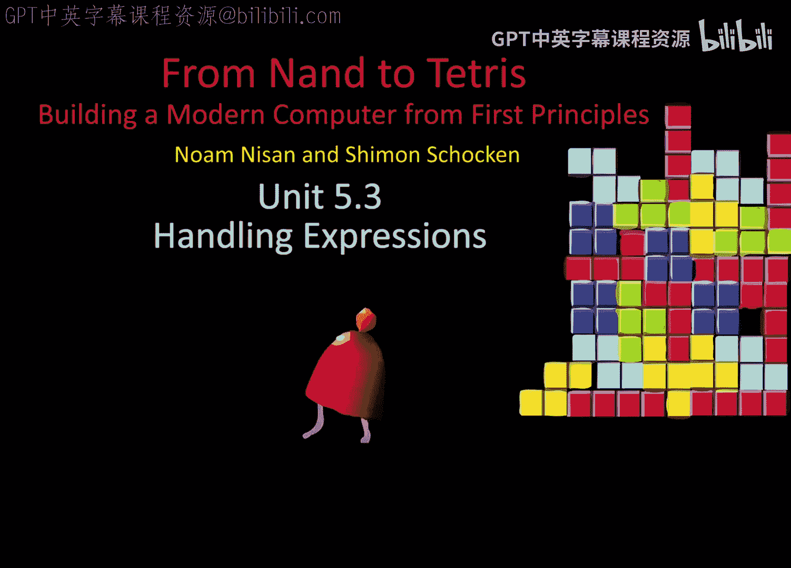

# 从零开始构建现代计算机2：单元5-3：处理表达式 🧮



在本节课中，我们将详细探讨编译器如何处理表达式。我们将学习如何将高级编程语言中的表达式（使用中缀表示法）系统地转换为虚拟机（VM）的栈机器代码（使用后缀表示法）。

---

## 从语法到代码生成

上一单元我们讨论了变量的处理。这些变量通常出现在表达式的上下文中。当时我们简要提及了将这些表达式转换为虚拟机代码的过程。在本单元中，我们将深入探讨这一转换的细节。

首先，让我们回顾一下Jack语言中定义表达式的语法子集。根据课程配套书籍中的语法定义，一个表达式可以是一个**项**，或者一个**项**后跟一个**运算符**和另一个**项**。

例如：
*   **5** 是一个整数常量，根据语法，它是一个项，因此也是一个表达式。
*   **x** 是一个变量名，同样是一个项，因此也是一个表达式。
*   **x + 5** 符合“项 + 运算符 + 项”的模式，因此也是一个合法的表达式。

我们可以构造出无限多、高度复杂的表达式。作为编译器编写者，我们面临的问题是：如何系统地将这些多样化的表达式（从简单的 `5` 或 `x` 到复杂的组合）映射到虚拟机指令上？

## 表达式表示法：中缀、前缀与后缀

要理解转换过程，我们需要引入**解析树**的概念。以简单表达式 `A * B + C` 为例，其解析树描述了表达式的语义结构。

我们通常将表达式写成 `A * B + C` 的形式，这种表示法称为**中缀表示法**，因为运算符位于两个操作数之间。这种表示法对人类来说很直观，因为我们在小学就被这样教导。

然而，这种表示法并非唯一。我们也可以使用**前缀表示法**（例如 `+ * A B C`），将运算符放在操作数之前。它也被称为函数式表示法，因为函数调用就是这种形式（函数名在前，参数在后）。

更重要的是，我们还有**后缀表示法**（例如 `A B * C +`），它先列出操作数，然后列出要应用的运算符。后缀表示法与我们的栈机器语言密切相关，因为虚拟机语言本身就是后缀形式的。例如，要计算 `A + B`，我们执行 `push A`, `push B`, `add`。

我们的源语言（如Jack、Java、Python）使用中缀表示法，而目标虚拟机语言使用后缀表示法。因此，编译器的核心任务之一就是将中缀表达式转换为后缀表达式。

## 转换策略：通过解析树生成代码

一种直观的转换方法是：
1.  从源代码（中缀）生成解析树。
2.  按照特定顺序（如深度优先遍历）访问解析树的每个节点。
3.  在访问过程中，生成对应的虚拟机代码。

例如，对于表达式 `x + 2 * y`，其解析树根节点是 `+`，左子树是 `x`，右子树是 `*`（其左子树是 `2`，右子树是 `y`）。深度优先遍历会依次访问 `x`、`2`、`y`、`*`、`+`，从而生成代码：`push x`, `push 2`, `push y`, `call Math.multiply`, `add`。

然而，为整个程序构建完整的解析树可能非常庞大和低效。幸运的是，存在一种替代方法，可以在不显式构建整个解析树的情况下，动态生成代码。

## 递归代码生成算法

我们将使用一个优雅的递归算法 `codeWrite` 来动态生成代码。该算法接收一个表达式并生成对应的虚拟机代码。其核心逻辑如下：

以下是该算法的伪代码描述：
```pseudocode
function codeWrite(expression):
    if expression is a number (e.g., 5):
        output "push constant 5"
    else if expression is a variable (e.g., x):
        // 根据符号表确定变量段
        output "push [segment] [index]"
    else if expression is of form "expr1 op expr2" (e.g., x + y):
        codeWrite(expr1)
        codeWrite(expr2)
        output VM command for `op` (e.g., "add")
    else if expression is of form "op expr" (unary, e.g., -z):
        codeWrite(expr)
        output VM command for unary `op` (e.g., "neg")
    else if expression is a function call (e.g., f(2, y, -z)):
        codeWrite(argument1) // e.g., 2
        codeWrite(argument2) // e.g., y
        codeWrite(argument3) // e.g., -z
        output "call f [argumentCount]"
```

这个算法不仅捕获了输入表达式的语义，还确保了在运行时，表达式的计算结果会被放置在栈顶。

## 从语法分析到代码生成

在之前的项目中，我们编写的是语法分析器，它接收类似 `let x = a + b - c;` 的源代码，并输出描述其结构的XML标签。例如，它会将表达式扁平化地标记为 `<term>a</term><symbol>+</symbol><term>b</term><symbol>-</symbol><term>c</term>`。

在当前项目中，我们不再生成XML。相反，我们利用语法分析器识别出的结构，直接调用类似 `codeWrite` 的算法来生成可执行的虚拟机代码。虽然编译器程序的整体API和结构仍然适用，但生成XML的部分需要被替换为生成虚拟机指令的逻辑。

## 运算符优先级与括号

现在，让我们关注一个重要的细节：运算符优先级。考虑表达式 `a + b * c`。根据我们上面的递归算法（严格从左到右处理），可能会生成先计算 `a + b`，再与 `c` 相乘的代码。然而，在标准数学中，乘法 (`*`) 的优先级高于加法 (`+`)，因此正确的结果应该是先计算 `b * c`，再与 `a` 相加。

这里有一个关键点：**Jack语言规范本身没有定义运算符优先级**。这意味着，对于没有括号的表达式 `a + b * c`，编译器生成上述两种代码版本中的任何一种在语言层面都是“正确”的。运算符优先级的处理方式成为了编译器实现的一部分，由编译器作者决定。

那么，如何让程序员表达他们想要的运算顺序呢？答案是通过**括号**。括号是Jack语言的一部分，编译器必须尊重括号所指定的优先级。对于表达式 `a + (b * c)`，编译器必须生成先计算 `b * c` 的代码。我们的 `codeWrite` 算法在处理括号时，会自然地优先处理括号内的子表达式，从而生成符合数学直觉的正确代码。

---


本节课中，我们一起学习了表达式处理的完整流程。我们了解了中缀、前缀和后缀表示法的区别，以及它们与栈机器的关系。我们掌握了一个强大的递归算法，能够将任何复杂度的中缀表达式动态转换为正确的虚拟机后缀代码。最后，我们讨论了Jack语言中运算符优先级的特殊性，并明确了括号在控制运算顺序中的关键作用。这些知识为我们接下来处理程序的控制流结构打下了坚实的基础。