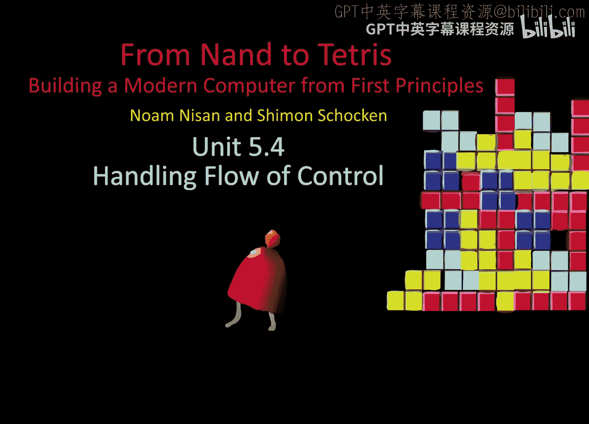
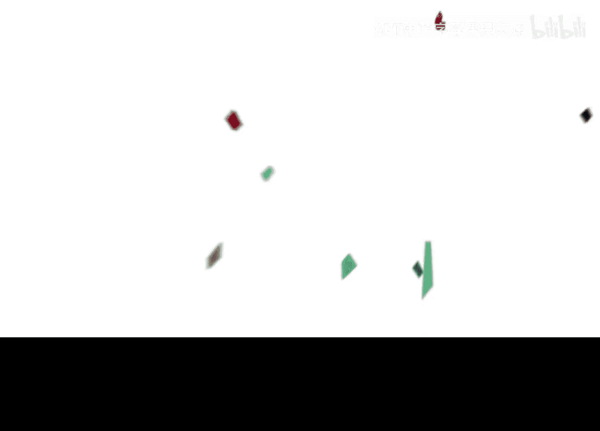

# 耶路撒冷希伯来大学《从零开始构建现代计算机2｜Build a Modern Computer from First Principles》中英字幕 p58 58_07_05_单元5-4_处理控制流.zh_en -BV1DA4m1w7FU_p58-

Welcome to unit 4 of this module in which we are going to talk about the challenge of handling the translation of flow of control into the VM language。

Well， let's start with an example as usual， and what we have here is an example of some jack code which presumably computes the square root of some given number x using some binary search algorithm。

Allright， so。This is the source code。And the challenge， of course。

 is translating or reexpressing the semantics， which is captured in this source code into the VM language。

Now I would like to point out at the outset that I could have named this module also not necessarily handling flow of control but rather handling statements。

 because in the Jack language we have five possible statements of which we see， I think four。

 in this example we have let statements and we see quite a few of them here。

 we have while statements， if statements， return statements and do statements。

 so we don't have a do statement example here but all the others are present。

And so the challenge that we face is reexpressing every one of these statements using the VM language。

 not necessarily just the three commands that you see here。And yet。

 I would like to argue that of these five statements， the only。

Two interesting ones are the while and the if， because let do and return are trivial statements to translate and。

We have already done some of it before， we'll do some of it in the next units。

And translating while and if are far more challenging。

 and that's why I want to focus on these two branching commands or flow of control commands only。

 So the challenge once again is to translate while and if statements into code that involves the three branching commands of the VM language which are go to。

 if go to and label， how do we do it。Well， the first thing that I'd like to observe is that we have some very structured or well structured patterns here and once we focus on the patterns。

 everything becomes much easier to comprehend and handle in particular a while statement always has some expression that has to be evaluated。

 if this expression is true， then we go into the while and we evaluate the statements。

 if not we skip the while， and we go to whatever is after the end of the while。

 and with the if we have a similar situation， if the expression is true。

 we execute the statements of the if clause， if not we execute the statements of the else's clause。

 if there is an else' clause。And once again， the structure here is very well defined。

 and therefore we can systematically handle it quite nicely using a compiler or the co generator that we develop in this module。

So what I'd like to do next is focus on each one of these statements while an if in isolation。

 So let me begin with the if。Here is the generic structure of an if statement in the Jack language。

And。Before I generate code for this statement， I would like to rewrite it using。

What is sometimes called a flow chart， I believe。 So as you notice。

 the first thing that I do is I take the expression of the if， and I negate it。

And then I look at the result if the result is true。I go on to execute statements 2。

 the block of statements， which is denoted here in statements 2。 If not expression is false。

 I execute statements 1。Now， why do I do this negation because？

Once you negate the expression in such a way， code generation becomes far simpler and tighter。

 And in particular， here is how we generate code for an if statement。We compile。

I should say we generate code that compiles the。呃。Let me take it back。

 we generate code that computes the value of the expression and puts it on the stack。

 then we navigate whatever we compute， if the result is true， we go to label L1。

 if the result is false， we go to label L2。And that's it。 You know。

 this is the resulting execution of the if statement。Now， where do these labels come from。Well。

 the answer is that the compiler generates these labels quote unquote automatically。

 so it's the job of the person who develops the compiler to write code that generates these labels cleverly and when I say cleverly I mean that these labels have to be unique something that I will discuss later on in the module So you simply generate the labels you go to it and later on you plug the label into the code exactly where it belongs。

 So once again， you know you just have to convince yourself that everything that I show here is completely deterministic given any if statement we can generate the code that will compile and compute exactly the same if statement using the VM language only。

So that's how we handle if。What about while？Well， while in a way is even simpler than if， right。

 this is the generic while statement in its source called the manifestation。

 And the first thing that I do conceptually speaking is I generate this flow chart。

 which begins once again with negating the expression。If the result is true， I get out of the while。

 if the result is false， it means that the expression is true。

 and therefore I go into the while and I execute the statements。

 and then I go back to reevalu the expression and so on and so forth。

 That's how I implement this loop here。 So how will the generated code look like。 Well。

 it will look like this， right？ I。Conceptally speaking， I use this flowchar and I follow it。

 So I start by inserting a label into the code stream。 I call this label L1。

Then I generate code that computes the value of the expression。 I then immediately negate this value。

 If what I got is true， I go to L2。 I step。Out of the loop， if it's false。

 I go on to generate code for the statements and executes them。

 And then I go back to L1 in order to reenter potentially reenter the Y loop， as we did before。

So once again。I don't really need this flow chart explicitly。

 it just sort of it's a mental exercise that tells me to think about cogen。

 but given any wild statement， I can systematically generate the VM code that will implement the same while semantics in the virtual machine。

Once again， the labels here are created automatically by the code writer。So that it。

 that's how I compile if and while statements and as I said before。

 compiling the other three statement types， let do and return is fairly straightforward。Alright。

 now there's some。Mild complications， which are very easy to resolve。

And in order to talk about these complications， I want to go back to the generic code that I showed you before。

 and I'd like to observe that a program typically contains multiple if and while statements。

We can have many of them， not just two， as we have in this example。So how do we handle it？ Well。

 all we have to do is make sure that the compiler generates unique labels， right so once we used L1。

 for example， we should not use L1 in other control structures that we find or compile downstream。

 We should always create， you know new labels like L 2， L3， L4， and so on very easy to handle。

 but it's a detail that you have to remember。So that's one thing that we have to worry about。

 creating unique labels。The other detail or the other observation is that the if and the while statements may well be nested。

 In fact， here we have an if which is nested within the while。

 and as you know within this if I can have another while and within this while I can have another while and so on and so forth and I can get what is sometimestime called a telescopic code right and the level of nesting is infinite。

😊，Theoretically， I mean， practically， you don't have too many levels of of nesting。

 but you should be able or your compiler should be able to support this phenomena of nested if and while commands。

 How do we handle it？ Well， the answer is that we already took care of it。

 because the compiler that we developed all along， you know。

 beginning with the parer and throughout what we do in this module。

 This compiler employs a highly recursive compilation。Sorry。

 this compiler employs a highly recursive compilation strategy。And therefore。

 there's no problem at all Compiling a while within an if within a while and so on。

 it will happen naturally， because that's how。The software engineering works in the way we designed our compiler。

So having taken care of these complications。I'd like to recap and point out once again， that。

Beginning with this source code。We already know how to handle variables。 You know。

 we did it in the first unit of this module。Then we talked how to handle expressions。

 we also know how to handle expressions using this code writer algorithm， if you recall。

 and now we also discussed how to handle flow of control。So things look pretty promising。

And if you add up all these capabilities here， you can conclude that we already have。

All the tools and techniques that we need in order to develop a compiler for a simple procedure or language。

 like， you know some subset of the C language without， say， as。 We can do it。

 We can write a compiler。For that language， which is quite remarkable， I think。

And I can see some of you probably telling yourself，Ge。Simman showed me seven and a half slides。

 and I can write a compiler。That's that's impressive。 Well， the answer is that， you know。

 first of all， I didn't show you7 and a half slides。 I showed you about 30 slides， but still。

 it's impressive that with so little material we can already write a compiler。😊。

So we have every reason to be proud in this accomplishment， but at the same time。

We have to remember a few things。First of all， the compiler that we develop does not translate all the way down to machine language。

It translates only quote unquote， to the intermediate VM language layer。And therefore， the distance。

 so to speak， that the compiler has to cover。Between the source and the VM is much shorter than the distance that we should have covered or would have covered if we translated all the way from。

 let's say C to machine language。So the reason why writing a compiler is such a manageable and an elegant process or one reason。

Is because we already took care of the VM obstruction。 You know， the compiler writer。

 you in the next project， all you have to do is generate VM code and you treat the VM code as an abstractstruction。

 You don't care how pop and push commands are being implemented。 Why don't you care about it。

 Because we already took care of it in the previous projects and in the previous modules。

So this once again is an example of the great virtue of working in a modular fashion， you know。

 because we already took care of this obstruction， we can now use it without worrying about the details of how these VM commands are actually being executed。

So you see that， you know， if you design your software engineering in a modular and kind of unit tested fashion。

 everything becomes much more manageable， elegant and useful。All right， so。

This is what I wanted to say about handling flow of control and about handling statements in the jack language in general。

 and in the next unit we'll venture into the very interesting issues involved in handling code that creates and manipulates objects。

