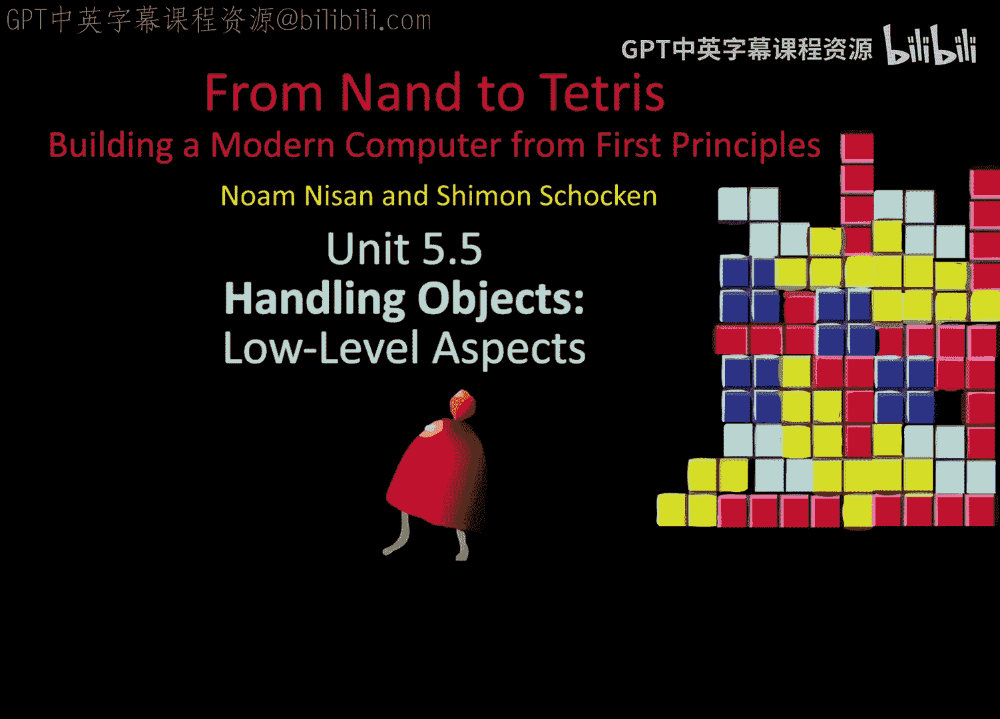

# 耶路撒冷希伯来大学《从零开始构建现代计算机2｜Build a Modern Computer from First Principles》中英字幕 p59 59_07_06_单元5-5_处理对象：底层实现.zh_en -BV1DA4m1w7FU_p59-

So we now begin a sequence of three units that discuss how the compiler generates code that is designed to handle objects。

Now， before we start to talk about this code proper。

 I would like to make a few comments about some low level aspects of data handling using VM commands。

And to begin with， let's look at the big picture。The big picture is such that when you write a high level object oriented program。

 you can allow yourself the luxury to think in terms of all sorts of obstructions you think in terms of。

 for example， two dimensional points。Being objects that are implemented in a language like Jack or Java。

 which is very programmer friendly， and it allows you to think about these points and about the algebraic operations that you can apply on these points。

 almost like a mathematician that deals with these points in the context of some mathematics application。

However， if you were forced to write the same code using the intermediate VM language。

 you wouldn't have all this luxury of objects and methods that operate on objects instead you would be stuck。

 so to speak with a much simplified worldview of the virtual machine which consists of eight virtual memory segments。

 so everything that you did in the high level you had to do using these virtual memory segments and push and pop and other VM commands。

And finally， if you were forced to do all this using machine language。

 then obviously you will be far more restricted， the whole notion of objects and arrays would completely lose its meaning and you would be reduced to operating directly on the Ram。

So with that in mind， we are kind of fortunate that we have compilers that save us all this trouble and write all the necessary low level and intermediate code automatically。

And this is the purpose of a compiler to close these gaps and to give us the luxury of writing programs at the high level and let the compiler worry about all the details of expressing the same semantics in simpler and more primitive languages。

Now in this course， we've already dealt with a VM translator。

 you've written a VM translator in Project 7 and8， and so now we have to focus on the compilation stage only。

So with that in mind， we have to write VM code or more accurately。The compiler has to write。

 oh let me put it this way。 We have to write a compiler that writes VM code。

And let me remind you that in VM programs。If we want to operate on these eight segments。

 we have to use push and pop commands and we always have to say on which segment we operate and on which entry within the segment。

 for example， you know push local3 or something like that， pop static2 and so on。All right。

 and at the end of the game。Everything that we do at the VM level is going to be reduced to operations on the RA and to remind you the VM implementation deals with this mapping by looking at the RAM in a very specific way。

First of all， the first five words in the RA are used as very important pointers that hold the current value of the stack pointer。

 the current value of you the base address of the local segment。

 the base address of the argument segment， this， and that。

 and all these segments refer or belong to the VM function， which is currently running。

And in addition， the VM implementationation also allocates a certain area on the RA to hold the global stack。

 you know that is the stack that keeps the working stack of the currently running VM function as well as all the working stacks and memory segments of the functions that wait for the current function to terminate。

 namely the functions which are on the calling chain。

So let us say a few words about how this architecture is used in order to support the notion of local and argument variables。

 Well， local argument variables are stored on the stack and managed by the VM implementation。

And as far as the VM code is concerned， we can access them using the local and argument segments respectively and once again。

 they are managed by the VM by the VM implementation on the stack and the way the VM implementation records the location of these segment on the stack is by using the two pointers LCL and Arc the VM implementation puts。

 for example， the local statement， I'm sorry， the local segment in a certain area and the stack and it records the base address of this segment in the LCL pointer and it does exactly the same thing with the argument segment。

All right， moving along， how do we use the same architecture to represent object and array data？

Well here the situation is similar but slightly more complex， first of all。

 we use a different area altogether on the RA which is called heap and on the he we record the data of all the objects and arrays that the current program seeks to manipulate。

And I wish to remind you that in an object oriented application。

 you may well have numerous objects and quite a few arrays that are necessary in order to implement the computer game or the financial application or whatever it is that you are trying to implement。

 you know you may well have dozens， hundreds， thousands。

 maybe even millions of objects that you have to manage at the same time， one at a time。

 but you know overall， you may have numerous objects to worry about。

So as opposed to the local and the argument segment， which are singular。 so to speak。

 you have only one of each。To worry about here we may have many objects on the heap and before we access an object using this segment。

 we have to somehow tell the system what do we mean when we say this， I mean。

 to which object are we actually referring。So the implementation of this location， first of all。

 is taking care of using the pointers this and that， just like we did with a local an argument。

 however， before we use the two segments this and that。

 we first have to use the pointer segment to tell the system，😊。

Where we want to align this and that on the ramp。Now this should be handled using VM commands you may ask yourself。

 you know why did we or why do we have to use the pointer segment in such a way？

 Well you know that's how Noram and I decided to design this architecture we had to provide a mechanism to anchor this and that on the particular object and array that the code has to operate on and we're using this virtual segment pointer for this purpose Now I bet that some of what I just said sounds a little bit obscure or esoteric I think that the following example will clarify everything。

So suppose we wish to access Ram words80008001，2 and so on， because， you know。

 they stand for a particular object or a particular array。

 or because they store the data of a particular object or an array。 How do we do it？ Well。

 I'd like to show you the sequence of commands that are needed to implement it。 And for each command。

 I will discuss the command， as well as what the VN implementation does with this command。 So。

 first of all， we have to anchor。This， the this segment on the desired address and the desired address is 8000。

 so we push 8000 onto the stack and then we pop it off the stack and into00。

In response to these two commands， the V implementation will set this pointer to 8000。

 so we'll get this effect。Now by the way， you shouldn't be surprised from what you had right now because if you did Project 7 and 8。

 you actually implemented these particular implementations or these particular realizations of the VM commands。

 right？Moving along。Once you set this pointer to a particular address。

That this segment can be used as if it mirrors or as if it it is anchored exactly on the 8000 address in the Ram。

So from now on， given that we have this desired mapping， I can happily use commands like。😊。

Pop this 0。 Now， what will pop this zero do， It will take the value， which is currently。I'm sorry。

 lets let's do push this zero， it will take the value which is currently located in RamM 8000 and it will push it onto the stack and pop you will take something off the stack and put it in RamM 8000。

And we do this using the this segment。 We can do exactly the same with any any other index of this。

 we can do。 we can use this one， this two， this three， this I。And in order to access the I word。

 we add up 8000 and I and we can use this obstruction here to zero in on the exact word that we want in the Ram。

So notice that the VN program doesn't know where all these segments are located on the RA it only you know works with this segment and the V implementation takes care of all the other details in the background so here's a specific example suppose you want to set RamM 8000 to 17 how do we do it Well we push 8000 pop point to 0 by doing this we get the desired anchor so to speak or the desired alignment and now that this is aligned on the proper area in the Ram we go on to do push 17 and pop this0 this will put the number 17 virtually in the segment this and practically it will put it in RAM location8000。

So呃。This technique that I just showed you here is the general you know sort of generic way to access the Ram specific location in the Ram using VM commands and that's how were going to deal with object data when we'll get to it and that's also how we're going to deal with array data in a very similar fashion that we'll discuss later on in the course。

 So to recap object data is accessed by VM commands using this segment array data is accessed by VM commands using the that segment。

 and in both cases we need to write some VM code that first anchors this and that or any one of them on the desired location in the RA and we do this using the virtual pointer segment it has two entries only0 and1。

Z for setting this segment properly and one for setting the that segment。

 but don't worry about the arrays because we'll deal with them later on in the course。So with that。😊。

I gave you some information about low level data handling techniques using VM commands and we now have what we need in order to go on and discuss how to write VM code that handles object construction。

