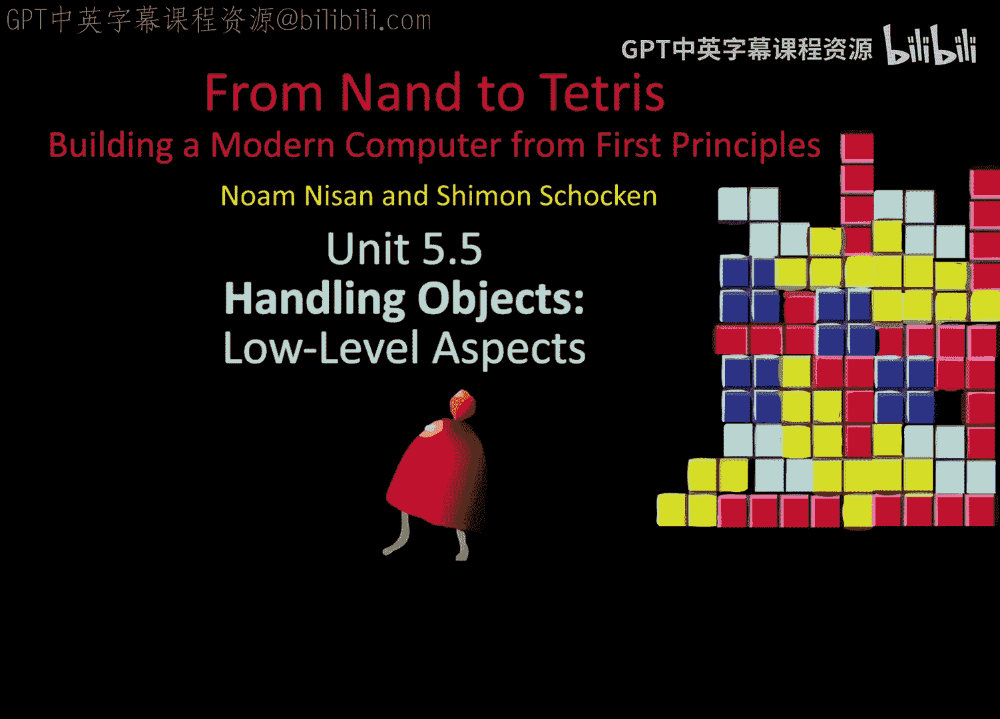

# 从零开始构建现代计算机2：单元5-5：处理对象：底层实现 🖥️



在本节课中，我们将学习编译器如何生成用于处理对象的代码。在深入讨论代码本身之前，我们先了解一些使用虚拟机命令进行数据处理的底层细节。

## 概述

上一节我们介绍了高级编程与底层实现之间的鸿沟。本节中，我们来看看如何利用虚拟机架构来支持对象和数组数据的表示与访问。

## 从高级抽象到底层实现

当你编写高级面向对象程序时，可以奢侈地思考各种抽象概念，例如二维点对象。这些对象在像Jack或Java这类对程序员友好的语言中实现，允许你像数学家一样思考这些点及其代数运算。

然而，如果被迫使用中间虚拟机语言编写相同代码，你将无法享受对象和方法的便利。相反，你将面对一个简化的虚拟机世界观，它只包含八个虚拟内存段。所有高级操作都必须通过这些虚拟内存段以及`push`、`pop`等虚拟机命令来完成。

最后，如果被迫使用机器语言完成所有工作，限制会更多。对象和数组的概念将完全失去意义，你将直接操作RAM。

幸运的是，我们有编译器来自动处理所有这些麻烦，生成必要的底层和中间代码。编译器的目的就是弥合这些鸿沟，让我们能够专注于高级编程，而由编译器负责在更简单、更原始的语言中表达相同语义的所有细节。

在本课程中，我们已经处理过虚拟机翻译器。你在项目7和8中编写了虚拟机翻译器，因此现在我们可以只专注于编译阶段。

## 虚拟机代码基础

考虑到这一点，我们必须编写虚拟机代码，或者更准确地说，我们必须编写一个能生成虚拟机代码的编译器。

让我提醒你，在虚拟机程序中，如果我们想操作这八个内存段，必须使用`push`和`pop`命令，并且必须指定操作哪个段以及段内的哪个条目。例如：
```vm
push local 3
pop static 2
```
最终，我们在虚拟机级别所做的一切都将简化为对RAM的操作。虚拟机实现通过一种特定的方式看待RAM来处理这种映射。

首先，RAM的前五个字被用作非常重要的指针，它们保存着：
*   栈指针的当前值
*   局部段的基础地址
*   参数段的基础地址
*   `this`指针
*   `that`指针

所有这些段都属于当前正在运行的虚拟机函数。此外，虚拟机实现还会在RAM上分配一个特定区域来保存全局栈。这个栈不仅保存当前运行函数的运行栈，还保存调用链上等待当前函数终止的所有函数的运行栈和内存段。

## 支持局部变量和参数变量

以下是关于这种架构如何支持局部变量和参数变量概念的说明。

局部变量和参数变量存储在栈上，并由虚拟机实现管理。就虚拟机代码而言，我们可以分别使用`local`和`argument`段来访问它们。虚拟机实现通过`LCL`和`ARG`这两个指针在栈上记录这些段的位置。例如，虚拟机实现将局部段放在栈的某个区域，并将该段的基础地址记录在`LCL`指针中，对参数段也做同样处理。

## 表示对象和数组数据

接下来，我们看看如何使用相同的架构来表示对象和数组数据。

这里的情况类似但稍微复杂一些。首先，我们使用RAM上一个完全不同的区域，称为**堆**。在堆上，我们记录当前程序要操作的所有对象和数组的数据。

在一个面向对象的应用程序中，你可能拥有许多对象和数组来实现计算机游戏、金融应用或其他任何程序。你可能需要同时管理数十、数百、数千甚至数百万个对象。

因此，与局部段和参数段（每个只有一个）不同，我们可能在堆上有许多对象。在使用`this`段访问对象之前，我们必须以某种方式告诉系统“this”指的是哪个对象。

`this`和`that`位置的实现首先通过使用`this`和`that`指针来处理，就像我们对局部变量和参数所做的那样。然而，在使用`this`和`that`这两个段之前，我们必须先使用`pointer`段来告诉系统我们希望将`this`和`that`指向RAM上的哪个位置。

你可能会问，为什么我们必须以这种方式使用`pointer`段？这是由架构设计决定的，我们需要提供一种机制来将`this`和`that`锚定到代码需要操作的特定对象和数组上，为此我们使用了这个虚拟的`pointer`段。

## 一个具体示例

我敢打赌，我刚才说的一些话听起来有点晦涩难懂。我认为下面的例子将澄清一切。

假设我们希望访问RAM地址8000、8001、8002等处的字，因为它们代表一个特定的对象或数组，或者存储了特定对象或数组的数据。我们该怎么做呢？

我想向你展示实现它所需的命令序列。对于每个命令，我将讨论命令本身以及虚拟机实现对该命令的处理。

首先，我们必须将`this`段锚定到所需的地址（8000）。我们通过以下命令实现：
```vm
push constant 8000
pop pointer 0
```
响应这两个命令，虚拟机实现会将`this`指针设置为8000，从而得到我们想要的效果。顺便说一句，如果你完成了项目7和8，你应该不会对此感到惊讶，因为你实际上已经实现了这些虚拟机命令的具体实现。

一旦你将`this`指针设置为特定地址，`this`段就可以被使用，就好像它镜像或锚定在RAM的8000地址上一样。

因此，从现在开始，给定我们有了这个所需的映射，我可以愉快地使用像`push this 0`这样的命令。`push this 0`会做什么？它会获取当前位于RAM[8000]的值，并将其压入栈中。而`pop this 0`则会从栈中取出一个值，并将其放入RAM[8000]。

我们使用`this`段来做到这一点。我们可以对`this`的任何其他索引做完全相同的事情，例如`this 1`、`this 2`、`this 3`、`this i`。为了访问第`i`个字，我们将8000和`i`相加，并利用这里的抽象来精确指向RAM中我们想要的字。

请注意，虚拟机程序并不知道所有这些段在RAM上的具体位置。它只使用`this`段，而虚拟机实现在后台处理所有其他细节。

## 访问RAM的具体步骤

这里有一个具体的例子。假设你想将RAM[8000]设置为17。我们该怎么做？

以下是实现步骤：
1.  **锚定指针**：首先，我们需要将`this`指针指向地址8000。
    ```vm
    push constant 8000
    pop pointer 0
    ```
2.  **设置值**：然后，我们将值17压入栈，并弹出到`this`段的第0个位置。
    ```vm
    push constant 17
    pop this 0
    ```
    这将在虚拟的`this`段中放入数字17，实际上它会将其放入RAM位置8000。

我刚才在这里展示的技术是使用虚拟机命令访问RAM中特定位置的通用方法。这就是我们处理对象数据的方式，也是我们以非常类似的方式处理数组数据的方法（我们将在课程后面讨论）。

## 总结

本节课中，我们一起学习了虚拟机层面处理对象和数组数据的底层机制。

*   **对象数据**通过虚拟机命令使用`this`段访问。
*   **数组数据**通过虚拟机命令使用`that`段访问。
*   在这两种情况下，我们都需要先编写一些虚拟机代码，将`this`和`that`（或其中之一）锚定到RAM中的所需位置。我们使用虚拟的`pointer`段来实现这一点，它只有两个条目（0和1），0用于正确设置`this`段，1用于设置`that`段。


有了这些关于使用虚拟机命令进行底层数据处理的背景知识，我们现在具备了继续讨论如何编写处理对象构造的虚拟机代码所需的基础。