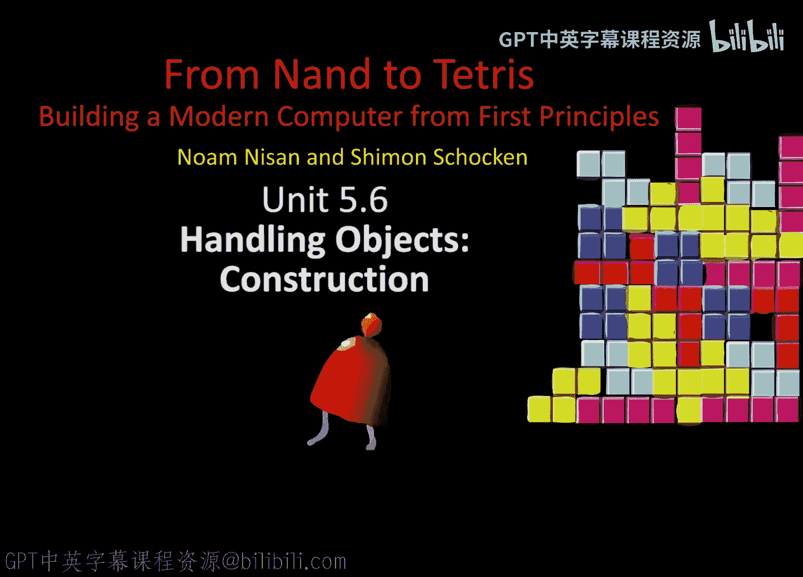
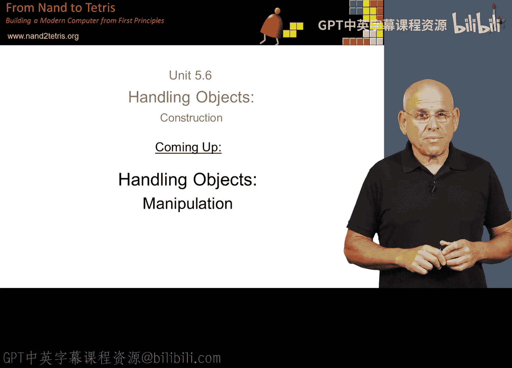

# 耶路撒冷希伯来大学《从零开始构建现代计算机2｜Build a Modern Computer from First Principles》中英字幕 p60 60_07_07_单元5-6_处理对象：构造.zh_en -BV1DA4m1w7FU_p60-

Now that we understand some techniques on how we can use VM commands to access selected areas on the RA。

 we can go on and talk about how to write VM code that handles object construction。

Now beginning with a big picture here is an example of some client class that seeks to create a point object and as usual we do it as we do in Java and C sharpharp using a two stage process。

 first of all， we declare an object variable P1 and later on we may or may not call a constructor and assign this object to the variable that we previously declared P1。

And here is the point class that actually services this request。

 in other words we have a constructor which is a subroutine within the point class and when we invoke the new method or then the new subroutine within the client class。

 we actually cause the code of the constructor to start running。

So what we have here is a typical collar collie kind of relationship。

And you should bear in mind that as far as the compiler is concerned。

 what we have here is two completely separate and standalone compilation units。

 So we are facing the challenge of first of all， compiling the client class and then separately compiling the point class and not necessarily in this order。

 right， So how do we do it。 Well that's what this unit is all about。

Let us begin with the client class and as usual everything that we do in the high level is going to be reflected in some way on the low level and in this course we are always fond of exploring both layers simultaneously so this will be no exception。

😊，When we do var point P1。The compiler will end up generating code that essentially maps the P1 variable on some location in the stack。

 which is going to be initialized to0。 and then later on， when we actually call the constructor。

 the the code， the compiled code that will start running will end up creating the object proper on the he。

And the same code will also， when not necessarily the same code， but。

The two classes running together will end up taking the base address of the newly created object and storing it in what we assigned previously。

 the P1 variable。Now the 6012 address is completely arbitrary， I made it up。

 and I assume that this is the place in the RA that the compiler ended up storing this particular object。

So that's what happens in a very sort of high level view of operation。And with that。

 let us now delve into compiling this particular method call， which happens to be， I'm sorry。

 a constructor call。And in order to do this， we will look at a slightly more interesting code in which we declare and create actually two object variables。

 P1 and P2， as well as one primitive variable D。And here is the compiled code that the compiler will generate from this particular high level source code。

 So first of all， what will the compiler do with these two variable declarations。那。Actually。

 the compiler deals with every statement kind of one at a time。

 so it's a little bit misleading that I wrote the two statements together here。

 but I'm doing it just to save a space and minimize clutter。

 whenever the compiler encounters a variable declaration it generates no code whatsoever。

 The only thing that the compiler does is it updates the relevant symbol table and because we are now compiling code that resides in a certain subroutin will end up updating the symbol table of this subroutin and recording that what we have here are the two point variables P1 and P2 as well as one primitive variable D。

Moving along， we now want to compile the statement point calling point。

nu and assigning the result to P1， how should we do it？Now， look at this high level method call here。

Point dot New 23。What do we have here？Well， what we have is just a call to some subroutine。

 so we can handle it just like we handle any subroutine call in the VM language。

 We can push the two arguments 2 and 3 and call point new to execute its magic。

 you know whatever magic it may be。😊，So we are calling the suboutine for its effect， so to speak。

 however， because new is a constructor， there's a certain contract or a big time assumption which lurks in the background。

 And in particular， the calling code， this code that we are now writing。

 assumes that when the constructor will execute whenever it will happen when the constructor will execute。

 it will end up allocating some space on the Ramm for the newly constructed object。

 and it it will also take the base address of this space on the Ramm and it will return it to the collar。

 it will return it to me。 Im the call， right。So with that in mind。

 it makes perfect sense to pop the topmost value of the stack into P1。 why。

 because that's exactly what we want， right we want P1 to point at the base address of the newly constructed object。

 So if this contract will be respected by the constructor， we'll have exactly what we wanted。

 as we see in this Ram diagram。What about P2， it's exactly the same story and therefore I'm not going to repeat it。

So that's how the compiler handles calls to create new objects from the call's perspective。Now。

 let me kind of recap and say a few words about the resulting impact。 first of all， when。

We declare the variables when the compiler generates code to declare the variables。

 well we know that it generates no code。 it just it creates the symbol table or modifies the symbol table。

 Well it essentially it ends up mapping you know these three variables on the Ram and initializing them to0。

 I'm repeating what I said before fore closure。And only when。

We call the constructors and only when the constructors will actually go to work only then during runtime。

Are we going to actually create the objects on the Ram and assign their base addresses to the previously allocated variables。

So object construction is a two stage affair that happens both during compile time and during runtime。

 and it's important to understand it。And and that's why I took the trouble to repeat this slide as well。

Alright， so now we know how to generate code to handle object construction from the call perspective。

 and we can move on to talk about the Koli。So the challenge now is how to handle the compilation of constructors。

Well let's think about it。 first of all a constructor is typically designed to do at least two things first of all。

 arrange some space on the Ram for the new object and second of all， no less important。

 a constructor typically assigns certain values to the fields of the newly constructed object that's what typically happens right when you say new point2 comma 3。

 you expect the X property of the point to be set to2 and the y property to be set to three。

 so the constructor is responsible for doing these initialization tasks。All right。With that in mind。

 the constructor。Must have access to the objects's fields。How can we do it。

 How can we access the object fields， Well， we talked about it in the previous unit， right。

 We can access the object fields。By accessing this virtual segment， don't forget。

 we are writing VM code， we have to do everything from the VM code perspective so we can manipulate this segment and this will end up manipulating the current object。

 the object that the constructor just created。And in order to access this segment。

 we first have to anchor it properly on the right address in the Ram using the pointer segment。

Nothing is new here because we discussed it in the previous unit。

But now we'll see how it comes to play in the actual task of， of developing a compiler。 Alright。

 so here is。The call to the constructor。That I repeat here just for context。

 you know I don't have to repeat it because it belongs to a different class right we already took care of this class and now we are taking care of the point class。

 but I wanted to show it once again for perspective because these things don't happen you know in a vacuum。

So how do we compile this point class， Well， we begin by compiling the three statements。

 class point field in X， Y， static in point count and。

This is not really the subject of this unit because in this unit we are talking about compiling constructors only。

 but I will comment that when the compiler handles these three high level commands。

 it generates no code whatsoever。 The only thing that it does is creates the class level symbol table and that's it。

And then at a certain point the compiler will get to a point where it has to generate code for the constructor。

 so the first thing that we see is the constructor signature so to speak or the constructor declaration and how does the compiler handle it well once again it will generate no code whatsoever。

 the only thing that it will do with this statement is that with this declaration is that it will create。

The subroutine symbol table， the subroutine happens to be the constructor and recording it that all we have so far are two variables。

 aX and AY， and both of them are argument kind of variables。Well。

 now comes an interesting and important stage in code generation。

The compiler knows that it generates code for a constructor。

And it knows that the constructor has to create some space on the Ramm for the newly constructed object。

So the first question you should ask is how does the compiler know how much space is needed？Well。

 the compiler can consult the class level symbol table and realize that objects of this particular class of the point class require two words only X and y right because you know we have a 16 bit machine。

 everything is 16 bit。In a more complex language like Java， we may need more words in the case。

 you know， if we have more complex integer types or float types or floating point。But here。

Just by looking at the symbol table， we know that we need to secure a memory block that contains two words。

 right Now the question is， how do we find such a free memory block on the Ram？Well， at this stage。

 the operating system comes to the rescue。And the operating system which we have seen here and there during the course。

 supplies all sorts of very important functionality。

 and one part of this functionality is a function called AlO， comes from the word allocateoccate。

If you provide a look with a certain argument。Like five。

 then Aloc will go to work and it will find a memory block on the Ram。

 which has two important properties。 First of all， it is five words long。 And second， second of all。

 it's free。 You know， no one needs it。 and therefore the constructor can can safely use it。Now。

 the implementation of Aoc is very clever and elegant。

 and we will look into it and implement it in the last module of this course when we actually build the operating system。

 but for now。We are going to use it as a black box obstruction。

 So everything that I said is written here in this comment。

 and the compiler now is going to use the operating system to create this space on the Ram。

How do we do it， We push to because we need two words and we call memory all for its effect。

 and we know that memory all is going to return the base address of the newly created object。

With that in mind， it makes perfect sense to pop this value that was returned by alloc into pointer 0。

 why， because if we do this， we are going to align this virtual segment on the object that we currently that we have just constructed on the Ramm。

And I do this because I know as a compiler writer， I know that with very high likelihood。

 the next commands in the constructor will want to access the fields of the newly created object。

 And if they will not want to do it then so be it so I'm not going to use this segment。

 but if I will need to use this segment， I took care of it。

 It is readily available and now I can use it safely。 in particular， indeed。

 if you look back at the high levelve code， you see that the next two statements that we have to handle are exactly what I just described。

 these are statements that seek to access the x and y properties or the x and y fields of the new object。

 Well， now that this segment has be properly aligned I can happily do just that。

 So I generate code that pushes argument0 Y argument0。😊。

Because I look it up in the symbol table and I see that AX stands for argument0。

 so I push it on the stack and then I unload it or pop it into this0 and then I do the same with the AY and y and by doing this I'm going to manipulate this0 and this one and because I took care to anchor them correctly I'm going to manipulate the right area on the Ram。

😊，All right， moving along， I have to handle let point count equals point count plus 1。

And this is not terribly interesting because I'm not manipulating any objects here。

 So I'm not going to bela on it。 And finally， And that's very important。

According to the rules of the game， every jack constructor must end with a return this statement and indeed we see that we have returned this statement in this constructor as well。

 so how do we compile it easy right this is already anchored on the right address so all we have to do is push pointer0 on the stack because pointer0 contains the base address of this and return this address to the caller。

And that's the end of the compile code of this particular constructor， but as you can imagine。

 you know this code will be very similar for many other constructors as well。In principle， of course。

Now， what do we do with this return address？Well， let us remind ourselves， you know。

 where we started， where we started with some color issuing a call to the constructor's code。

 So I'm returning the value to this location in the high level code， and it may look。

It will be more clear if we think about the compiled calls code after the call is the call called point do new。

 you know it sort of sits back and waits for the constructor to do its job and it knows that when the constructor will terminate its processing。

 the topmost value on the stack will be the return value。

 the base address that was of the object that was just constructed and therefore it makes perfect sense。

I'm sorry， and therefore it makes perfect sense to pop this topmost value onto P1。

 and this will create once again the desired setup of an object that we discussed all along。

So that's it。 That's how we handle constructors。 And so we have mastered the art and the science of generating code。

 both for the。Constructor calling as well as for the constructor execution itself。

 And now that we have done that， we can go on and talk about object manipulation。

