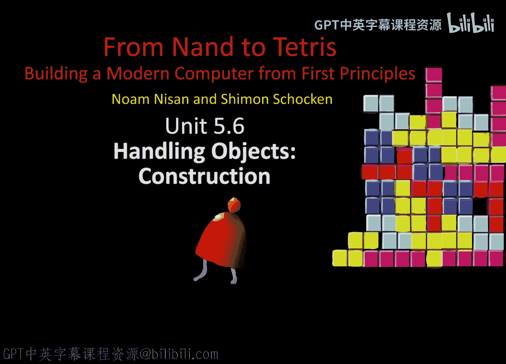
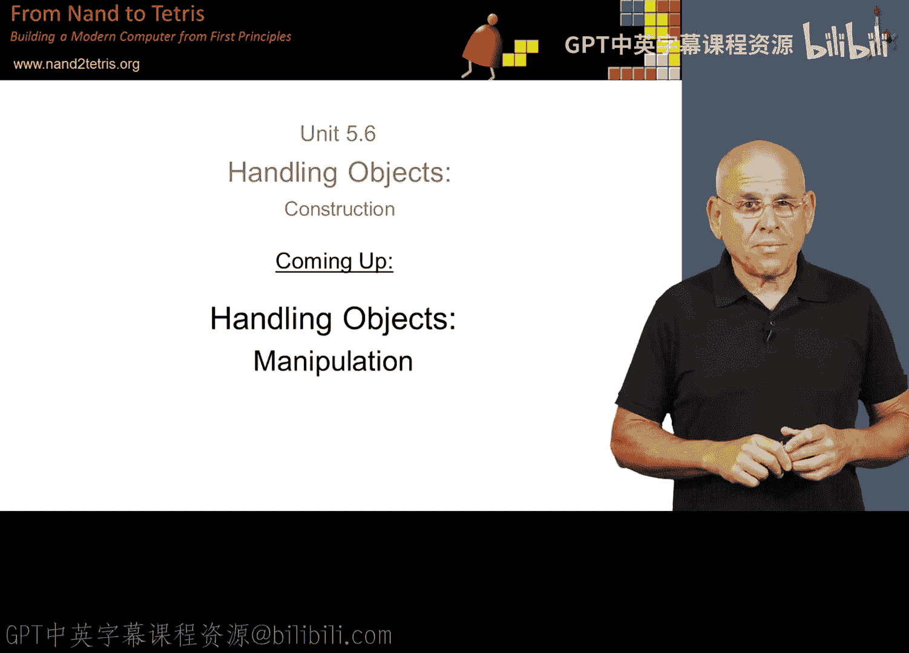

# 从零开始构建现代计算机2：单元5-6：处理对象：构造 🏗️

在本节课中，我们将学习如何编写虚拟机（VM）代码来处理对象的构造过程。我们将从调用者的视角和构造函数本身的视角，分别探讨如何生成相应的VM指令。

## 概述

对象构造是一个两阶段的过程，涉及编译时和运行时。编译时，编译器处理变量声明并更新符号表。运行时，构造函数被调用，在堆上分配内存并初始化对象。我们将学习如何为这两个阶段生成正确的VM代码。

## 从调用者视角编译对象构造

上一节我们介绍了如何访问堆上的特定区域。本节中，我们来看看如何从调用者的角度编译创建对象的代码。

当高级语言（如Java）中声明一个对象变量时，例如 `var point P1;`，编译器不会生成任何VM指令。它只会在当前子程序的符号表中记录这个变量，并将其在栈上对应的位置初始化为0。

当调用构造函数时，例如 `P1 = Point.new(2, 3);`，编译器需要生成调用代码。这个过程与调用普通子程序类似。

以下是处理此类调用的步骤：
1.  将构造函数的参数（例如2和3）压入栈。
2.  使用 `call Point.new` 指令调用构造函数。
3.  构造函数执行完毕后，会将其新创建对象的基地址作为返回值留在栈顶。
4.  调用者代码使用 `pop` 指令将这个地址存入之前为 `P1` 变量分配的位置（例如 `pop local 0`）。

这样，`P1` 变量就指向了堆上新创建的对象。

## 从构造函数视角编译对象构造

现在，我们知道了如何生成调用构造函数的代码。接下来，我们探讨如何编译构造函数本身的VM代码。

构造函数的主要任务有两个：
1.  在堆上为新对象分配内存空间。
2.  初始化新对象的字段。

为了访问和操作对象的字段，我们需要使用 `this` 虚拟段。在构造函数开始执行时，`this` 段尚未指向有效的对象内存。

以下是编译一个构造函数（例如 `constructor Point new(int x, int y)`）的步骤：

1.  **分配内存**：编译器首先查询类的符号表，确定对象需要多少字（word）的内存（例如，`Point` 类需要2个字存储 `x` 和 `y`）。然后，它生成代码调用操作系统的 `Memory.alloc` 函数来申请一块连续的空闲内存。
    *   **代码示例**：`push constant 2` 后跟 `call Memory.alloc 1`。`alloc` 函数会将分配的内存块的基地址返回到栈顶。

2.  **设置 `this` 指针**：将 `alloc` 返回的基地址弹出到 `pointer 0`。这样，`this` 段就被锚定到了新创建的对象内存起始处。
    *   **公式/代码**：`pop pointer 0`

3.  **初始化字段**：现在可以通过 `this` 段来访问对象字段。将传入的参数（如 `x` 和 `y`）赋值给对象的对应字段。
    *   **代码示例**：`push argument 0` 然后 `pop this 0`（设置 `x`）；`push argument 1` 然后 `pop this 1`（设置 `y`）。

4.  **返回对象引用**：根据语言规范，构造函数必须返回新对象的引用。由于 `pointer 0` 正持有这个基地址，只需将其压入栈并返回即可。
    *   **代码示例**：`push pointer 0` 后跟 `return`。

完成这些步骤后，控制权返回给调用者，调用者如前所述，将返回的地址存入目标变量。

## 总结

本节课中我们一起学习了对象构造的完整编译过程。
*   从**调用者视角**，构造被编译为：压入参数、调用构造函数、接收返回的对象地址并存储。
*   从**构造函数视角**，构造被编译为：使用 `Memory.alloc` 分配内存、用返回地址设置 `this` 指针、初始化对象字段、最后返回 `this` 指针的值。

理解这个两阶段的协作过程（调用者准备、构造函数执行并返回结果）是处理面向对象编程中对象生命周期的关键。掌握了对象构造的编译方法后，我们就可以继续学习如何操作已构造好的对象。