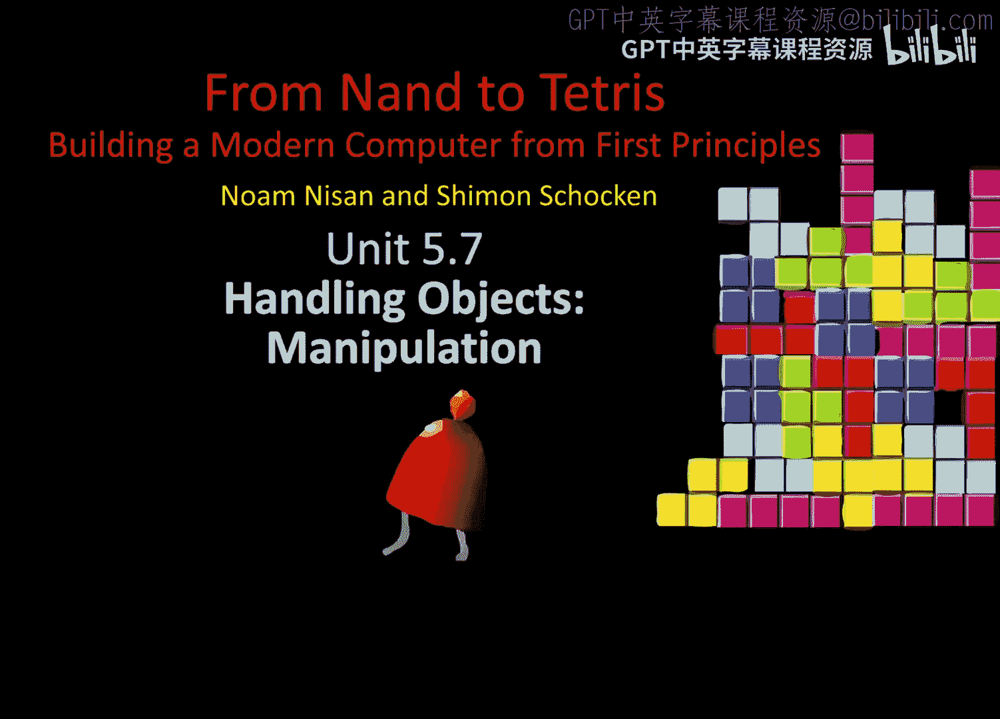

# 耶路撒冷希伯来大学《从零开始构建现代计算机2｜Build a Modern Computer from First Principles》中英字幕 p61 61_07_08_单元5-7_处理对象：操作.zh_en -BV1DA4m1w7FU_p61-

Now that we understand how objects are constructed， we can move on to talk about object manipulation。

And when I say object manipulation， I mean。Two different things。 first of all。

 we have to know how to handle code that calls methods that are supposed to operate on on selected objects。

 And then we have to discuss on compiling the methods themselves。 So as usual。

 we have a colorqu kind of relationship。 here we have an example of some client class that creates some objects。

 similar objects to those that we discussed in the previous unit。

And then we see some examples of method calls。 And because。This code is almost self explanatory。

 I can guess what is going on here， right， It seems like in the first method call。

 I am calling the get X accessor。On P1， and this will presumably get the value of the x coordinate of the P1 point and put it in the x variable。

In the second statement， it seems like I am doing a vector edition of P1 and P2 and I'm putting the result in P3。

 which is yet another point variable。And in the last statement。

 it seems like I'm measuring the distance between the Cartesian distance between P1 and P2 and putting the result in the integer variable D。

Now， obviously， all of this is completely irrelevant for the compiler， but as usual。

I want to provide some background information， so let us focus on the last statement here in which we call the distance method for its effect。

 this is the call and here is the colee the Colee is the distance method which is located in the point class and when we call it。

 this is the code which will end up executing。And as a compiler writer。

 I'm faced with a challenge of compiling these two classes separately。

 right because both of them are or each class is a separate and standalone compilation unit。

So to get started， let us look at the calling code。Now。

 before we actually deal with the code generation， I would like to make a general comment about the challenge of compiling object oriented code。

And here's the challenge。When you write programs using object oriented style。

Then according to the object oriented philosophy， if you will， if you want to apply。

Some if you want to use some subroutine like distance。

 then first you specify the name of the object on which you want to operate。

 then you write the name of the subroutine， and then you may or may not supply some additional arguments to this subroutine。

 That's the rule of the game。In object oriented languages， that's how you。

Apply a method or call a method on a particular object。However。When you write a compiler。

You're going to translate all these calls into some procedural language like the VM language or ultimately to machine language。

 and these languages you know don't understand what objects are all about。

 And so youre faced with the challenge of transforming the object oriented lingo。

 so to speak into procedural lingo。And。Here's how you can do it。 What you do is you take。

The object on which you want to operate and you pass it as the first implicit argument to the desired method。

 That's how you always do it。 you take this object that you see at the end at the bottom of these examples here I just selected it as one typical example and you kind of push it literally you push it onto the stack because you want it to become the first argument on which this method is going to operate。

So when we write code that handles such methods code， such a method calls， that's exactly what we do。

 So here's the general technique。Here is the high levelve method call and in order to generate code that affects this semantics。

 we first of all push the object onto the stack， then we push as many arguments as we had within the parameter list or within the I'm sorry within the argument list。

 we push them all onto the stack and then finally we call for its effect。

And here's an actual example。 If you want to compile this particular method call。

 we do it by pushing the P1 and P2 objects and then calling distance for its effect。 Now。

 what do I mean when I say push an object onto the stack。 After all， you know。

 the object can be huge。 It can be， I don't know， it can be the image of some Jpeg picture that occupies。

 you know， many thousands of words on the Ramm。 How do you push it on the stack。 Well。

 I don't really care what the object contains。 all I'm interested in is the base address of this object。

 And the base address is stored exactly in P1 and P2。

 So these are the things that I push onto the stack。

 And then if the calling method will have to do something to these objects。

 I assume that it will have the code that will know how to go into the object and actually manipulate it。

As we will， will actually see in。In the remaining of this unit。 So in particular。

 we now know how to handle the color side of the method calling or the object manipulation operation。

 And now let's move our attention to the method itself in this particular case to a distance。Well。

 let's think about it。 Meods are designed to operate on the current object。 always， you know。

 that's that's why you write methods， right， you know。

 you want to do something to the current object。And the current object is something that we refer to as this in all most object oriented languages。

And because we know that the method will want to operate on the methods on the objects fields。

 we have to somehow facilitate x to these fields。 How can we do it Well。

 we discussed it in the first unit of the three unit series about hand objects。

 we can access the objects I field by accessing this I。 For example。

 the first field is stored or represented by this zero， the second field by this one。

 the third field by this two and so on。However， before we use this segment。

 we first have to anchor it on the proper address on the RA。

 and we do this as we learned two units earlier using the pointer segment。

So this technique and this reminder that I just gave you will come to play in the next slides in which we discuss the actual code that we generate。

So first of all， just for context， here is the client code that calls the method for its effect。

 we don't really need it， it's a separate compilation unit， we dealt with it already。

 but it provides context。And here is the method itself， distance。

How do we compile this method Well the method is compiled within some class right so the first thing that we do is when we compile the point class is we'll compile the three lines class point。

 the field declaration， the static declaration as we discuss in the previous unit this will end up with generating no code whatsoever at the same time the compiler will create the class level symbol table and then at some point the compiler will come to generate code for a distance and the first thing that I want to describe is what the compiler does with these two statements。

Well， both the method declaration and the variable declaration once again generate no code。

 instead the compiler creates the symbol table of the subroutin and pop it populates it with that this object。

 the current object， as well as the explicit variables that it found in the parameter list and in the variable declarations。

Al right， moving along， the next thing that we have to do。Is， you know， we write the compiler。

 We know that we are now compiling a method。 We can anticipate that the method will want to operate on the current object。

 So we know that we have to generate code that will anchor。This on the correct address in memory。

 Now， what is the correct address， It's the address of the kind object。 Now， what is the kind object。

 It is the object that the color passed in order to operate upon。

And this object is always stored in argument 0。If you're not sure take a look at the subrines symbol table and you will see that this is argument 0 right so here's what we do。

 We push argument 0 onto the stack and then we unload it or pop it onto pointer0 by doing this we effectively set the this pointer to contain the address of the current object。

 the object on which we were called to operate。Well， now that I did it。

 I can safely access this as needed as needed by the high level code in particular here's a command that seeks to manipulate the x property or the x field of the current object。

 how do we do it well we can easily do it now because this has been taken care of so we push this0 what if this zero when we look at the symbol table that's what represents x right x is mapped on this zero。

 so we push this0 on the stack and then we have to do to call get x on other so we push other other happens to be argument1 according to the symbol table and then we call point get x for its effect notifying that we pushed one argument。

😊，And then once we get the result of get x， we can do the subtraction and store the result in local zero。

 which is the entry that represents Dx according to the symbol table。

How do we handle the DY statement in a very similar fashion and therefore I'm not going to repeat it。

And finally， we have to handle the math square root computation， you know。

 which computes the Cartesian distance between the two points。 This has nothing to do with。Handling。

You know， fields and so on。 so I just give you the code and however。

 what is super important is to remember that after the method has run its course and did everything that it was supposed to do。

 it must return something to the collar。This is a requirement in VM programming。And indeed。

 we see that we have a return command at the end。 so the compiler generates a return command。

 and in this particular example， what will get returned is the value that was computed by square root。

Now， where will this value go to？Well， remember that we had a call， right， so that。

When the distance method completes its execution and terminates， control will return to the collar。

And it will be more clear if we look at the compiled code of the call and we see that control will return。

To the point which is exactly specified here just after the method call。So with that in mind。

 it makes perfect sense to now push the topmost value into D because we know that the topmost value is something very useful that was returned to us by the method。

 by contract， we know that the method returned something so we remove it from the stack and put it into D。

That's what the high level code that wanted us to do。 So we generate code that does just that。

 as we saw previously。All right。So we know how to handle methods and with that in mind。

 here is a very important footnote。How do we handle void methods Well void methods are very similar to regular methods。

 however they return no value， at least in the high level view of the code。

 it looks like the return no value。 for example， if I want to print P1 if P1 stands for the intersection of let's say4 and5。

 then when I print p1 I would like to see left par n4 comma 5， right par n。

 I have a method that does exactly that this method resides in the point class and I don't want to repeat its code because we can find it in previous units somewhere and it's not important anyway。

So the question is， of course how do we compile this void method and so let's let us review that so most of what you'll see now we repeat what we did below or before and therefore I'm going to do it briefly first we compile the class declaration。

 the field declarations， the static declarations and we generate no code we just generate or create the class level symbol table then when we have to generate code for compiling method void print。

 the only thing that the compiler will do is it will create the symbol table of this subrout which so far contains one entry only which is this right because every method irrespective what it has to do always contains this object。

As it's。Is the first entry of its symbol table。Alright， now what should we do next？ Well。

 we have to generate code that associates this with with the current object as we did before。

 So we push argument 0 and pop point to 0。 Nothing is new here。

Then we compile the code that was omitted。So you find it here as well。 And finally。

And that's why I went to the trouble of discussing this whole thing。 And finally。

 I have to remember that methods must return a value。Now。The print method。Has a side effect， right。

 It prints it prints4 comma 5， but it returns no value to the call。

 And you see it from the calling code， right， the calling code doesn't use any assignment or any variable。

 it simply says do。 So it does not expect to to get a return value。

 And yet according to the rules of the game， I must return a value。 So  first of all。

 I return a value because I'm a good citizen， And I was told that I always have to return a value。

 So I as a compiler writer， I generate code at the end of each method that returns a value。

 And if I have nothing to return， I push constant0， which is a dummy value and then I return。Okay。

 so once again， as a convention， if you compile or when you compile void methods at the end of the compile code。

 you push something， We don't care what。And you return。Now where do we return， we return right here。

 and if we look at the compile code right there。And so， now， the compiled code。

Faces the slight problem。That the stack contains some unnecessary value and we have to get rid of it so that's exactly what we do in the last command that you see here pop temp0。

 we pop the top value of the stack and we dump it somewhere in temp0 for example and by doing this we remove this unnecessary value from the stack and we can go on to execute the remaining code。

 so to recap each compiled method whether it's void or not must return a value by convention。

 void methods return something， some du value and by convention it's the responsibility of the call to read the stack from this unnecessary value and therefore it's a responsibility of the compiler writer to generate this statement。

 pop10 which always complete。The call to avoid method。Allright。

 so with that we said everything that we need to say about compiling both the color side and the coli。

 as you see， the high levelve programmer is completely oblivious to all the incredible drama that takes place behind the scene and now you are fully connected to this drama as well。

 so you have gained。What I hope is a very deep understanding of how computers handle objects。

 and with that in mind， we are now ready to move on and talk about the last unit in this sequence in which we'll discuss how compilers handle arrays。

