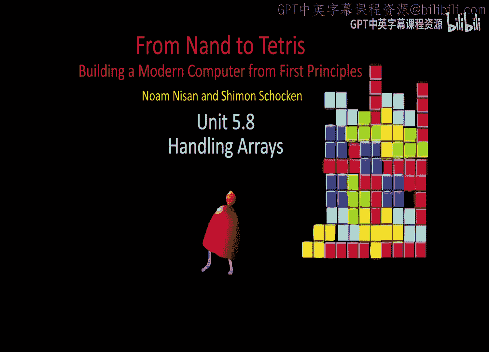
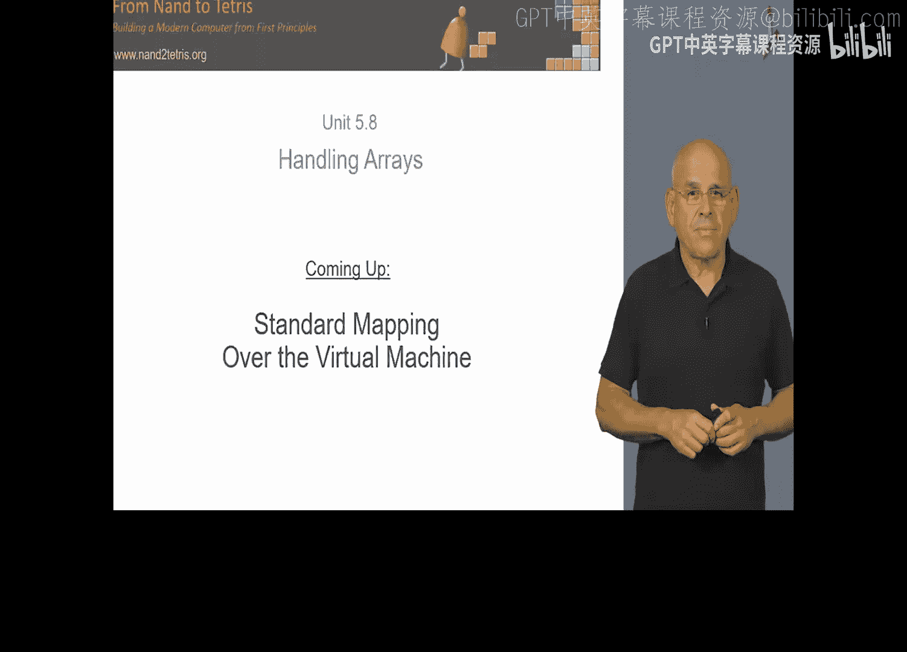

# 耶路撒冷希伯来大学《从零开始构建现代计算机2｜Build a Modern Computer from First Principles》中英字幕 p62 62_07_09_单元5-8_处理数组.zh_en -BV1DA4m1w7FU_p62-

So welcome to unit 5。8 in which we're going to talk about arrays。To remind you。

 we are developing the code generation capabilities of our compiler， we already handled variables。

 expressions， flow of control and objects， and in this unit we are going to discuss how the compiler generates code for handling arrays。

Now， as usual， we' are going to split this conversation into additional subconversations and we'll discuss how to construct arrays and then how to manipulate them。

 so let us begin with the array construction。Here is a map of our whole RAM repeating something that you've seen by now several times in the course。

 and let us assume that the high levelvel programmer writes VAar array AR。

 so basically the programmer is declaring an array called ARR。Well， in response to this。

 the compiler is going to do something very humble。

 it will only allocate a local variable to represent this array and in Jack it will also initialize this variable to0 and that's it。

Now it is possible that later on in the program， you will also like to construct this array。

 so you do this by calling the new suboutin of the array class and if you do this。

 then by some sort of magic that we are going to discuss when we write the operating system。

The compiler will together with the operating system will allocate sufficient space in the heap to represent this array and the base address of this newly allocated block。

 whichever this address may be， is going to be stored in local zero。Now in this example。

 I have invented or contrived the address 8054， it makes it's just an arbitrary example。

So let us review how the compiler or the cogen part of the compiler is going to handle these two statements here。

So beginning with Var array ARR， what will the compiler do with this statement Well it will do very little first of all。

 this statement generates no code whatsoever， and the only thing which is going to be effective is the symbol table so the compiler is going to add one line to the symbol table。

 this line will say that we have a variable called local0 and this variable is of type array and the name of this variable is ARR that's it。

 that's how we're going to handle this array declaration statement。What about the array construction？

Well。If you look at this statement here， you will realize that all we have here。

Is a standard call to aject sub routine。And this is something that we already know how to handle。

 we talked about handling methods and functions and so on， we know how to generate code to do this。

 you know we have to push N and then call U for its effect。

 so there's nothing new here and as far as the color is concerned or as far as the compiler is concerned。

When it compiles this call's code， it will simply generate code for handling a regular sort of plain vanilla call to some subroutine for its effect and that's it so that's what we have to say about array construction and as you see there's very little work to do here。

All right， moving along， the whole gist of this module or unit， I'm sorry。

 is actually in array manipulation and that's what we're going to do next。

Before we talk about Romanman inulation。I wish to remind you about2。

Virtual segments that we have in our VM architecture called this and that。If you recall。

 these two segments are kind of portable in the sense that we can park them anywhere we want in the RAM and then we can use these segments to manipulate the RAM in some desire the addresses。

 but the mechanisms of achieving this are kind of hairy。

 so we like to refresh your memory about how we actually do it。So。And before I do this。

 I'd like to remind you that we also have。The two point is this and that with capital。

 this and capital that you see them in locations three and four in the Ramm。

And these two pointers hold the base addressess of this and that。

And if you want to park or anchor this。In a particular location in the Ram， for example。

 in the arbitrarily chosen address 8058， then as a programmer。

 what you do is you take this number 8058 and you put it into this pointer once you do this the VN implementation is going to align that this virtual segment with address 8058 What about the that segment it's exactly the same story only you have to use the that pointer instead of this。

Now， in general， one can use this and that for any purpose that one chooses。

But if you write a VM translator， then we recommend that you use this to represent the values of the fields of the current object and you use that to represent the values of the current array。

And in order to do this， once again， we use the this and that pointers in order to align this and that wherever we want in the Ram。

And the way to do it， the way to create this alignment is to use。

A certain software mechanism that we made up when we designed the VM language in particular。

 we use yet another virtual segment called pointer。

NowPoer is one of the eight virtual segments that are available to our disposal。

 this is a very special segment because it has only two entries，0 and1。

The zero entry represents this。In capital THIS and the one entry represents capital TH8 that。So。

If you want to put to map this on a particular address in the Ram。

 you put this address on the stack and then you pop it onto 00。And the V implementation is going to。

Take this segment and kind of align it with the desired address。 And the same is true for。So。

This is how we use or can use this and that in general。 And with that， literally speaking。

 let us take this capability and talk about how we can use it to actually access the Ram。 So heres。

A specific example which may well make the previous discussion unnecessary in case it it only managed to confuse you。

 So as usual， seeing an example。Is quite a。🤧Iumminary。

 so let us suppose that we want to put the number 17 in this arbitrary address in the Ramm 8056。

 How can we do it？ Well， we can push this value onto the stack， and then we can pop。

We can push the address。 I'm sorry， onto the stack and pop it onto0er1 once we do it。

The V implementation will you know affect the pop and will take this value and put it into that now take a look at the Ram and you will notice that the that pointer now contains 8056。

As an immediate side effect， the implementation will align that zero with a desired address。

 So we'll get this setting right here。And once we do this。

 we can start manipulating the that segment in particular， we can。Push 17 onto the stack。

 That's the number that we want to put in in the desired address and pop it into that zero。

Once we do this， the implementation will affect the pop。 It will put this value into that zero。

 And as an extremely important side effect， you know， virtually speaking， it will set。

The actual address， you know， in the Ramm to the desired value to 17。And。With that in mind。

We can now move on and talk about how we can。Use this logic and generalize it in order to achieve array address。

 And that's what we'll do now。All right， so we look once again at this array mapping on the RA。

 let us assume that this is the current situation and let's say that the high levelvel jack programmer decided to put the number 17 in the third entry of ARR。

How should the compiler generate code to make this happen？Well。

 here's what we can do based on what we did just you know， a few seconds ago， we can push ARR。

Which happens to contain the base address of this array。 We push it onto the stack。

 Then we push the index that we want to effect onto the stack。We can add them up。

 and once we add them up， we store the result， or we pop the result onto 001。Once we do this。

 the number 856， which happens to be the base address plus 2， will be stored in the that pointer。

That virtual segment will be aligned with the address that we want to manipulate and at this stage we can actually affect the assignment。

 we can push 17 and pop it onto that zero。As a result。

 the the implementationple will put the number 17 in that zero as well as in the RA in the respective address。

Now。There are two interesting observations that I would like to make about this example here。Well。

 first of all， notice that we use only that zero。We don't use any other entries from that segment。

Unlike this segment that we use when we manipulated objects where zero stood for the first field value。

 one stood for the second field value，3 stood for I'm sorry，0 yeah。

 well you know what I'm talking about right， we use that entries to represent the values of。

Of the field of the current object and yet in bed。When we want to manipulate a particular index in any given array。

 we always do something like this okay we always manipulate that zero only and we really don't use anywhere if I recall correctly。

 we never use other entries in the that segment if this is not completely clear to you it will become clear when we see some more examples。

So that's the first technical observation。The second observation is somewhat philosophical and much more important。

 notice that the VM code that you have here in front of you knows absolutely nothing about the whole stream。

😊，It doesn't know where the array is located in the Ramm。

It doesn't know which addresses we are manipulating。

It operates in a completely symbolic logical world， the world of the VM。And in that respect， it is。

 it's a very safe code。 You know， it cannot。The code cannot kind of breach out of the VM world and and mess up with the environments that that are outside the virtual machine because。

All the physical considerations are being implemented or handled by the VM implementation by the VM translator。

And the VM code itself is completely oblivious of the host platform。

 This is super important not only because we want the code to be safe， but also because， you know。

 in a world consisting of numerous different computers， laptops， tablets and cell phones。

 digital watches and whatnot。We don't know where this code is going to run。

 It can run on many different platforms， and we want the same code to run on all these different platforms and therefore we don't have the luxury of making any assumptions about the underlying audio platform。

 so I hope that this distinction here is not lost on you because it's very important。

 That's one of the most fundamental virtues of working with a virtual machine。The fact that you are。

 you can be oblivious of the surrounding hardware platform。All right。

 so let's take this and generalize it into array X in general and let us assume that we have to handle the general statement。

 array expression 1。Equals expression 2 because。You know。

 the index of the array can be something like ARR， 17 times the x plus calling some subroutine。

 you know the expression can be as elaborate as you please and likewise。

 expression2 can be quite can we elaborate as you please， how do we handle it。 Well。

 following the example that we just saw we push ARR。Then we evaluate expression 1。

 you know using the VM we generate code for evaluating expression1。

 we push the result onto the stack， we add the map， we take the result。

 we pop it onto001 just like we did before。And then we evaluate and push the result of expression2 and pop it onto that zero。

This should deliver the day and in a first glance it looks perfectly okay。Unfortunately。

There's a problem， and this code will not work。Let me show you why。 So， you know。

 here's what will happen。 And let me illustrate the general problems。 Suppose we want to compile。

AI equals Bj。Well， you know， following what we did before， we push a， push I add。

Pop the result into0 of1。And this will save this will I'm sorry， align that zero with the AI。

And then we turn to the right hand side， we push B， push J add。And again， we pop on2。01。

And that's where we're going to get a problem because this assignment here into001 is going to mess up and override the address that we stored previously in point01。

So this will simply not work out and we need a better solution。

So we have to be more clever about it and that's what we'll do next。

So here is a solution that will work to generate code for AI equals BJ。

We start just as before by pushing A， pushing I and adding them up。And once we do this。

 we turn to the right hand side， we do the same push B push Jed。

 notice that we haven't yet used the pointer virtual segment。And once we do these six operations。

 what we'll get is the following state， the stack is going to contain these two addresses。

 the RA address of AI， and the RA address of BJ。And then we're going to pop the topmost value。

 which is the base address of BJ onto 001。 So we're going to get the state that you see here。

And then now that that0 is aligned with BJ， we push the value that we find in BJ and pop it into temp 0。

 So this is something that we haven't done before in the course I think we haven't used the temp segment yet。

 So now you see an example of why we need it。So we we use T as a temporary variable that now contains the value of BJ。

 and this will be the picture of the VM segments after state 2。Well， now that we did all that。

 we are actually home free because we can now take this address of AI and pop it onto001 safely because we save we use temp to save this value and once we do this the stack will be emptied and point01 is going to contain the base address of AI。

 that zero is going to be aligned perfectly well with the AI so I can proceed to push temp0 which is the value of BJ onto the stack and then unload it or pop it onto that zero which is AI or the address of AI。

And this will actually accomplish what I need。So。This solution。

 unlike the previous one will always work， it is a bulletproof and that's how I'm going to generate code to handle array axis to generalize this example here if we have to generate code for this high level generic statement。

 we push AR， then we generate code to evaluate and push expression1， we add them up。

Then we generate and evaluate code for and push the result of expression2 onto the stack， we pop10。

 this is the big innovation that we just introduced。And once we do this， we pop  point of1。

 push them 0， pop that 0。 and this will generate the necessary code to。And though。

The top high level statement that you see here。Now， if needed， expression 2 can be as complex。

 exotic and interesting as you please。 It can handle point of1。 It doesn't matter because。

We brought the temp segment to the rescue and this pattern here will deliver exactly what we want。

What about complex array references like this one Well it turns out that the solution that we have here is sufficiently general and it will actually deliver the goods and it doesn't matter how complex your array reference is。

This code or this solution is going to handle it。And so this pretty much wraps up what I wanted to say about accessing arrays and so we know how to declare arrays。

 we know how to access them， I mean we know how to generate code that supports array declaration and manipulation。

 and so that's the end of this unit on handling arrays and in the next unit。

 we're going to change the subject and talk about something called the standard mapping over the Vi machine。

