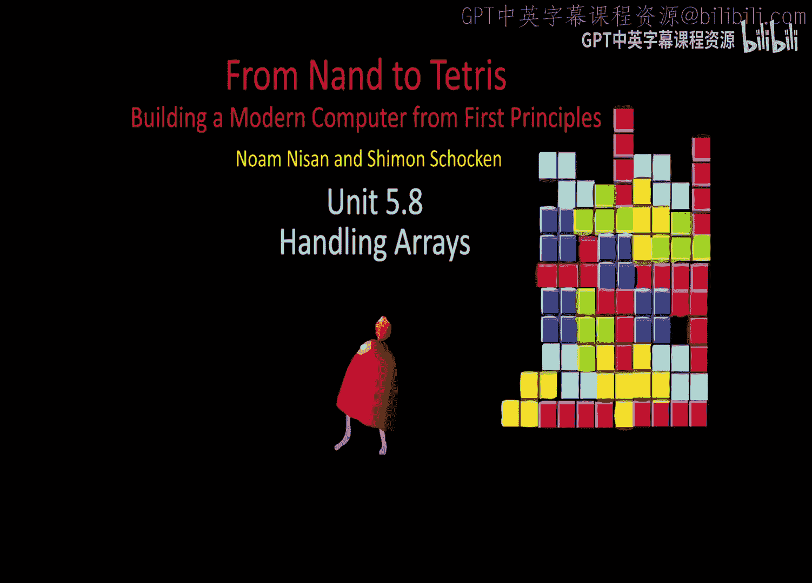
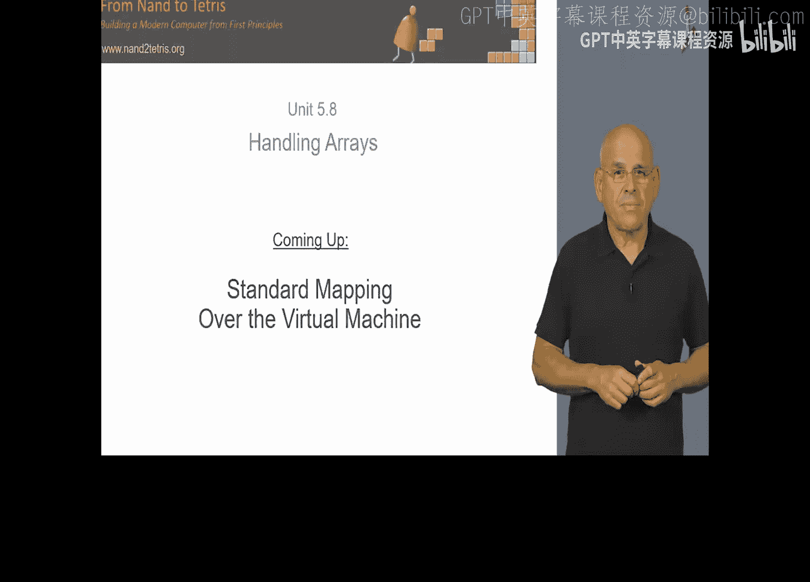

# 从零开始构建现代计算机2：单元5.8：处理数组 🧩



在本单元中，我们将学习编译器如何为数组的声明和操作生成代码。我们将从数组的构造开始，然后深入探讨如何访问和操作数组元素。

## 数组构造 🏗️

上一节我们介绍了对象处理，本节中我们来看看数组的构造。首先，我们回顾一下RAM的布局。

假设高级Jack程序员写下 `var Array arr;` 来声明一个名为 `arr` 的数组。编译器对此的响应非常直接。

以下是编译器处理此声明和后续构造的步骤：

*   **处理声明语句**：`var Array arr;` 这条语句本身**不生成任何代码**。编译器唯一要做的是更新符号表，添加一行记录，表明有一个名为 `arr`、类型为 `Array` 的变量（例如，存储在局部变量0的位置）。
*   **处理构造语句**：当程序员通过 `let arr = Array.new(n);` 构造数组时，编译器将其视为一次普通的子程序调用。我们已经知道如何为方法调用生成代码（例如，压入参数 `n`，然后调用 `Array.new`）。因此，这里没有新的代码生成逻辑。操作系统（后续课程会讲解）会与编译器协作，在堆中分配足够空间，并将该内存块的基地址存入变量 `arr`（即局部变量0）中。

## 数组操作基础：`this` 与 `that` 指针 🧭

在深入数组操作之前，我们需要回顾VM架构中的两个关键虚拟段：`this` 和 `that`。

`this` 和 `that` 是两个特殊的指针段，它们允许我们动态地指向RAM中的任意地址，从而间接操作内存。它们的基地址分别存储在RAM位置3 (`THIS`) 和 4 (`THAT`) 中。

为了将 `this` 段锚定到特定地址（例如8058），我们需要使用 `pointer` 虚拟段。`pointer` 段只有两个条目：0代表 `this`，1代表 `that`。

操作步骤如下：
1.  将目标地址（如8058）压入栈。
2.  执行 `pop pointer 0`。VM实现会将此地址存入 `THIS` 指针，从而将 `this` 段对齐到地址8058。
3.  此后，操作 `this` 段（如 `push this 0`）实际上就是在操作地址8058处的内存。

对 `that` 段（使用 `pop pointer 1`）的操作逻辑完全相同。在VM翻译器的实现约定中，我们通常用 `this` 来访问当前对象的字段，用 `that` 来访问当前数组的元素。

## 访问数组元素 🔍

现在，我们运用 `that` 指针来学习如何访问数组元素。假设数组 `arr` 的基地址已存储在局部变量0中，我们想将数字17存入 `arr[2]`（即第三个元素）。

生成VM代码的思路如下：
1.  **计算目标地址**：将数组基地址（`arr`）和索引（2）压栈，然后相加。结果就是 `arr[2]` 在RAM中的物理地址。
2.  **对齐 `that` 段**：将上一步计算出的地址通过 `pop pointer 1` 存入 `THAT` 指针。这样，`that` 段就被对齐到了目标元素的位置。
3.  **赋值**：将值17压栈，然后执行 `pop that 0`。这会将17存入 `that` 段的第0个位置，也就是我们想要设置的 `arr[2]`。

对应的VM代码序列是：
```assembly
push local 0    // 压入数组基地址 (arr)
push constant 2 // 压入索引 2
add             // 计算 arr + 2 的地址
pop pointer 1   // 将该地址存入 THAT 指针，对齐 that 段
push constant 17// 压入要存储的值
pop that 0      // 将值存入 that 0，即 arr[2]
```

这里有两个重要观察：
1.  我们总是操作 `that 0`，而不像对象字段那样使用 `this 0`, `this 1` 等。因为对于数组，每次访问不同索引时，我们都会重新对齐 `that` 段。
2.  这段VM代码完全在虚拟的、符号化的层面运行，它不知道数组具体在RAM的哪个位置。所有物理地址的计算和映射都由底层的VM翻译器处理。这使得代码安全且与具体硬件平台无关，是实现可移植性的关键。

## 处理通用数组赋值语句 🛠️

上一节我们看了一个简单的例子，本节中我们来看看如何处理更通用的数组赋值语句：`arr[expression1] = expression2`。一个直接的生成策略可能如下：
1.  计算 `arr + expression1` 的地址并存入 `pointer 1`。
2.  计算 `expression2` 的值。
3.  将结果值弹出到 `that 0`。

然而，这种方法存在缺陷。考虑语句 `a[i] = b[j]`。如果按上述步骤：
1.  计算 `a+i` 地址并存入 `pointer 1`。
2.  计算 `b+j` 地址。**但计算 `b+j` 本身可能涉及复杂的表达式，其中可能包含对 `pointer 1` 的写入操作**，这会覆盖第一步中存储的 `a[i]` 的地址，导致错误。

因此，我们需要一个更健壮的方案。以下是解决 `a[i] = b[j]` 的正确VM代码生成步骤：

1.  **计算左值地址并暂存**：计算 `a + i` 的地址，但先不存入 `pointer 1`，而是留在栈顶。
2.  **计算右值**：计算 `b + j` 的地址，然后通过 `pop pointer 1` 对齐 `that` 段到 `b[j]`。接着，使用 `push that 0` 和 `pop temp 0` 将 `b[j]` 的值存入临时变量。
3.  **取回左值地址并赋值**：此时，栈顶仍保留着 `a[i]` 的地址。将其通过 `pop pointer 1` 对齐 `that` 段到 `a[i]`。最后，将临时变量中的值 (`temp 0`) 压栈并 `pop that 0`，完成赋值。

这个模式可以推广到通用的 `arr[exp1] = exp2` 语句。以下是代码生成模板：

```assembly
// 1. 计算左值地址 (arr + exp1) 并留在栈顶
push arr        // 压入数组基地址
[生成计算 exp1 的代码] // 结果在栈顶
add             // 栈顶现在是 arr[exp1] 的地址

// 2. 计算右值 (exp2) 并存入临时变量
[生成计算 exp2 的代码] // 结果在栈顶
pop pointer 1   // 将对齐 that 段到 exp2 结果指向的地址？(这里需要修正)
push that 0     // 取出该地址的值
pop temp 0      // 存入临时变量

// 3. 为左值地址对齐 that 段并赋值
pop pointer 1   // 将栈顶的 (arr+exp1) 地址存入 THAT 指针
push temp 0     // 压入右值
pop that 0      // 赋值给 arr[exp1]
```

**重要修正**：上述模板步骤2中，`exp2` 可能本身就是一个数组访问（如 `b[j]`），因此它计算出的就是一个地址。我们不应该直接 `pop pointer 1` 然后 `push that 0`，因为 `exp2` 可能就是一个简单值。正确的通用步骤是：
1.  计算左地址（`arr+exp1`），结果留在栈顶。
2.  计算右表达式（`exp2`）的值，结果压栈。
3.  将右值弹出到临时变量（如 `temp 0`）。
4.  将左地址弹出到 `pointer 1` 以对齐 `that` 段。
5.  将临时变量中的右值压栈，并弹出到 `that 0`。

这样，无论 `exp2` 是简单值、变量、还是另一个数组访问，都能正确处理。

## 总结 📚

本节课中我们一起学习了编译器如何处理数组。
*   我们了解到数组的声明只更新符号表，而构造则是通过普通的 `new` 方法调用实现。
*   我们回顾了 `this` 和 `that` 指针的机制，它们是间接操作内存的关键。
*   我们深入探讨了如何通过计算基地址加偏移、并使用 `that` 指针来访问和赋值数组元素。
*   最后，我们分析并解决了在通用数组赋值语句 `arr[exp1] = exp2` 中可能出现的地址覆盖问题，引入了使用临时变量的健壮代码生成模式。



掌握这些知识后，我们的编译器就具备了处理复杂数据结构——数组的能力。下一单元，我们将改变主题，讨论虚拟机标准映射的相关内容。