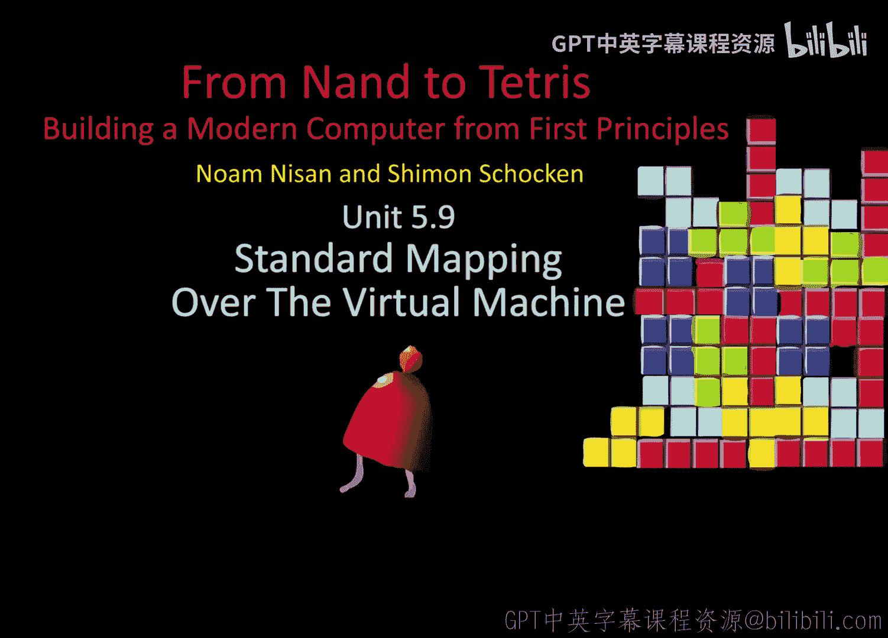
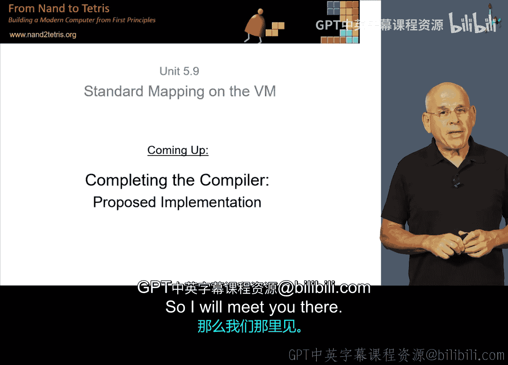

# 耶路撒冷希伯来大学《从零开始构建现代计算机2｜Build a Modern Computer from First Principles》中英字幕 p63 63_07_10_单元5-9_虚拟机上的标准映射.zh_en -BV1DA4m1w7FU_p63-

In this unit， we are going to talk about a set of conventions。

That developers of J compilers are advised to follow。And taken together。

 we call these set of conventions， the standard mapping over the virtual machine。

Let's start with a big picture。To remind you， we are developing a compiler and this compiler is too tiered。

 so it has two stages。 first we compile from the jack level to the VM code。

 then we compile from the VM code all the way down to the target platform。

The second part has been taken care of in modules1 and 2 and in this module and in the previous one。

 we take care of closing the gap between Jack and the virtual machine。So for all practical purposes。

 we can ignore everything that happens below the VM code and focus on the translation of J programs into VM code。

Now think about it when you write a J program or a Java program or a C++ program。

 it doesn't matter in any one of these programs， you create all sorts of let's call them entities。

 you know things like classes， functions。Constructors， methods， and so on。

And yet when you have to translate these things into the VM level。

 you end up with something that looks completely differently， right at the VM level。

 we don't know what is an object。 We don't know what is a constructor。 You know。

 all we have is stack and virtual segments。 and we somehow have to map every one of these high levelve constructs。

 every one of these obstructions on the reality of the virtual machine。

And how to do it is something that we discussed throughout this module。

 but now I want to sort of recap and put together you know all the rules that we have to follow when we create those nappings from the high level to the VM level。

And we do it using this document or set of standards that we call the standard mapping over the VM platform。

By the way， if you want to create compilers for other languages like Java C++ and so on。

 then for every one of these languages， for every one of these compilers。

 were going to have a different document describing the standard mapping because every one of these languages has you know different constructs。

 although many of them are quite similar， but in this course of course we focus on the jack language。

 so that's what were going to discuss here， how to map Jack on the virtual machine。All right。

 so let' us start with files and subrout mapping conventions。Well。

 a Jack program is a collection of one of more classes， each class has a unique name。

 and every one of these classes or every one of these class files is going to be translated onto a respective VM file that has the same prefix file name。

And in the process， every subroutin in the source code is going to be translated on a function at the VM level。

So。Each sub routine goes to a function， each file goes to a VM file。

And notice that a jack constructor or function that has k arguments is going to be compiled into a Vm function that operates on k arguments as well and in this example we see that new which is a constructor it has one argument at the jack level it will also have one argument at the VM level Likewise the same is going to happen with the function buzz what about methods well with methods it's a little bit more tricky a jack method that has k arguments is going to be compiled onto a Vm function that operates on K plus one arguments。

 So in this example the bar method has only one argument X at the jack level and yet at the VM level it is going to have two arguments and willll elaborate on this further and actually we also talked about it when we talked about object manipulation。

Early on in this module。So you see that you know if you look at the diagram。

 something interesting is shown here。😊，The kind of the suboutines if you will。

 you know whether they are constructors methods or functions， well。

 all this is being lost in translation， right because when it reaches the VM level。

 everything is going to be mapped onto functions。 So we have to somehow capture the constructor semantics the function and and the method semantics at the VM level and we do it by certain conventions like the one that I just discussed now that methods take one additional argument compared to to the source code the manifestations we have more to say about this later on。

Okay， what about mapping variables， Well， in Jack， we have four kinds of variables。 We have locals。

 arguments， statics and field variables。And each one of them is handled in a certain way。

 so the local variables of some Jer routineout are mapped on the virtual segment label。

 I'm sorry local。And so if you have local variables like x and y and let us assume that these are the first two local variables that are declared in your subroutin。

 then x is going to be mapped on local0 and y is going to be mapped on local 1 if youll have more variables down the road。

 they will be mapped on local 2，3 and so on and so forths。What about argument variables。

 exactly the same setting， the first argument goes to argument 0。

 the second goes to argument 1 and so on and so forths。

Static variables are mapped on the virtual segment static that is associated with a currently compiled file and the mapping is very similar。

 The first static goes to static0， the second static goes to static1 and so on and so forth forth what about field variables Well the field variables of the current object are handled as follows。

First of all， we have to assume that pointer0 has been set to this object。

 Someone has to do it for us and the agent that does it is the the generated code of the current suboutin。

 so let us assume that it has been done already well if this has been done then the I field of this object is mapped on this I at the VM level。

 So if x happens to be a property or a field， it will go to this0 and if y happens to be also a property to go to this one and so on and so forth。

So that's how we handle variables。What about the arrays？Well， with arrays。

 we proposed the following convention。If you try to access any array entry。A R R subai。

Then here is what you should do。First， you should set pointer1 to the entries's address。

 which happens to be ARR plus I。And then once you did this initial anchoring， so to speak。

 then you simply access the entry by accessing this zero。So it doesn't matter what I is， you know。

 whether it's 18 or 312， you always set point01 to it and then you access this zero。

We found out that that's the easiest way to handle arrays in our compiler。

So which conventions do we have to follow when we compile suboutines。Well。

 in Jack we have three kinds of suboutines， we have methods， constructors and functions。

 so let's talk about each one of them separately。Let's start with methods。

When we compile a jack method， the compiler must make sure that the compiled code will begin by setting the base of this virtual segment to argument 0 y。

Because we have a very important convention in place and the convention says that the color of the method is going to push the address of the object on which the method is supposed to operate as the very first argument before calling this method for its effect。

So when the method starts running it has to you know work on the current object and we achieve this obstruction by doing this。

 we set this to the contents of argument zero and this will establish access to the object in which we have to operate once we do this we can refer to this0。

 this one， this two as we discussed previously as placeholders for the fields of the current object so that's very convenient and it makes perfect sense。

What about constructors？Well， when we compile constructors， we first of all。

 have to create space in memory for the object that we seek to create。And once we do this。

 we set the base of this new block to the this segment。And by doing this once again。

 we establish access to this object， and then once again we can use this zero， this one， this two。

 and so on， you know for all sorts of things that the construct may want to do。For example。

 constructors are fond of setting the object fields to all sorts of initial values。Well。

 now they can do it because we have established access to to the newly constructed object。

And before returning， let us remember that the compiled VM code of the constructor must also remember to return the base address of the newly constructed object to the collar。

Now， when I think about it， I'm not sure that we even have to specify this in the standard napping。

Because if you recall， we actually elevated this requirement to the jack level。In Jack。

 when you write a constructor， you must remember to always return this。

And so because we require this at the jack level， the compiler will automatically generate code for handling return this。

 and we don't have to mention it here as well， but you know there's no harm in mentioning this important convention here also。

So what about compiling void functions or void methods？Well。

 void functions and methods don't return values， at least at the jack level。

 they don't return values。 and yet。At the Vm level they have to return something because that's the requirement we require that every VM function returns a value and because we have to return something we've decided that if you follow our standard mapping we request that you return constant0 by the way the color of a void subroutin has to remember that it called avoid void subroutine and therefore when the suboutoutin returns the first thing that it has to do is get rid of the top of the stack right the element at the top of the stack because it contains a constant zero。

And and that's what we'll discuss next， right， how to handle subrout calls， you know。

 what conventions do we have to follow here？Well， when we compile a typical call like a routineout name with a set of arguments。

The color must push the arguments onto the stack and then call the subroutine for its effect。

 so it does push agon， push a2 and so on and then call subname。Now， if this subroutin is a method。

 then the call must must remember that the first thing it has to do is to push a reference to the object on which the method is supposed to operate and only then it proceeds to push arg1。

 a2 and so on and call the method for its effect。And， you know。

 you see how everything connects here because once you do this。

The address of the current object becomes the value of argument 0 that we discussed before from the standpoint of the called method。

What about calling a void subroutine well avoid subroutin does not return a value in J。

 but at the VM level it returns some dummy value we decided on constant zero and therefore after the subroutin returns the compiled code of the subroutin call must pop and ignore the return value。

So that's how we handle the conventions of compiling subruine calls。Finally。

 we have to handle some constants， right， and。Let's see we have three constants in jack。

 we have null falls true and you see how each one of them is being handled for the case of minus-1。

 we can simply generate code that pushes one followed by the NAG command and this will put effectively minus1 at the top of the stack。

Allright actually we also have to discuss classes and sub routineoutine so let's do it The basic jack operating system is implemented as a set of eight VM classes with names like mathth。

vm memoryory。vm and so on and so forth we will discuss these classes at length and implement them in the next and final modular in the course in module 6。

😊，And all the OS classes class files must reside in the same directory as the VM files generated by the compiler。

So as you see at this directory level， there's no difference between your application files and the OS files。

 they are all treated as a big collection of VM files。

 and therefore any VM function in your code can call any OS VM function in any one of these classes for its effect。

And that's how we handle the operating system。What about some special O services， Well。

 there are such services。 Obviously， if you write a jet compiler， you have to remember a few things。

 first of all。😊，Whenever you have a multiplication command。

It has to be handled by calling mathth dot multiply。

Whenever you have a division command at the operator at the J code。

 it has to generate code that calls me dot divide。String constants are created using the constructors string dot U and the length of the required string。

stringring assignments like x equals。呃。Whatever N NA A N D， well this string， NA N D。

 which consists of four characters， is handled by making four calls to string dot append car。

 So once again the compiler has to deliver this obstruction。

Object construction requires allocating space for the new object in the Ram。

 and therefore somewhere in the constructor， we have to call memory a。

Size is going to be derived from the number of fields in this object that we seek to create and because in Jack everything is 16 bit。

 then we have a one to one mapping between the number of fields and the number of Ram words or RAM locations that we need to accommodate this object。

And finally， objector recycling is handled using the OS function memory dot Dal， and that's it。

 you know， these are the things that developers of jack compilers over our virtual machine have to keep in the back of their minds when they write the jack compiler。

In the next unit， we'll talk about how to actually structure this compiler。

 you know which API we recommend to follow， so I will meet you there。

