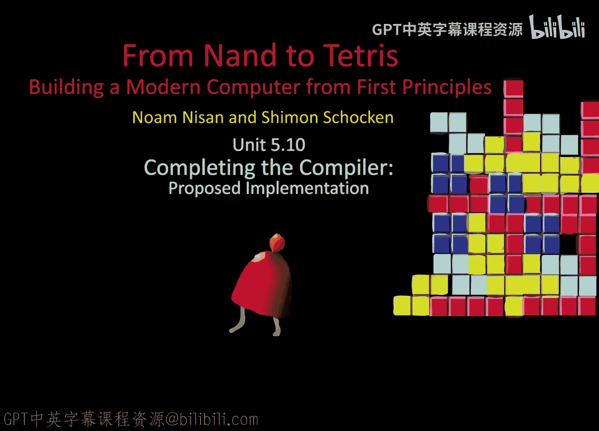
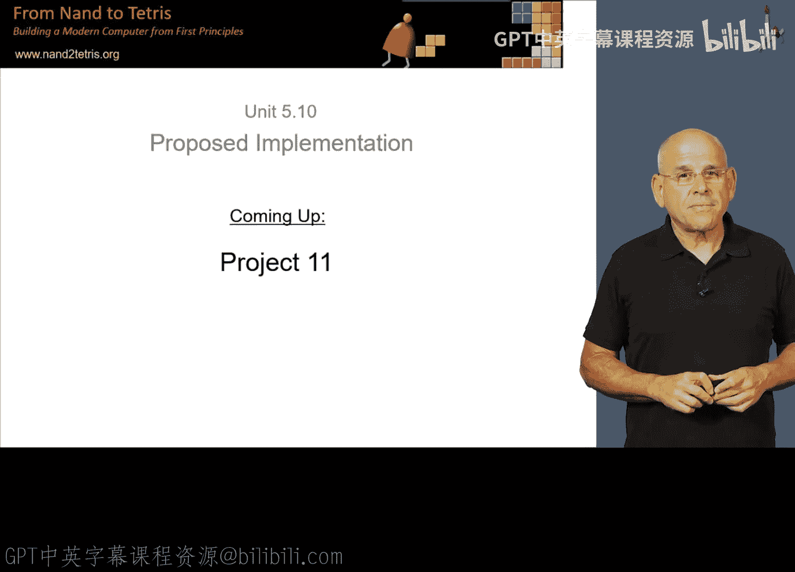

# 耶路撒冷希伯来大学《从零开始构建现代计算机2｜Build a Modern Computer from First Principles》中英字幕 p64 64_07_11_单元5-10_编译器完整实现建议方案.zh_en -BV1DA4m1w7FU_p64-

In the previous unit， we talked about certain conventions that developers of jetcomprs are advised to follow。

 we called it the standard VM mapping over， I'm sorry， the standard mapping over the VM platform。

And in this unit， we'll discuss finally how to actually build this compiler。

So here's the overall architecture and roadmap of our compiler to remind you in the previous project in Project 10。

We wrote a syntax analyzer that generates Xml code。

 Now we have to take this software and morph it into。A program that generates VM code。

 This program will be our J compiler and obviously we'll do it one step at a time is usual。Now。

 we propose to base the compiler's software architecture on five separate modules。

If you write it in Jack， I'm sorry， if you write it in Java。

 it will be five Java classes and the jack compiler is sort of the main program which is going to drive everything。

 then we have a jack tokenizer， symbol table， a VM writer and a compilation engine。

And in this module， and I'm sorry in this unit， we are going to focus mainly on the symbol table and the VM writer。

 why， because everything else has been developed already in Project 10。

 although we still have to tweak with it， we'll have to modify some of the code that you wrote in these modules。

 but once again the gist of what we'll do is concentrated in a symbol table and in the VM Write。

All right， so let us begin with the topmost class， the J compiler， How do you use it， know。

 let's start with the user level functionality。Well， if you write the jet compiler in Java。

You will probably say something like Java。Then the name of your program， J compiler。

 and then you supply it with a mandatory input。And this input can be one of two things。

It can be either a final name。Dot jack， in which case the compiler will generate from it another file with the same name。

 but with a VM extension， this is the output of the compiler。

Or this input can be the name of a directory。 You know， if it doesn't have an extension。

 it must be the name of a directory。In which case， the compiler is going to generate one VM file for every jack file found in this directory。

So what I just described is summarized in this output segment here。And。

Let me say a few words about how it actually works。 well for each source jack file。

 the compiler creates a jack tokenizer object in order to process the input。

And it also creates an output VM file。 Now， I should say it more accurately。

 The jack tokenizer is going to represent the input。 So， you know。

 this will be the input of the compiler and the dot VM file is going to be the compiler's output。Now。

 once once we do this setup， the compiler can go on to use symbol table compilulation engine and VM writer in order to generate the VM code and write it or emit it into the output file。

 the VM file。All right， now theject organizer is the next module in the list and here I'm happy to say that mission accomplished。

 we already developed aject tor in Project 10， we can use it as is we don't have to touch it for the full scale compiler as well。

 so this thing has been taken care of。😊，What about symbol table， Well。

 symbol table is new and because it's new。Let me start with some background。

So here's an arbitrary example， the point class that we used several times in this course。

And we see that there are several kinds of symbols or variables lurking here。 First of all。

 we have field variables and static variables， you know X Y are fields and there's only one static variable point count。

These variables have a scope and the scope is the region in the program in which they are recognized and they are recognized throughout the class right any subroutine in this class can see and manipulate static and field variables。

And the compiler keeps track of these variables using a class level symbol table。

 an example of which you see here。 So as you see。The three。

 the two field variables and the single static variables are accounted for in the class level symbol table。

Now another kinds of variables that we may have are arguments and local variables。

 that's what we see in this example here， other is an argument。

 Dx and Dy are local variables and the scope of arguments in local variables is the subroutine code in which they are being declared。

 now these variables are not recognized are unknown outside this subroutine。

The compiler is going to keep track of these kinds of variables using another symbol table。

 which is you know a subroutine level table， as you see here in this example。Now。

 one thing that we can conclude from this exposition here。

Is that we never need more than two symbol tables。 The compiler never needs more than two symbol tables。

 why。Because the class level symbol table can be initialized each time we start combining a new class。

Obviously。And what is maybe less obvious， the suboutin level symbol table can also be reset each time we start compiling a new suboutin within the current class。

 why because。You know， the previous symbol table that we had is no longer interesting。 It's passe。

 Its you know， contains irrelevant information。 We already compiled the previous method。

 We can forget about it。 We generated the code。So when we move on。To compile the next sub routine。

 we can reset the symbol table that we used before。So the symbol table class。

 if you implement it as a class， let's say in Java is going to have two instances only a class table symbol table and a routine symbol table。

Now within the symbol tables， the compiler， as you see here。

 gives each variable a running index within its scope and kind。The index starts  zero。

 It is incremented by one each time a new symbol is added to the table and it is reset to0 when we start a new scope。

 know a new symbol table。Now all these operations have to be handled by the routines of the symbol table module or the symbol table class。

 and that's what we're going to discuss next， the API of this class。So first of all。

 this class will have a constructor that creates a new symbol table。

It will have a start suboutin routine that simply starts a new subbutin scope。

Following the tips that I gave you before。Then perhaps the most interesting method is the method that adds a symbol to the table。

 It's interesting， but it's straightforward。 It receives you know， various items of information。

 the name of the symbol that we want to add the type of the symbol and the kind and based on this information。

 it adds a new。Tupple， if you will， to to the symbol table。

 Then we have a var count routine that returns the。

The number of symbols that were already defined or added to the symbol table of this kind。

 you know whether it's static field， argument and so on。

 and this routine is quite helpful in several places when you generate code。

And then we have three queries， if you will， with the names。

 a kind of type of an index of which return。Some useful information about a certain symbol。

So you know we can say， you know what is the kind of x kind of x where it can be the method will say it will look up the table。

 it will say it's static field， something else。 what is the type of x where once again the method will go to the symbol table and will say you know the type is such and such and same with with index So you know these routines are also very helpful when you generate code for obvious reasons。

If you're not convinced， you will when you actually develop a compiler。

Now I took the same API and sort of put it in a smaller space on the slide。

 so there's nothing new here。 I also put the two symbol tables that we saw before just for reference and I'd like to say a few words about implementation。

The symbol table abstractstruction that we discussed all along。

Can be implemented using a classical data structure called a hash table。

And if you're not sure what is a hash table， you're welcome to read about it in the internet and look up hash tables in the library that supports your language。

 whether it's Java or Python， every modern language has a hash table obstruction somewhere。

And so we can use one hash table to represent the class scope and another hash table for representing the subroutine scope。

When we start compiling a new sub routine， the letter hash table can be emptied and reset。

 and that's basically what we have to do。Now here's another tip which is relevant for the compiler in general。

When you compile error free jet code。Each symbol， which is found neither in the subruine symbol table nor in the class table。

Must be a symbol that represents either as a routine name or a class name。

 So thats that's a useful tip。That will serve you well when you write the compiler。Moving along。

 let's talk about the VM writer， the VM writer's job is to emit。

 generate and emit VM code into the output VM file。And here's the API。

The VM writer has a constructor that creates a new output file。

 whenever we start compiling a new class， we have a write push routine that writes a VM push command now in order to write a VM push command you have to know to which segment you're pushing and what is the index that you want to effect so once you have these two pieces of information。

This routine is trivial。Likewise， the right P routine is also trivial， it writes a P VM command。

Write arithmetic command writes the command。 You know， So if the argument is sub， it will write sub。

Very straightforward。And all the other routines， you know follow the same rationale。

 you know they get some arguments and they generate from it a straightforward VM command。

 So you know this module is relatively simple to develop and yet it's important from software engineering standpoint because it encapsulates you know all the activities which are related to actually generating output from the compiler。

Finally， we have the compilation engine。And the compilation engine gets its input from the jack tokenizer and writes the output to the output file using the VM writer。

 So output is generated by calling VM writer methods。The compilation engine， if you recall。

 we discussed it several times in the previous module。 And in this one。

 it is organized as a series of compile X， X routines。 X。

 X X being a syntactic element in the jack language。 We have something like 15 such elements。

 So we'll have something like 15 such。Compile routines。 And the contract among these routines。

 because they keep calling each other all the time， is that each compile X X routine should read。

The X， X， X contract construct from the input。 It should advance the input exactly beyond X， X， X。

 and then it will。Amit the output VM code， which affects the semantic of X， X， X， You know， X。

 X S can be something like while let。And so on。Therefore。

 we should call this compile routine only if X Xx is indeed the current syntactic element that we are handling。

Now， if this element is part of an expression and therefore it's something that should have a value。

 then the emitted VM code should compute this value and put it at the top of the VM stack。

So that's what the compilation engine is supposed to do。It does it using this API。Now this API。

 which consists of this slide and the next one。So two slides for this API。

This API is completely identical to the API that we had for the compilation engine when we wrote the syntax analyzer in Project 10。

And therefore， I don't want to belab about it。 you know。

 I talked about it in the previous project and yet in this project，We have to。Mph， you know。

 this API into API。That generates not XML code， but VM code。So there's some work to be done here。

And we are going to spend the next unit。Project 11 overview in order to give you step by step guidelines on how to actually carry out and test this morphing from code that generates XML to code that generates executable VM code。

So that's what we'll do in the next unit。

