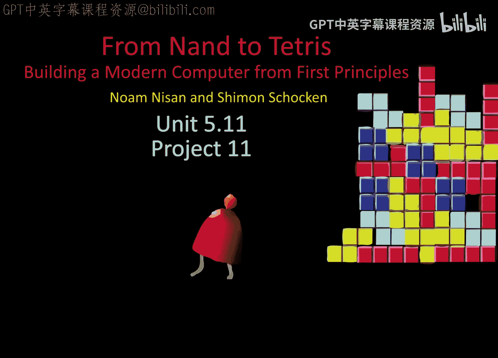
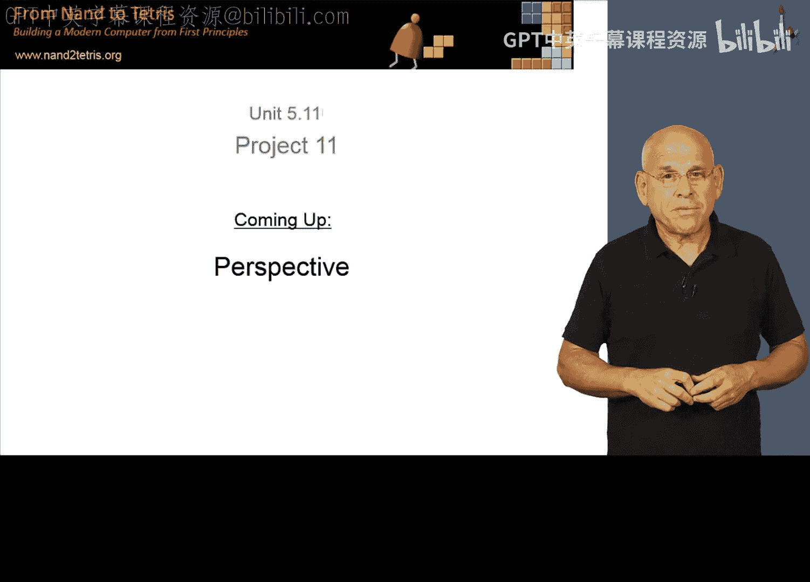
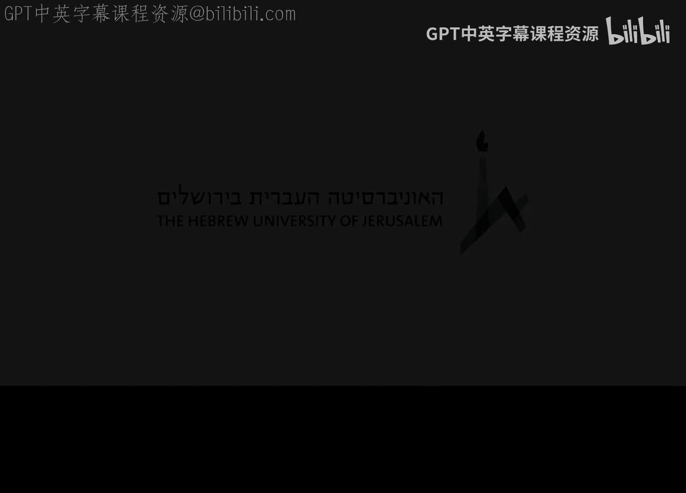

# 耶路撒冷希伯来大学《从零开始构建现代计算机2｜Build a Modern Computer from First Principles》中英字幕 p65 65_07_12_单元5-11_项目11.zh_en -BV1DA4m1w7FU_p65-

Welcome to Project 11 in which we're going to complete the construction of our compiler。

Now to remind you， we decided to split this substantial software development task into two separate and standalone projects in Project 10。

 we built a syntax analyzer and in this project in Project 11 we are going to extend and morph this syntax analyzer into a full scale compiler。

Now we' are going to do this morphing in two standalone stages also and let me describe them。

 Well first of all， we've built a syntax analyzer and this analyzer is capable as you remember to parse the source code input and generate from it XML code that demonstrates that the syntax analyzer knows what it's doing。

 that it knows how to parse and understand the syntax of the source code。Now。

 this understanding is quite impressive indeed yet。😊，It has one limitation。

 it doesn't handle identifiers in a very clever way。

Because you see the source code contains like you know any high level program。

 it contains numerous identifiers， X Y， names of subroutines， names of arguments and so on。

 and all these identifiers are treated by the syntax analyzer in the same way it simply calls them identifier and that's it。

So what we want to do next is to develop the ability to handle and understand the semantics of the symbols in the source code。

 so we're going to develop the ability of creating and using symbol tables。

And there's an interesting question， as usual in this course。

 how can we test this module in isolation from the rest of the system？Well。

 we decided that we will test the symbol table capability by extending the basic analyzer that you've already built and by generating some richer XML code that will include the same code that you generated before plus a more refined identification of the identificationentifiers that the analyzer found in the source code。

 as we'll explain in just a few minutes。Once we have this capability in place。

 we can go on and develop the code generation capability of the compiler。

 once we have the code generator， we can throw away the XML。

 we need it no longer and we can tweak a little bit the passer in order to develop by now executable VM code instead of the static XML code that we develop before。

So these are the stages that we are going to follow in Project 11 and let us begin with the symbol table。

Before we get started， let us remember how the output of the syntax analyzer looks like in particular note how we treat the variable count presently the syntax analyzer simply tags it as an identifier right？

And yet。As we decided we want to be much more specific about the role of this symbol in the source code and here's how we're going to do it。

 We're going to extend the syntax analyzer to output the following information first of all。

 the identifies category， whether or not it's a var and argument， a static field class or subroutin。

 so every one of these categories with appear in the XML output， by the way。

 when we say var it's a synonym for local you know var and local variables are the same thing in our jargon。

And if the identifiers category is one of Var argument static or field。

 we want the XML code to also include the number of this identifier within its kind。

 so you know whether it's argument 0，1，2， and so on。

 we also want the syntax analyzer to output this information。And finally。

 we also want to output whether the identifier is being defined， for example。

 in the context of a var J command or whether it's being used， for example。

 in the context of some evaluating some expression。

 so that's another item that we want your syntax analyzer to output to your XML output。

So how are we going to actually implement this symbol table capability， Well。

 in one of the previous units， we gave the symbol table API。

 So we request that quite naturally you now implement it in a language like Java or Python。Now。

 once you have this API implemented， you have to test it。And to test it。

 we suggest that you extend the syntax analyzer that you already developed in Project 10 with the identifier handling capabilities that we described at the top of this slide。

Now we don't care exactly how you do it， we don't care you know what tags you're going to use。

 you should come up with your own format and simply output it and convince yourself that your syntax analyzer now has the ability to provide a refined analysis of the identifiers that it it passes we also don't expect that you submit this part of the project this is for yourself for your own benefit only and it's very important that you do it because it will enable you to test the symbol table in isolation or to unit test the symbol table in a standalone fashion。

How should you do it Well， we suggest that you test this extended syntax analyzer by simply running it on the test programs that we gave you in project 10 and once again convince yourself that it knows how to handle identifiers cleverly。

All right， so let us assume that we have done with this and therefore by now we can move on to talk about cogen。

😊，Now， before we do this， I want to kind of take stock at what we have done so far。

By now we have a syntax analyzer which is capable of parsing and understanding not only the syntax of the source J code。

 but also the semantics of all the identifiers。And so now that the source code is fully understood syntactically and symbol treated。

It lends itself to the last and final stage in the compilation， which is code generation。

 And that's what we're going to do next。Now， how are we going to do it？Well， here's the deal。

We are going to provide you with a set of six test programs whose names are listed here on the right hand side。

And the development plan is going to be staged， and we're going to use the notion of unit testing。

So you will develop your compiler in stages and in each stage you will do whatever is necessary in order to translate the next test program。

So for every one of these test programs you have to do the following。 first of all。

 use your evolving compiler so to speak， to compile the directory that contains the test program。

 typically it's well， I shouldn't say typically some of these directories contain a single VM file。

 other directories contain several VM files， so you have to compile the entire directory。

 then you have to look at the generated code， the VM code that your compiler has generated。

 if things look fishy， you have to go back to stage1 and fix your compiler。If things look okay。

 then you load the directory into the VM emulator。Now you can do it because if your compiler is well functioning。

 it will create a set of VM files， one for every given jack file。

 so when you load the directory into the VM emulator。

 the emulator will load the VM files and you'll be able to actually execute them。

So you can execute the generated code， you can inspect the results we will tell you what to look for and once again。

 if things are not working correctly， you have to fix your compiler and go back to stage one。

 so that's the loop that you have to go through with every one of these test programs。

Now I'd like to point out something interesting normally when you compile a program。

 a program that you have written。And you get some errors。

 you assume that the culprit is the code that you wrote。

 so you fix the source code in order to compile it better in the next iteration， But in this project。

 exactly the reverse is is true。 why， because the test programs that we provide our perfect programs。

 they contain no syntax or runtime errors whatsoever。 and therefore， if you get any error。

You must assume that what is not working properly here is not the source code。

 but rather your compiler， it's your compiler that you wrote， which is misfunctioning。And you know。

 this is something that normal application developers don't even dream about。

 they don't even think about the possibility that the compiler has a bug。

But since you took the antiteary course， you are now in a different league in terms of competence and expertise。

 and this comes with certain responsibilities。 If something is screwed up。

 it's your compiler that has to be fixed and that's what Project 11 is all about。

 you're writing a compiler。Alright， so what we'll do next between now and the end of the unit is we'll go through every one of the six test programs and say a few words about it so that you will know what to expect。

Well， here's the seven program， it has a single class called Maine。

 a single rather trivial subroutine or a void method called Maine。And。

It simply computes the value of1 plus two times3。And so this test code is designed to test how your compiler handles a simple program。

 an arithmetic expression involving some constants only a do statement and a return statement。

 so once again you have to develop or extend your compiler to handle these capabilities only。

 and then you can test it on the seven program and move happily to the next test program。Now。

 if things work properly， your compiler will generate something like this VM file here now it should not necessarily generate the exact VM file that you see here because different compilers generate you know different target programs and that's perfectly okay。

But you know， whatever program your compiler generated， you can then load it into the VM emulator。

 and when you will run this program， you have to see the number7 at the top left of the screen。

 If you see this number， you will know that your program is well behaving。

 your compiler I meant is well behaving。All right， moving along， here's a little quiz。

 but a rather tricky one。Inspect the VM code on the right and focus on the two red instructions。

 Select one of the correct observations， a。The two highlighted instructions are designed to clean up the memory before the function returns。

B， they are related to the function call and return contract and C。

 they are example of some unnecessary code that is sometimes generated by the compiler。

What is the correct answer。Why don't you stop the tape and think about this question for a little while and then we'll talk about the answer。

So let me explain why。Well， look at the top red statement。

 which is P10 and notice that it comes just after the command call output dot print end。

And there's a very tight relationship between these two VM commands， why？Because you know what。

 let's also go back to the jack source code and realize that call outputput。

 printin came when the compiler generated code for do output。 print in。So here we have a method call。

In the context of a do statement。And the compiler writer knows that by contract， every VM method。

 irrespective of whether it returns a value or not， I'm sorry。

 irrespective of whether it's void or not。Every V method must return a value。

 It must return something。And therefore in this particular case。

 we are calling the method in the context of a do statement。

 so this indicates to the compiler that we are not interested in the return value of this method and therefore it is still our responsibility to do something with its return value。

Now， because this return value serves no purpose whatsoever， we simply dump it。

 so we pop it off the stack because it was placed there by print end。

 which operates according to the contracts。And we pop it onto temp 0。 You know， we don't care。

 We don't。 We're not going to use it。 We completely ignore it。So once again。

 whenever we generate code for subrout call in the context of a do。

We must also generate code that yanks the return value of the stack and throws it away somewhere。

So that's the explanation to P10。What about the next command。

 where the next command is push constant zero？Well， the next command is necessary。In the context of。

You know， the overallval of the in that we have here， which is main dot main。

If you go back to the jack code once again， you see that main dot name is a void method。

Or avoid function。 It doesn't matter。Well， it doesn't matter once again， if it's void or not。

 it must return a value according to the rules of the game。

 So at the end of the code that I generate， the compiler writer or the compiler generates for main dot main。

 I must return something。And therefore， we decided that in that case。

 you will simply return or you will generate code that returns constant 0。Assuming that。

 you know the color of this method will yank it as we just saw， but you know that's not my business。

 my business is just to deliver what is required by my contract。

 so I push something to the stack and return。So you see。As compiler writers。

 you have an obligation to play by the rules because there are so many other people you know around you which assume that you play by the rules and if you don't do that you're going to create some massive problems so this I think is quite a perceptive quiz that hopefully help to illustrate some important aspects of method call and return。

Alright， the next test program that I will discuss。 The third test program is deals with converting。

Bineary to， I'm sorry， decimal to binary。 So here's an example。 If we give this program the number 1。

71， we expect it to return。A set of bits that represent this number in binary。

So we have to decide on some way to represent the input and the output and here is how we do it by some arbitrary agreement that we made up we are going to put the input in this case。

 171 in RAM 8000 and we expect the program if it runs properly to output the set of 16 bits that represent this number in binary into the RAM from address 8001 all the way to 8016。

So when we run this program， if we look at the RA， take a look at 8，000。

 we see that indeed it contains the value 171 and if we look at the next 16 values。

 we can scroll down the RA， we will see that they contain the bits that represent this number in binary。

If the program was well translated。So。Here's the program itself。 It has a main function。

 The main function calls some private private functions or some private static methods and。

I don't want to。To discuss it， you can stop the tape and look at the code。 or actually。

 you can look at the code when you work on the project。 You don't have to do it now。And for now。

 you can just observe that this program is designed to test the ability of your compiler to handle expressions。

But simple expressions that contain no arrays and method calls。

 and also we are going to test the ability of your compiler to handle if while do let and return。

 So once again the tip is that before you test this program you have to add to your compiler。

 the abilities to carry out these things to handle expressions。

 simple expressions and to handle every one of these five statements。

 which all you know these are the statement types that we have in the jack language。

So I'd like to give you some tips on how to test the compiled code because this is an interactive program that deals well it's not interactive but it deals with the RA and therefore there are some little things that we have to worry about Well first of all how do you get to address 8000。

 Well a convenient way to do it is to use the binocular control just click it and the simulator will enable you to enter some address and then you can zero in on this address in the RA。

The next tip is that when you rewind the code。The compiled code of this program。

 it is going to erase the Ram。 so you will not be able to see the results of the most recent execution of the program。

 So don't rewind the code unless you really have to。

Another thing that I want to point out is that if you want to enter something into the RAM in particular。

 if you want to enter a value into 8000 in order to test the program。

 you should note that you cannot access the RA when the animation mode is in no animation。

This is just some you know peculiar feature of the VM emulator。

 So before you enter a value into the Ram， you have to get out of the no animation mode。

 enter the value and then go back to no animation because otherwise it will be very difficult to follow the execution of the program。

And finally， if you want to see the program's results at the end of the program execution。

 you have to click the stop button if you want't click the stop button。

 you will not get to see what we see here in the RA once you click it boom。

 you will get to see the state of the RAM and you can appreciate whether or not your program the compile program is well functioning。

 if it's well functioning， it means that well it shouldn't it doesn't mean but it adds some more evidence to the observation that your compiler is well behaving。

All right， the next program is square， or we also call it square dance。

 and we talked about this program at length at some point in the course。

 So I'm not going to belabor on it now。 I just want to point out that this program。

Is designed to test how your compiler handles constructors。

 methods and expressions that include method calls。Once you develop this functionality。

 you're invited to test it on the square application。

The square directory includes the square doJ class file， the square game doJ class file。

 and a main class that tests everything and once again these files were discussed previously in the course if you want you can go back to look at them。

The next test program that we're going to look at is called average。

And here is the code of this program。 It's a single class file with a single function in it。

 And as you see， this program uses arrays and indeed， well， not indeed。

 but when you run this program。😊，You will get some values which seem to be correct。

And this program is designed to test the ability of your compiler to handle arrays and strings。

 So once again I said it several times， I will say it again once you think that your compiler knows how to handle arrays and strings。

 you are welcome to test it on the average test program。And the next program。

 one before the last test program is called Pong。That's yet another program that we saw several times during the course。

 And this program is。A complete object oriented interactive game。

 and it tests the ability of your compiler to handle a complete object oriented applicationplication。

 including the handling of objects and static variables。Now when you look at the screen here。

 you can identify the ball， you can identify what we call bet。

 but other people call pedal and something more obstruct which is the pongga itself and indeed the directory of pong includes the following files。

 a ball obstruction or ball class that delivers the ball obstruction a bet obstruction the pongga itself and a main file that runs the show so to speak your compiler is supposed to compile the entire pong directory and in particular it will compile each one of these files separately it will generate four VM files when you load the directory into the VM emulator if everything works properly you'll be able to。

Play pong。Most likely we'll have to delay the execution in order to to be able to control the game。

 So if you remember， there's an execution speed slider in the VM emulator that you can play with in order to。

To play the game。Finally， the last program that we supply is called complex arrays。

And this program is designed to test how your compiler handles array manipulations that include all sorts of fancy index expressions。

 So for example， you know， take a look at this expression here。 as you can see。

 the indexdices of the arrays are quite hairy。 And indeed， that's exactly what we want you to test。

 We want you to test that。 the compiler knows how to handle these。These are cryptic statements。

 and to save you time when you run this program。If everything works properly。

 you will see the following output， you will see the required result。

 we took the trouble to compute it for you and then the actual result。

 what your program has actually generated if these results will be in agreement。

 you know that your VM code is well functioning which means that the compiler has done its job appropriately。

So you can look at the code， it includes some private methods， not terribly interesting。

 as far as the compiler goes， but once again， if you want to understand the test code。

 you're welcome to do it on your own。So， to recap。We have to complete the development of the full scale compiler。

In order to test that your compiler。Is progressing according to our test program。 We supplied these6。

Test programs， they are all available in the project 11 folder。

 and you have to develop your compiler in a way that tests every one of these programs in the given order。

 very important to develop or recommended to develop the compiler。

So that it will carry out these tests in the given order。All right。

 so this has been the description of Project 11 and in the next and final unit in this module。

 we will say some bring us some general observations about cogeneration and compiling high level languages。

