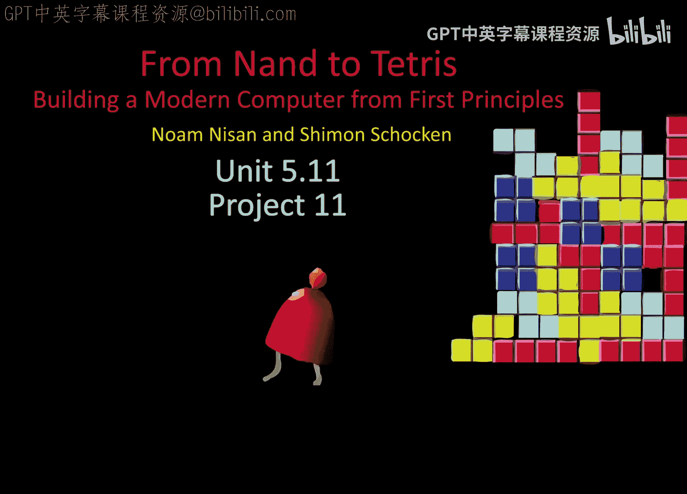
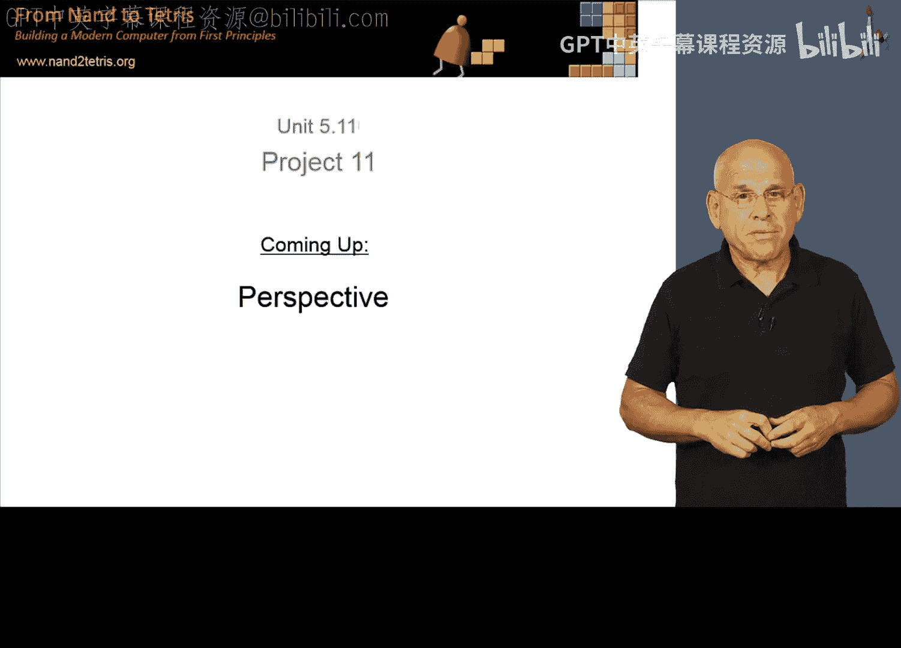
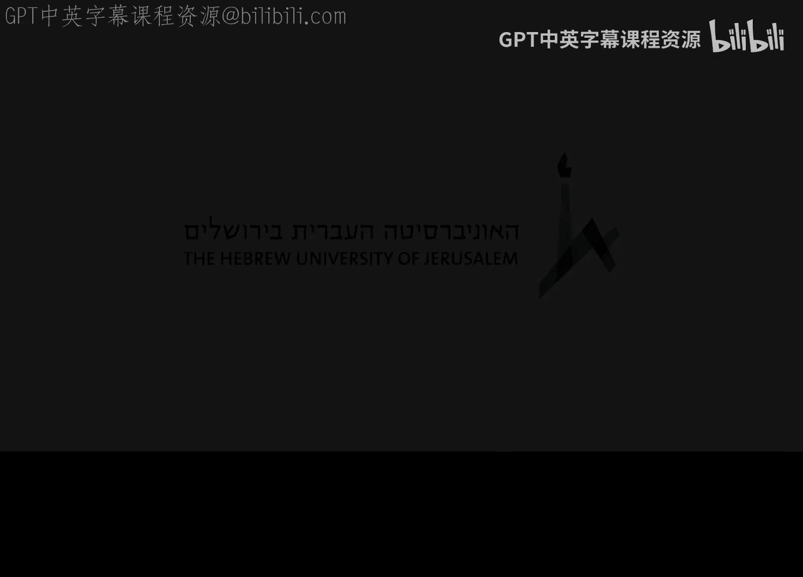

# 从零开始构建现代计算机 2：项目 11：构建编译器

在本项目中，我们将完成编译器的构建。我们将把项目 10 中构建的语法分析器扩展和转变为一个功能完整的编译器。

## 概述

在项目 10 中，我们构建了一个语法分析器。在本项目中，我们将分两个独立的阶段，将这个语法分析器转变为一个完整的编译器。首先，我们将为其添加符号表处理能力，以理解源代码中标识符的语义。其次，我们将在此基础上实现代码生成功能，最终输出可执行的 VM 代码。

## 符号表处理

上一节我们介绍了项目的整体目标，本节中我们来看看第一阶段：符号表处理。

目前，语法分析器将所有标识符（如变量名、子程序名）统一标记为 `identifier`。为了更精确地理解源代码，我们需要分析每个标识符的语义角色。

我们将扩展语法分析器，使其在 XML 输出中包含以下信息：
*   **标识符类别**：是 `var`（局部变量）、`argument`、`static`、`field`、`class` 还是 `subroutine`。
*   **索引编号**：如果标识符属于 `var`、`argument`、`static` 或 `field` 类别，还需输出其在该类别中的序号（例如，`argument 0`、`argument 1`）。
*   **定义或使用**：标识该标识符是在声明中被定义（如在 `var` 语句中），还是在表达式等上下文中被使用。

以下是实现此功能的方法：

首先，你需要根据之前单元中给出的 API 规范，用 Java 或 Python 等语言实现符号表。

接着，为了测试符号表，我们建议你扩展项目 10 中已构建的语法分析器，为其添加上文所述的标识符处理能力。你可以设计自己的 XML 标签格式来输出这些信息，并通过运行项目 10 的测试程序来验证其正确性。这部分测试仅供你自己验证，无需提交。

## 代码生成

在成功为语法分析器添加符号表功能后，源代码的语法和符号语义都已被充分理解。接下来，我们将进入编译的最后阶段：代码生成。

我们将通过一系列测试程序来分阶段开发和测试你的编译器。以下是测试流程：
1.  使用你正在开发的编译器编译包含测试程序的目录。
2.  检查编译器生成的 VM 代码。如果发现问题，返回修改编译器。
3.  将生成的 VM 文件目录加载到 VM 模拟器中并执行。
4.  检查运行结果是否符合预期。如果不符合，则修复编译器。

需要特别注意的是，我们提供的测试程序本身是完美无误的。因此，任何错误都意味着是你的编译器存在缺陷，需要你来修复。

以下是六个测试程序的说明，请按顺序完成：

### 测试程序 1：Seven

此程序测试编译器处理简单算术表达式、`do` 语句和 `return` 语句的能力。程序计算 `1 + 2 * 3`。成功编译运行后，屏幕左上角应显示数字 `7`。

生成的 VM 代码中可能包含类似 `pop temp 0` 和 `push constant 0` 的指令。前者用于在 `do` 语句上下文调用方法后，丢弃其返回值。后者用于在 `void` 方法返回时，按约定推送一个返回值（此处为 0）到栈上。

### 测试程序 2：ConvertToBin

此程序测试编译器处理表达式（不含数组和方法调用）以及 `if`、`while`、`do`、`let`、`return` 这五种语句的能力。程序将十进制数转换为二进制表示。

测试时，输入值（如 171）需预先放入 RAM[8000]，程序运行后，转换得到的 16 位二进制结果将存入 RAM[8001] 至 RAM[8016]。

测试技巧：
*   使用 VM 模拟器的望远镜图标快速定位 RAM 地址。
*   程序运行后会修改 RAM，因此重新运行前无需（也不应）重置代码。
*   在非“无动画”模式下才能修改 RAM 值。
*   程序执行完毕后，需点击“停止”按钮才能查看 RAM 的最终状态。

### 测试程序 3：Square（Square Dance）

此程序测试编译器处理构造函数、方法以及包含方法调用的表达式的能力。该目录包含 `Square.jack`、`SquareGame.jack` 和 `Main.jack` 文件。

### 测试程序 4：Average

此程序测试编译器处理数组和字符串的能力。它是一个单文件程序，计算一组数字的平均值。

### 测试程序 5：Pong

这是一个完整的面向对象交互式游戏，用于测试编译器处理完整面向对象应用的能力，包括对象和静态变量的处理。目录包含 `Ball.jack`、`Bat.jack`、`PongGame.jack` 和 `Main.jack` 文件。成功编译后，可在 VM 模拟器中运行游戏，可能需要调整执行速度滑块以便操作。

### 测试程序 6：ComplexArrays

此程序测试编译器处理包含复杂索引表达式的数组操作的能力。程序运行后，会输出“期望结果”和“实际结果”，两者一致则表明编译正确。

## 总结

本节课中，我们一起学习了如何分阶段完成编译器的构建。我们首先通过实现符号表来增强语法分析器的语义分析能力，然后按照特定顺序，通过六个逐步复杂的测试程序来开发和验证代码生成功能。最终，你将拥有一个能够将 Jack 高级语言编译成可执行 VM 代码的完整编译器。