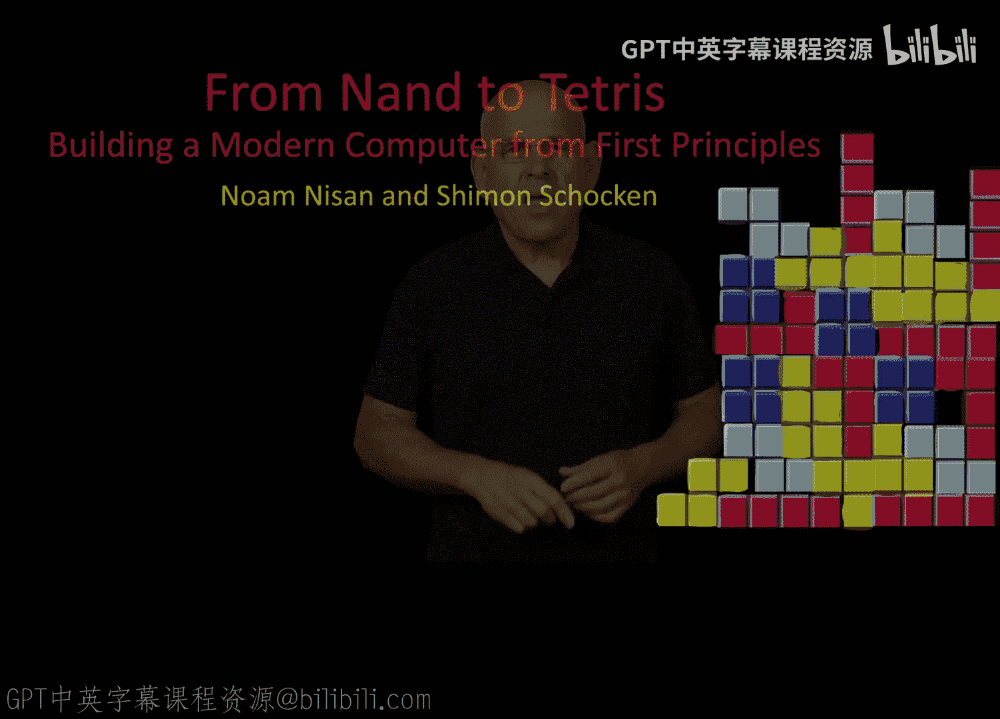

# 耶路撒冷希伯来大学《从零开始构建现代计算机2｜Build a Modern Computer from First Principles》中英字幕 p66 66_07_13_单元5-12_视角.zh_en -BV1DA4m1w7FU_p66-

Welcome to the perspective unit on Co generation in which we are going to answer some frequently asked questions as usual。

So let's see。 you mentioned several times in the course that Jack is a relatively simple language。

What would it take to generate code for a more realistically complex language？Indeed。

 Jack is very simple。To begin with， it doesn't really have a type system。

You know all the data values are 16 bits and the data value of any type can be assigned to a variable of any other type。

This freedom allows J compilers to almost completely sidestep all the headache that is associated with handling typing issues。

For example。When compiling and evaluating expressions。

 jet compilers don't have to bother about determining the type of the expression according to the types of the constituents elements of these expressions。

Likewise， array entries are also untyped in J Now in contrast。

 most programming languages feature rich and versatile typing systems。

 so you know different amounts of memory must be allocated for different types of variables。

 you know 16 bits， 32 bits， 64 bits and so on。The conversion from one type into another requires specific casting and language operations。

The compilation of expressions like x plus y depends strongly on the types of x and y and so on and so forth。

All these requirements make compilation much more challenging。

Another significant simplification is that Jack does not support inheritance。

This implies that all method calls can be handled by the compiler statically during compile time。

In languages that do have inheritance like Java， compilers must read method calls during runtime。

Because they have to determine to which class the method belongs according to the object on which the method was called to operate。

 you know this object is somewhere along the inheritance hierarchy and this determines which methods we have to invoke。

This is sometimes called late binding。And also， and this is completely unrelated to what we discussed before。

 Jack has no public fields。 The only way to access a field from outside the class is through accessor methods that the programmer must write。

 So， you know， if you look at all these things， the lack of a typing system， the lack of inheritance。

 the lack of public fields。All these simplifications make cogen far simpler in J compared to compilers of industrial strength languages。

With that， let's move on to the next question。Well。

 this question is actually related to the first one。

 how difficult will it be to close the gaps between Jack and languages like Java or Python？Well。

 some extensions。Like handing inheritance， as I just discussed， well。

 these extensions require significant co generation efforts。You know， supporting inheritance。

 polymorphism， late binding， that's a lot of compilation work。

And yet other simplifications of the jack language can be easily relaxed， Well。

 I shouldn't say easily， but they can be relaxed with their relatively little effort and that's because they are quite quite straightforward。

 For example， we can easily add control structures like4 and switch。

 that's not such a big deal in terms of extending our compiler。😊。

And adding more data types aside of the three types we have now requires more effort， but once again。

 the extension is relatively straightforward。Another limitation of Jack is that you cannot assign character constants to variables of type car C。

 H AR。 in order to bypass this limitation， the jack programmer must use all sorts of string functions。

 which is kind of tedious。 Well， once again， that's an example of a feature that can be easily fixed in in the jack language using some。

 you know， we have to。Both extend the grammar， as well as the compiler。And indeed。

 I would like to observe that each of the language extensions that we discuss in general。

 well each of these activities extending the language requires two very separate activities。

 first of all， the language designer has to sensibly extend the language grammar and syntax and this is something that must be done with great care。

😊，And then you know once the specifications have been extended。

 the compiler writer must extend the parer and the co generator in order to accommodate these changes in the language。

 so altogether you know these are big time changes that must be done with great care as the language evolves from one version to the other as programming languages normally do。

Now。Once again， there are many things that can be implemented and improved inject。

Most of these extensions， you know that's the good news is that most of these extensions are independent of each other。

 and in that respect they can be implemented by making relatively local and simple extensions to the parer and cogen that were already developed。

So with that， let's move on to the next question。Which is。

What is the meaning of compiler optimization？Well。It's not terribly important that the compiler itself will be efficient and optimized。

 What's important is that。The compiler will generate。Low level code。

 which is efficient and optimized。 And I hope you understand the this distinction。For example。

 consider a high level statement like X plus plus in say Java。

An Aive Java compiler may translate this statement into push X。Pushuan。Ed。And pop X， you know。

 x plus plus。And then the VM translator will kick in and translate each one of these four VM commands into several machine level level instructions will end up with something like 50 lines of code。

And so the result will be， you know， a considerable chunk of code。At the same time。

 an optimized compiler may notice that what we have here is simply a variable incrementing operation。

And with that in mind， the compiler or the optimized compiler will translate x plus plus into two machine instructions only at X followed by M equals m plus 1。

That's at least what we could have done in the jackHck platform。Of course。

 this is just one example of many optimization tricks that are expected from a full service compiler。

In general， the ability to generate compact code that uses。As few cycles and as few hardware。

 as little hardware resources as possible， well， this ability is a very attractive。

 very attractive feature of coal generation and compilers in general。Well。

 none of this optimization was done in the VN translator that we developed in this module。

So to wrap up my answer to this question。I would like to comment that， even though。

The co generator that we developed is unoptimized。 It still represents a sophisticated and substantial piece of engineering。

So once you complete developing this core generator。

 you should feel very proud of your accomplishment。You've just finished developing a compiler。

 a compiler for an object based Java like language， so muzelov。And with that。

 you know that's the end of our module， module 5。 and in the next module。

 we're going to develop an operating system。And this operating system will be developed using the jack language。

