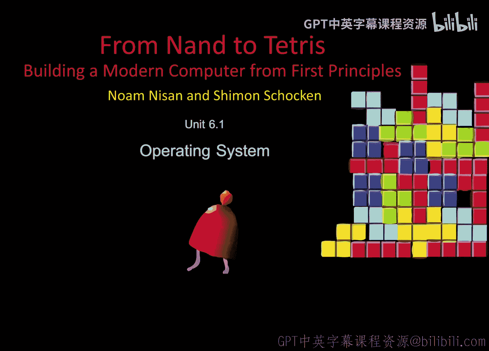
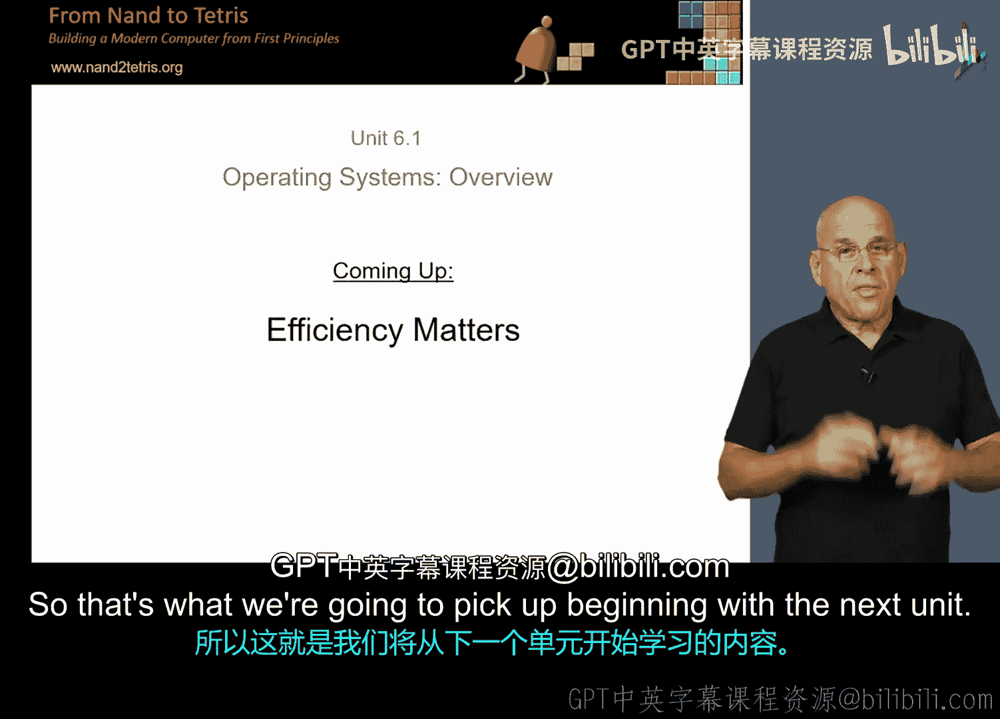

# 耶路撒冷希伯来大学《从零开始构建现代计算机2｜Build a Modern Computer from First Principles》中英字幕 p67 67_08_02_单元6-1_操作系统.zh_en -BV1DA4m1w7FU_p67-

Welcome to moduleule6， the last module in Nteris part two。In fact。

 we're going to have one more module following this one。

 but it's going to be mostly ceremonial and the real module is the last module is this one。And。

We're going to have a handful of many different things that we're going to discuss about operating systems。

And you know， this module reminds me of a generous dinner that you might get in some Indian restaurant out there。

 We're going to have numerous little dishes with many different colors and tastes and I think that you're going to to enjoy it tremendously。

 So to remind you this is our big picture that's the plan of our course and we are now right here in the operating system module。

😊，And you see。There's no way to write high level programs without having some operating system support in the background。

And the goal of the operating system is to close many gaps that exist between your high level programming and the bareborne hardware on which your programs are supposed to execute。

And closing these gaps and describing this operating system is what this module is all about。

Now there are numerous operating systems out there and here are the icons of those that are better known and here is another operating system which is less known yet。

 and that's the operating system that we are going to develop in this module。

 the jack operating system。Now why do we need operating systems to begin with。

 well take a look at this piece of high levelvel code written in Jack and if you will do so。

 you will see that there are many calls in this code to methods that don't exist in this class。

And presumably they exist in some other classes like keyboard， output， mathth。

 and these classes are in fact， they belong to the standard class library that accompanies the Jack language。

Now， this is not something that we invented。 Every modern high language comes equipped with a standard library that supports it。

 This is true for Java， for Csha， for Python， for C+ plus， of course。

And so when you develop a high level language， the users of this language will expect to get along with it a standard library that supports it。

And so。One way to think about operating systems is to take the perspective of a high level programmer。

And to view this system as a set of classes that belong to some standard library。

And the high level programmer will expect to get all sorts of the mathematical calculations implemented。

 you know， things like square root。He or she will expect to get support in terms of data structures like strings and stacks and arrays and you know whatnot。

The programmer will expect to be able to interact with the input devices like keyboard and mouse and the perhaps microphone in some high level and obstruct and convenient way。

 likewise， programmers would expect to be able to write on the screen。

 whether it's text or graphics using some convenient APIs。And interfaces。

 So as developers of operating systems， we have the obligation to support all these necessary obstructions。

Now， in addition， the operating system is supposed to deliver all sorts of system oriented services。

 which are presumably more kind of low level than what we discussed here。First of all。

 we have to be able to manage the host memory， and I'm talking now about the RA。Otherwise。

 we won't be able to help the compiler create new objects and new arrays whenever the high level programmer wants to do that。

And if we have a mass storage， discs， you know either hard disk or flash memory or whatnot， well。

 we have to manage this storage also， and in order to do this。

 we also need some file system obstruction， will'll have to support at least files and hopefully also folders and subfolds and so on。

 you know all the stuff that people typically take for granted。

Which is obviously just an obstruction that someone has to realize。

We'll need to develop all sorts of drivers which are programs that serve to mitigate between the high level programs and the low level peripheral devices that include things like the keyboard and the screen and the mouse and all sorts of other devices。

 plotter or whatever printer， everything that you want to connect to your computer has to be managed。

 somehow。Obviously， you will need to be able to talk to this computer and so someone has to realize things like shells and a windowing system。

And， you know， a lot of people want to be able to。To do many things at the same time， right， I mean。

 every one of you probably is used to write emails and chat and。

Blog and write talkbacks and post various messages and。

People today are fond of doing all these things at the same time。 I don't understand how。

 but in order to do this， you know， we need to equip our computer with the ability to multitask and run。

Several programs at the same time。And no man and woman today is an island and we expect our computers to interact with all the other computers in the world through some network and for this。

 we have to have some software that mitigates and control this communications。

 and once we have communications， we also have to worry about security。

So we have to support all these services， someone has to support it。

 and this mighty someone is the operating system。And so as you can see。

 writing an operating system is a gigantic undertaking。And in this course in antiotetriris。

 which is just you know one humble little course， we are not going to develop a full blownown operating system。

 but will develop a sufficiently interesting and challenging system that will include first of all all the stuff that you see here on the left hand side。

 so all the language extensions will be developed will also develop the memory management part of the system services。

And to some extent， we'll develop some IO device drivers and everything else is left for future work as optional projects that can follow up our nanotetriris courses。

All right， so here is our jack operating system in all its glory。

 it consists of eight classes and let me go through every one of them briefly。😊。

The math class provides all sorts of mathematical operations。 So Java's mathth class， I think。

 features something like 60 or 70 mathematical functions。

Although many of these functions are overloaded so actually it's less well we offer this selection and obviously we can add more if we want then we'll have a memory class which is this class is actually classical because it contains some fundamental operations which exist in any operating system out there。

 peak bulk Aloc Dialoc and presumably these words mean nothing and that's perfectly okay。

 they will mean a lot in a short while。We're going to provide a class that allows you to draw graphics on the screen。

 lines， circles， some polygons， and we'll use this extensively。Actually， we used it。

 we used it already in some of our。Projects before。

And we'll have another class that we use extensively output in order to write text on the screen。

Then we'll have a keyboard class with which we can interact with a user who uses his or her keyboard out there。

We'll have a string processing class， very similar to Java's string class and to the one which is used in C sharpp。

 So we'll have to develop all these。Capabbilities then we'll have an array class。

 which is somewhat unique to Jack because in Jack arrays are not a primitive part of the language as they are in some other languages。

 rather we decided to implement arrays using our operating system and by doing this。

 the arrays become very similar to objects。 and in fact。

 that's also what happens in Java and in C sharp。 but we don't have time to get into it。

 it is hidden from the highlevel programmer and finally we'll have a cis class that includes some useful services and that's it。

 know this is our operating system。 As you may know。

 there are people who make a living from developing operating systems。😊，And these people。

Basically fall into two categories。 First of all， there are theoreticians， you know。

 people who are experts in algorithms and data structures。

And they take requirements like those that we have here and they come up with all sorts of ingenious algorithms and data structures。

Which are designed to deliver these requirements and deliver them efficiently。

And then there's another class of people who take these great ideas and actually implement them。

 they implement it by writing programs in languages like C++ and C。

 and they implement these data structures and algorithms and make them actually happen。

And in this course， in Antetriris， we'll take both perspectives and in the subsequent units of this module。

 we'll talk actually every one of these units will begin with some theoretical discussion。

On what is needed in the way of algorithms and data structures。

 And then the second half of the unit will actually implement these ideas。Using the Jack language。

And so you see the jack operating system is written in Jack you know。

 just like the Unix operating system is written in C。So we also need some bootstrapping capabilities。

 and this will be part of this module as well。So there are many take home lessons in this module。

 I've written only a few of them。We are going to learn quite a bit about every one of these super important。

Areas of interest in applied computer science that。

That you see here and we are going to learn it both at the high level， at the low level。

 and at the end of this module， you'll understand all this stuff in the marrow of your bones。

And how are we going to do it， well， this module is a great opportunity。😊。

For Noam and myself to introduce you to some beautiful algorithms。

That are designed to manage resources and draw graphics on the screen and so on。

And in order to implement these algorithms， we'll also introduce you to the art of Ingenious hacking and we'll give you some ideas on what can be done in order to control the host platform that surrounds your software。

And of course， we're going to give you numerous implementation tips on how to actually build it using all the tools that are available to us。

 So that's the plan。And before we。We end this unit。

 I'd like to say just a few words about efficiency。So far。In this course。

 we allowed ourselves to be kind of bse， I think is the right word and slackck about efficiency。

We didn't worry too much about efficiency。 We just wanted things to work。

 and we didn't care if they were quick or slow or whatnot。

 when it comes to developing operating systems， efficiency is critically important because。

The algorithms that we develop are going to serve everything that we do on top of these algorithms。

If someone doesn't work sufficiently fast， then all the application programs that are going to run on top of this service are going to become sluggish and vice versa。

 if you manage to optimize something at the low level then everyone on top of it is going to treat you like a big hero and so when it comes to OS。

 we can no longer afford this bliss of ignorance in terms of efficiency and we have to be very clever about how the programs are going to operate so that's what we're going to pick up beginning with the next unit。

