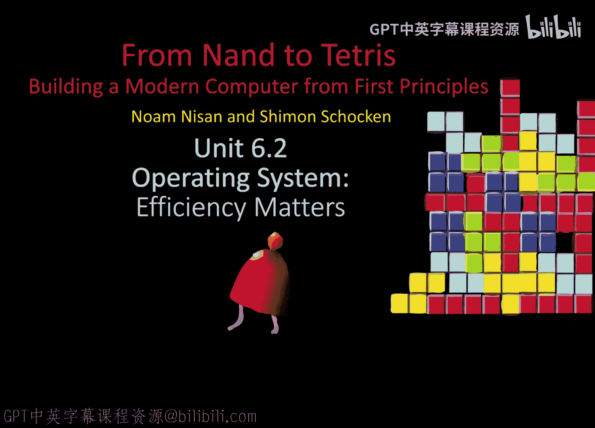
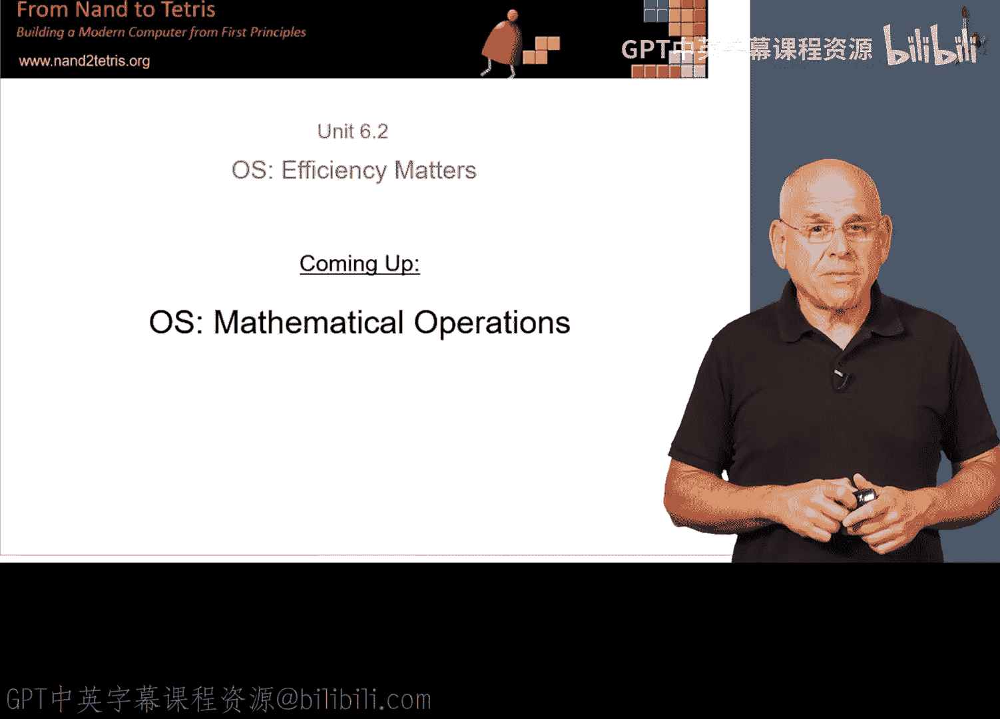

# 耶路撒冷希伯来大学《从零开始构建现代计算机2｜Build a Modern Computer from First Principles》中英字幕 p68 68_08_03_单元6-2_效率问题.zh_en -BV1DA4m1w7FU_p68-

As I said in the previous unit， we decided to open the module on operating systems with a discussion of some efficiency matters。

So once again， heres the jack operating system and let us focus on the top left class。

 so to speak math。We see that mathth is a collection or a library of several widely used mathematical operations。

And the first thing that I would like to claim is that when it comes to operating systems。

 efficiency really matters。You see every one of the operations that you see here is going to be used by numerous application programs and perhaps by other classes in the operating system as well。

So the lower is the service， so to speak in the software hierarchy。

 the more you want it to be efficient because it is going to support many more services on top of it Now I think about things like multiplication。

 division square root， they better be efficient。So to illustrate。

 let us focus on the multiplication method and to begin with。

 let's take a look at the client perspective so to speak。

 so you know you can write some jack program and at some point to say X times y。And if you want。

 by the way， you can also multiply numbers using this syntax in the first example in the top multiplication。

 the compiler is going to be generous enough to understand that asterisk stands for invoking the method that you see at the bottom and the compiler will automatically replace 419 times 5003 by mathth multiply these two numbers。

So you can do either way， right， It doesn't matter。

 So this is just a syntactical comment that I wanted to to put aside and。

Someone has to deliver this functionality， and this agent is， of course。

 the math class in the in our jack operating system。

 So heres an example of a possible solution to multiplication。

We are going to do what is known as repetitive addition。

 and basically we are adding X to some accumulator y times。Now before we continue。

 I'd like to say a few words about the syntax that we are going to use in this unit and in all subsequent units from now until the end of this module。

 we no longer use the jack syntax of curly brackets and semicolons and so on。

 instead we do something which is similar to Python we'll use indentation to stand for blocks of code and we do this because we want you to focus strictly on the algorithm and ignore you all sorts of syntax clters which are not terribly important when we discuss the operating system。

So with that in mind， what is the running time of this algorithm？Well。

 I'm not sure what is the exact running time， but I see from the code here that it's really completely dominated by y if y is a large number then we are going to have many iterations in this program。

 we're going to have y iterations in this particular algorithm。

And if you ask me you know what is the running time of this algorithm。

 then in computer science when we are asked to give such assessments。

 we always take a very honest and conservative standpoint and we try to give what is known as the worst case answer。

 So let us assume that n is the largest number that we maybe asked to multiply。

 So n is the largest value of y。 and with that in mind we observe that the algorithms runtime is proportional to n。

 Y proportional to n。 because we have y iterations。

 or actually we have n iterations in the worst case。 And in every one of these iterations。

 let us assume that we have to make something like 10 machine level operations after compilation and so on。

 So overall we have to we have to。Pform 10 times n machine operations。 So whatever。

 you know whether it's 10 or 20 or 40， it doesn't really matter because n dominates the picture here and therefore the running time is simply proportional to n。

 if n is a huge number， this algorithm will run extremely slowly。So let's remember this algorithm。

 put it on the side and consider now another solution。

And this solution is based on what we learned in elementary school。So for example。

 if I ask you to multiply 27 times 9 in binary。Then I can do exactly what I learned in grade2 or3。

 I don't remember， basically I take the first number also known as the multicon and this is a big word so I'll simply use X instead so we take X。

 we write it down。And I'm sorry， we take x， we multiply it by the rightmost digit of the multiplier。

 which happens to be1。And so we get the same number， the same x， we write it down。

 then we take the same x and we multiply it by the next digit up the significance letter。

 so to speak， which happens to be0。 So we get a bunch of zeros。

 Then we do the same with the next bit once again we get a bunch of zeros。

 then we do the same thing with the next bit which happens to be1。And finally。

 we add up all these bits along the rows and or along the columns。

 and we get the result which happens to be 243。All right。

 now let me present to you a more systematic way of doing the same thing。

 Well here I take into consideration the fact that this number does not exist in a vacuum it sits within some word in memory and the width of this word in jack is 16 bits。

 but in a modern computer it's typically 64 bits or maybe even 128 bits。

 So I write down the number and then I pad with zeros until the end of the word and I do the same with with why。

😊，And here's the algorithm。I take X and write it down， as is。Then I shift x1 position to the left。

 write it again， shift it another position to the left， write it again and so on and so forth。

 and in this particular case I do it four times y4 because，The second number， the multiplier。

 has four significant bits，1，0，0，1。 So it's enough to carry out these shifts four times。

And then I have to add the map。 Now， how do I add the map， Well。

 I take the multiplier and I write it kind of vertically。

Just for my own record keeping and then I'm going to add up only those rows for which the index or the eighth bit in the multiplier is one。

 so it looks from you know this example here that I have to add up only the first and the last row and indeed if I do it I will get the same result that I got before。

So it looks like you know two very similar procedures yet the second procedure is easier to implement in a computer program and indeed here's the program that implements it。

 we start with some accumulator sum which is initialized to zero and then we use a variable that we call shifted x and at the beginning shifted x is the same as x that's the first row below the line so to speak and then we go through the following loop。

For each eye going from zero to the number of digits that they have in their representation。W。

And so W can be 16 or 64 or it is a relatively small number。 so for every one of these digits。

If the eighth bit of the multiplier is1。I add shifted x to sum。And then irrespective of this test。

 I do another shift and I go back to the full loop and do the same over and over again until I exhaust you know all the bits in the representation。

So what I described here is just sort of a sequential way to describe what I did waving my hand when I gave you this example up there。

 you can stop the tape and verify that it's exactly the same thing。And at the end of this process。

 I returned the sum to which we arrived。All right now there are some very nice properties of of this algorithm。

 once again， let us assume that n is the largest number that we may be asked to multiply。

 it may be a million a billion a trillion you know whatever is the number that you can represent given W bits and yet irrespective of the magnitude of this number the runtime of this algorithm is proportional not to n but rather2 w to the number of bits which is fixed right because we work with a fixed representation with either 163 to 64 bits and so on and。

This。Constant， 1664 and so on is going to determine how long this algorithm going is going to perform。

Now， it also happens that the number of bits that it takes to represent a number n is log base 2 of n。

 which is a relatively。Not relatively。 it's a very small number。 I mean， when n is very large。

 log2 of N is still。Very small。 Now， there's another nice property of this algorithm。

 If you look at it， it involves only addition operations。

And shifts now shift is a trivial operation in the world of binary numbers and also note that shift is simply the same as adding up the same number。

 so shifted x is shifted x plus shifted x that's another way to think about shift。

 So any way you look at it， what we have here is an algorithm that runs just a few iterations and in each iteration it carries out only addition operations。

 which is lovely。😊，It means that we can easily implement this algorithm either in software。

 as we did here or in hardware， we can easily build a logic gate or a chip that carries out multiplication using this logic here。

All right， now if you are not convinced that logarithmic runtime is good。

 I'd like to give you some examples and in particular take a look at this table here and what I have on the left column is some representative examples of the magnitude of n。

 the input。Now if I have an algorithm whose runtime is proportional to n。

 let's say that the proportion constant or coefficient is 10。

 then the running time of this algorithm will be as shown here in red and you see that as the input becomes large。

 the running time becomes very slow proportionally。And what about log。 Well。

 here's the log function applied to the very same inputs。

 And you see here is that irrespective how the input input grows， the log remains very small。

And we can see the dramatic difference between these two functions very vividly if we plot them one next to the other。

 so on the x axis we see the size of the input n and here is the linear function， the red one。

 and you see that as n goes up this function goes through the roof， so to speak。

 and yet at the same time the log remains asymptotically bounded。

 it will also reach infinity at some point， but it will take a lot of time。

 it will happen only with astronomically large input sizes。

And so the attractive thing about log of N is that as you double the input， log of N。

Increases by one unit， only。And in words， as the size of the input doubles。

 the algorithm that has a logarithmic running time requires one additional iteration。Now。

 this statement is quite remarkable and it has far reaching practical implications。

And to illustrate it， let's take an example which is close to home。

All of you guys are searching the internet and you are doing it using search engines。

And every one of these search engines is using all sorts of versions of an algorithm called binary search。

And binary search has this nice property of having a runtime which is logarithmic in the size of the input。

 What does this mean？It means that， for example， suppose that the size of the internet is 1 billion items。

And you want to search every one of these items and find it you know， as fast as you can。 Well。

 according to this table。If you want to search or find one item out of a billion using a logarithmic runtime algorithm。

 it will take 300 iterations。So far， so good。Suppose now that tomorrow the size of the internet is going to double。

 it is now going to be 2 billion items。 how long will it take now to find any particular item in this huge sort of universe of information？

Well， according to the logarithmic rationale， it will take 310 steps。

 you know because the constant here equals 10， so from 300 went up to 310。

And suppose that you know a few days later or a few months later。

 the size of the internet will double again and it will be 4 billion items。

 how long will it take the search engine to find any one item in this huge pile of information。

 it will take the algorithm， 320 iterations。So you see that as the size of the internet shoots out of the roof。

The search time is logarithmically bounded and it never becomes too large and this is， I think。

 a dramatic example of the incredible power of logarithmic runtime and that's why in computer science。

 you know whether it's theoretical computer science or applied computer science。

 we are always delighted when we manage to come up and congere logarithmic runtime algorithms。

All right， so to recap， this has been a unit about efficiency。

 but as a side effect of talking about efficiency， we also talked about fast implementations of multiplication。

😊，And what we'll do in the next unit is continue from this point onward and discuss the implementation of some other mathematical operations。

