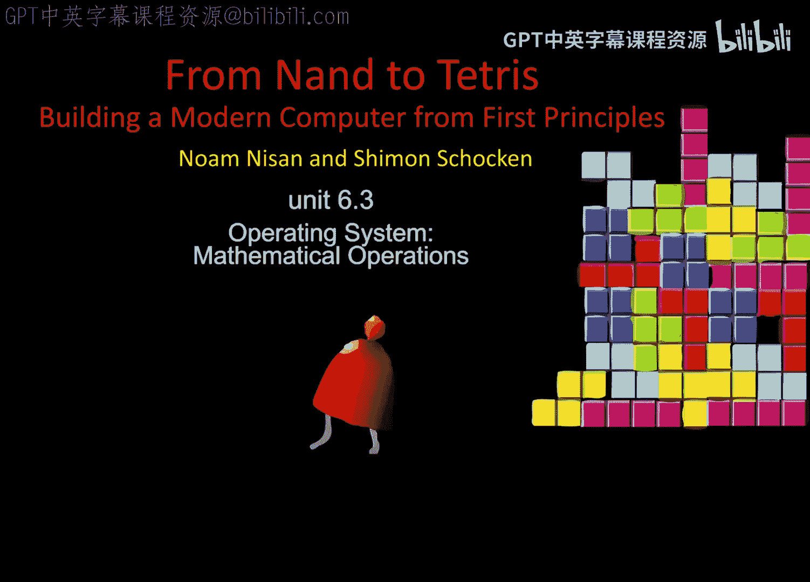

# 耶路撒冷希伯来大学《从零开始构建现代计算机2｜Build a Modern Computer from First Principles》中英字幕 p69 69_08_04_单元6-3_数学运算.zh_en -BV1DA4m1w7FU_p69-

Welcome to this unit in which we are going to continue the discussion of mathematical operations that we began in the previous unit。

In the previous unit we discussed the dramatic difference between linear runtime。

 which we normally don't like and logarithmic runtime， which we normally love。

 and that is because it is bounded and it is always rather small。

 irrespective of the size of the input。And using this observation here， we have shown。

Two different multiplication algorithms。 The first one was naive， and it had a linear runtime。

 This was the algorithm in which we did multiplication by repetitive addition。

And the other algorithm was much more clever and faster and it ran， if you recall。

 in logarithmic runtime and to put it in practical terms。

 the runtime of the better algorithm depended on the number of the digits of the input。

 which is always a small number like 32 or 64 or 128。

 depending on the size of the data type that you are handling。And in this unit。

 we will continue in the same spirit and talk about some other mathematical operations using this dual。

Presentation of an naive algorithm leading to a better one。So let's start with division。Well。

 here's how the comes to play in Jack programs。 You can write either something like x equals something divided by something。

 Or if you want， you can make a direct call to the divide。A function of the math class。

 Both syntax forms are acceptable， but of course， the first one is more desirable because it's more readable。

 And yet， if you do the first one as you know， the compiler eventually is going to reduce it to a function call。

 So I just wanted to to point this out as a， as an interesting observation。

So heres an naive way to implement divide， and basically we're going to count how many times we can subtract y from x before we get a remainder which is strictly less than y。

For example， what is 20 divided by 6。 Well，20-6 is 14。We subtractducted it once。

And then 14 minus-6 is 8。We subtracted it another time， and then 8-6 is 2。

 We subtracted there three times and 2 is less than 6。 So we are done。 So the answer is， I'm sorry。

 the answer is3 with the remainder of2。That's the algorithm。And， as you see。

The algorithm's runtime depends on the size of x。And if n is the largest number that you can represent or that you can be asked to divide。

 then the runtime will be proportional to n。And you see it because if you look at the Y loop。

 you realize that the number of iterations that you have to do depends on x on the magnitude of x。

 And that's bad news。Because not only the runtime here is very large。

 It's also potentially very large。 It's also unpredictable。 You know， in some inputs。

 you will get the answer right away on other inputs。

 the algorithm will run millions or billions of times。 That's not a good situation。So fortunately。

 we have a much better algorithm， which is based on long division。So what is 175 divided by3 well。

 as we learned in sometimes in elementary school， we go through this cryptic procedure here and we get the result。

Now， most people don't enjoy seeing long division and they don't enjoy it because I think because。

As children， they were taught to go through the motions of long division without bothering to to understand what is going on。

 I mean， teachers many times don't understand it themselves。 And that's why people you know。

 develop met phobia。 So what I'd like to do next is。😔，First of all。

 explain to you why this algorithm works。 And in the process of explaining it。

 I will also illustrate that this is actually。A darn good algorithm。

 So here's our division exercise or division example，175 divided by 3。

 So here is how I'm going to do it。Consider the following question。

 what is the largest number x out of 19080 all the way down to 10 so that 3 x is no greater than 175？

Well we start with 100， so 100 times 3 is 300， it's too large， let's skip the 90 and go to the 80。

 80 times 3 is 240 too large， skip the 70 go to the 60， 60 times 3 is 180 too large。

50 times 3 is 150 bingo。 We got it。 So 50 is the answer to this question。

And so we write 50 up there in the result slot。And we note that the answer must be at least 50。

And if you don't see it。Notice that basically what we did here is accelerated subtraction。

We have managed to subtract 3 from 1，75，50 times。But we are not done yet， right。

 we haven't yet exhausted the 175， and we still have some more work to do how much more work we have to do。

 Well， we multiply 50 by 3。 we get 150 and we see that theres still a remainder of 25 that has to be divided by 3。

And so now we have to subtract 3 from 25 so many times until we get the right answer。

So here's the next question， what is the largest number x out of 9。

87 all the way down to 1 so that 3 x is no greater than 25。Well，9 times 3 is 27， it's greater。

 not good，8 times 3 is 24 bingo， we got it。So we conclude that the answer must be at least 50 plus 8 right we subtracted 50 before。

Now， we' subtracted350 times before。 Now we subtracted three another eight times。

And we have a remainder which we compute up there of one。

 So we still have to divide the remainder  one by3。But one is less than three。 So we are done。

And the answer is 58， with the remainder of one。So as you see， we got the answer very fast， you know。

 as fast as we can， actually。And the beauty of this algorithm。In，You know。

 in addition to its simplicity is that the runtime of this algorithm is proportional to the number of digits that we have in the input。

 which is log N。On base 2。If we if we divide binary numbers and log n on base 10。

 if we divide decimal numbers。So that's a great result。

And to sum up you know what we did with these two algorithms。

 let's take another quick look at them again。 here we had repetitive subtraction and here we had the long division algorithm the runtime of repetitive subtraction depends on the input size which can be huge and the runtime of the long division depends on the number of digits of the input which is never too big。

And if you're not convinced， you know， take a look at this example here。And this is。

Happens all the time with computers that we have to divide and subtract divide or multiply huge numbers。

For example， in graphical operations。And the runtime of the naive algorithm in this case will be something along this number here。

 which is the number of times that you can subtract three from the astronomical number that you see here。

And the running time of the long division algorithm is going to be 27。

 which is the number of digits in the input。 So you see the incredible efficiency of long division。😊。

And so that's what I had to say about these two algorithms and。

The next thing that I'd like to show you is yet another division algorithm。

Which is the division algorithm that we are going to use in our own operating system。 So once again。

 we have to divide x by y。And the algorithm that we are going to use in our operating system is the following one。

 It's a recursive algorithm。It may take a few minutes to understand what is going on here。

But basically， this algorithm is based on the following insight。Suppose we want to divide 100 by 7。

Well， I don't know what's the answer， but I do know that the answer is。

Twice as much as 50 divided by 7。Now， what is 50 divided by 7， I don't know。

 but it must be twice as much as 25 divided by 7。 and you got the picture。

So you see that in just a few。Drilling steps， I get the right answer。

And it turns out that the running time of this recursive algorithm is log of n。

Which once again is as good as it gets in these algorithms。

 we cannot hope to get anything better than that。And the beauty of this algorithm is that it involves only addition and subtraction operations。

 which are the same。 Theyre all addition， and therefore versions of this algorithm can be implemented very efficiently in either software or hardware。

So that's the algorithm that we requested to implement in the。

Dis function of our math class in the jack operating system。Alright。

 so we discussed multiplication and division and we presented highly efficient algorithms which are once again as good as it gets almost baring some symptomotic symptomically possible improvements。

 which we won't worry about。 and the next function that I'd like to discuss is square root。

 the last one。 So here is square root and how can we compute square root efficiently。Well。

 square root is actually an example of a very large。And the highly practical familial functions。

That have two。Highly attractive features。First of all。

 the inverse of square root can be easily computed。 It is simply x times x。

 and we know how to compute multiplication efficiently。So that's one attractive possibility property。

The second attractive property is that square root is monotonically increasing。 You know。

 it never does something like this。 It， it always。Goes up。Together with x。

 together with the with the input。Now， based on these two properties。

 we can conclude that square roots can be computed using a binary search algorithm。

And the binary search algorithm has a running time， which is logarithmic。So once again。

 we are back in the cozy place of logarithmic running times。

 and we are very happy and theyre pleased。 And this is the algorithm that we are going to use。😊。

In our operating system， I don't want to dwell on it because quite frankly。

 this is not a course about algorithms。 but if you want。

 you can stop the tape and and indulge in understanding how it works。

And that's how we are going to implement square roots。 And once again。

It is a highly efficient algorithm。So to recap， we talked about multiplication， division。

 square root。The remaining functions are so trivial that I don't want to waste our time discussing them。

 and I trust that you will be able to handle them quite easily。So moving along。

 I do want to talk about some implementation notes which are important。

Because mathematical operations always。Have some potential problems that have to be dealt with。

So here's our multiplication。Algorithm in Cel code。

And there are three issues which we have discussed。 First of all， how do we multiply signed numbers。

 not necessarily negative， but numbers that have signs。

How to handle overflow if we get it and how to implement the operation I bit of I of y。

 which is required somewhere in the in the algorithm。

 So we'll deal with each of these questions separately。Handling negative numbers。Or mixed numbers。

 Well， it turns out if you inspect this algorithm， it turns out that if the inputs are represented using a tools complement。

 the algorithm works just fine。 It will always give you the right answer。You can try to prove it。

 you can try to play with an example， or you can just believe us there's no need to handle sign numbers in any particular way。

Okay， what about overflow。Well， if you look at the algorithm。

 you will see that there are at least you know there are two places where we can get overflow。

 some become some plus shift dis and shift dis become shift dis plus shift dis。

So what should you do about overflow well it turns out once again that the algorithm always returns the correct answer modululu2 to the 16th。

 which means that you know maybe it will not give you all the digits of the correct answer but the digits that it will give you will be the right ones and normally you know we don't have overflow so for us you know this result is good enough。

Finally， we have this condition here， which is somewhat challenging。 You know。

 we have to extract the I bit of some 16 bit value。Which which we call why in this algorithm。

 So how do we do it， How can we extract， let's say， the fifth bit of 1，0，0，1，1，0，0，0，1，1。

1616 B value。 How should we do it。Well， we suggest to encapsulate this extraction。

 this operation in a Boolean function that we call bit。 It has a。Two arguments。

 The first argument is the 16 bit value that we want to operate on。 and the second one is the I。

 the index that we want to extract。And this function normally can be implemented very efficiently using a bit shifting operations。

Which some languages like Java has。 And yet Jack does not feature Biwise operations。

And therefore we need some workaround and what we propose is to create an array。

 a fixed array to create it once and for all， when we start the computer and this array will hold the 16 values 2 raised to the power of I where I goes from 0 to 15。

And we can build this array as follows。 We recommend that it will be a static array。

 We call it you know， you can call it whatever you want。 but that's， I think。

 a pretty good name two to the if。So we can declare it statically at the class level of mathth and we can use mathth in it to actually build it and populate it with values。

 once you have this array in place， if you'll think about it a little bit。

 you will see that you can use this array in order to implement the bitta function quite easily。

And once again， I want to reiterate。 We build this array only once when we start up the operating system。

 And this actually is quite。Typical to operating systems when they start running， you know。

 there's an init stage in which the operating system builds all sorts of data structures that it is going to use throughout its execution。

But you know many different classes can use these data structures。 and in this example。

 the math class is going to use it quite extensively。Alright， so that's a multiplication。

Moving along。 I'd like to say a few words about division here。 we have the following issues。

 First of all， once again， how do we handle signed。Numbers， x and Y。 You know。

 what should we do if we are asked to divide。151 by-17。 Well， here's what we recommend。

You can divide the absolute values of the inputs and then set the results。As needed。Okay， so。

You have four possibilities and you can handle it quite easily。What about overflow well。

Why can certainly overflow in this recursive computation， Because we multiply it by 2。

And sometimes we， we add one。 So， you know， it can。Become fairly large。

And right now the algorithm doesnt is completely oblivious of the size of y。

 so we suggest that we monitor the y。 and in general。

 when you have a two complement number which grows， you know a positive number that grows。

 when it becomes negative， that's the point where there is overflow。And so we can add this condition。

 we can， you know， instead of saying y greater than x， as we have in the algorithm。

 we can say if y is greater than x or。Yhy is less than 0， then we return0。 and for us。

 this is a good enough way to handle overflow。What about square root。Well， with square root。

 we have also a potential overflow。 It can happen right here。And how should we handle it。Well。

 once again， we can play with the conditions。 And instead of using the condition that you see in the algorithm。

 we recommend that you add another clause to this condition， and this will。

This will once again handle the overflow properly。So these are our implementation notes of these three functions。

 And this completes the implementation of our math class， because once again。

 the remaining functions， apps， min and marks are trivial and we don't want to。

to spend time talking about them， I trust that you will know how to implement them yourself。

So with that， we are done implementing our first OS class， the math class。

 and in the next unit we'll talk about memory management。

