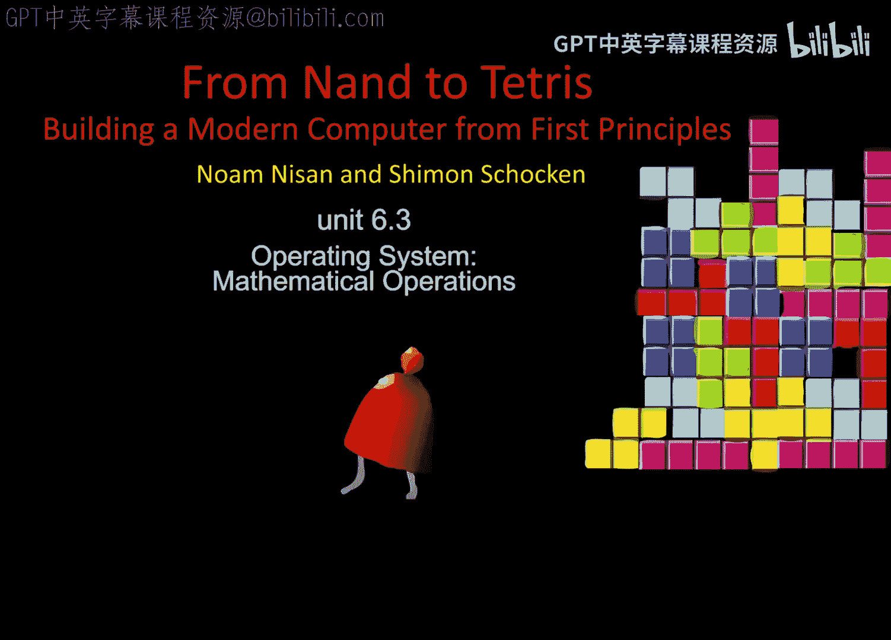

# 从零开始构建现代计算机2：单元6-3：数学运算 🧮



在本节课中，我们将继续讨论数学运算，重点介绍除法与平方根的高效算法实现。我们将对比朴素算法与高效算法，并探讨在Jack操作系统中的具体实现细节。

上一节我们讨论了线性运行时间与对数运行时间的巨大差异，并以此为基础介绍了两种乘法算法。本节中，我们来看看除法与平方根运算。

## 除法运算 ➗

在Jack程序中，除法可以通过两种语法形式实现：
*   `x = something / something`
*   直接调用`Math`类的`divide`函数

第一种形式因其可读性更佳而被推荐，但编译器最终会将两者都转换为函数调用。

### 朴素除法算法

以下是实现除法的朴素方法：计算在余数严格小于除数`y`之前，能从被除数`x`中减去多少次`y`。

例如，计算20除以6：
1.  20 - 6 = 14 （减1次）
2.  14 - 6 = 8 （减2次）
3.  8 - 6 = 2 （减3次）
4.  2 < 6，停止。

结果为商3，余数2。

该算法的运行时间取决于`x`的大小。如果`n`是可表示或被要求相除的最大数字，则运行时间与`n`成正比。这不仅意味着运行时间可能很长，而且不可预测，在某些输入下算法可能需要运行数百万甚至数十亿次。

### 高效长除法算法

幸运的是，我们有一个基于长除法的更优算法。以175除以3为例：

该算法的核心思想是加速减法过程。我们不是一次减去一个3，而是寻找能一次性减去多个3的最大倍数。

1.  首先确定：在100, 90, 80, ..., 10中，最大的`x`使得`3*x ≤ 175`？答案是50（因为50*3=150）。
2.  将50记录在结果中，并计算余数：175 - 150 = 25。
3.  接着处理余数25：在9, 8, 7, ..., 1中，最大的`x`使得`3*x ≤ 25`？答案是8（因为8*3=24）。
4.  将8加到结果中（累计商为58），并计算新余数：25 - 24 = 1。
5.  由于1 < 3，除法完成。最终结果为商58，余数1。

此算法的美妙之处在于，其运行时间与输入数字的**位数**成正比，即**O(log n)**。对于二进制数是log₂ n，对于十进制数是log₁₀ n。这是一个巨大的改进。

为了总结这两种算法，让我们快速回顾一下：
*   **重复减法算法**：运行时间取决于输入大小，可能非常巨大。
*   **长除法算法**：运行时间取决于输入位数，永远不会太大。

例如，对于一个天文数字，朴素算法的运行时间将是该数字本身的数量级，而长除法算法的运行时间仅为27（即该数字的位数）。这展示了长除法的极高效率。

### 递归除法算法

在我们的操作系统中，将使用另一种递归除法算法。该算法基于以下洞见：若想计算`x / y`，可以先计算`(x/2) / y`的结果，再根据奇偶性进行调整。

**算法思路**（伪代码表示）：
```
function divide(x, y):
    if (y > x) return 0
    q = divide(x, 2*y)
    if (x - 2*q*y < y)
        return 2*q
    else
        return 2*q + 1
```

该算法的运行时间同样是**O(log n)**，达到了此类算法的理论最优。其优点在于仅涉及加法和减法操作，因此无论在软件还是硬件中都能高效实现。这就是我们要求在Jack操作系统的`Math`类中实现的`divide`函数所使用的算法。

## 平方根运算 √

平方根函数具有两个吸引人的特性：
1.  其逆运算（平方）很容易计算：`sqrt(x)`的逆运算是`x * x`，而我们已经掌握了高效的乘法算法。
2.  平方根函数是单调递增的。

基于这两个特性，我们可以使用**二分查找算法**来计算平方根。二分查找算法的运行时间也是**对数级**的，即**O(log n)**。

因此，我们将使用二分查找算法在操作系统中实现平方根运算。这同样是一个高效的算法。

## 内容回顾与实现说明 📝

我们讨论了乘法、除法和平方根的高效算法。其余函数（如绝对值、最小值、最大值）较为简单，相信你能轻松处理。

接下来，讨论一些重要的实现注意事项，因为数学运算总存在一些必须处理的潜在问题。

### 乘法实现要点

以下是C语言风格的乘法算法伪代码，我们需要处理三个问题：
1.  **如何处理有符号数**：如果输入使用二进制补码表示，该算法无需特殊处理即可正常工作。
2.  **如何处理溢出**：算法中可能发生溢出的地方（如`sum = sum + shiftedX`）。该算法返回的结果是模2^16的正确值。这意味着它可能无法给出完整结果，但给出的位是正确的。通常我们不会遇到溢出，因此这个结果是可以接受的。
3.  **如何提取特定位**：算法需要提取16位值`y`的第`i`位。我们建议将此操作封装在一个名为`bit`的布尔函数中。

由于Jack语言不支持位运算，我们需要一个变通方案。我们建议创建一个静态数组，在计算机启动时一次性构建。该数组保存16个值：2^0, 2^1, ..., 2^15。

```
// 在Math类中声明静态数组
class Math {
    static Array twoToTheI;
    ...
}
```

可以使用`Math.init()`来构建并填充这个数组。一旦有了这个数组，就可以轻松地实现`bit`函数。重申一下，这个数组仅在操作系统启动时构建一次，这是操作系统的典型做法——在初始化阶段构建各种将在整个执行过程中使用的数据结构。

### 除法实现要点

对于除法算法，需注意：
1.  **有符号数处理**：建议先计算输入绝对值的除法，然后根据需要设置结果的正负号。共有四种情况（正/正，正/负，负/正，负/负），可以轻松处理。
2.  **溢出处理**：在递归计算中，`y`可能溢出（因为我们会将其乘以2）。我们建议监控`y`的值。对于一个增长的二进制补码正数，当其变为负数时，就发生了溢出。因此，我们可以在算法条件中添加判断：如果`y > x` **或** `y < 0`，则返回0。这足以处理溢出。

### 平方根实现要点

对于平方根算法，同样存在潜在溢出点（例如在计算中点值的平方时）。我们建议在算法的条件判断中添加额外的子句，以妥善处理溢出。

这些就是这三个函数的实现要点。至此，我们完成了`Math`类的实现，因为其余函数确实很简单。

## 总结 🎯

本节课中我们一起学习了：
1.  **除法运算**：对比了运行时间为**O(n)**的朴素重复减法算法与运行时间为**O(log n)**的高效长除法算法。并介绍了将在Jack操作系统中使用的递归除法算法。
2.  **平方根运算**：利用其单调性和易求逆的特性，采用运行时间为**O(log n)**的二分查找算法实现。
3.  **关键实现细节**：包括有符号数处理、溢出检测，以及在缺乏位运算支持的Jack语言中，通过预计算2的幂次数组来高效提取特定位的技巧。


我们已经完成了第一个操作系统类——`Math`类的实现。在下一单元，我们将讨论内存管理。