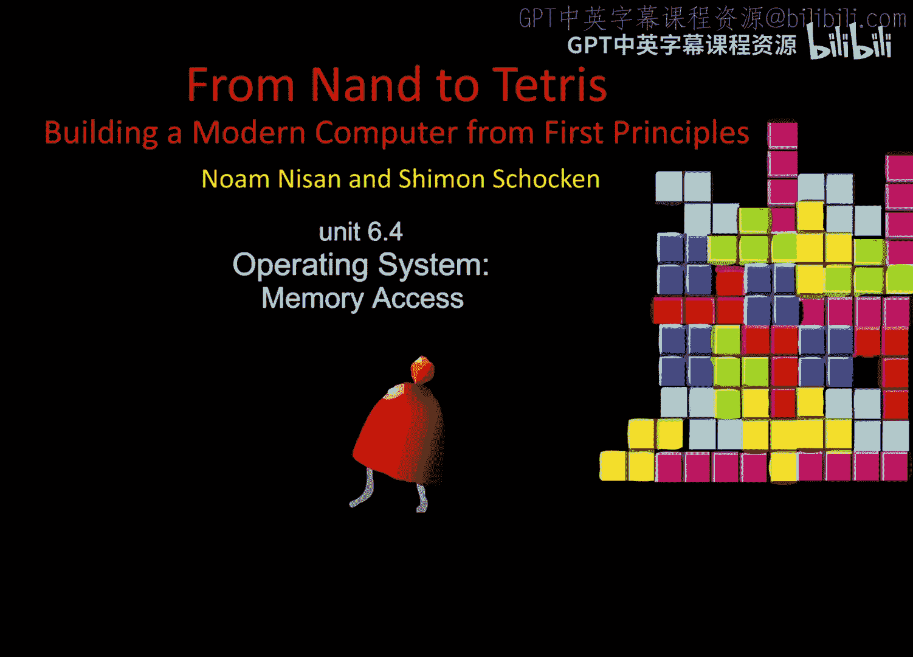

# 耶路撒冷希伯来大学《从零开始构建现代计算机2｜Build a Modern Computer from First Principles》中英字幕 p70 70_08_05_单元6-4_内存访问.zh_en -BV1DA4m1w7FU_p70-

We are going to devote two units to discuss memory management。In the jack operating system。

 beginning with memory access。So here is the overall operating system。

 and I wish to remind you that we are implementing a class called memory。

And we'll begin by explaining the needs， the solutions， the algorithms， and so on， and finally。

 as usual， we'll end with implementation notes。So the memory class features four classical operations。

 peak Pol， Aloc and Dioc， and they are classical in the sense that every operating system out there。

 you know whether it's UniX Windows， OSX， implements these operations in one way or another and typically they also have the same names。

 So the jack operating system will include an implementation of these services also。

 and that's the subject of this in the next unit in this unit we are going to talk about peak and Pollk only。

So why do we need pe and poke or what is the problem to which pe and poke is the solution？Well。

 our programs run on some host computer and the host computer has a host RAM。And yet。

 our programs don't know how to handle the Ram， right， if you write a program in Jack。Well。

 the program eventually accesses the Ram or you know we should state it more accurately。

 the code which is generated from our program eventually accesses the RamM， but at the high level。

 all we know is to handle variables， objects， arrays。

 and you know this is fortunately we can access the raM using these obstructions。

 otherwise it would be a nightmare to write highle programs。

And yet someone has to create a bridge between these high level obstructions and the barebon Ramm。

And likewise， application programs are quite fond of reading things from the keyboard and writing stuff to the screen。

 and they do it without paying any attention to how these operations are actually being carried out Well we know by now that they are being carried out by the operating system because the operating system once again provides a bridge between the high level Jack programs and the bareborn hardware。

And the screen and the keyboard in particular are implemented using memory maps。

 which are located also in the Ram。 So at the end， it all boils down to turningning bits on and off in this RamM unit。

And that's what Pe and Pol are designed to do。In particular。

 the OS provides low level services that facilitate direct access to the Ram。

And then using these low level primitives， the O S builds some more advanced functions。 For example。

 readingin and print， which。Use these primitives in order to deliver the obstructions that the。

High levell programmers expect to see and use and in this unit we are going to talk about once again a peak and poke peak is designed to return the value of a selected address from the Ram so it returns a 16 bit value and Polk takes a particular address and a value。

 a 16 bit value and it sets the RamM in this address to the supplied value。So， for example。

 I've picked an arbitrary address，19 and19003。Which happens to contain the number 7。

And so if I write the code the let x equals a memory dot peak in this address， x will become7。

If I write the code do memory poke this address to -1， then this address will become。1，1，1，1，1。

16 times， which is the binary manifestation of decimal minus1 in the twoza complement method。

So that's the typical operation or the generic operation of Pe and poke and you see why they have these names。

 you know， peak， it allows you to literally peek into the Ramm and figure out what is written in a particular address。

And pokeke enables you to you know， take your fingers so to speak and。

 you know poke a particular address in the Ramm and change it to some other address。

 some other value， if you so desire。Alright， so how should we implement Pe and book。

Well it turns out that this is quite a fascinating question。This is our RA。

 which happens to be divided into all sorts of logical areas by the hardware and software conventions that we introduced throughout the course。

And we want to be able to， somehow。Accs any given address from this Ram directly。And yet。

 we want to do it in Jack because our operating system is written in jack， you know。

 just like Windows is written in C plus plus。So how can we access the whole strand from Jack。Well。

Let's start with the naive solution。 Here's the naive solution。We create an array that we call Ram。

And we initialize it to be an array of 16 B values。Of 32768 entries。

 which is the size of the heck Ram。Well， this will not work for two related reasons。First of all。

 the compiler， if you recall， we've done it in the previous module。

 the compiler will attempt to allocate this array into the heap。Because that's what compilers do。

 When you ask compiler to create a new object or a new array。

 it will end up calling memory all and memory all will try to。

To put this array or object into the heap。And this will fail， obviously。

 because this array is too large。 It， It does not fit into the heap。And so。

 you know this this approach is is doomed and in fact， you know， think about it。

 even if we manage somehow to stick it into the heap， still。

 we will not be able to access the memory maps， for example。

 which we have to access if we want to control the screen and the keyboard。😊，So this will not work。

But it's， you know， sometimes it's good to start with something。 It doesn't work because it。

Because the bad solution leads you to the right solution。

 And this is actually what happened to us when we thought about this challenge here。

 So this doesn't work。 And here is another approach that does work。We have。Obviously。

 this memory class that we are now writing or eventually will use it to implement。

All the algorithms that we present here。And here's what we can do。

 We can create a static array at the memory class level， which we call Ram。

 We could call it any name we want。 But Ram makes a perfect sense here。😊。

And we are going to create this array in the init function of memory。 remember that some OS classes。

 I haven't said it before， but maybe it's the first time I'm saying it's some OS classes have init functions。

which are not exposed to the users of these classes。

 but and yet the classes may use them for all sorts of internal accounting and bookkeeping。

 so to speak and other purposes， so in the image function we can do we can do the following exotic assignment we can say let Ram equals 0。

Now， this is a very strange statement。Because think about it， Rem is an array。

And you don't expect to access arrays by using their name， right。

 normally you access as by using some you know indexed access in here。We treat RA as a variable。

And we just set it to 0。 Well it turns out that that's exactly what we want。Because if we。

 if we set Ram to zero， then we are going to get complete access to the entire Ram。

Because think about it anywhere in the program from now on， if we say left Ram ADR equals something。

Then。You know if ADDR is is some value between 0 and 320767 it will place Val exactly where we want。

 why， because if we access RamM I according to the rules of the game。

 we are going to access the RamM location0 plus I because 0 happens to be the base address of this array。

So this ingenious heck that you see here is going to give me complete control of the whole strand from the symbolic high level language。

Now， why does this hack work， It works because。Jack is a weak typed language。

And the jet compiler is very forgiving。And the jack compiler doesn't care if you say letter Ram equals 0。

 even if Ram is an array。 mean， in some other languages。

 the compiler will throw an error right here and you won't be able to do it。 But in Jack。

 you can do it。 And by doing this， you gain this。Lovely trap door into the ram。And obviously。

 if the program， if the programmer。Doesn't know what Hi or she is doing。

 they can also destroy the computer now because now that they have complete access to the Ram。

 they can mess up with a stack， they can mess up with a heap and so on and so forth。

So you know such is the power of system programmers。

 you know of programmers who write system software。

 and obviously we are writing an operating system so the programmers should know what they're doing and therefore this hackck is perfectly acceptable and you need such hacks when you write an operating system in some high levelve language like C++。

All right， so to sum up， we know how to create this Ram array。

 which I proposed in the previous slide。And so I do it in my using my init function and then I still have to implement Pe and poke。

 but I would argue that now that we have this rama array。

 implementing pe and poke becomes a piece of cake， it's like nothing。

 it's like you know one or two statements and you got it implemented。

So you can think about it yourself and there's no need for me to give you the exact solution。

 and so we know how to handle and implement Pe and bulk。So to remind you。

 we are working on the memory class and now that we can pick and poke we can move on to talk about Aloc and Dal。

 and that's what we'll do in the next unit。

