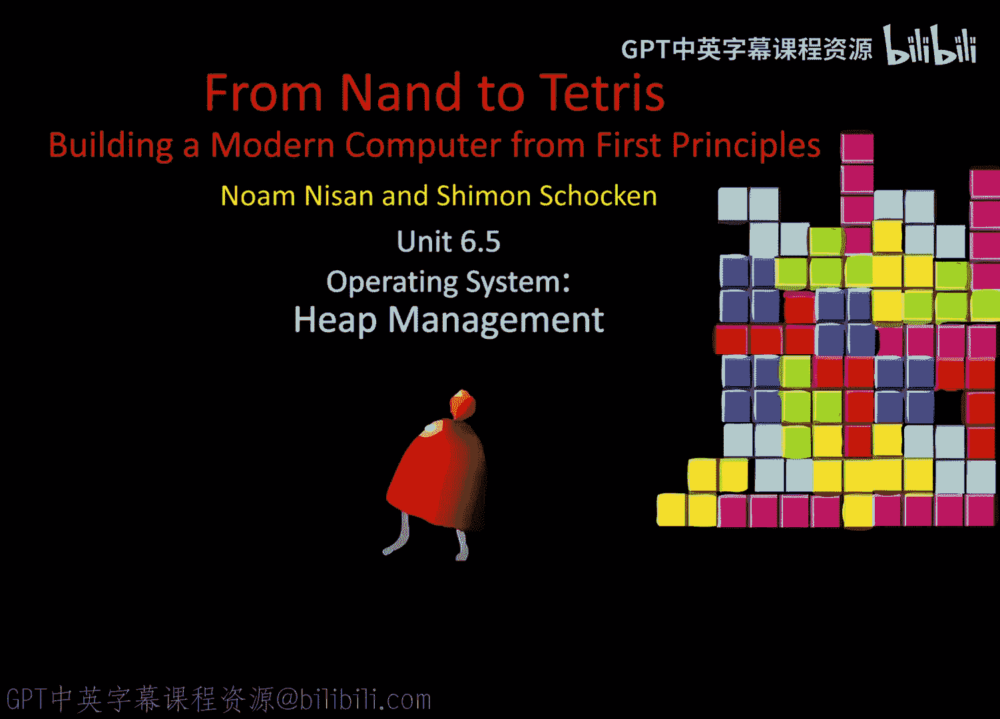

# 耶路撒冷希伯来大学《从零开始构建现代计算机2｜Build a Modern Computer from First Principles》中英字幕 p71 71_08_06_单元6-5_堆管理.zh_en -BV1DA4m1w7FU_p71-

Heap management。We continue to talk about how our operating system manages the main memory resource of the whole step platform。

And in particular， we are talking about the memory class of the Je operating system。

 we already discussed Pe and Pol， which are two classical OS operations and in this unit we'll talk about Aloc and Doc。

Another two classical operations that every operating system out there implements in one way or another。

So let us start with the need。Well， as you know， during granttime， the programs that you write。

 I'm talking now about high level programs typically create possibly many objects and arrays。

And we discussed many times this nice architecture in which every object and every array is implemented using a pointer that cleas from some variable which typically resides in the stack。

 and this pointer points at some block in the memory that holds the actual data of the object or the array。

Now this area where we put the data of all the objects and arrays that application programs create is called HEAP following App computer science terminology。

So the challenge is to manage this memory resource， which we call a heap to manage it efficiently。

 in particular， we have to know how to allocate memory whenever where asked to do it。

 and we have to know also how to recycle memory of objects and arrays that are no longer necessary。

Now we are going to do all this using an OS class called memoryory。

 and in particular well have one function called aoc that gets the size of the memory block that it has to allocate as an argument。

 and then it goes to the RA， it finds a block that has this required size and returns the address of this block to the collar。

The sister of this function is Dlook that does kind of the opposite。

 it takes the address of a certain object or array and simply recycles the RA space that was allocated to this object or array on the RA。

All right so。I wish to remind you that。You knowIf we want to manage the computer Ram。

 we typically divide it into a certain area that we call stack， another area that we call heap。

And let me give you kind of a high level perspective of what's going on。

 So let's you know put the operating system for a minute on the deck burner and let's discuss what the jack programmer or the Java programmer for that matter sees。

So the high level programmer creates begins by creating some object variable。

 Let's say that it's an object of type point。 And in response， what will happen is that。

A variable will be allocated somewhere on the stack and the label P will be associated with this variable and this variable at the beginning is going to be reset to0 or initialized to0。

Then at a certain point of time， the high levelve program may or may not call a constructor to actually build an object of type point and associated with this P variable that has been declared before。

 what we'll get is something like this， I picked up an address from the heAP arbitrarily 8012。

 and we allocate a block of two words in this particular address and then we create the link between P and this block as you see now the contents of the P variable is the base address of of the block that was assigned to represent this object。

So that's how the high level program area thinks about this act of creating a new object。

 And as you know， someone has to deliver this functionality。

So if we still stick to the high level view， this someone is the constructor。😊。

Because when we call point dot new， we invoke a constructor for its effect。 and as you see。

 the constructor which resides in the point class does all sorts of things which are high level。

But perhaps the most important thing that it does is something that you don't get to see。

 because what happens is that when the compiler compiles this constructor code here。

 it is going to inject low level code that affects the operation this equals memory alloc 2。

In other words， the constructor is going to take care of asking the operating system to allocate space for the new object。

And by the way， it knows that we need two words because it can look up the symbol table and realize that objects of type point have two fields。

 x and y。And because in our computer everything is 16 bit。

 you know both the data types at the high level and the width of the words in the memory。

 there's a one to one correspondence between the number of fields that an object necessitates and the size that you are going to pass to the alloc OS function。

So that's how the constructor is going to handle the allocation of space for the new object。

Now what about object destruction Well in object destruction once again。

 if we take the high level view of the J programmer when an object is no longer necessary like this object P that we created before。

 we have to say P dot dispose， we don't have to， but if we want to reclaim the memory that this object holds。

 we have to say P dot dispose。And likewise， just like we had a constructor in the point class。

 we should have also a disposalr， a function called or a method called a dispose。 And as you see。

 unlike the constructor， which implicitly。Created the new space on the Ram for the new object。

 the disposal explicitly。Recycles the the memory block， which is associated with this object。

 It explicitly does so by calling memory do thealoc。Now。

 some of you who have experience writing code in languages like Java and C sharpharp may wonder because you were never asked to actually deal with these things explicitly。

 and that's because languages like Java and C sharpharp has something called garbage Collector。

Which is a process that runs always in the background and does this thing for you automatically。

In other words， the garbage collector keeps track of all the references that are being made to every object that your program creates。

 these references happen when more variable point to this object and also at some point you know。

You get all sorts of D references happening in your high level program。

 so when the number of references that point to a particular pointer object goes down to zero。

 the garbage collector kicks in and calls thealO implicitly。

 so you don't have to take care of it yourself。We decided that we are not going to implement this goody inject。

 it's a very interesting algorithm and a very nice exercise。

 but in Jack we don't have it and therefore we expect programmers to diallo the memory associated with their objects explicitly。

So we talked about object construction and destruction and we did everything from the high level of the J programmer now let us take one step downward and talk about how we actually have to implement these things at the OS level。

How do we do it？ Well， we do it using an ingenious technique called He management。

 and that's what we're going to discuss next。So let me begin with a simple approach or a simple solution to heat management。

 and later on we'll present a more sophisticated approach。So it all begins with the bare bone Rem。

And you know， as you know， at some point， we're going to create some logical space on this Ram。

 which we call stack another logical address space that we call a heap in each one of these spaces is going to have a base address which we may call in our operating system。

 we may call it stack base in the he base。All right， so given this scenario。

 how do we do heat management？Well， at the beginning， we take a variable called the3。

And assign it to HeapBase。Now this variable3 is going to serve as the base address of all the memory which is freely available for new objects。

 so when we begin this program when we begin the life cycle of the current program。

 three points to He base which means that the entire he is now a game。

 you know we can use the whole he is ready for our disposal。

So the next thing that we're going to talk is Aloc， aoc size。

 which allocates a memory block of size words。So， let us assume。

That some client comes along and says a look 3。 I need a block of size3。 How are we going to do it？

 Well， here is a small little simulation， As you see。

 we have carved the top three words from our free area and we are giving it to the call。

And in order to do it or as a side effect of doing it， we have to， first of all。

Assign it a certain pointer so that we'll be able to tail the color where this block begins and we call this base address block。

Another thing that we have to do is we have to， as you just saw， we have to update free， right， free。

Before used to point at heap base。 and now we have to to do three equals3 plus3 to reflect the fact that we have three less words available in the heap。

And finally， we have to return block to the collar。

Everything that I just described by waving my hands and with this little animation is shown here in the code。

 block equals3， free equals3 plus size， return block。 you know。

 these three things taken together will handle the act of carving out and allocating a block of size size。

Now， at some point， the user who is a high level programmer may decide to delog。A certain object。

 How do we do this？ Well， I promise to you that my algorithm and my approach are going to be simple。

 So if someone says the log block， we simply do nothing。 okay we。We don't bother， okay？Well。

 this will work for a while until at some point we'll run out of memory， right。

 because we only go down， right， we never recycle， we never put memory back into the pool。

So this is appropriate for optimistic people who hope that the execution of their programs will terminate before the memory does。

 right but in reality， if you have a program that creates thousands and millions of objects which happens every once in a while。

Then you need something more clever， right you have to work a little bit harder to manage your resources in a less wasteful and more responsible manner。

 and that's what we're going to do next。So heres a more realistic solution。

We're going to use a linked list to keep track of all the he segments which are presently available to us。

So what you see here is a snapshot of how this linked list would appear after we already created a few objects in our and arrays in our program。

 So we have a free list and this is， you know these are all the memory resources which are presently available to us。

 you know， this is something which is managed by the operating system。

Now every element of this list has the following anatomy， which I describe below。

 so once again what you see below is sort of a more detailed description of the segment that sits in the middle。

 so a typical segment has a data part which contains all the。

The words which are available to store the actual data of the object or the array。

As well as two overhead words， which include， first of all。

 the size of the data block and a pointer or a reference to the next segment in the free list。

That's the anatomy of every one of these segments。So with that in mind。

 what do we do when someone says aoc size， well， we start going through our linked list and we look for a block that has the right size。

And once we find this block， we can remove it from the linked list and give it to the collar。

What do we do with the Dallog， if someone says a Dlog object and gives us some address in memory。

 we can take the block which of which this address is the base address and simply append it to the end of the free list。

So that's the basic idea of what we're going to discuss next in detail。All right。

 so let's start with Aloc。Suppose that someone comes along and says， I look3。

 now give me a ra block of size3。How do we service this call？Well。

 let me start with some terminology。If the segment size is greater than size plus2。

 we say that the segment is possible。So if you look at this free list right here。

 you will see that the first segment is not possible right because the size of this segment is 6 and in fact we need I'm sorry the size the data size of this segment is four and in fact we need five because you know we just decided that we need3 plus2。

 the two of course are for the overhead fields which are absolutely necessary。😊，However。

 the last two segments are possible， so we can use them to service this call。

So we are going to search the free list for one of two different possibilities。

There's one algorithm which is called first fit and this algorithm marches through the free list and it looks。

For the first possible segment that is found。And then there' is another algorithm very similar。

 which is called a best fit， which looks not necessarily for the first segment。

 but rather for the smallest possible segment。So here is a first fit in this example。

 it will hit on the second segment and best fit will hit on happens to hit on the last one。

Now the benefits of first fit is that it's kind of a greedy algorithm that gives you an answer as quickly as possible。

 the benefit of best fit is that it manages the linkedist in a more efficient way。

And which algorithm to use is a matter of all sorts of considerations that I'm not going to get into。

 so we don't care if you implement first fit or best fit， it's up to you。All right。

 so let us assume that we use the first fit algorithm， we found this segment。

 what do we do next well we are going to carve a block of size size plus2 from this found segment and well return the base add of this block to the collar。

So this will be the situation after the allocation。

 what you see at the bottom is the block that we hand to the call and what you see on top of it is the free list following the allocation as you see。

 we have updated the free list in order to account for this allocation that just took place。

Now what about D， well， suppose that we have this object here， the handle to this object is block。

And we want to recycle it。 We want to put it back into the pool of freely available memory。Well。

 we do it using a call to Dlo object and so for example， you know if someone says a Dlog block。

 what we do is we append this object to the end of the free list。

 so we'll end up with this situation here at the bottom。

 you see that the block which is no longer necessary was appended to the end of the free list and now you know the data that it contains is no longer relevant。

 but it may well serve objects and arrays that will be created later on。

So that's how D is implemented。Now， notice that the more we recycle。

The more the freeist will become fragmented。And by fragmented。

 we mean that it will contain many segments which are rather short。

And this is going to be a little bit frustrating， why。It will be frustrating for aoc。Why is that？嗯。

Well， you know， one way to describe it is is the following。

 Suppose you drive you a car and you want to park it somewhere。And I bet。

 you know this feeling that you drive a along road。

And there are quite a few parking spaces available， but all of them are too small。 You know。

 all of them are half a me smaller than the size of your car or 1 m smaller or a quarter or just a centm smaller。

 See， that's a fragmented situation。And I bet that you had this feeling that I have all the time that wouldn't it be nice if we could take a few cars and sort of。

Push them forward。And close all these fragmented gaps so that we can create one gap that will be sufficiently large to fit our car in。

 Well， that's exactly what we want to do here。If you want to create a new object or a new array which is larger than any one of these blocks。

 it would be nice if we could take a few of these blocks and put them together。

 merge them to create some larger blocks。This process is done by an algorithm called Dfg。

 standing for a def fragmentation。And indeed， in every operating system， every once in a while。

 Drag kicks in， it goes through the entire free list and it tries to merge as more small segments that it can into continuous segments in the memory。

And。This is something that we have not included in our operating system and once again。

 if you want to implement it， you are welcome to do it， but you're not required。

 It's a nice extension project。So let's talk about some implementation tips which in this particular case are kind of interesting and important。

So this is a snapshot of our memory map。We're implementing the memory class of the operating system。

 and in particular we want to implement this free list。

 right we want to create and manage it somehow。So。We propose。

To create a static array that you can call heap， that's quite a natural choice。

And we propose that somewhere in your memory in it function。You will do the following things。

 first of all。You set Heap， which is the base address of this array to the agreed upon base address of the heap。

 which is a convention。That in the he computer happens to be 2048。

Then you set free list to this very same he base。 So at the beginning， you know。

 the free list begins at the beginning， we also set He 0 to 0 because。

Currently or presently at the beginning， the freelies contains one segment only。

 and the size of this segment is the size of the entire heap，14000 and something， you know。

 something16000 and something-2048。Which on the he computer happens to be this number here。

So at the beginning， when we just get started， as you see。In the initial state。

 the entire heap is available。 Free lease contains one long segment。

And it kind of degenerates to be a simple setting that we had before。

Now what happens next Well by the way， I have to say something about memory in it。

 I did not include it in the in the public API that I showed you because clients of the OS are not supposed to mess up with it。

 but we do need an in function at the OS level and that's exactly what this in function does。

It sets up the free list for us。All right。So here is the situation after。

A few all and Doc operations took place。What you see in the middle is the abstraction of the free list and what you see on the right。

Is how this free list is actually implemented in memory。 And if you don't see it very well。

 I will add some color。 and now things become a little bit more obvious。

If you look at the top of the Ram， we see that the free list contains the number 8012。

So that's where the first segment is located。And then this segment points at 7513。

 So that's where the pink segment starts。 This segment points at 9576。

That's where the blue segment starts and the last one and indeed we see that this segment points at0。

 which is the end of list value。So。So that's how the free list is is implemented in memory。Now。

 as I said， we can realize this free least using the heap array。

And one thing which you have to realize。Is that although we declare this array， as you see。

 static array heap， we never。Call a no for it。Right。Because， you know， first of all。

 we cannot do it because array new is going to call aoc and we're implementing aoc。

 so this is unacceptable， but even if we did， you know this array will be too large to fit into memory。

So this is yet another example of a little heck that we use of using an array。

 not really as an array， but rather as some collection of pointers which we use for our benefit in order to create this free list for us。

And the next and the size properties of every memory segment。

I realized or can be realized using he ADDR minus-1 and H ADDR minus2。

If you don't completely understand it， just you know， when you start building it in Project 12。

 you will realize that things will kind of fall into place， believe me。

If we have all this thing represented for us， then thealO and the alloc and the DFraG can be realized as operations on this heap array。

So to recap。In it is going to be implemented using this pseudoda code here。

Alloc size will be implemented using this soda code here， which we discussed before。

We are looking for either best fit or first fit， first fit is probably easier to implement。

And if we find this block great， if we don't find such a block in the free list。

 then we can try to do de fragmentation。And then we have to update the free list to reflect the allocation and return the handler to the newly assigned object。

And dial is much easier to implement， all we have to do is take this object and append it to the end of the free list。

So that's it， you know we are finished implementing the memory class。

 we implemented peak and poke in the previous unit and we've implemented AlO and DO in that unit。

All these functions are classical， you can find them in any operating system out there。

 and now you actually understand how they work。So that's it。

 we are done with a memory class and in the next unit we're going to delve into graphics。

